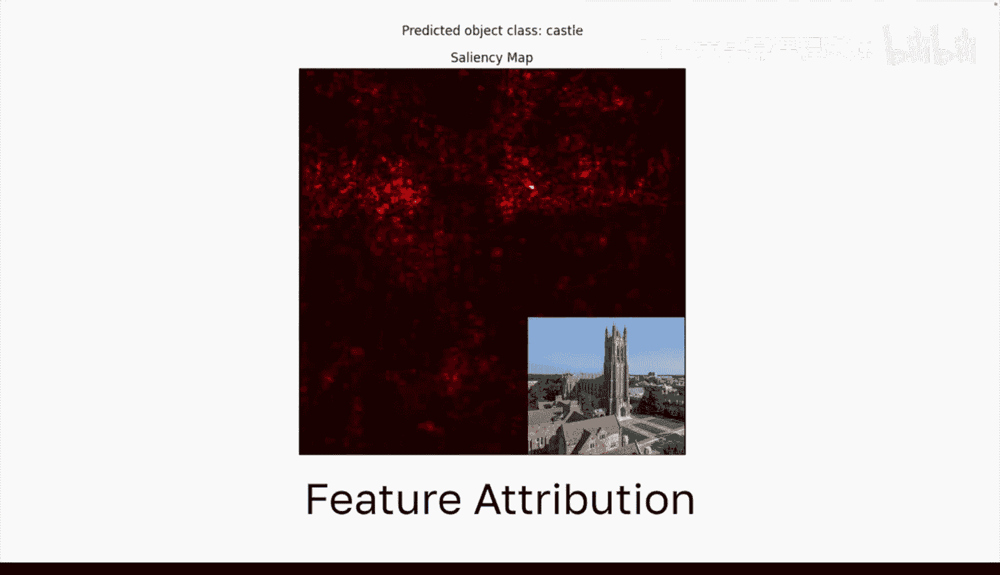
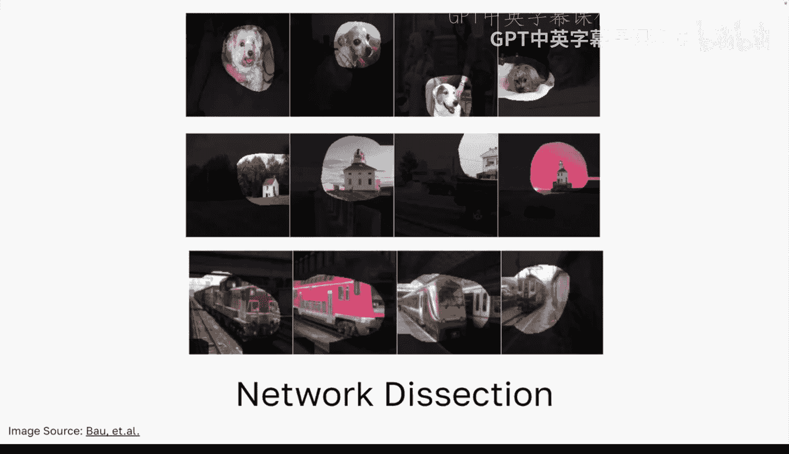
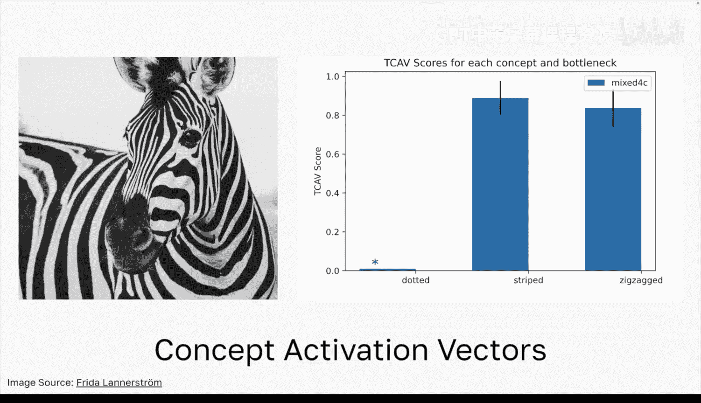
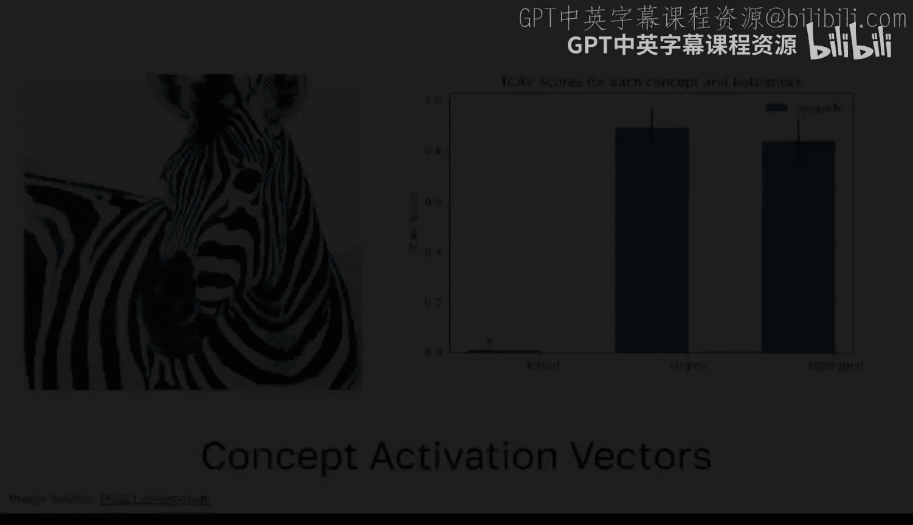

#  009：深度神经网络解释方法 🧠

在本节课中，我们将学习几种用于解释深度神经网络（DNN）这一典型“黑箱”模型的核心方法。每种方法都有其优缺点，我们将逐一介绍它们的基本原理和实现思路。

神经网络是典型的黑箱模型。幸运的是，存在多种方法可以解释神经网络。每种方法都有其优缺点，建议你继续深入学习，以了解更多关于这些方法的优缺点以及如何自己实现它们。

解释神经网络的方法包括特征可视化、特征归因、网络解剖和概念激活向量。

---

## 特征可视化 👁️

上一节我们提到了几种解释方法，本节中我们首先来看看特征可视化。我们可以使用一种称为特征可视化的方法来可视化神经网络内部发生的情况。

特征可视化是使神经网络中学习到的特征显式化的过程。它回答了“这个神经元、通道或层看到了什么”的问题。

在谷歌2017年介绍该方法的文章中，我们可以看到在神经元级别、通道级别和层级别的不同特征可视化结果。

以下是实现特征可视化的基本思路：

1.  **通过优化创建图像**：我们从随机噪声图像开始。
2.  **对图像施加约束**：为了获得有意义的可视化结果，我们需要对图像进行约束。
3.  **最大化神经元激活**：在特征可视化中，我们的目标是最大化特定神经元的激活。

这种方法有时能为我们提供神经元所调谐特征的有意义可视化解释。但有时也会产生一些相当奇怪的结果，例如下图所示的可视化结果中出现了狗脸。

---

## 特征归因 🎯

了解了如何可视化内部特征后，我们来看看另一种方法：特征归因。它关注的是模型预测的贡献度。

特征归因指示了模型中每个特征对某个实例预测的贡献程度。

显著图是用于图像的一种特征归因方法。下图是杜克大学教堂图片的显著图示例，其预测的物体类别是“城堡”。

---

## 网络解剖 🔬

除了分析特征贡献，我们还可以尝试将神经网络单元与人类可理解的概念联系起来。这就是网络解剖方法。

网络解剖方法于2017年提出，它将人类概念与单个神经网络单元联系起来。

网络解剖的实现相当直接。以下是其步骤：

1.  **获取带有人类标注视觉概念的图像**：这些应该是像素级标注的图像，包含不同抽象层次的概念。
2.  **测量图像在CNN通道上的激活**：计算卷积神经网络通道对输入图像的激活。
3.  **获取激活与标注概念的对齐关系**：将激活模式与人类标注的概念进行匹配。

该方法可用于探测任何卷积层。在下图来自原论文的示例中，我们可以看到与“狗”、“房子”和“火车”概念相关的激活区域。

---

## 概念激活向量 (TCAV) 📊

最后，我们来学习一种更量化的概念分析方法——概念激活向量。

概念激活向量是概念在神经网络层激活空间中的数值表示。基于概念激活向量的测试（TCAV）于2018年首次提出。

对于任何给定的概念，TCAV衡量了该概念对模型预测某个类别的影响程度。在下图的例子中，我们观察“斑马”这个类别，以及“点状”、“条纹状”和“锯齿状”这几个概念。我们探索的是神经网络中一个名为 `mixed4c` 的层。

在右侧的条形图中，显示了每个概念的TCAV分数。正如所料，对于“斑马”类别，“条纹状”和“锯齿状”概念的TCAV分数很高，而“点状”概念的分数非常低。

---

## 总结 📝

本节课中，我们一起学习了四种解释深度神经网络的核心方法：
1.  **特征可视化**：通过优化图像最大化特定神经元激活，以可视化其学习到的特征。
2.  **特征归因**（如显著图）：量化每个输入特征对单个预测的贡献程度。
3.  **网络解剖**：将CNN内部单元激活与像素级标注的人类概念进行对齐和关联。
4.  **概念激活向量 (TCAV)**：在激活空间中定义概念方向，并量化其对模型预测特定类别的敏感性。

这些方法从不同角度打开了神经网络的“黑箱”，为理解和信任深度学习模型提供了重要工具。