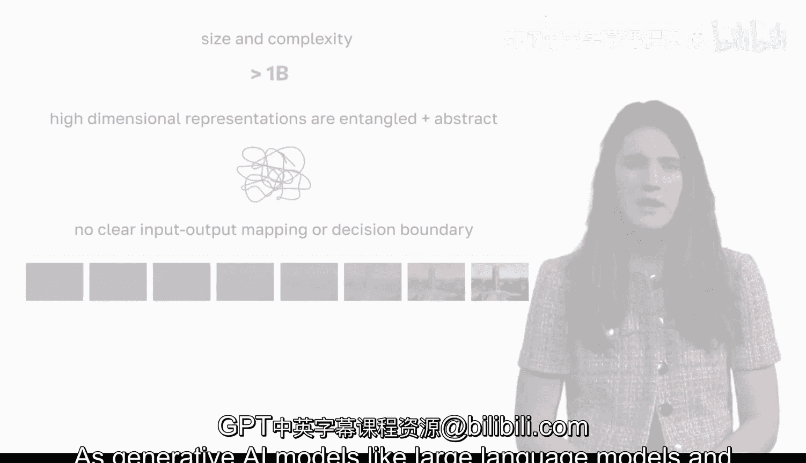
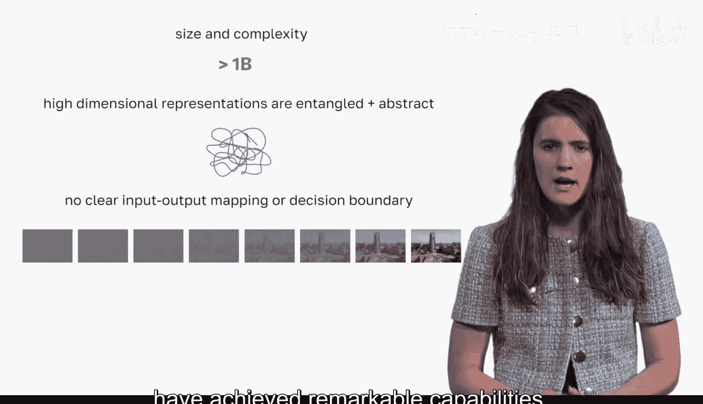
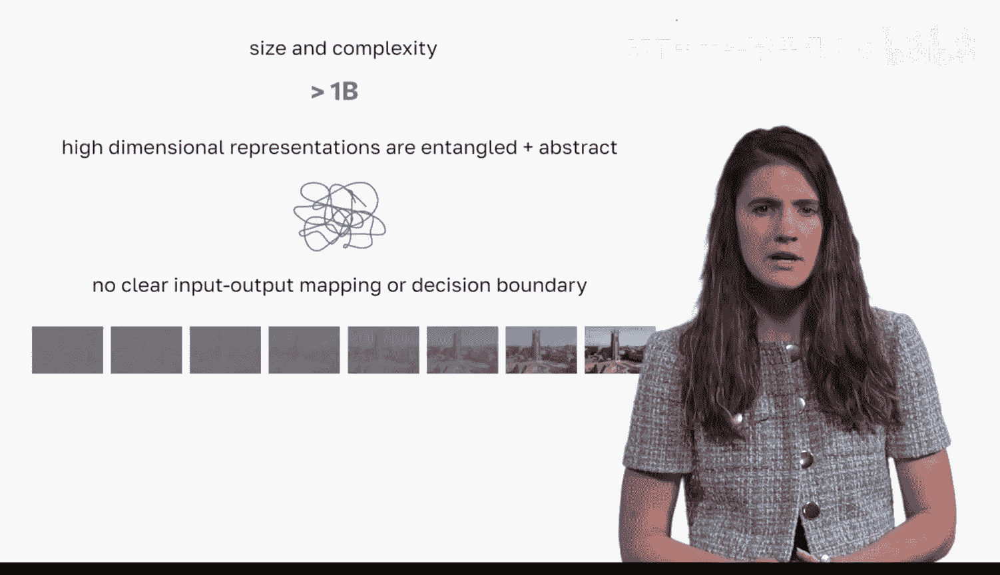
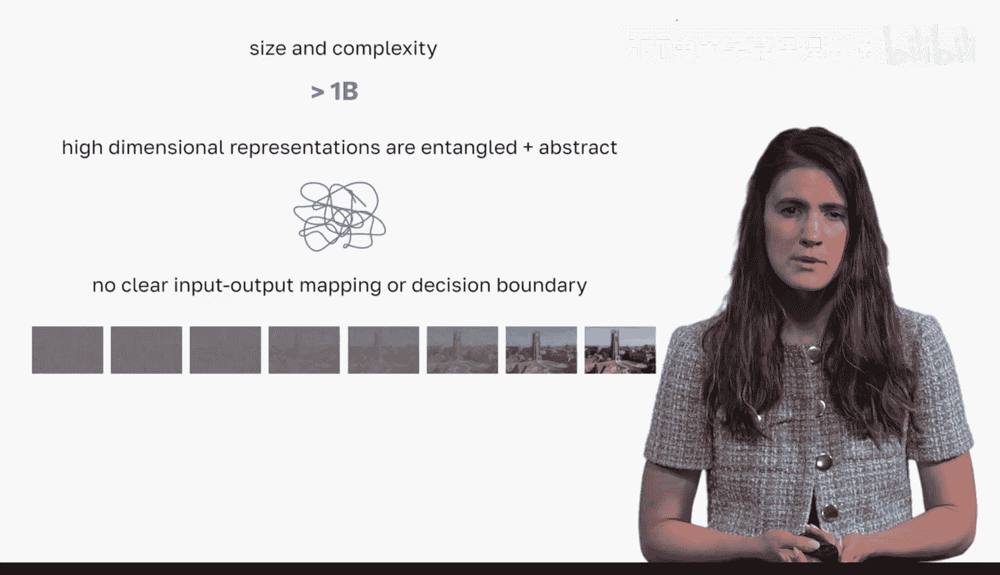
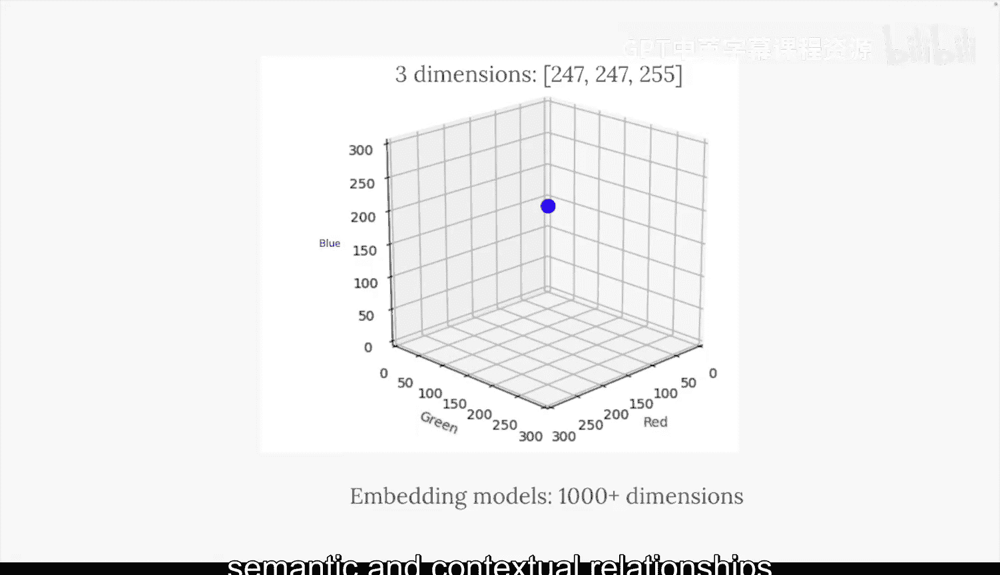

#  010：解释生成式人工智能

在本节课中，我们将要学习解释生成式人工智能模型所面临的独特挑战与重要性。生成式AI模型，如大语言模型和图像生成的扩散模型，虽然能力卓越，但其内部运作机制却极为复杂和不透明，这使得解释它们的行为变得困难。

## 生成式AI的解释挑战 🧩

上一节我们介绍了课程概述，本节中我们来看看解释生成式AI模型的具体难点。尽管这些模型性能令人印象深刻，但它们极其复杂且不透明，难以解释。

像GPT-4这样的大语言模型，其参数量可能高达数万亿，这使得追溯其推理过程变得几乎不可能。它们学习到的是高维、分布式、相互纠缠且抽象的表示。

对于扩散模型这类生成模型，不存在清晰的输入-输出映射或决策边界。通过扩散生成图像的过程始于随机噪声。模型在潜在空间中学习图像或文本等高维数据的复杂分布。

**潜在空间** 是一个关键概念，它允许模型生成与文本或图像输入对齐的内容。这种透明度的缺失，在模型被用于高风险应用时可能带来问题。

## 为何解释生成式AI至关重要 ⚖️

理解了挑战之后，我们来看看为什么解释生成式AI的行为至关重要。随着生成式模型变得日益强大并被广泛采用，解释其行为的能力变得至关重要，原因如下：

以下是几个核心原因：

*   **透明与问责**：这些模型能生成高度逼真和富有创意的图像，但其内部运作通常是“黑箱”。可解释AI技术有助于揭示生成图像背后的推理过程，促进透明度和问责制，这对于建立系统信任至关重要。
*   **偏见与公平**：与其他AI模型一样，图像生成器可能延续其训练数据中编码的社会偏见，或从互联网数据源继承不良偏见。可解释性方法有助于识别和缓解这些偏见，促进技术的公平和负责任使用。
*   **创意控制与迭代**：解释模型如何理解提示词并生成特定视觉元素，能使艺术家和创作者优化提示词、尝试不同方法，从而更有效地实现其艺术构想。
*   **安全与伦理考量**：随着这些模型生成高度逼真且潜在有害内容的能力增强，可解释性有助于识别和降低风险，例如生成露骨或非法内容、深度伪造或其他技术滥用。
*   **模型改进**：可解释性技术提供的洞见可以指导开发更好的图像生成模型，通过揭示模型架构、训练数据或优化目标中的优势、弱点和改进领域。

## 回顾潜在空间概念 📊

在深入探讨具体方法前，我们需要先回顾一个核心概念：潜在空间。正如我们在本模块开头所讨论的，我们将人类可理解的信息（如语言和图像）转换为机器能理解的数字。

一种方法是获取大量数据，并找出在语义和上下文上相似的概念。例如，在“河岸”的语境中，“bank”一词在语义上应接近“shore”和“riverside”。而在“在银行存钱”的语境中，“bank”在语义上应更接近“金融机构”。

我们本质上将这些概念压缩成一个固定长度的向量或一系列数字，以代表所有这些信息。我们熟悉简单的二维坐标图，可以将一个点映射到空间中，这个点有x和y两个维度。或许我们可以想象一个三维坐标图，可以绘制一个具有x、y、z三个维度的点。

现在，想象绘制一个具有一千甚至更多维度的向量。这种将概念映射到的多维空间被称为**嵌入空间**或**潜在空间**。

潜在空间的一个有趣之处在于，只要我们有将不同信息源（如文本和图像）关联在一起的数据集（例如来自互联网的大量图像和标题数据集），我们就可以将它们映射到同一个潜在空间。

然而，如果我们连理解三维空间中的关系都感到困难，那么想象一下，理解复杂概念和多模态数据之间的语义和上下文关系对我们来说有多么困难。

## 本课程的重点与拓展 🎯

对于本模块的剩余部分，我们将专注于生成式语言模型，通常称为大语言模型。

但是，生成式图像模型中的可解释性也非常引人入胜，例如图中展示的GAN模型的潜在空间引导扰动、扩散模型的反事实解释，以及Park等人提出的有趣的特征归因方法。

虽然这不是本课程的主要议题，但我们将在本专项课程后续的“可解释机器学习”课程中，深入探讨生成式图像模型的可解释性。

---

**本节课总结**

本节课中，我们一起学习了解释生成式人工智能（如大语言模型和扩散模型）所面临的独特挑战，包括其极高的复杂性和不透明性。我们探讨了对其进行解释至关重要的多个原因，包括确保透明度、公平性、创意控制、安全性和促进模型改进。我们还回顾了“潜在空间”这一核心概念，它是理解生成式模型如何工作的基础。最后，我们明确了本课程将主要关注语言模型的可解释性，并指出了图像生成模型可解释性这一广阔而有趣的研究方向。