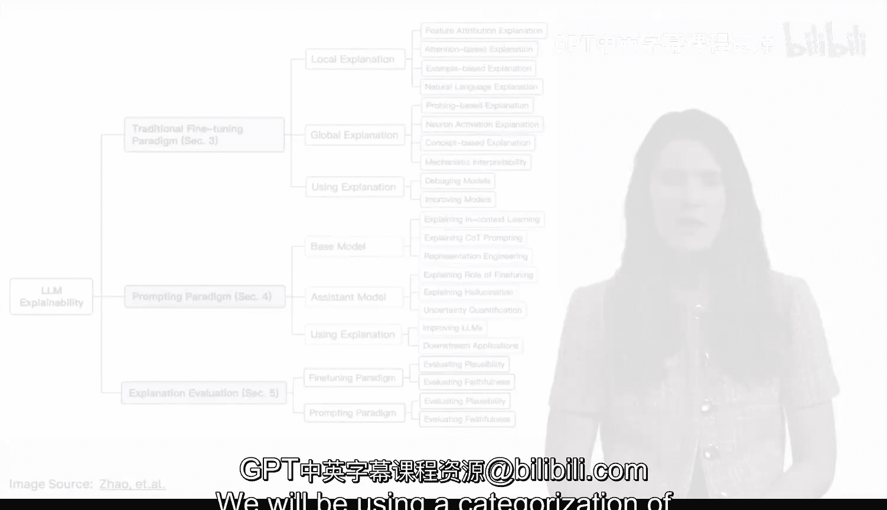
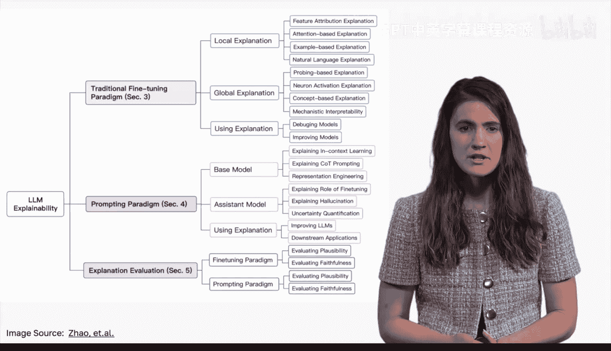
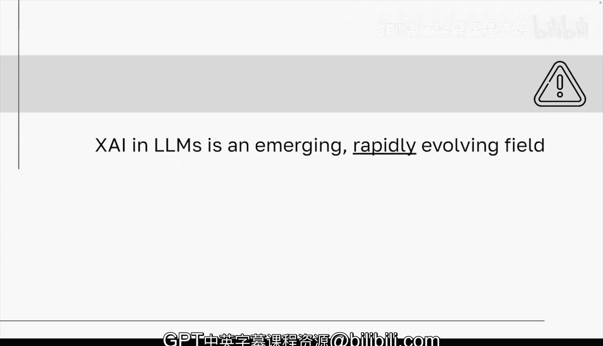

#  011：大语言模型中的XAI挑战

在本节课中，我们将探讨可解释人工智能在大语言模型领域所面临的核心挑战。我们将基于Zotal在2023年提出的分类框架，重点讨论在微调、提示工程以及知识增强等场景下的XAI方法，并分析当前面临的主要困难。

## 大语言模型可解释性的分类框架

上一节我们介绍了XAI的基本概念，本节中我们来看看如何将其应用于大语言模型。我们将主要依据Zotal在2023年提出的分类法来组织讨论。

我们的讨论将主要围绕**微调**和**提示工程**中的XAI展开，并涵盖图中所示的多种解释方法。

除了微调和提示工程，我们还将探讨XAI在**LLM知识增强**或**检索增强生成**中的应用。

## 大语言模型XAI的主要挑战

将XAI方法应用于大语言模型面临着一系列独特的挑战。以下是几个关键难点：

*   **模型规模与复杂性**：像GPT-4这样的大语言模型参数量巨大（可能达到万亿级别），这使得追溯其推理过程变得异常困难。它们学习到的是高维、分布式、相互纠缠且抽象的表示。
*   **缺乏基准真值**：在许多任务中，不存在或很少有明确的“标准答案”，这导致难以设计能准确反映模型决策过程的解释算法，同时也使得评估解释的**忠实度**和**保真度**颇具挑战。
*   **模型透明度不足**：许多LLM缺乏关于其模型架构、权重和训练数据的详细文档，这种不透明性阻碍了可解释方法的发展。

## 关于本领域发展的说明

在开始深入探讨之前，需要特别说明一点：大语言模型的可解释性是一个新兴且快速发展的领域。

这意味着当前讲授的材料可能在六个月后就会过时。虽然我希望随着新研究的发表不断更新本课程，但必须提醒大家，这里所讲的内容并非关于可解释LLM的全部真理，它仅仅是该领域当前进展的一个快照。

作为你在XAI持续学习的一部分，我鼓励你阅读最新的论文，并紧跟关于LLM可解释性的思维模式和观点的变化。

😊

本节课中我们一起学习了应用于大语言模型的XAI所依据的分类框架，并重点分析了其面临的核心挑战，包括模型复杂性、基准真值缺失以及透明度不足等问题。同时，我们也认识到这是一个快速演进的领域，需要持续关注最新研究。