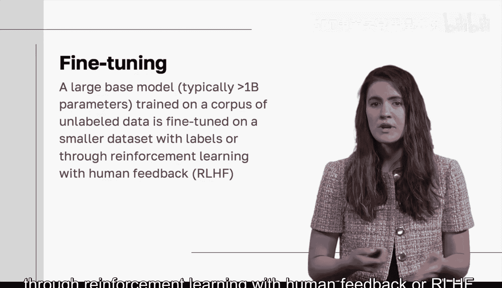
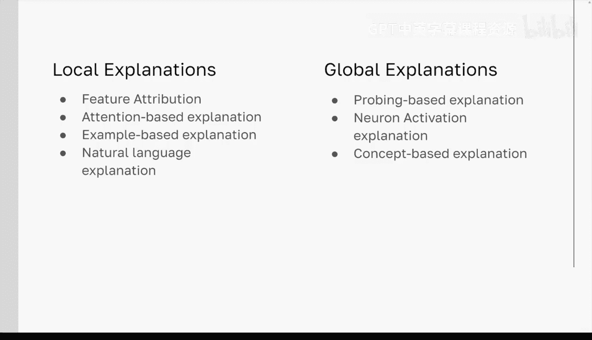
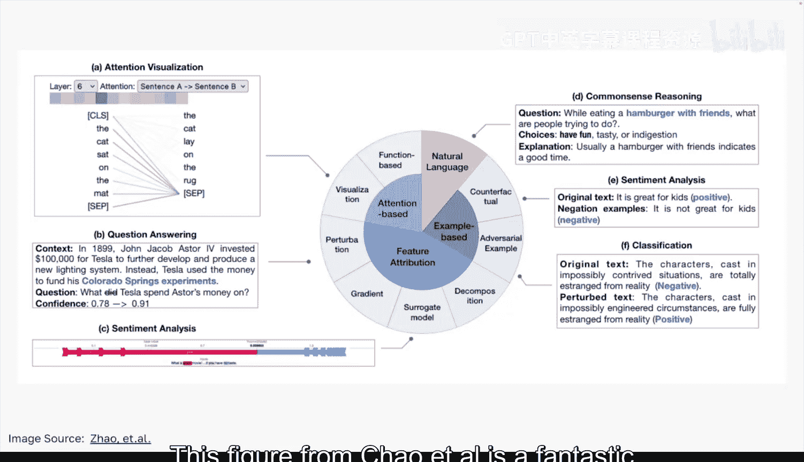
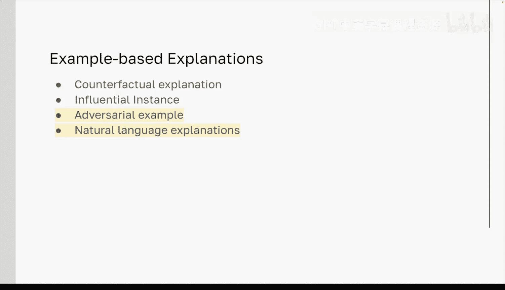
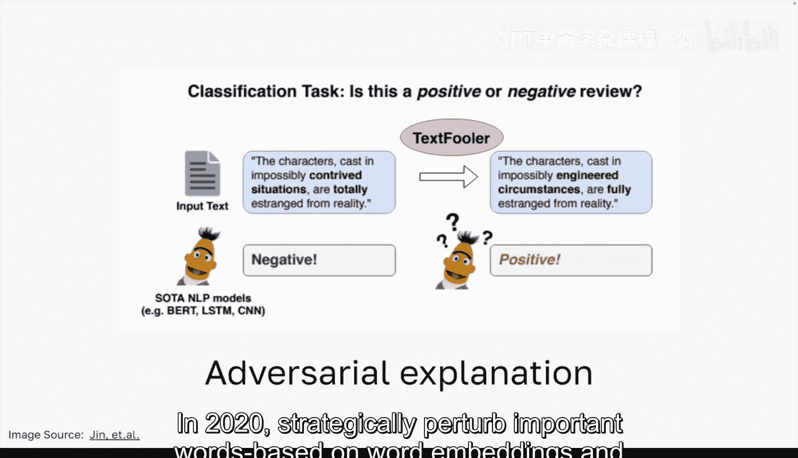
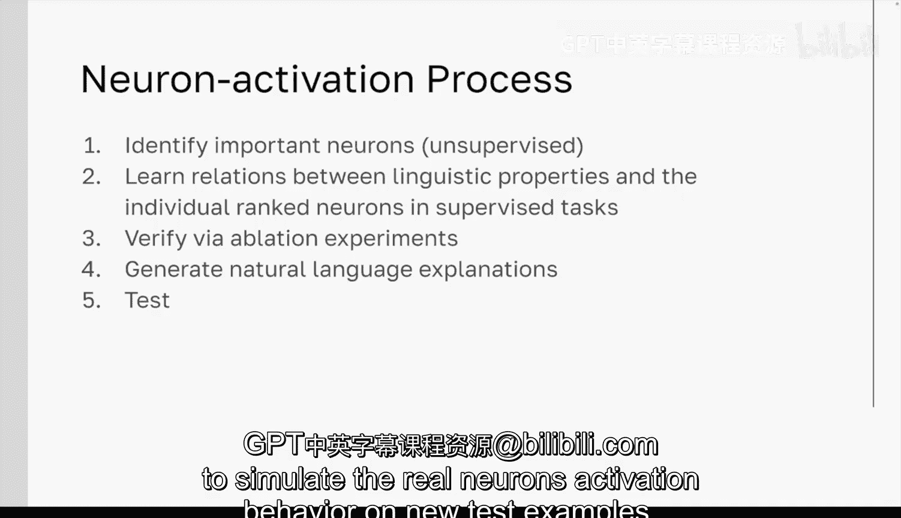

#  012：XAI在大语言模型微调中的应用

在本节课中，我们将要学习可解释人工智能在大语言模型微调过程中的具体应用。我们将回顾微调的基本概念，并深入探讨用于解释微调后模型的多种方法，包括局部解释和全局解释。

## 回顾大语言模型微调

上一节我们介绍了XAI的概述，本节中我们来看看它在微调场景下的具体应用。首先，让我们回顾一下大语言模型的微调过程。

在大语言模型微调中，一个大型基础模型（通常参数量超过10亿）首先在无标签的语料库上进行预训练。随后，该模型在一个带有标签的较小数据集上，或通过人类反馈的强化学习进行微调。

这个过程可以用下图表示。我们使用大规模文本语料库对基础模型（如Llama 2）进行无监督预训练。基础模型通常不擅长生成令人满意的回答。为了获得能提供有用结果的模型，通常需要进行某种形式的微调。我们使用一个较小的微调数据集，对基础模型进行监督微调和/或人类反馈的强化学习，从而创建出我们的助手模型（如Llama 2 Chat）。

## 微调中的解释类型

我们可以将大语言模型微调中的解释分为**局部解释**和**全局解释**。局部解释旨在解释一个特定的预测或一组预测，而全局解释则试图提供对模型的整体性理解。

以下是本课将讨论的局部解释方法：
*   **特征归因**：分析输入特征对模型输出的贡献。
*   **基于注意力的解释**：利用模型的注意力机制来理解其决策焦点。
*   **基于实例的解释**：通过具体例子来解释模型行为。
*   **自然语言解释**：用生成的文本来解释模型的决策过程。

以下是本课将讨论的全局解释方法：
*   **基于探针的解释**：通过训练浅层分类器来探测模型内部表示的含义。
*   **神经元激活解释**：分析单个神经元或维度的激活模式。
*   **基于概念的解释**：将输入映射到一组概念，并衡量每个概念对预测的重要性。

如果你计划学习本专项课程中的可解释机器学习课程，我们将详细讲解其中的许多方法。

## 局部解释方法详解

Chow等人的研究对局部解释方法进行了出色的梳理。让我们深入细节。

### 特征归因方法

目前，大语言模型主要有四种特征归因的可解释性方法。

首先是**基于扰动的解释**。这种方法通过移除、掩码或改变输入特征（可以是嵌入向量、隐藏单元、单词或标记）来扰动输入样本，然后评估模型输出的变化。

其次是**基于梯度的解释**。这种方法通过分析输出相对于每个输入维度的偏导数来确定每个输入特征的重要性。导数的大小反映了输出对输入变化的敏感度。在LLM中，积分梯度是主要的基于梯度的解释方法。

第三是**SHAP方法**。我们在XAI方法概述中简要讨论过SHAP。Gen等人在2023年将SHAP适配到基于Transformer的语言模型。TransSHAP主要专注于将SHAP应用于子词文本输入并提供序列可视化解释。

最后是**基于分解的方法**。分解技术旨在将相关性分数分解为输入的线性贡献。层相关性传播就是一个例子。

### 基于实例的解释

基于实例的解释是LLM微调中的另一种局部解释方法。

**反事实解释**揭示了基于某些观察到的输入变化，结果会发生什么改变。**有影响的实例**通过衡量单个训练样本对测试点损失的影响程度，来描述其影响力。

我们今天将涵盖的主题包括对抗性示例和自然语言解释。

### 对抗性示例

神经网络模型非常容易受到输入数据中精心设计的小修改的影响，这些修改可以极大地改变模型的预测，尽管对人类来说几乎无法察觉。这些被称为**对抗性示例**。

对抗性示例暴露了模型失败的领域，并在训练期间用于提高模型的鲁棒性和准确性。

早期的对抗性示例生成专注于词级操作，如错误、删除和插入。更先进的方法，如Jia等人在2020年提出的TextFooler，则基于词嵌入和语义相似性，策略性地扰动重要词汇。

大语言模型中对抗性示例的最新方法，利用掩码语言模型，并采用“掩码后填充”的过程来进行标记级扰动，如替换、插入和合并。W等人于2022年提出的Semi方法提出了一个更通用的框架，直接在嵌入空间（如知识和上下文语义）上操作。它迭代地优化扰动后的嵌入以满足攻击目标。

Semi攻击的一个可视化示例如表1所示，将一个蓝色单词替换为红色的对抗性单词，误导了正确预测到错误类别，但不会欺骗人类。

### 自然语言解释

我们将讨论的最后一个局部解释是**自然语言解释**。这种方法通过生成的文本来解释模型在输入序列上的决策过程。

其方法是使用原始文本数据和人工标注的解释来训练一个语言模型。最近，这已被应用于各种数据集和任务。

如下表（来自Lowe等人）所示，2019年的一篇论文引入了常识解释数据集，并用它来训练语言模型自动生成解释，这些解释可用于训练和推理。类似地，2022年的一项更近期的研究探讨了自然语言解释的少样本域外迁移学习，即从拥有大量自然语言解释的父任务迁移到子任务。

## 全局解释方法详解

现在让我们讨论全局解释。基于概念的解释允许我们将输入映射到一组概念，并衡量每个预定义概念对模型预测的重要性分数。测试概念激活向量就是这种方法的一个例子。

在可解释的LLM微调中使用的两种全局解释——基于探针的解释和神经元激活解释——将是我们更详细讨论的主题。

### 基于探针的解释

在基于探针的解释中，我们可以查看基于分类器的探针或无参数探针。

在**基于分类器的探针**中，过程是：首先冻结LLM参数，然后从LLM生成表示。接着，在这些表示上训练一个浅层分类器来预测语言属性。如果你探测的是句法，你关注的是词性、形态或依存关系等。或者，如果你探测的是语义，你检查的是共指、实体和关系。

**无参数探针**直接在定制化的数据集上评估LLM，而无需使用分类器。

需要注意的是，与许多这类方法一样，探针的有效性在研究人员中存在争议。高性能可能并不意味着LLM真正理解了语言。

### 神经元激活解释

神经元激活分析检查的是单个神经元或维度，而不是整个向量空间。它涉及两个步骤：一，识别重要神经元；二，学习语言属性与神经元之间的关系。

缺乏真实标注使得评估组件级解释具有挑战性。

下图展示了一个神经元激活解释的例子，它观察了GPT-2第五层第131个神经元的激活可视化。

神经元激活解释的过程如下所示。首先，以无监督的方式识别重要神经元。这涉及基于相关性测量、学习到的权重或使用监督分类方法等指标对神经元进行排序。接着，在监督任务中学习语言属性与单个排序神经元之间的关系。然后，通过消融实验（如掩码和擦除）定量验证排序后神经元的重要性。对于LLM，生成自然语言解释，总结触发给定神经元高激活的文本模式。最后，通过测试这些解释能让模型在新测试示例上模拟真实神经元激活行为的程度，来评估自然语言解释的质量。

## 总结

本节课中，我们一起学习了可解释人工智能在大语言模型微调中的应用。我们回顾了微调的基本流程，并系统性地介绍了用于解释微调后模型的多种方法。我们区分了局部解释（如特征归因、对抗性示例、自然语言解释）和全局解释（如基于探针的解释、神经元激活解释），并了解了它们的基本原理和应用场景。理解这些解释方法对于构建更可靠、更透明且值得信赖的大语言模型至关重要。