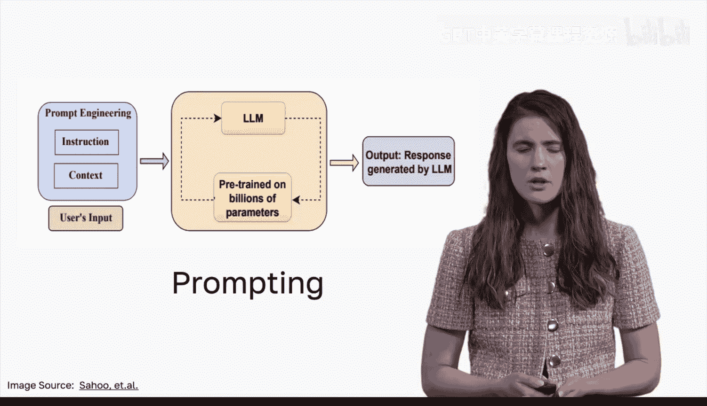
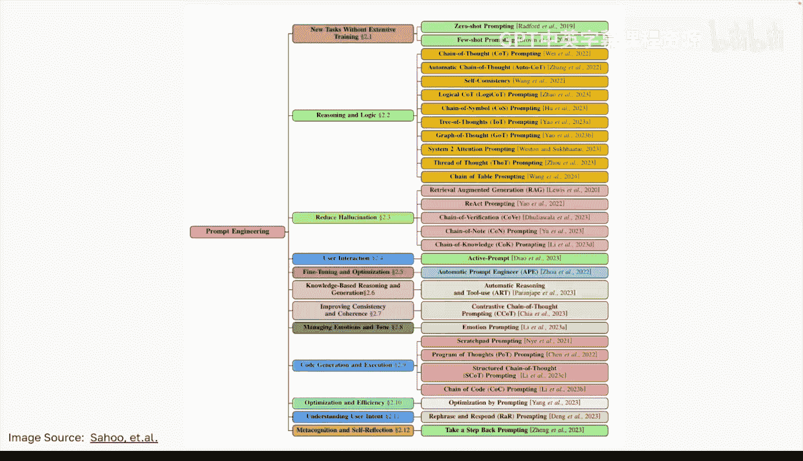
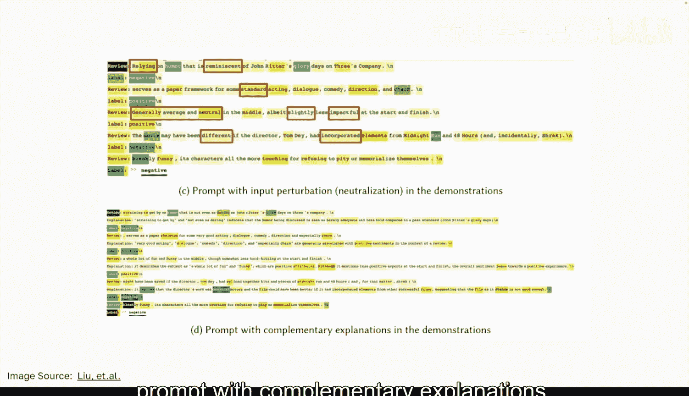
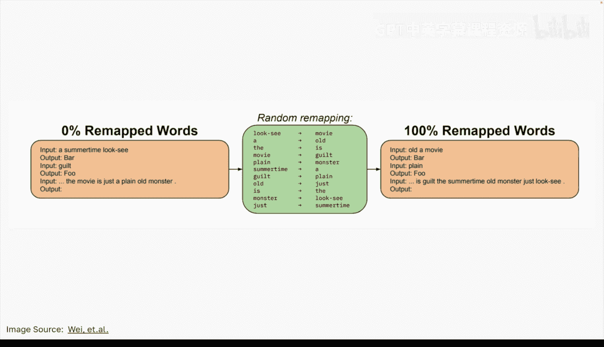
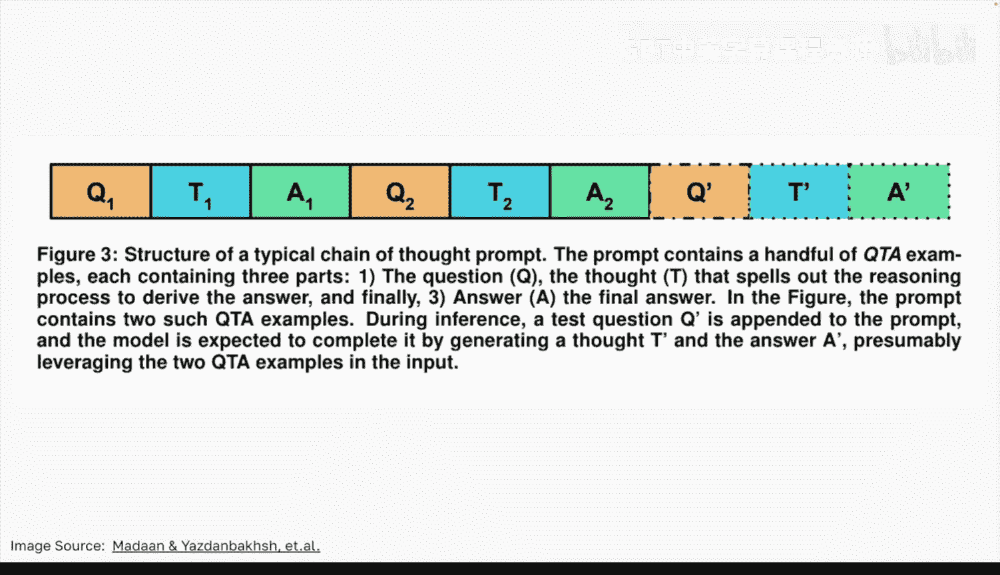
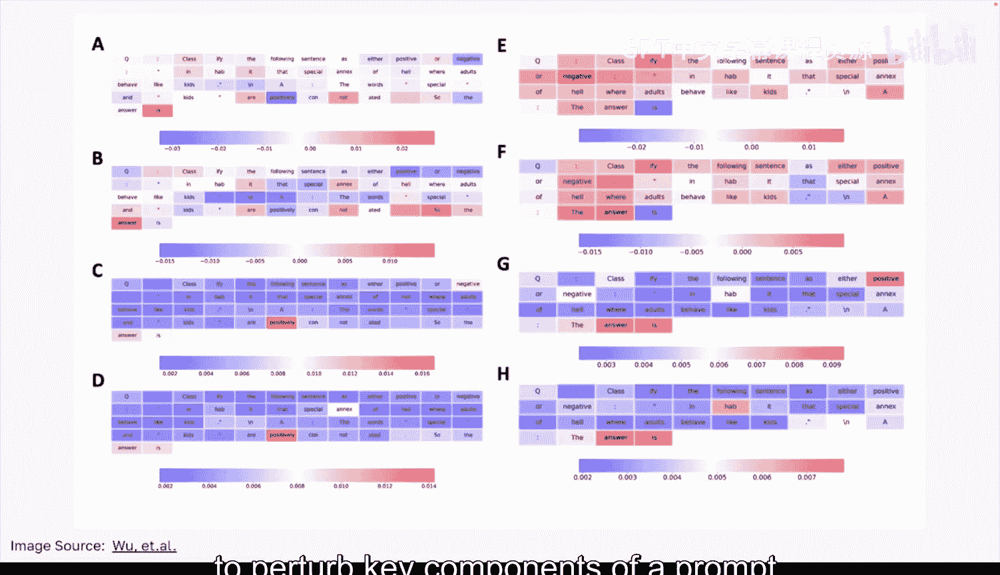
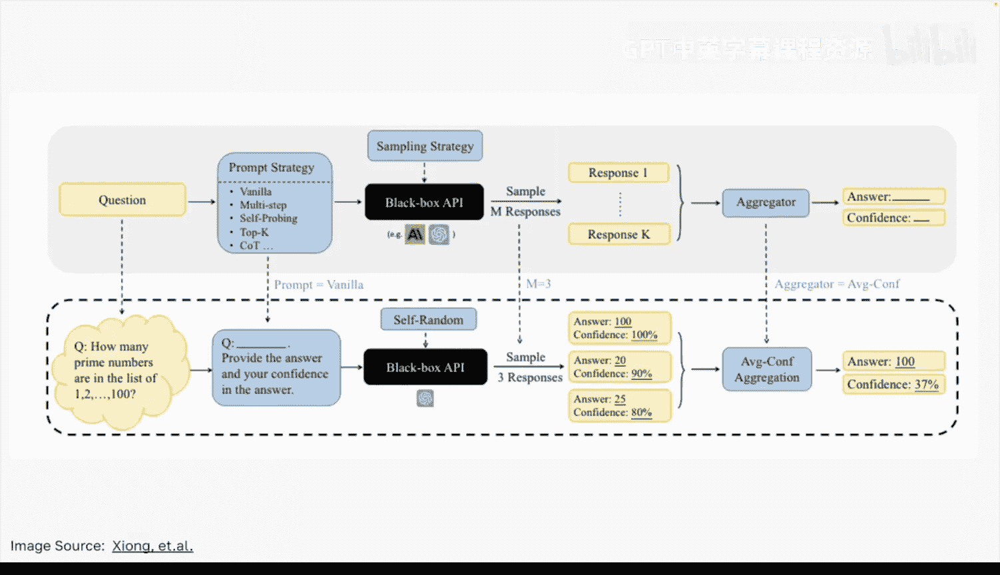
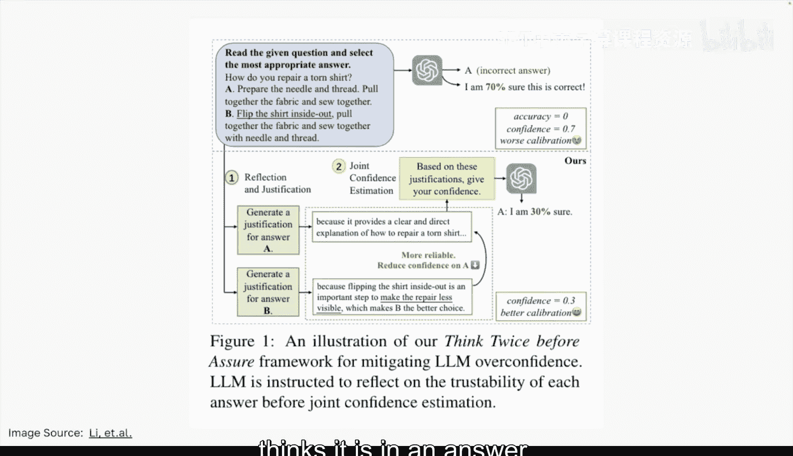

#  013：大语言模型提示中的可解释性应用

在本节课中，我们将学习大语言模型提示工程中的可解释性方法。我们将探讨两种主要的提示技术——上下文学习和思维链，并了解研究人员如何分析这些技术如何影响模型的行为。最后，我们还将讨论大语言模型面临的不确定性挑战及其评估方法。

## 大语言模型提示工程回顾

提示工程涉及用自然语言策略性地设计特定任务的指令，以在不改变模型参数的情况下引导其输出。一个提示通常包含指令、上下文和用户输入，用于指导预训练大语言模型的输出。

以下是提示工程中一些不同的方法学概览（源自Sahuitel等人2024年的论文）。

## 上下文学习与思维链提示

在可解释性的背景下，我们将讨论两种类型的提示：上下文学习和思维链。

上下文学习是指在提示中为模型展示任务示例。思维链提示则涉及引导模型描述其推理过程，并逐步解决问题。

## 上下文学习的可解释性

当我们思考上下文学习的可解释性时，我们试图回答的问题是：**上下文学习如何影响模型行为？**

为了回答这个问题，近期的研究依赖于对比示例、输入文本扰动、翻转标签以及使用语义无关的标签。

*   **Lee等人（2023）** 使用SST-2情感分析基准任务，通过分析对比示例和显著性图谱来解释上下文学习在LLMs中如何工作。作者通过翻转标签、扰动输入文本和添加补充解释来构建对比示例。
    *   以下是一个在示例中翻转标签的提示。
    *   以下是一个进行输入扰动的提示。
    *   以下是一个添加了补充解释的提示。

*   **Wei等人（2023）** 通过研究两种设置来解释上下文学习如何受语义先验与输入-标签映射的影响：使用翻转标签的上下文学习，以及使用语义无关标签的上下文学习。下图展示了重新映射输入的概览，其中词语被映射到其他词语以降低输入的语义意义。

## 思维链提示的可解释性

对于思维链提示的可解释性，我们提出一个类似的问题：**思维链提示如何影响大语言模型的行为？**

为了回答这个问题，近期的研究探索了显著性分数、扰动和反事实分析。

下图展示了一个典型的思维链提示结构，包含问题（Q）、思考（T）和答案（A）。

*   **Woo等人（2023）** 分析了输入词元的显著性分数。显著性分数表明每个输入词元对模型输出的影响程度。其目标是理解，与标准提示相比，思维链提示是否会改变显著性分数，或者说，思维链为何能提升性能。
*   **2022年的多篇论文** 通过向少样本提示中的思维链示例添加错误来进行扰动，以确定哪些方面对于生成好的解释是重要的。其中，Madon等人的一篇论文还提出了反事实提示，用于扰动提示中的关键组成部分，如符号、模式和文本。

## 大语言模型的不确定性挑战

不确定性是当前大语言模型面临的一个重大挑战。尽管它们在生成类人文本方面能力令人印象深刻，但大语言模型可能表现出过度自信，即使在其训练数据不完整或模糊时，也会提供高度确定的回答。这种不确定性量化的缺失可能导致潜在风险，例如传播错误信息或基于不可靠的输出做出关键决策。解决这个问题对于构建可信赖和可靠的AI系统至关重要，尤其是在医疗保健、金融和决策制定等高风险领域。

上一节我们探讨了提示技术如何影响模型行为，本节中我们来看看如何评估模型输出本身的可靠性。

*   **基于一致性的不确定性估计**：Xi Yong等人在其2024年的论文中提出，这种方法涉及对一个问题生成多个回答，并利用这些回答之间的一致性来估计模型的置信度。他们通过向答案生成过程引入随机性（例如，自洽性）或在提示中添加误导性暗示来诱导生成不同的回答。其理念是，如果一个微调后的大语言模型在多次回答中表现得更一致，那么它对答案的估计置信度就更高。
*   **词元级不确定性**：Dwent等人的一篇论文着眼于词元级不确定性。核心概念是：大语言模型通过预测每个词元来生成文本。词元级不确定性方法根据每个预测词元的概率分布计算其置信度分数。整体不确定性可以基于词元级不确定性的聚合来估计。

## 直接询问模型的置信度？

现在，你可能会问：**我们不能直接要求一个大语言模型告诉我们它对答案有多自信吗？**

答案可能是不能。尽管有研究框架被提出，例如Lee等人在2024年提出的让大语言模型证明其置信度，而不是简单地要求模型给出其置信度的朴素方法，但仍有一些问题需要考虑。

*   当前的大语言模型经常产生幻觉，并且不知道它们不知道什么，或者其训练数据之外的信息。它们极有可能凭空编造。
*   很难将这种自信度映射到任何真实的事物上。
*   虽然这可能是一种尝试理解模型自认为对答案有多自信的有趣方法，但它本身并不是一种可解释的人工智能方法。

## 总结

本节课中我们一起学习了可解释人工智能在大语言模型提示工程中的应用。我们回顾了上下文学习和思维链这两种核心提示技术，并了解了研究人员如何通过对比示例、显著性分析、扰动和反事实等方法来解释它们对模型行为的影响。最后，我们探讨了大语言模型面临的不确定性挑战，并介绍了基于一致性和词元级概率的评估方法，同时指出了直接询问模型置信度所存在的局限性。理解这些方面对于开发更可靠、更透明的大语言模型应用至关重要。