#  020：决策制定

在本节课中，我们将通过一个现实世界的案例研究，学习如何将人工智能解释有效整合到决策流程中。我们将以一家大型金融机构引入AI系统辅助贷款审批决策为例，详细拆解其应用最佳实践的具体步骤。

---

## 概述

上一节我们讨论了将AI解释整合到决策中的一般性原则。本节中，我们来看看一个具体的应用案例。一家大型金融机构希望引入AI系统来辅助贷款审批决策，目标是提高流程的效率、一致性和公平性。我们将跟随他们的实施步骤，了解如何将理论原则付诸实践。

---

## 第一步：确立明确的目标与指标 🎯

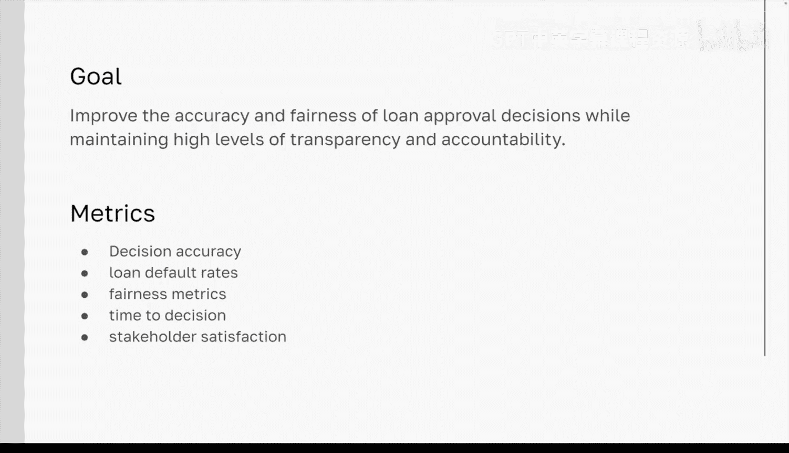

首先，该机构为AI系统的整合设定了清晰的目标和评估指标。

**目标**是提高贷款审批决策的准确性与公平性，同时保持高水平的透明度与问责制。

用于评估目标的**指标**包括：
*   **决策准确率**
*   **贷款违约率**
*   **公平性指标**（例如，差异影响 `Disparate Impact`）
*   **决策耗时**
*   **利益相关者满意度**

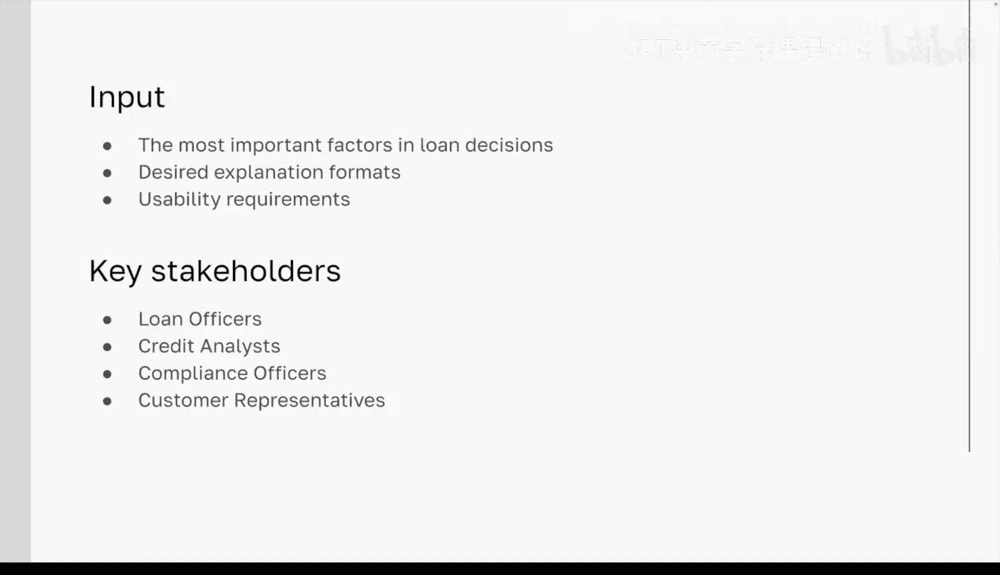

---

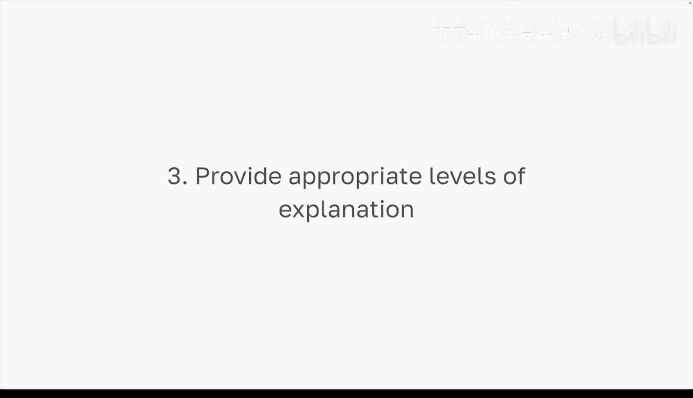

## 第二步：早期引入利益相关者 👥

他们很早就让关键的利益相关者参与进来。在XAI系统的设计与开发阶段，他们与**贷款专员、信用分析师、合规专员和客户代表**进行了深入沟通。

以下是他们从利益相关者处收集的关键输入：
*   贷款决策中最重要的因素。
*   期望的解释呈现格式。
*   系统的易用性要求。

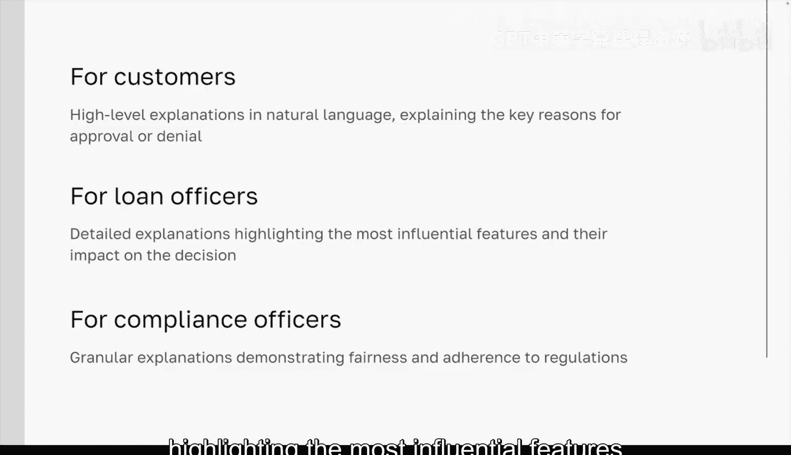

---

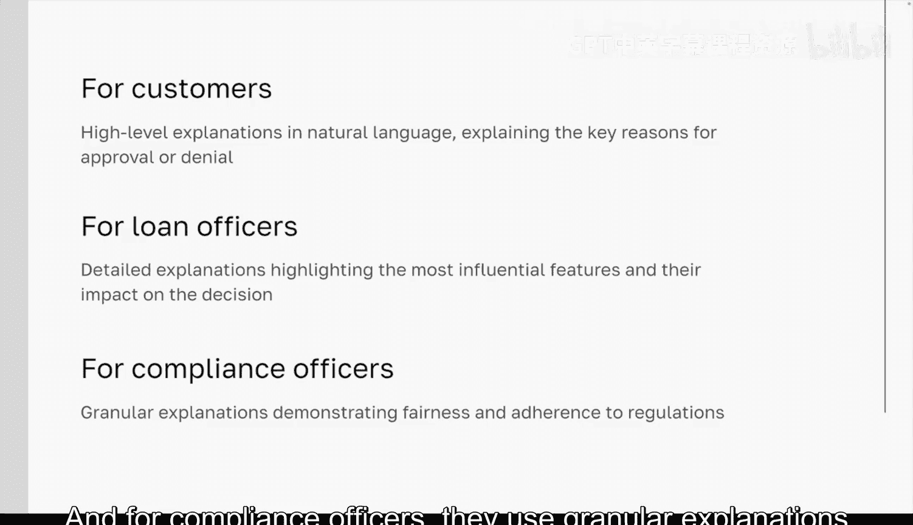

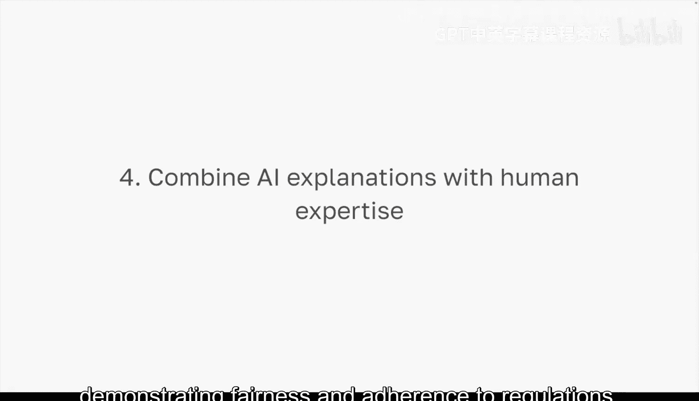

## 第三步：提供恰当的解释层级 📊

根据用户角色的不同，他们提供了不同详细程度的解释。

*   **面向客户**：提供**高层级的自然语言解释**，说明批准或拒绝贷款的关键原因。
*   **面向贷款专员**：分享**详细的解释**，突出显示最具影响力的特征及其对决策的影响。
*   **面向合规专员**：使用**细粒度的解释**，以证明决策的公平性并符合监管要求。

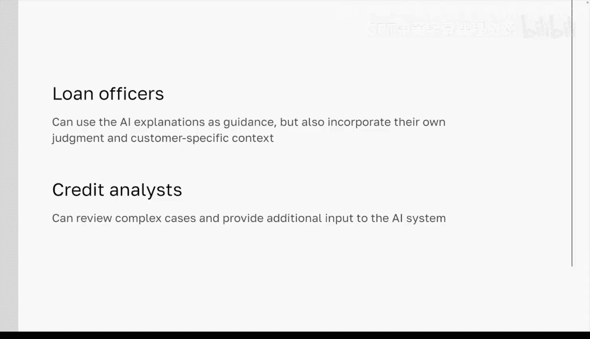

---

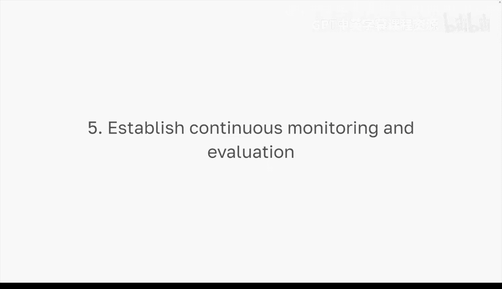

## 第四步：结合AI解释与人类专业知识 🤝

他们确保AI解释与人类专业知识相结合。贷款专员可以将AI解释作为指导，但同时结合自己的判断和客户的具体情况。信用分析师可以复核复杂案例，并为AI系统提供额外的输入。

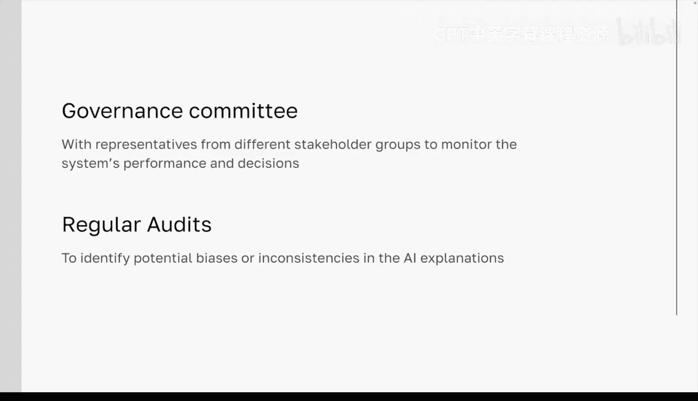

---

## 第五步：建立持续监控与评估机制 📈

他们建立了一个由不同利益相关者代表组成的治理委员会，以监控AI系统的性能和决策。同时，他们定期进行审计，以识别AI解释中可能存在的偏见或不一致。

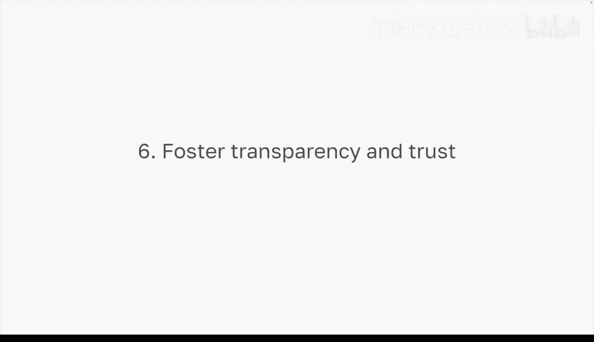

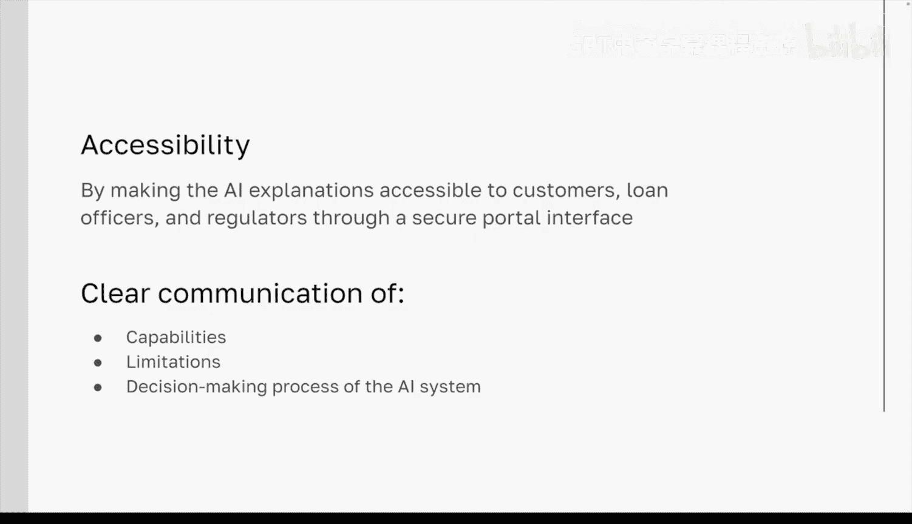

---

## 第六步：促进透明度与信任 🔓

他们通过安全的门户界面，向客户、贷款专员和监管机构提供AI解释的访问权限。并且，他们清晰地沟通了AI系统的能力、局限性和决策流程。

---

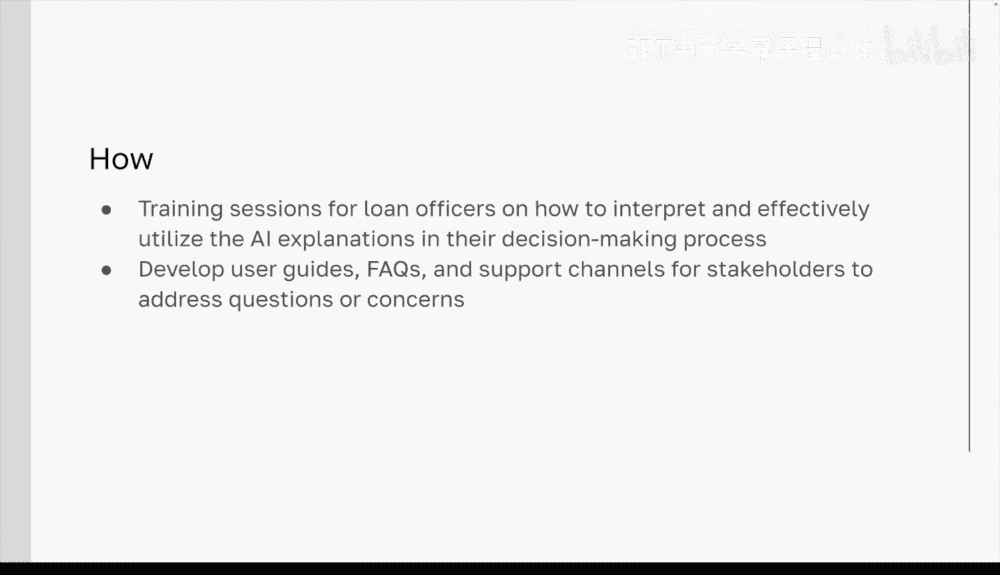

## 第七步：提供培训与支持 🧑‍🏫

他们为贷款专员提供培训课程，教导他们如何解读并在决策过程中有效利用AI解释。此外，他们还为用户指南、常见问题解答和支持渠道，以解决利益相关者的疑问或顾虑。

---

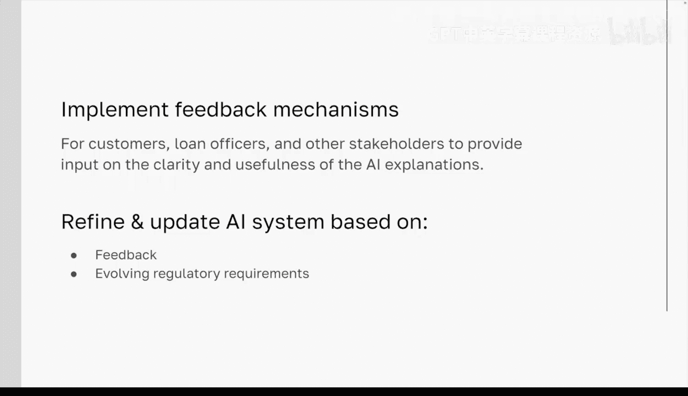

## 第八步：鼓励反馈与持续改进 🔄

他们为顾客、贷款专员和其他利益相关者建立了反馈机制，收集关于AI解释清晰度和实用性的意见。基于这些反馈以及不断变化的监管要求，他们持续优化和更新AI系统。

---

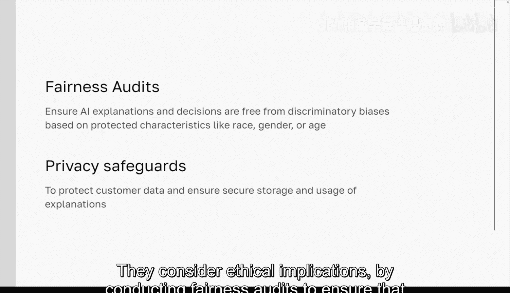

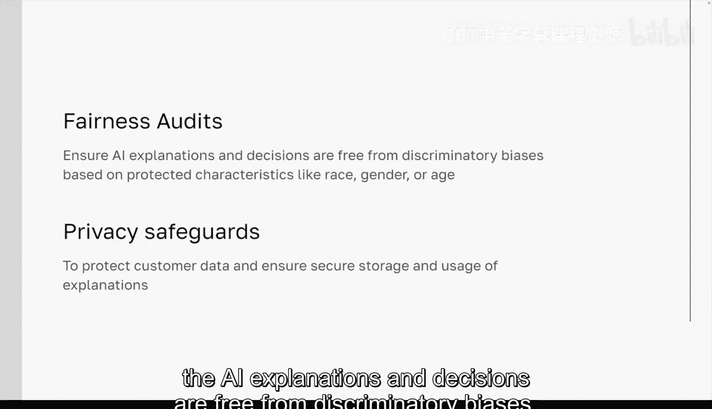

## 第九步：考量伦理影响 ⚖️

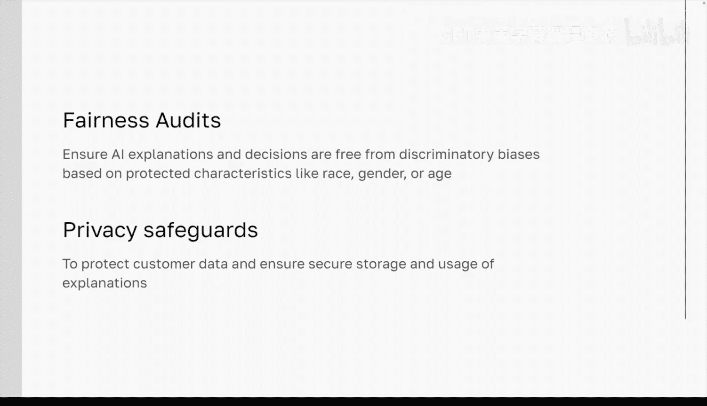

他们进行公平性审计，以确保AI解释和决策不会基于种族、性别或年龄等受保护特征产生歧视性偏见。同时，他们实施隐私保护措施，以保护客户数据，并确保解释信息的安全存储和使用。

---

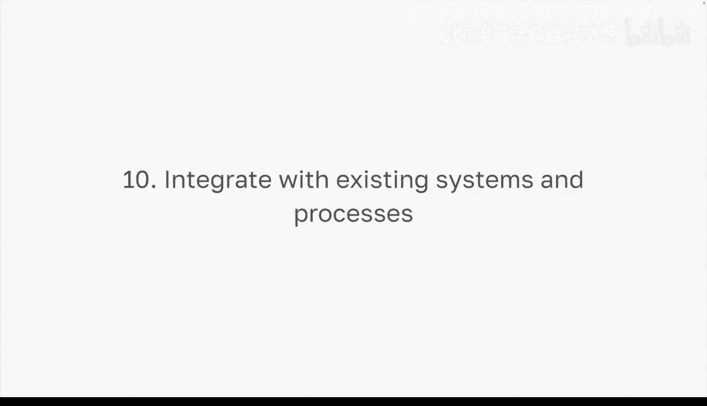

## 第十步：与现有系统和流程整合 🔗

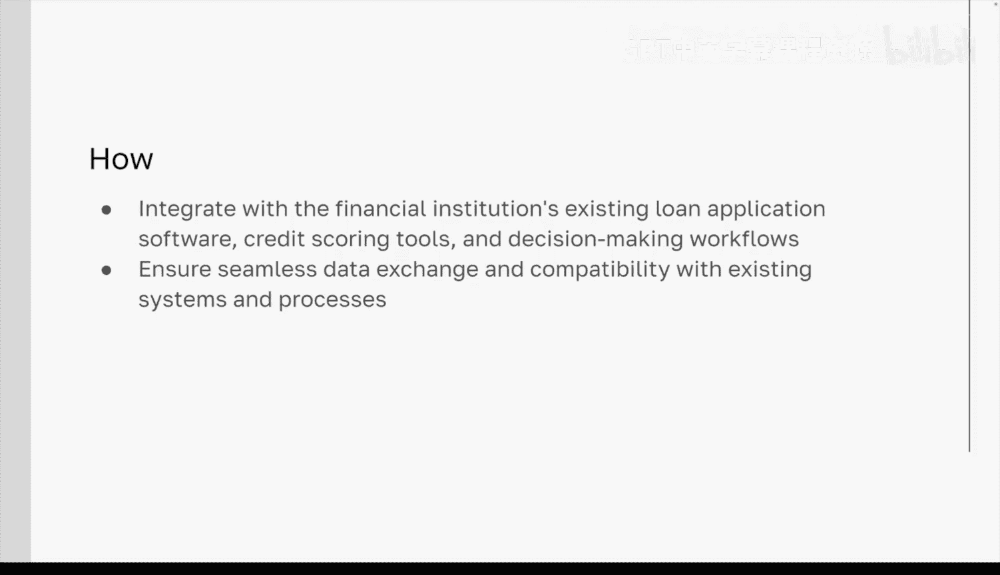

最后，他们将XAI系统与金融机构现有的**贷款申请软件、信用评分工具和决策工作流**进行整合。他们确保了与现有系统和流程之间的无缝数据交换和兼容性。

---

## 总结

本节课中，我们一起学习了一个将AI解释整合到贷款审批决策中的完整案例。正如你所见，在整合过程中需要考虑诸多因素，包括设定目标、引入利益相关者、提供分层解释、人机结合、持续监控、建立信任、提供支持、收集反馈、伦理考量以及系统整合。对这些因素进行审慎考量，将使组织能够有效利用AI解释来增强决策过程，同时确保透明度、问责制，并与人类价值观及专业知识保持一致。