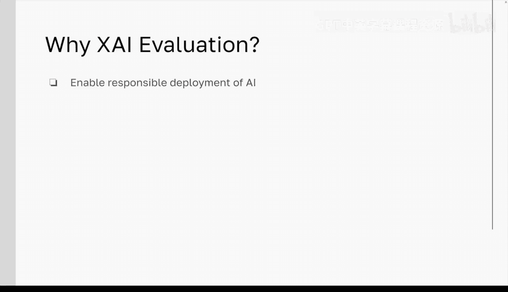
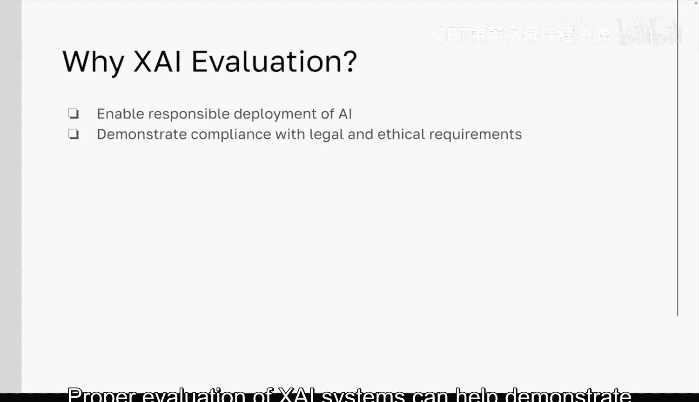
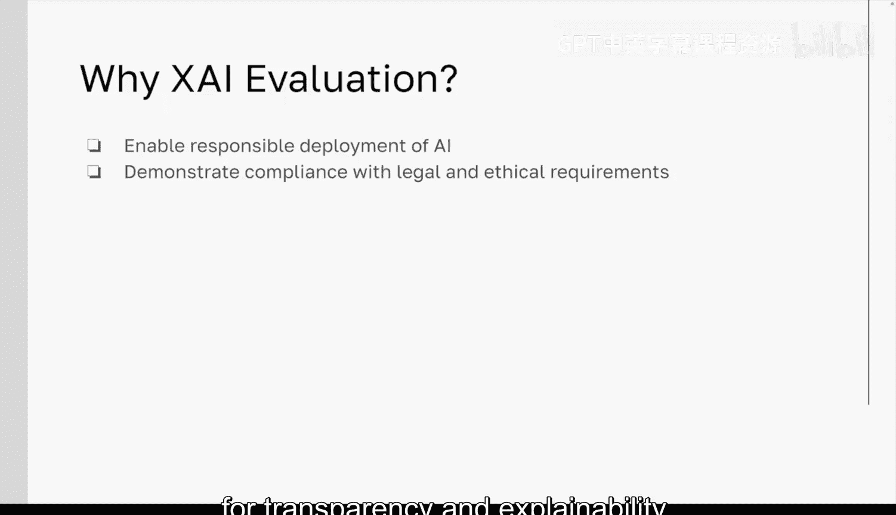
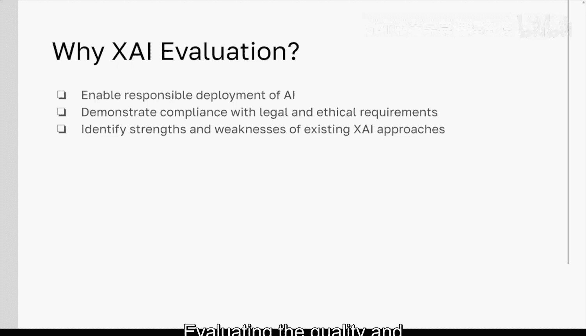
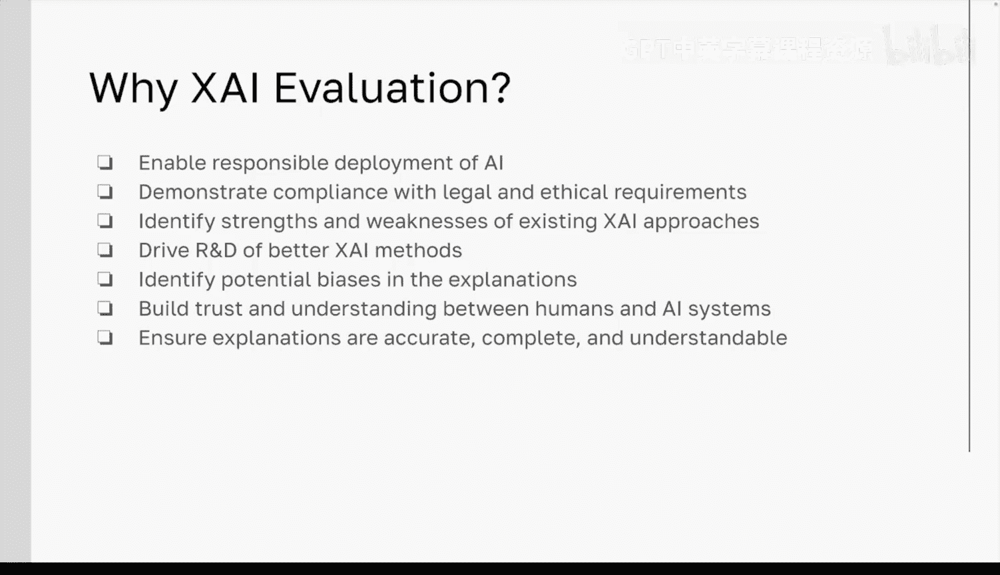
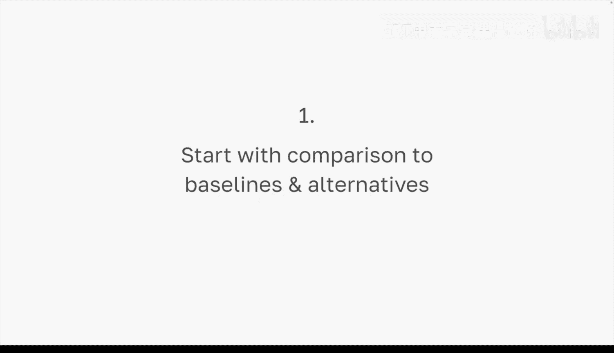

#  021：XAI评估的重要性与介绍 🎯

在本节课中，我们将要学习为什么需要对可解释人工智能系统进行评估，并初步了解评估的常见类型。理解评估的重要性是确保AI系统可靠、公平且值得信赖的第一步。

在讨论如何实施XAI评估之前，我们先探讨其重要性。

随着人工智能系统在医疗、金融和刑事司法等高风险领域日益普及，对问责制以及遵守法规和道德准则的需求也在不断增加。

对XAI系统进行恰当评估，有助于证明其符合关于透明度和可解释性的法律与道德要求，从而推动AI技术的负责任部署。

评估解释的质量和有效性，对于推动更好的XAI技术和方法的发展也至关重要。严格的评估框架和基准测试有助于识别现有方法的优缺点，从而引导研究努力，以提升AI系统的可解释性。

XAI评估有助于识别XAI系统在解释中可能存在的对不同群体或亚群体的潜在偏见或不公平对待。通过评估解释在不同数据集或亚组间的一致性和公平性，可以采取措施来减轻偏见并确保公平对待。

最后，XAI系统的目标是为AI模型的决策提供解释，这对于建立人类与这些系统之间的信任和理解至关重要。恰当的评估有助于确保生成的解释是准确、完整且易于理解的，从而促进透明度并培养对AI系统决策过程的信任。

需要注意的是，XAI评估是一个不断发展的研究领域，新的评估标准、指标和数据集会定期出现。本模块所列内容并非详尽无遗。

以下是几种常见的XAI系统评估类型。

除了与基线或替代方法进行比较外，评估过程还应包括对不同XAI技术生成的解释性能和质量进行比较，或与基线方法进行对比。这应始终是您评估过程的一部分。

上一节我们介绍了XAI评估的重要性与常见类型，本节中我们来看看在开发XAI系统时的一些具体评估方法。

本节课中我们一起学习了XAI评估的核心价值，包括确保合规性、推动技术进步、识别偏见以及建立信任。我们还初步了解了评估的常见类型，为后续深入学习具体的评估方法奠定了基础。