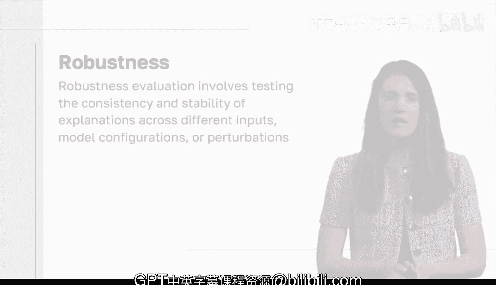
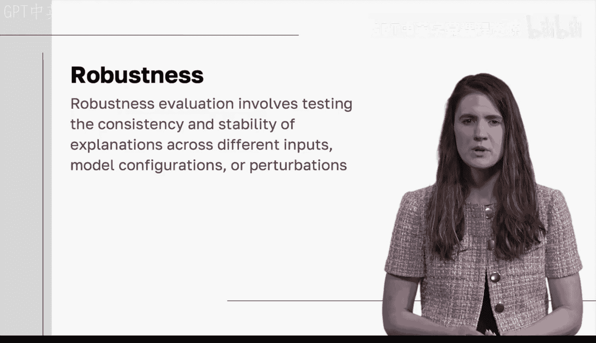
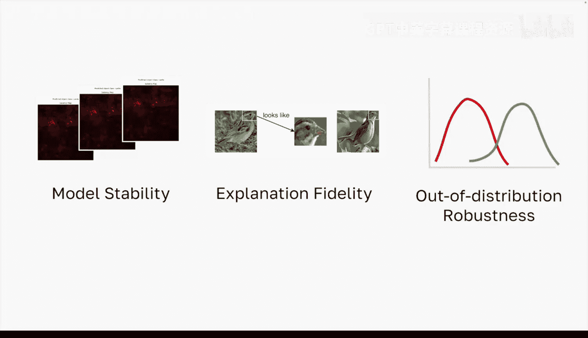
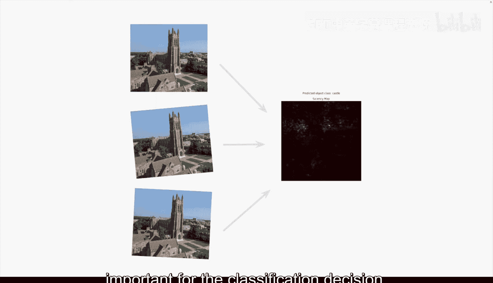
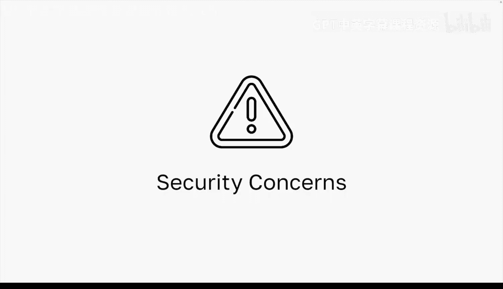
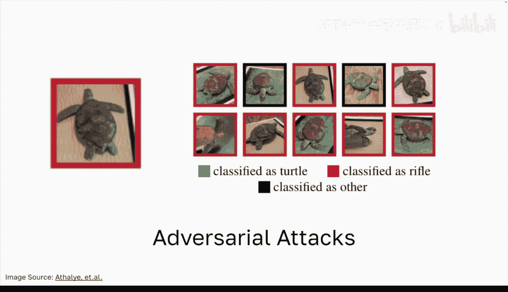
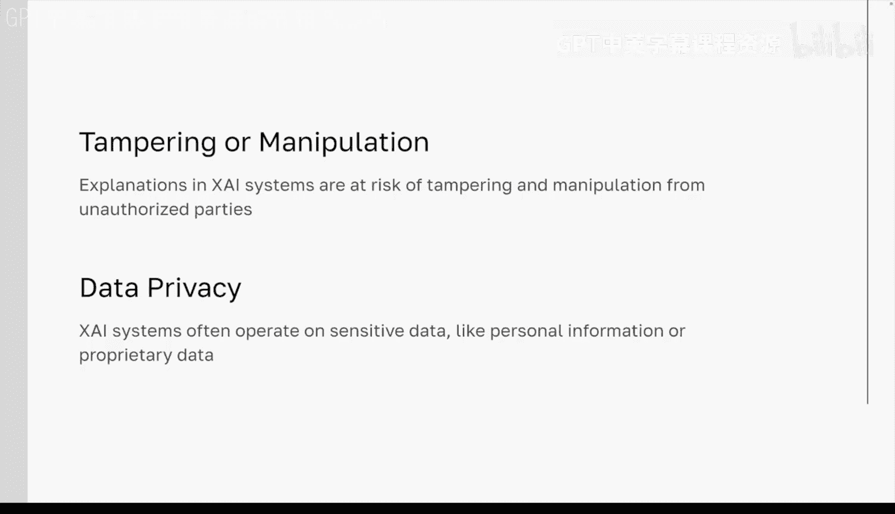
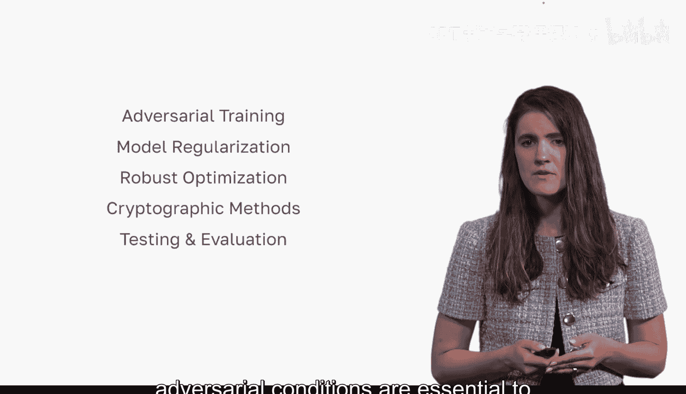
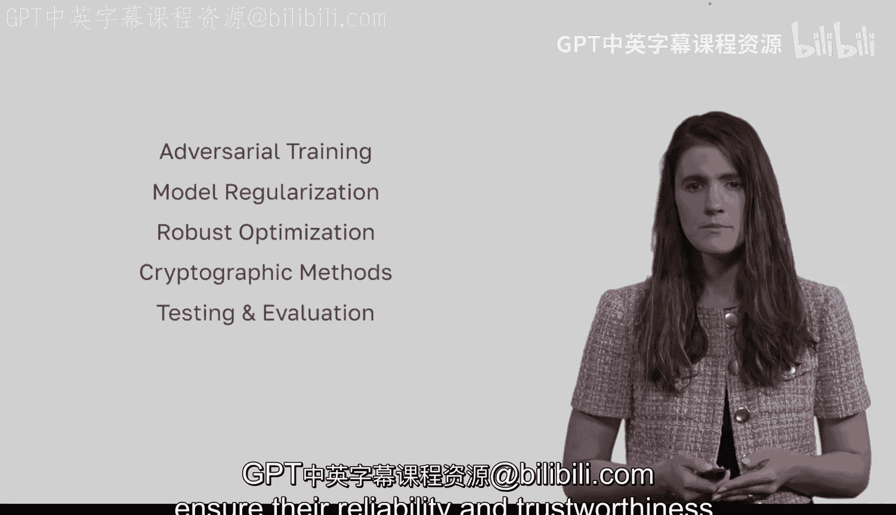

#  025：XAI安全与鲁棒性介绍 🛡️

在本节课中，我们将要学习可解释人工智能系统的安全性与鲁棒性。鲁棒性评估涉及测试解释在不同输入、模型配置或扰动下的**一致性**与**稳定性**。一个可靠的XAI系统必须能够抵御各种挑战，确保其解释的**可信度**。

## 鲁棒性的核心维度

上一节我们介绍了鲁棒性的概念，本节中我们来看看构成XAI系统鲁棒性的三个关键维度。

**模型稳定性**：确保输入的微小变化不会导致解释发生剧烈改变。其核心是保证解释对输入扰动的**不敏感性**。

**解释保真度**：确保解释能够准确反映模型真实的推理过程。其核心是保证解释与模型内部逻辑的**一致性**。

**分布外鲁棒性**：确保XAI系统即使对于偏离训练数据分布的输入，仍能提供有用的解释。其核心是保证解释在未知数据上的**泛化能力**。

## 模型稳定性详解 🧱

模型稳定性要求XAI系统在面对输入数据或模型参数的微小扰动时，仍能提供一致且可靠的解释。这确保了解释的可信度，不会因细微变化而发生剧变。

考虑一个用于图像分类的XAI系统，其解释基于神经网络卷积层的激活生成。如果输入图像受到轻微扰动，例如添加少量噪声或将图像旋转几度，一个稳定的XAI系统应能提供相似的解释，突出显示图像中相同或非常接近的区域，作为分类决策的重要依据。

## 解释保真度详解 🎯

XAI系统提供的解释应准确反映模型预测背后的真实推理逻辑。如果解释具有误导性或不准确，可能导致错误的解读和潜在的有害决策。

考虑一个用于贷款审批决策的XAI系统，其解释基于特征重要性分数。如果模型在预测时真正严重依赖申请人的收入和信用评分，但XAI系统却突出显示无关特征（如申请人的年龄或性别）为重要因素，这就违反了解释保真度。此类不准确的解释可能导致带有偏见的决策和潜在的法律问题。

## 分布外鲁棒性详解 🌐

XAI系统应能处理训练数据分布之外的输入，并提供有意义的解释，而不是失效或产生不可靠的结果。

考虑一个用于自然语言处理任务（如情感分析或命名实体识别）的XAI系统。该系统在新闻文章和社交媒体帖子的语料库上进行训练。如果系统遇到一份高度技术性的文档或用截然不同风格撰写的文本（例如法律文件或科学论文），一个鲁棒的XAI系统应仍能为其预测提供合理的解释，而不是失效或产生无意义的解释。

## 安全考量 🔒

在开发鲁棒的XAI系统时，安全考量至关重要。XAI技术存在一系列需要解决的安全问题。

以下是主要的安全威胁类型：

*   **对抗性攻击**：攻击者精心设计输入数据，以操纵模型的输出或XAI系统提供的解释。例如，一个3D打印的海龟模型可能被设计成一种对抗性攻击，其制作方式会欺骗模型，使其在不同方向上将其错误分类为步枪。鲁棒的XAI系统应能检测并缓解此类攻击。
*   **模型提取攻击**：在某些情况下，攻击者可能试图通过向XAI系统提交精心设计的输入并分析其解释，来提取或复制底层的机器学习模型。XAI系统应设计成能防止或缓解此类模型提取攻击。
*   **解释完整性**：XAI系统提供的解释应受到保护，防止未经授权的方进行篡改或操纵。
*   **数据隐私**：XAI系统通常处理敏感数据，如个人信息或专有数据。应采取适当措施确保数据隐私和保护。

## 增强鲁棒性与安全性的技术 🛠️

为了应对这些鲁棒性和安全问题，XAI系统的开发者采用了各种技术。

以下是常用的技术手段：

*   **对抗训练**：在训练过程中加入对抗样本来提升模型鲁棒性。
*   **模型正则化**：通过技术如 `L1/L2正则化` 或 `Dropout` 来防止过拟合，增强泛化能力。
*   **鲁棒优化**：使用专门的优化算法来寻找对扰动不敏感的模型参数。
*   **密码学方法**：利用加密技术保护模型参数、输入数据和生成的解释。

在不同场景和对抗条件下对XAI方法进行严格的测试和评估，对于确保其可靠性和可信度至关重要。

## 总结 📝

本节课中我们一起学习了可解释人工智能系统的安全性与鲁棒性。我们探讨了鲁棒性的三个核心维度：**模型稳定性**、**解释保真度**和**分布外鲁棒性**，并理解了它们对于构建可信XAI系统的重要性。同时，我们识别了XAI面临的主要安全威胁，如对抗性攻击和模型提取攻击，并概述了通过对抗训练、正则化等技术来增强系统防御能力的方法。确保XAI系统的鲁棒性与安全性，是使其在现实世界中可靠、负责任地部署的关键一步。