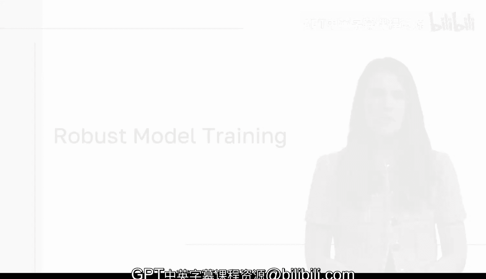
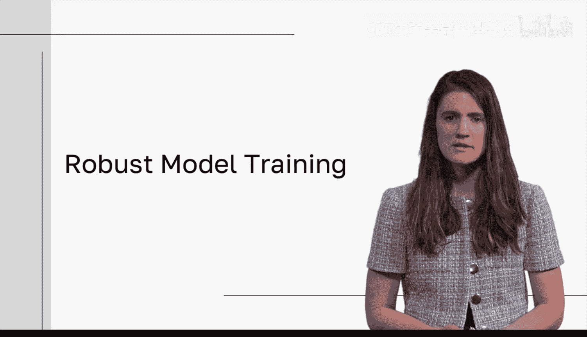
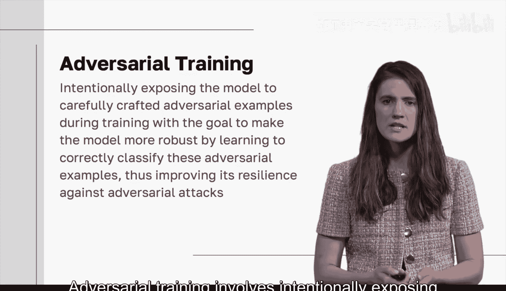
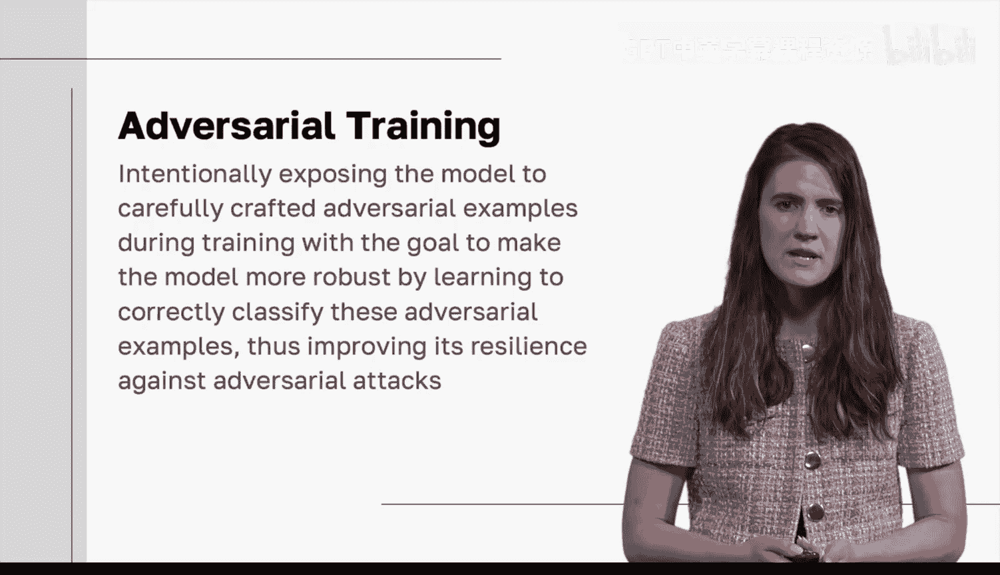
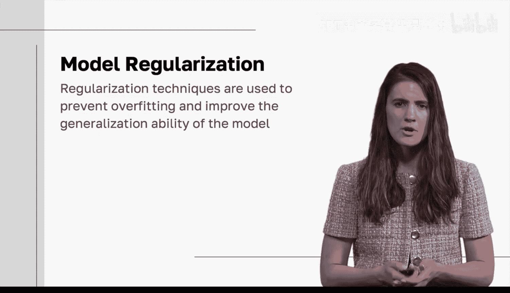
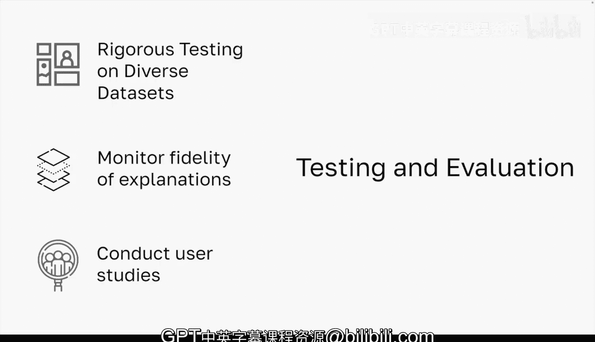

#  026：鲁棒模型训练 🛡️

在本节课中，我们将学习如何通过多种训练方法来增强可解释人工智能（XAI）系统的鲁棒性。鲁棒性是指模型在面对输入数据的小扰动、对抗性攻击或分布外样本时，仍能保持稳定和可靠的能力。增强鲁棒性对于构建可信赖的AI系统至关重要。

## 对抗性训练 ⚔️

上一节我们介绍了鲁棒性的重要性，本节中我们来看看具体方法。对抗性训练是一种旨在提升模型抵御对抗性攻击能力的技术。

其核心思想是在模型训练过程中，有意地让其接触精心构造的对抗性样本。目标是让模型学会正确分类这些对抗性样本，从而提高其对抗攻击的韧性。

对抗性训练可以形式化地表示为在损失函数中引入对抗性扰动项：
`损失函数 = 原始损失 + λ * 对抗性损失`
其中，λ 是控制对抗性训练强度的超参数。

## 模型正则化 📏

除了对抗性训练，模型正则化是另一种在训练中提升模型泛化能力和稳定性的重要方法。正则化技术主要用于防止过拟合，改善模型的泛化能力。

以下是几种常见的正则化方法：

*   **L1正则化（Lasso）**：其惩罚项等于模型系数绝对值的和。这倾向于产生稀疏模型，即许多系数会变为0。
    `惩罚项 = λ * Σ|w_i|`
*   **L2正则化（Ridge）**：其惩罚项等于模型系数平方的和。这倾向于让系数值变小但不为零。
    `惩罚项 = λ * Σ(w_i)^2`
*   **Dropout**：在训练过程中随机“丢弃”一部分神经元。在每个训练步骤中，每个神经元都有一定概率被暂时忽略。这迫使网络不过度依赖任何特定的神经元，从而促进冗余性。
*   **早停法**：当模型在验证集上的性能不再提升时，停止训练。这通过在模型泛化能力最佳的时刻停止训练来防止过拟合。

通过减少过拟合，XAI系统变得更加稳定，对输入数据中的微小扰动不那么敏感，从而提升了鲁棒性。

## 鲁棒优化技术 🎯

鲁棒优化技术旨在寻找能够在各种扰动或不确定性下优化性能的模型参数。这通常涉及在优化问题中引入额外的约束或目标项，以考虑最坏情况或对抗性扰动。

一个简化的鲁棒优化目标可以表示为：
`最小化 { 最大扰动在允许集合内 [ 损失(模型参数, 扰动数据) ] }`
这确保了模型在最坏情况的扰动下也能表现良好。

## 测试与评估 🔍

虽然前述方法可能不适用于我们讨论过的所有XAI方法，但接下来这一点对所有方法都至关重要，那就是进行严格的测试与评估。

在多样化的数据集上进行测试至关重要，这包括分布外数据和对抗性样本。我们可以通过敏感性分析或基于扰动的评估来量化和监控解释的保真度。

正如我们在上一节“评估”中讨论的，通过评估多次运行和不同输入下解释的一致性与保真度，并进行用户研究来评估解释的可理解性和实用性，我们可以识别XAI系统中潜在的漏洞、弱点或不一致之处。

---

本节课中我们一起学习了增强可解释人工智能系统鲁棒性的几种核心训练方法。我们介绍了**对抗性训练**以抵御恶意攻击，探讨了**模型正则化**技术（如L1/L2正则化、Dropout和早停法）来提升泛化能力和稳定性，概述了**鲁棒优化**的思想以应对不确定性，并强调了在多样化数据集上进行**严格测试与评估**的普遍重要性。综合运用这些策略，有助于构建出更稳定、更可靠、更值得信赖的AI系统。