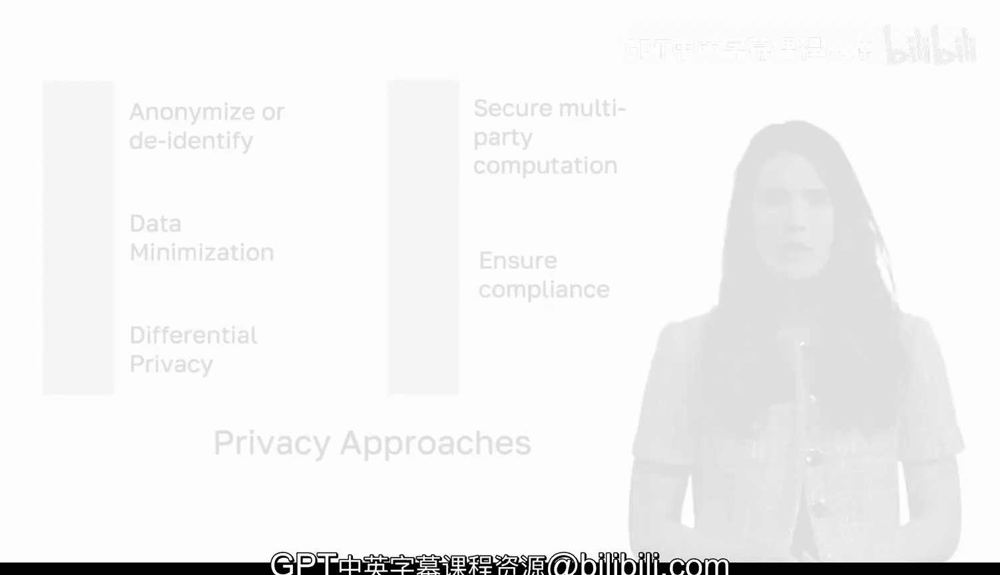
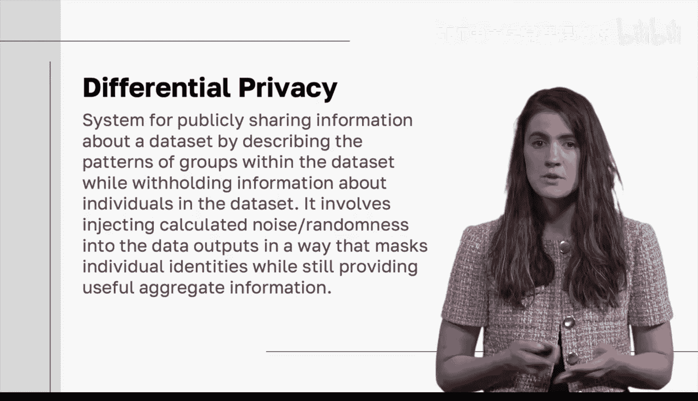
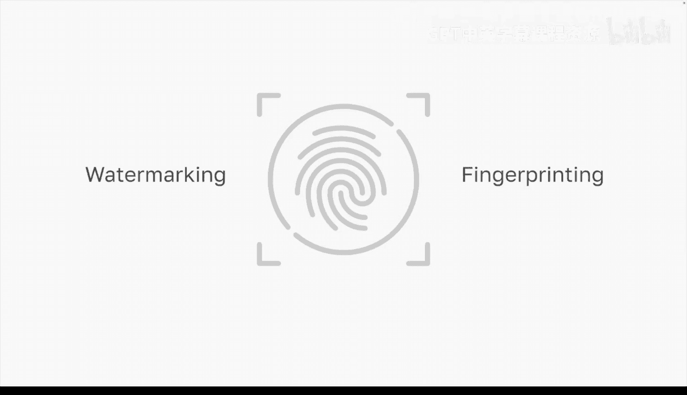
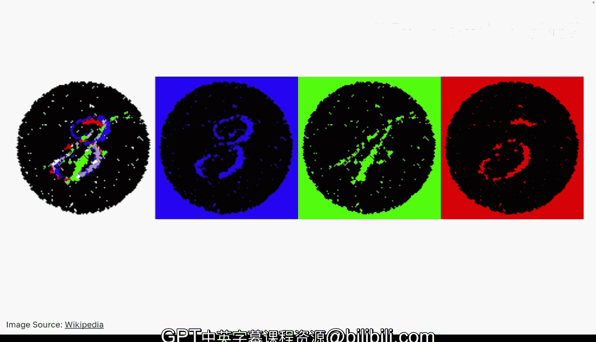

#  027：数据隐私与保护 🔒

在本节课中，我们将要学习可解释人工智能（XAI）系统中至关重要的数据隐私与保护问题。我们将探讨处理敏感数据时面临的挑战，并介绍几种核心的保护技术，包括数据最小化、差分隐私和安全多方计算。此外，我们还将了解如何通过水印、指纹和隐写术等技术来确保解释的完整性与来源可信。

---

可解释人工智能系统通常在敏感数据上运行，例如个人信息或专有数据，以生成解释。保护数据隐私的方法包括：在XAI系统处理之前对个人数据进行匿名化或去标识化。

实施数据最小化原则，实施隐私保护技术（如差分隐私或安全多方计算）以保护XAI系统使用的敏感数据，并确保遵守您公司、行业和应用领域的相关数据保护法规与指南。

上一节我们提到了数据隐私保护的重要性，本节中我们来看看几种具体的技术。以下是几种核心的数据隐私保护概念：

*   **数据最小化**：指仅收集、使用和保留完成特定目的所需的最少量的个人数据。它限制了敏感数据泄露和隐私侵犯的风险。在可解释AI的背景下，数据最小化协议将限制仅为绝对必要的目的而收集和使用个人数据进行模型训练和解释生成。任何AI功能运行所不需要的个人身份信息都将被移除或混淆。
*   **差分隐私**：是一种通过描述数据集中群体的模式并保留数据集中个体信息的方式，来公开共享数据集信息的系统。它涉及将计算出的噪声或随机性注入数据输出中，以掩盖个体身份，同时仍能提供有用的聚合信息。差分隐私可以应用于XAI系统使用的数据或生成的解释，以保护数据被使用的个体的隐私。通过向解释或中间计算添加受控噪声，差分隐私可以防止个体层面信息的泄露，同时仍能提供有意义的聚合解释。差分隐私在需要共享或分析数据同时保护数据集中个体隐私的场景中特别有用，例如人口普查数据、医疗记录或位置数据。
*   **安全多方计算**：是一种密码学技术，允许多方基于各自的私有数据输入联合计算一个函数，同时彼此之间以及任何第三方都无法获知这些输入。MPC可以通过允许不同方在不向彼此或第三方披露其私有数据的情况下，联合计算模型的解释，从而实现解释的安全计算。这在生成解释所需的数据分布在多个组织或方之间，且他们需要保持数据机密性的场景中非常相关。

---

除了数据隐私和保护，确保通信安全也很重要。这可以通过实施安全通信通道（如加密和数字签名）来防止解释在传输过程中被篡改或截获。

使用水印或指纹等技术也有助于确保解释的完整性和来源可信。

上一节我们讨论了保护数据本身的技术，本节中我们来看看如何保护解释本身。以下是两种用于确保解释完整性与来源的技术：

*   **水印**：是将一个独特的、不易察觉的标记或信号嵌入XAI系统生成的解释中的过程。此标记用作数字水印，类似于数字图像或文档中使用的水印。
*   **指纹**：是一种相关技术，涉及将唯一的识别标记或指纹嵌入XAI系统生成的解释中。与水印设计为不易察觉不同，指纹通常是可见的或易于从解释中提取。

水印和指纹技术都可以通过各种方法实现，例如在解释文本中嵌入特定模式或序列、修改解释的统计特性，或利用数字签名或隐写术等密码学技术。

---

这里，同一张图像在白光、蓝光、绿光和红光下观察，揭示了不同的隐藏数字。这是隐写术的一个例子。

隐写术是一种用于将秘密信息隐藏在另一种数字媒介（如文本或图像）中的非常有趣的技术。例如，在文本解释中，隐写术可用于将水印或指纹隐藏在文本本身中。这可以通过修改某些字符的最低有效位、调整文本的间距或格式，或使用行移编码或字移编码等技术来实现。隐藏的信息对人类读者来说是不可察觉的，但授权方可以使用适当的密钥或算法来检测和提取。

如果XAI系统生成视觉解释，例如显著图或注意力热图，有许多隐写术技术和变换可用于将水印或指纹嵌入图像数据中。这确保了XAI系统受到保护，免受未经授权方的篡改或操纵。

---

本节课中我们一起学习了可解释人工智能中数据隐私与保护的关键方面。我们探讨了**数据最小化**、**差分隐私**和**安全多方计算**这三种保护敏感数据核心隐私的技术。随后，我们了解了如何通过**水印**、**指纹**和**隐写术**来确保生成的解释在传输和存储过程中的完整性、真实性，并防止其被篡改。将这些技术结合起来，有助于构建更安全、可信且合规的可解释AI系统。