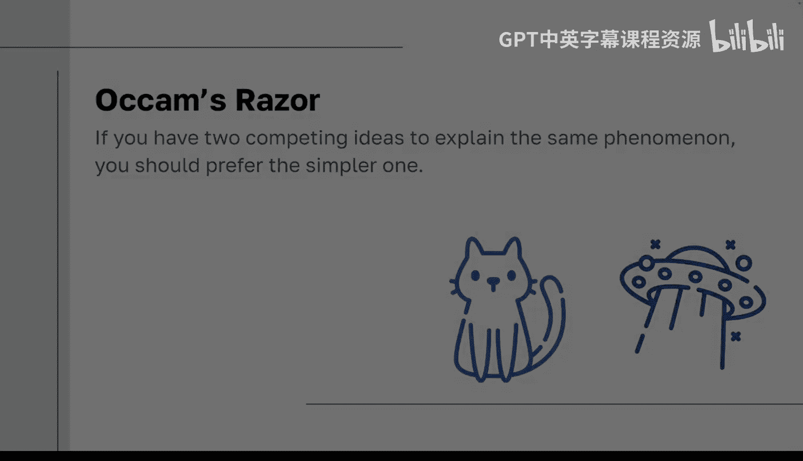

#  030：可解释机器学习导论

## 概述

在本节课中，我们将要学习可解释机器学习的基本概念、其重要性，以及它与可解释人工智能（XAI）的区别。我们将通过现实场景理解为什么模型的可解释性至关重要，并介绍几种核心的可解释机器学习模型。

---

## 为什么可解释性很重要？

我们通过几个场景来理解可解释机器学习的重要性。

以下是几个虚构但基于现实的例子：

*   **招聘场景**：你向一家使用AI算法筛选简历的公司投递了申请。尽管你的技能与职位描述完美匹配，但未被选中。招聘团队无法解释原因，因为模型只给出了结果。后来发现，模型在训练时使用了现有员工的简历，而许多员工简历中都有“玩地掷球”这项技能，你没有，因此被筛除，尽管这项技能与工作无关。
*   **金融场景**：你申请贷款被拒，尽管信用评分优秀。银行承认他们使用了AI算法处理申请，但无法解释拒贷的具体原因。
*   **医疗场景**：你到医院就诊，分诊AI算法根据你的社会经济状况（尽管工程师认为此数据不重要但未删除）将你排在队尾等待三小时，而患感冒的孩子却得到了即时诊治。

这些例子展示了不理解模型决策可能带来的严重后果。

一个真实的案例是：2023年，底特律警方使用人脸识别技术（一种计算机视觉机器学习模型）错误地将孕妇Portorsia Woodruff识别为劫车嫌犯并逮捕。他们无法确定模型为何识别出她的照片。

这些仅是模型决策缺乏透明度可能引发重大后果的几个例子。这也正是我们开始学习可解释机器学习的原因。

可解释机器学习的核心理念可以用柏拉图的一句话概括：**好的决策基于知识，而非数字**。

这是什么意思呢？我们可以绘制每月冰淇淋销量与每月鲨鱼袭击事件的图表。从纯数字角度看，两者似乎高度相关，你可能会得出结论：吃冰淇淋会导致鲨鱼袭击。

但在得出此结论时，我们忽略了知识——特别是关于季节性温度波动及其对人们吃冰淇淋和进入海洋行为影响的知识。因此，我们的结论截然不同：虽然这两件事相关，但我们知道其中一件并不会导致另一件发生。

---

## 可解释机器学习 vs. 可解释人工智能

在可解释人工智能（XAI）和可解释机器学习的语境下，**可解释机器学习**被定义为开发本质上可理解、能自我解释的机器学习模型。

这通常通过使用透明的建模技术来实现，例如：
*   **线性回归**
*   **决策树**
*   **基于规则的模型**

可解释机器学习背后的主要思想是，允许模型的内部逻辑和决策过程无需额外解释方法即可被理解。

可解释机器学习与可解释人工智能（XAI）有重叠，但并非完全相同。

*   **可解释机器学习**：专注于开发本质上可解释或能自我解释的机器学习模型和技术。例如线性/逻辑回归、决策树和基于规则的模型。目标是使模型本身透明易懂，无需额外解释。
*   **可解释人工智能（XAI）**：是一个更广泛的领域，旨在使任何AI系统（包括不透明的深度学习模型）更具可解释性。它涉及开发技术来解释“黑盒”AI模型训练后的输出和决策。例如SHAP、LIME、显著性图和概念激活向量。目标是为现有模型的行为生成事后解释。

简而言之：
*   可解释机器学习**从一开始就专注于本质透明的模型**。
*   XAI**专注于事后解释先前训练的复杂模型**。

可解释机器学习是更广泛的XAI领域的一个子集。这两个领域相互关联，经常结合使用，因为即使是可解释模型也可能需要额外解释，而复杂模型可以通过XAI方法变得更可解释。

---

## 可解释机器学习模型示例

上一节我们介绍了可解释机器学习的定义及其与XAI的区别，本节中我们来看看几种具体的可解释机器学习模型。我们将在本模块后续课程中深入探讨它们。

以下是几种主要的可解释模型类型：

1.  **线性模型**
    *   如**线性回归**和**逻辑回归**，具有高度可解释性，因为其预测基于输入特征的加权和。系数直接表明了每个特征的重要性和方向性。
    *   强制稀疏性（例如通过Lasso或弹性网络正则化）可以通过将无关特征的系数驱动至0来增强可解释性，这实质上执行了特征选择。

2.  **广义可加模型**
    *   试图解决线性回归的一些问题。例如，**广义可加模型**将线性模型与非线性特征变换相结合，同时保持可加且可解释的结构，显示每个特征如何影响预测。

3.  **决策树**
    *   如CART，本质上是可解释模型。其“如果-那么-否则”的层次化树状结构提供了一种自然的方式来追踪基于特征值如何对不同实例做出预测。

4.  **基于规则的模型**
    *   以人类可读的规则形式编码知识，例如：`如果 年龄 > 65 且 用药 = X，那么 风险 = 高`。规则提取技术也可用于学习近似黑盒模型行为的可解释规则。

5.  **本质可解释的神经网络**
    *   **基于原型的网络**（如ProtoPNet）将原型或示例整合到神经网络中。
    *   **单调约束**（如本课程将探讨的单调神经网络架构所用）确保模型预测随着特征变化而沿一致方向变化，符合人类直觉。
    *   **新表示网络**（如KAN）使用样条表示等替代权重的方法，在牺牲一些灵活性的同时提升可解释性。

这些可解释机器学习方法在医疗保健、金融和关键决策系统等领域极具价值，因为在这些领域，能够理解和检查模型推理过程至关重要。

这是一个非穷举列表。其他本质上可解释的机器学习模型还包括贝叶斯模型、K近邻和线性判别分析。

在当前生成式AI成果令人眼花缭乱的背景下，许多问题仍可使用可解释模型解决。我建议在评估用例模型时，将可解释模型纳入考虑范围。

---

## 奥卡姆剃刀原则

我在课堂教授AI和用AI构建产品时实践的一个原则是**奥卡姆剃刀原则**。

奥卡姆剃刀指出：**如果你有两个相互竞争的理论能解释同一现象，应选择更简单的那个**。

例如，你在半夜听到声响，形成两个假设：
1.  你的猫把东西从桌上碰掉了。
2.  外星人降落在你的屋顶，正在入侵你的房子。

根据奥卡姆剃刀，你应该倾向于两个假设中更简单的那个——你的猫碰掉了东西。

在AI的语境下，**如果你有两个AI模型在你的评估标准上表现相似，你应该倾向于更简单、更可解释的那个**。至少，你应该始终考虑最简单的方法，并提供为何需要更复杂方法的理由。

---

## 总结

本节课中我们一起学习了可解释机器学习的基础。我们了解了模型缺乏可解释性在招聘、金融、医疗等领域可能带来的现实风险，从而认识到其重要性。我们明确了**可解释机器学习**（开发本质透明的模型）与更广泛的**可解释人工智能**（为任何AI系统提供解释）之间的区别。我们介绍了几类核心的可解释模型，如线性模型、决策树和基于规则的模型。最后，我们引入了**奥卡姆剃刀原则**，强调在模型性能相近时，应优先选择更简单、更可解释的解决方案。理解这些概念是构建可靠、可信赖AI系统的第一步。