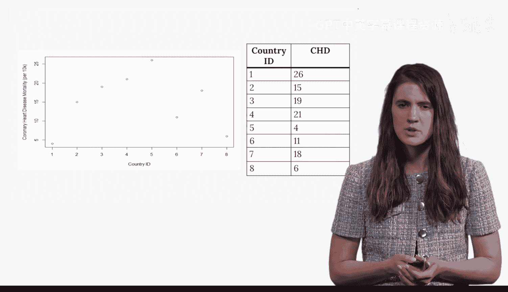
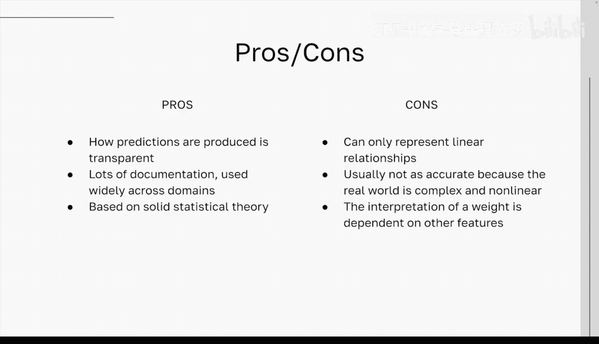

#  031：线性回归 📈

在本节课中，我们将学习线性回归的基本概念、工作原理及其在可解释人工智能中的应用。我们将从一个模拟数据集出发，逐步理解线性回归的各个组成部分，包括如何寻找最佳拟合线、理解残差，以及如何将模型扩展到多个变量。

---

## 数据与变量关系

我们将使用一个基于“七国研究”的模拟数据集来探讨线性回归的各个组成部分。该研究旨在考察全球范围内影响心血管疾病的因素。

首先，考虑冠状动脉心脏病死亡率与国家任意分配的ID之间的关系。由于ID列是任意选择的，我们预计它与死亡率之间没有强关联。散点图证实了这一假设，两列数据之间不存在强烈的线性关系。

## 残差与误差平方和

为了量化数据点与假设直线（斜率为0，表示无关系）之间的差异，我们计算了每个数据点到该直线的垂直距离，这些距离被称为**残差**。在直线上方的点残差为正，下方的点为负。

残差的计算公式为：
`残差 = 观测值 (y) - 预测值 (ŷ)`

将所有残差相加，正负残差之和为零。为了衡量总体误差而不受正负号影响，我们将每个残差进行平方，然后求和，得到**误差平方和**。

误差平方和 (SSE) 的公式为：
`SSE = Σ(观测值 - 预测值)² = Σ(yᵢ - ŷᵢ)²`

线性回归的目标就是找到一条直线，使得这个误差平方和最小。

## 简单线性回归与最佳拟合线

上一节我们探讨了无关系变量的情况，本节我们来看一个存在关系的变量：吸烟（该国成年人日均香烟消费量）。散点图显示，冠状动脉心脏病死亡率与吸烟量之间存在强烈的线性关系。

在简单线性回归中，我们尝试多条直线，并计算每条直线对应的误差平方和。具有最小误差平方和的那条直线被称为**最佳拟合线**。寻找这条线的过程称为**普通最小二乘法**。

其核心公式为：
`y = β₀ + β₁x + ε`
其中，`y`是因变量（响应变量），`x`是自变量（预测变量），`β₀`是截距，`β₁`是斜率，`ε`是随机误差项。

## 模型解释与预测

回到我们的例子，最佳拟合线的方程确定为 `y = 0.25 + 2.41x`。

*   **斜率解释**：`β₁ = 2.41` 表示，成年人日均香烟消费量每增加一个单位，冠状动脉心脏病死亡率的预期变化为增加2.41个单位。
*   **预测**：对于一个日均香烟消费量为20的国家，其预期死亡率为 `0.25 + 2.41 * 20 = 48.45`。

## 多元线性回归

简单线性回归处理一个预测变量。但在现实中，结果可能受多个因素影响，例如人口平均年龄、饱和脂肪摄入量、每日运动量等。这时就需要用到**多元线性回归**。

多元线性回归的原理与简单线性回归相同，但它拟合的是一个超平面，而非一条直线。其方程扩展为：
`y = β₀ + β₁x₁ + β₂x₂ + ... + βₚxₚ + ε`
现在，每个预测变量 `xⱼ` 都有自己对应的回归系数 `βⱼ`。

## 线性回归的可解释性

线性回归固有的可解释性使我们能够理解模型如何进行预测，以及哪些特征对输出最重要。

*   **系数解释**：系数 `β` 的**符号**表示特征与目标变量是正相关还是负相关。系数的**大小**表示该关系的强度，值越大影响越强。
*   **特征类型**：
    *   **数值特征**：`x` 增加一个单位，估计结果变化 `β`。
    *   **二值特征**：`x` 从0变为1，估计结果变化 `β`。
    *   **分类特征**：通常进行独热编码后，每个类别作为二值特征处理。
*   **特征重要性**：可以通过特征的 **t 统计量**的绝对值来计算。t 统计量是估计权重除以其标准误差。权重越大、方差越小（即估计越确定），特征通常越重要。

## 可视化理解模型

为了更好理解模型，我们可以使用两种常见的可视化方法：

以下是两种主要方式：
1.  **权重图**：直接展示每个特征的系数（权重）及其置信区间。
2.  **效应图**：展示每个特征对单个预测实例的贡献。效应计算为 `特征权重 × 实例的特征值`。这有助于理解单个预测的构成，并与整体模型进行比较。

## 线性回归的假设与挑战

线性回归依赖于一系列统计假设，在现实世界中这些假设常常被违背，这也是其一大挑战。

以下是线性回归的一些核心假设：
*   **线性**：因变量与自变量之间的关系是线性的。
*   **独立性**：观测值之间相互独立。
*   **同方差性**：残差的方差在所有自变量水平上保持恒定。
*   **正态性**：残差服从正态分布。
*   **无多重共线性**：自变量之间不应高度相关。
*   **无自相关**：残差之间没有相关性。
*   **无内生性**：自变量与误差项不相关。
*   **模型设定正确**：没有遗漏相关变量。

当数据违反这些假设时，线性回归的结果可能不可靠，此时需要考虑使用其变体或其他模型。

## 处理高维特征：稀疏性

在实际应用中，特征数量可能成百上千。更可解释的模型通常特征更少。引入**稀疏性**（即减少特征数量）是一个常用方法。

最流行的方法之一是 **Lasso 回归**。它在线性回归模型上施加惩罚，使许多不重要的特征的系数收缩至零，从而实现特征选择，得到一个更简洁、更可解释的模型。

## 线性回归的优缺点总结

本节课中，我们一起学习了线性回归作为可解释机器学习模型的核心内容。

**优点**：
*   **透明**：预测生成过程透明，易于人类理解。
*   **成熟**：有大量文档和广泛的应用领域，社区支持强大。
*   **理论基础扎实**：基于坚实的统计理论。

**缺点**：
*   **仅限于线性关系**：无法有效捕捉复杂的非线性关系，因此在真实世界的预测准确性可能不足。
*   **系数解释依赖其他特征**：某个特征的权重解释依赖于模型中包含的其他特征。

尽管存在局限，线性回归因其简单性和可解释性，仍然是数据分析和模型构建的基石工具。