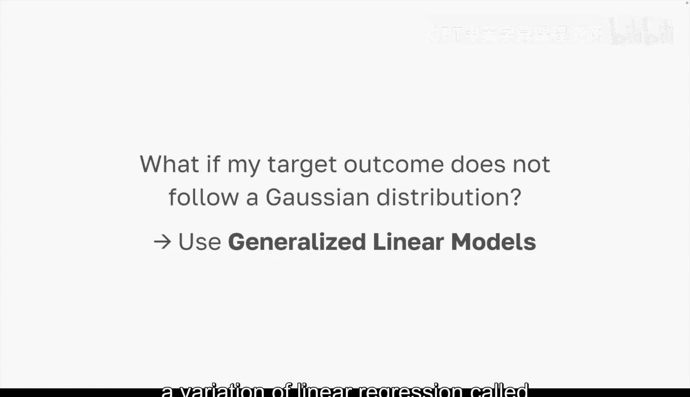
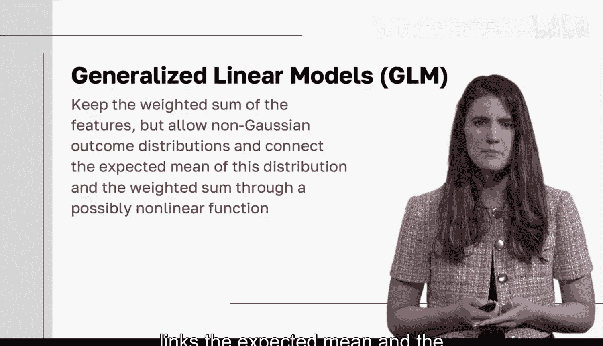
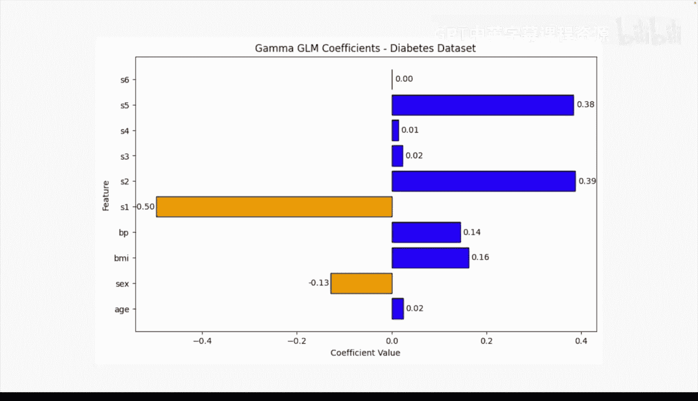
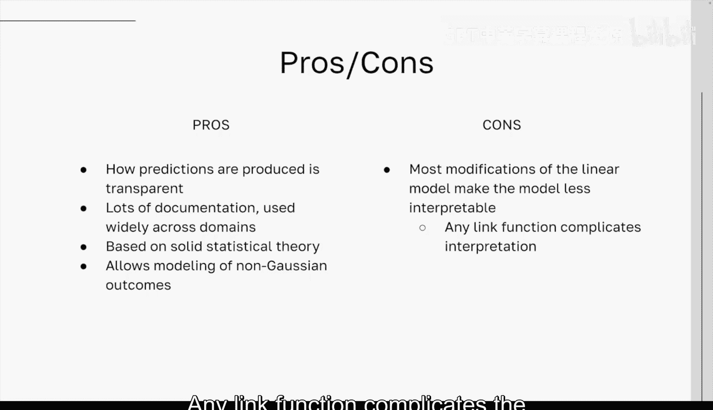

#  033：广义线性模型 📊

在本节课中，我们将要学习线性回归的一个扩展模型——广义线性模型。我们将了解它如何解决线性回归的局限性，以及它在可解释机器学习中的应用。

## 概述

线性回归存在一个问题，即其正态性假设。线性回归假设在给定特征的情况下，目标结果服从高斯分布。这个假设排除了许多情况，例如当结果是类别时（如糖尿病前期与健康），或计数结果（如猫的数量），或事件发生的时间，或具有极少数高值的偏态结果（如家庭收入）。

如果你的目标结果不服从高斯分布，你可以使用线性回归的一个变体，称为广义线性模型。GLM背后的核心思想是，你保留特征的加权和，但允许非高斯的结果分布，并通过一个可能非线性的函数，将这个分布的期望均值与加权和连接起来。

## GLM的核心思想与公式

我们已经见过一个GLM的例子。逻辑回归就是一个流行的GLM实例。逻辑回归假设结果服从伯努利分布，并使用逻辑函数将期望均值与加权和联系起来。

以下是GLM方程的一般形式。该方程包含三个组成部分：
1.  **链接函数**，记作 **G**。
2.  **加权和** `x^T β`，这是线性回归方程。
3.  一个来自指数族的**概率分布**，它定义了 **E[Y]**，即结果Y的期望。

用公式可以表示为：
**G(E[Y]) = x^T β**

逻辑回归模型就是一个GLM，它假设伯努利分布并使用逻辑函数作为链接函数。逻辑回归中使用的二项分布的均值是y等于1的概率。

## 模型解释与示例

假设的分布与链接函数共同决定了如何解释估计的特征权重。关于这一点，可以回顾逻辑回归的课程内容。

以下是一个来自糖尿病数据集的特征系数示例，以SHAP图的形式可视化。你将在代码演示中学习如何实现此操作。

## 广义线性模型的优缺点评估

现在，我们来评估广义线性模型在可解释机器学习中的优缺点。

以下是其主要优点：
*   **透明性**：与线性回归一样，其预测的产生过程是透明的，易于人类理解。
*   **广泛支持**：有大量关于GLM的文档，并且它在各个领域被广泛使用，因此有一个庞大的用户社区。
*   **理论基础**：GLM基于坚实的统计理论。
*   **适用性广**：GLM允许对非高斯结果进行建模，使其更适用于现实世界的应用。

然而，它也存在一些缺点：
*   **解释性降低**：对线性模型的大多数修改都会降低模型的可解释性。任何链接函数都会使解释复杂化，正如我们在逻辑回归中看到的那样。

## 总结

本节课中，我们一起学习了广义线性模型。我们了解到GLM通过引入链接函数和允许非高斯分布，克服了标准线性回归的正态性假设限制，从而能够处理更广泛的现实问题，如分类和计数数据。虽然这增强了模型的适用性，但也使得模型系数的解释比标准线性回归更为复杂。理解其核心公式 **G(E[Y]) = x^T β** 是掌握GLM工作原理的关键。