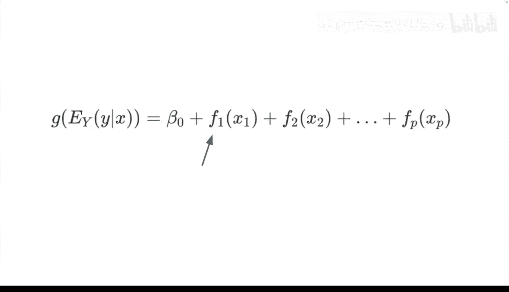
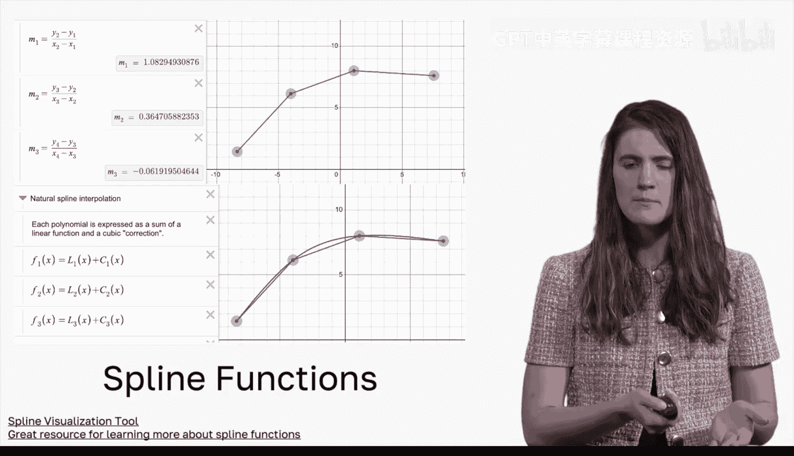
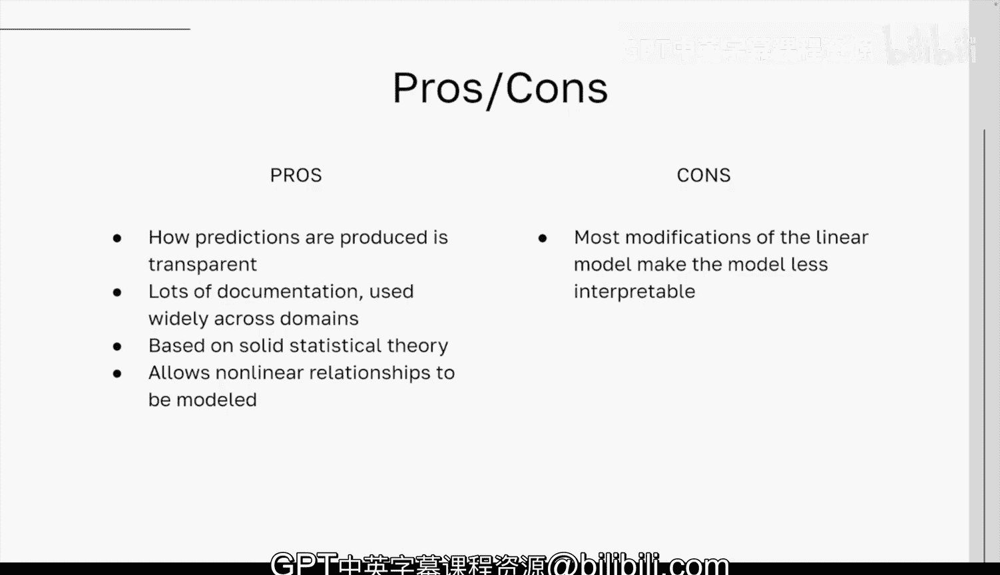

#  034：广义可加模型 (GAMs) 🧩

在本节课中，我们将要学习广义可加模型。我们将探讨线性回归在处理非线性关系时的局限性，并介绍一种更灵活的模型——广义可加模型，它允许特征与输出之间存在非线性关系，同时保持了模型的可解释性。

## 线性回归的局限性

上一节我们介绍了线性模型的基础。线性回归存在一个问题，即其线性假设。线性回归假设特征与结果之间的真实关系是线性的。但我们知道，大多数现实世界的应用场景并非线性。

如果我们的特征与结果之间的关系不是线性的，我们有哪些选择？以下是几个选项：
*   我们可以对特征进行转换，例如取其对数。
*   我们可以将特征进行分箱处理。
*   或者，我们可以使用**广义可加模型**。

## 广义可加模型 (GAMs) 的直觉

广义可加模型背后的直觉相当简单。GAMs 假设结果可以通过每个特征的任意函数之和来建模。GAM 仍然是特征效应的总和，但它现在提供了允许某些特征与输出之间存在非线性关系的选项，同时线性效应依然适用。

当特征与输出之间的关系是线性时，函数 `F_j(x_j)` 就取我们熟悉的形式 `x_j * β_j`。其公式应该看起来很熟悉，我们现在只是用函数 `f_j` 替换了权重 `β_j`。

**公式：**
`g(E[Y]) = β_0 + f_1(x_1) + f_2(x_2) + ... + f_p(x_p)`

## 如何学习非线性函数：样条函数

我们如何学习这些非线性函数呢？这通常通过**样条函数**来实现。样条由更简单的基础函数构造而成，用于逼近更复杂的函数。

如下图所示，这条曲线就是使用一组三个简单的线性函数进行逼近的结果。对于希望深入了解的读者，我在资源部分附上了一个链接，其中包含关于样条函数的优秀阅读材料。

## 广义可加模型的优缺点

现在，让我们来评估广义可加模型在可解释机器学习方面的优缺点。

与线性回归和广义线性模型一样，GAMs 的预测生成过程是透明的，这使得人类易于理解。此外，关于 GAMs 有大量的文档，并且它在各个领域被广泛使用，因此有一个庞大的用户社区。

GAMs 也建立在坚实的统计理论基础上。最重要的是，GAMs 允许对非线性的特征-结果关系进行建模，这使它们更适用于现实世界的应用。

然而，与广义线性模型类似，对线性模型的大多数修改都会降低模型的可解释性，这是我们需要深思熟虑的一点。

## 总结

本节课中，我们一起学习了广义可加模型。我们首先指出了线性回归在处理非线性关系时的不足，然后介绍了 GAMs 如何通过将每个特征的影响建模为非线性函数之和来克服这一限制，同时保持了模型的可解释性。我们还简要了解了用于构建这些非线性函数的样条技术，并讨论了 GAMs 的主要优点和需要注意的方面。