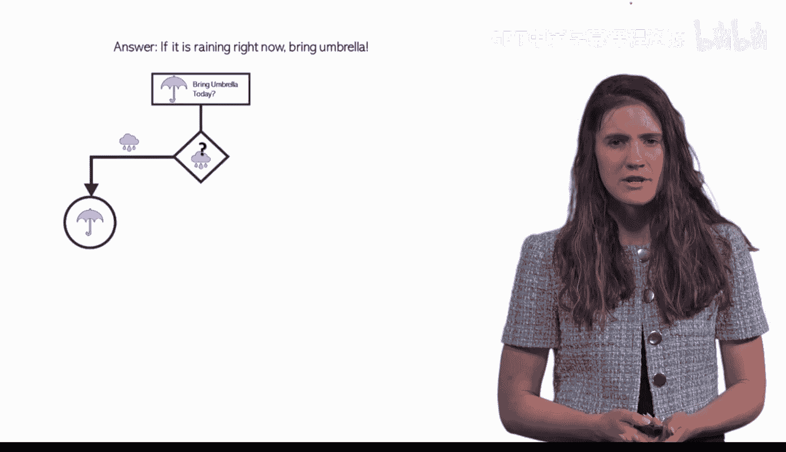
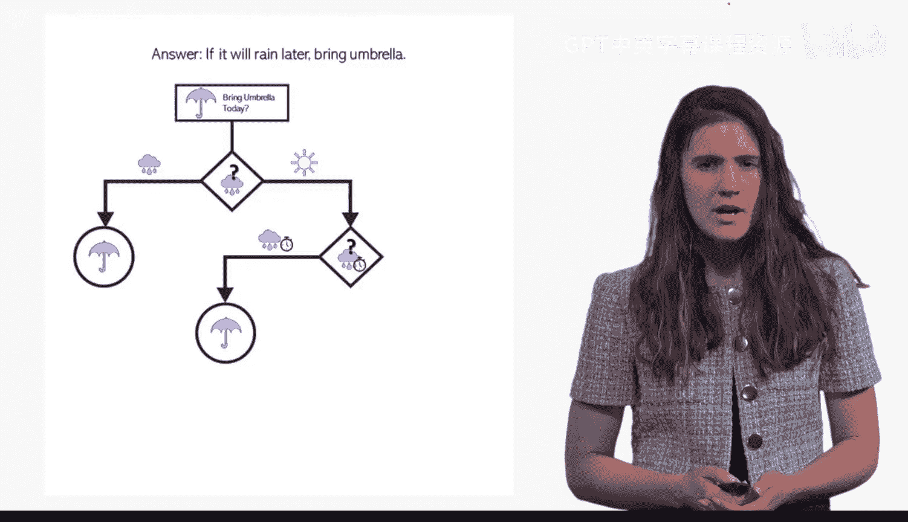
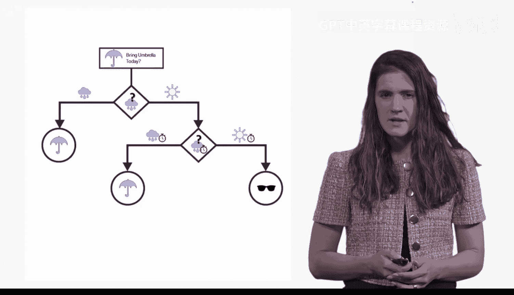
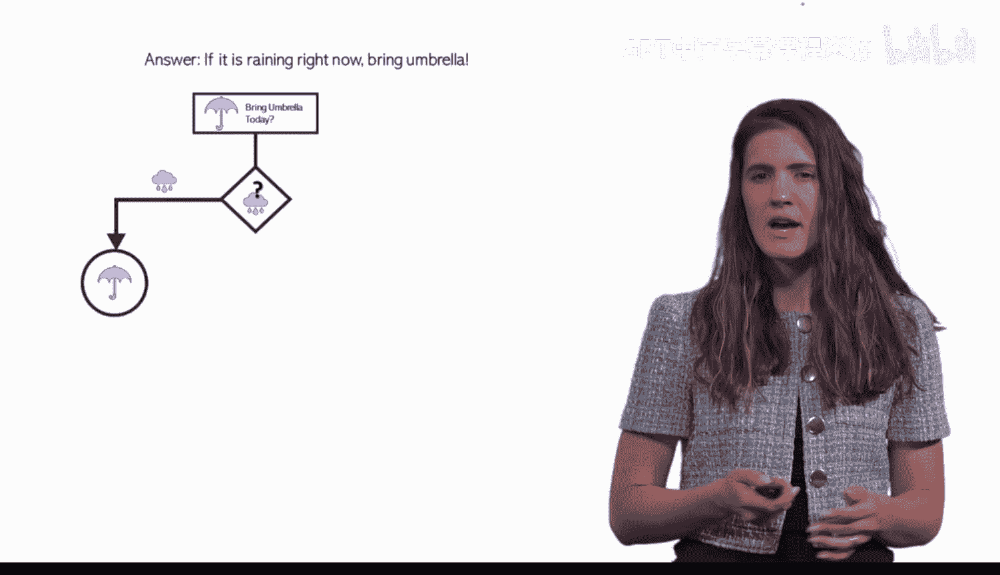
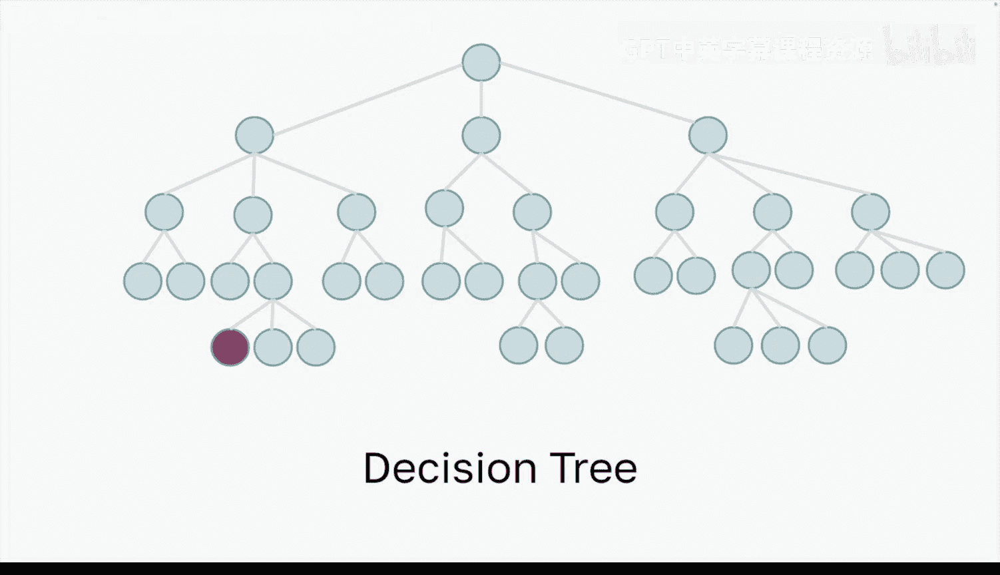
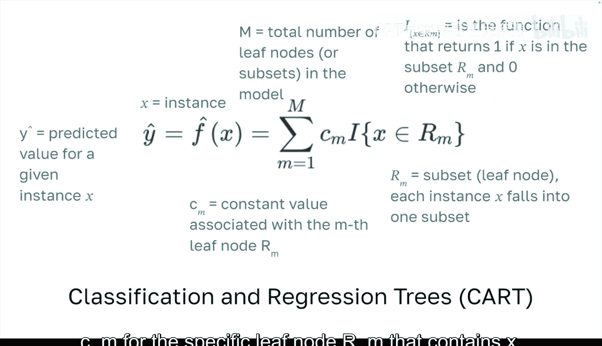
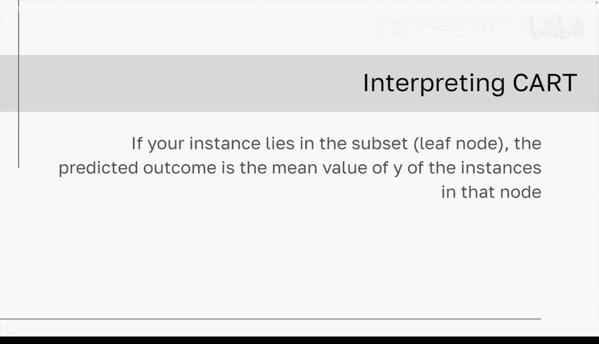
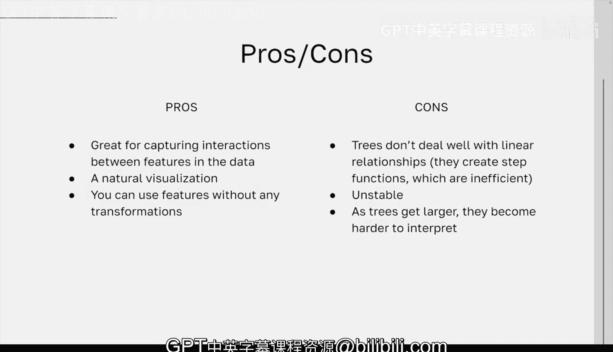

#  035：决策树 🌳

在本节课中，我们将学习决策树模型的基本原理、工作方式及其在可解释人工智能中的应用。决策树是一种直观且易于理解的模型，它通过一系列基于特征的判断来做出预测。

---

通过一个日常决策的例子，可以非常容易地理解基于树模型的直观思想。例如，“我今天应该带伞吗？”这个问题，可以用下图所示的决策过程来阐释。

你首先问：“现在正在下雨吗？”如果是，就带伞。如果是晴天，你接着问：“稍后会下雨吗？”如果会，就带伞；如果不会，就不带。

基于树模型就是以这种直观的方式工作的。它们根据特征的特定阈值多次分割数据，通过这种分割创建数据集的不同子集，每个实例都属于其中一个子集。中间的子集位于内部节点或分割节点。终端节点，也称为叶节点，是最终的子集，它们告诉你是否应该带伞。

为了预测每个叶节点的结果，会使用该节点中训练数据的平均结果。由于其直观性和可解释性，基于决策树的模型可用于分类或回归任务。决策树在许多领域被广泛使用。

虽然决策树有多种算法，但最广为人知的无疑是CART算法，即分类与回归树算法。以下是CART算法的公式表示。

如果 `x` 是我们的实例，`ŷ` 是给定实例 `x` 的预测值，对于 `M` 个叶节点中的每一个 `R_m`，我们将常数 `c_m`（叶节点中的目标平均值）乘以一个指示函数 `I(x ∈ R_m)`。该指示函数在 `x` 属于叶节点 `R_m` 时为1，否则为0。这样，求和运算实际上为包含 `x` 的特定叶节点 `R_m` 选取了常数 `c_m`，从而得到预测值 `ŷ`。

**公式：**
`ŷ = Σ_{m=1}^{M} c_m * I(x ∈ R_m)`

CART算法的实现从根据特征值将数据分割成不同子集开始。CART算法确定一个特征的切割点，该切割点能最小化目标变量的方差（用于回归）或基尼指数（用于分类）。方差衡量目标值在节点均值周围的分散程度。基尼指数衡量节点的不纯度或类别分布。

这个分割过程在每个节点递归进行。算法根据某个标准（如分类的基尼不纯度或回归的均方误差）选择最佳特征和该特征的最佳值来分割数据。

在CART算法的回归任务中，使用均方误差作为标准，因为它直接通过最小化MSE来衡量子集内的方差。通过最小化MSE，算法有效地最小化了每个子集内目标值的方差，从而得到更同质和更准确的预测。

递归分割会持续进行，直到满足停止标准，例如达到最大树深度、节点中实例数量达到最小值，或者进一步分割不能显著减少不纯度或方差。

一旦树构建完成，每个叶节点 `R_m` 包含一部分训练实例。对于回归树，落入叶节点 `R_m` 的实例 `x` 的预测值 `ŷ`，是 `R_m` 中训练实例目标值的平均值。

---

上一节我们介绍了CART算法的构建过程，本节中我们来看看如何解释CART模型。

如果你的实例位于某个叶节点子集中，预测结果就是该节点中所有实例 `y` 的平均值。如果我们想检查特征重要性，我们会查看所有使用了该特征的分割，并衡量与父节点相比，它减少了多少方差或基尼指数。所有重要性的总和被缩放到100，因此每个重要性可以解释为整体模型重要性的份额。

我们还可以分解我们的树。你可以跟踪一个决策在树中的路径，并通过在每个决策节点添加的贡献来解释一个预测。一个实例的预测是目标均值加上从根节点到终端节点的所有分割贡献之和。请注意，我们感兴趣的是特征贡献，而不是分割贡献，并且一个特征可能被用于多次分割，或者一次也不用。我们可以对每个特征的贡献求和，这提供了一种解释，说明每个特征对预测贡献了多少。

---

了解了决策树的构建和解释后，我们来评估一下它在可解释机器学习中的优缺点。

以下是决策树的主要优点和缺点：

*   **优点**：基于树的模型非常擅长捕捉特征之间的交互作用；它们提供了自然直观的可视化；你可以直接使用特征而无需任何转换。
*   **缺点**：树模型不擅长处理线性关系，它们会创建阶梯函数，这对于线性关系来说是低效的。它们也不稳定，训练数据集的微小变化可能产生完全不同的树。这是因为每次分割都依赖于父节点的分割。如果选择不同的特征作为第一次分割的特征，整个树结构都会改变。此外，随着树变得更大，它们会变得更难解释。

---

本节课中我们一起学习了决策树模型。我们了解了其直观的工作原理、CART算法的构建与预测公式、如何解释模型预测和特征重要性，以及模型的优缺点。决策树因其结构清晰、易于可视化而成为可解释人工智能中的重要工具。