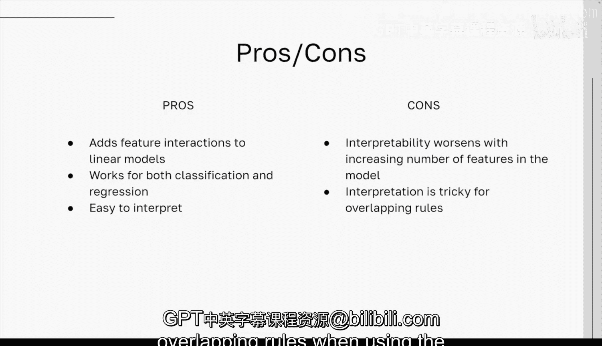

#  038：规则拟合 📚

在本节课中，我们将要学习一种结合了决策树与线性模型优势的算法——规则拟合。我们将了解其工作原理、具体步骤以及优缺点。

## 概述

规则拟合通过从决策树集成中生成规则，然后在这些规则上拟合一个稀疏线性模型，从而将决策树与线性模型结合起来。

## 算法简介

规则拟合算法于2008年被提出。一个有趣的事实是，这篇论文是一篇开创性的论文，也向我们介绍了一些可解释人工智能技术，例如特征重要性和部分依赖图。

直观地说，规则拟合学习一个包含原始特征的稀疏线性模型，同时模型中还包含许多作为决策规则的新特征。

## 核心概念

作为决策规则的新特征能够捕捉原始特征之间的交互作用。这些特征是通过训练用于预测目标结果的决策树生成的。

树中的每条路径都可以通过将分裂决策组合成一条规则来转换为决策规则。原始论文中的这张图展示了一棵决策树。每个节点对应的规则由从根节点到该节点路径上所有边相关的指示函数乘积给出。

决策规则是二元特征，其中 `1` 表示规则的所有条件都满足，否则为 `0`。

## 算法步骤

规则拟合算法过程涉及两个步骤。

### 第一步：规则生成

以下是规则生成的具体过程：
*   **规则构造**：规则通过分解决策树来构造，其中到每个节点的路径通过用“与”连接二元决策而成为一条规则。
*   **树拟合**：树被拟合以预测目标结果。因此，分裂和产生的规则都针对该预测任务进行了优化。
*   **规则创建**：通过组合导致每个节点的条件，从集成中的所有树创建规则。

关于这一步的一些说明：
*   任何树集成算法，如装袋法、随机森林、AdaBoost 或 MART，都可用于为规则拟合生成树。
*   规则拟合不仅从叶节点提取规则，还从树中的所有节点提取规则。
*   一个技巧是学习具有随机深度的树，以创建不同长度的规则并增加多样性。

### 第二步：创建稀疏线性模型

上一节我们介绍了如何从决策树中生成规则，本节中我们来看看如何利用这些规则构建最终的预测模型。

首先，将生成的规则与原始特征组合成一个新的特征矩阵。然后，在这个组合特征矩阵上使用 Lasso 训练一个稀疏线性模型。在包含原始特征之前，会对它们进行缩尾处理和标准化。

缩尾处理指的是一种数据转换技术，其中数据中的极值或异常值被替换为指定的百分位数值。具体来说，在规则拟合算法的上下文中，它意味着对于每个原始特征，低于 δ 分位数的值被替换为 δ 分位数值，高于 1-δ 分位数的值被替换为 1-δ 分位数值。

例如，如果 `δ = 0.05`，那么特征中处于底部 5% 的任何值都被设置为第五百分位数值，而处于顶部 5% 的任何值都被设置为第 95 百分位数值。这种缩尾处理有助于减少极端异常值对线性模型拟合过程的影响，使其更加稳健。它是直接删除完整异常数据点的一种替代方法。

关于这一步的一些说明：
*   线性模型对原始特征和规则都有影响。
*   Lasso 强制某些权重为 0，从而减少了规则数量。

## 模型解释

规则拟合的可解释性取决于你执行的是回归还是分类任务。

在回归的情况下，解释与线性回归模型相同。对于作为二元特征的决策规则，如果决策规则 `R_k` 的所有条件都适用，则预测结果会改变 `α_k`，这是线性模型中规则 `R_k` 的学习权重。

对于分类，解释与逻辑回归模型相同。如果决策规则 `R_k` 的所有条件都适用，则事件发生与不发生的几率会改变 `α_k` 倍。

我之前说线性回归是许多可解释机器学习方法的基础，并非玩笑。

## 优缺点评估

让我们评估一下规则拟合在可解释机器学习方面的优缺点。

规则拟合的优点如下：
*   它为线性模型添加了特征交互。
*   它适用于分类和回归。
*   它易于解释。

然而，规则拟合也存在一些缺点：
*   正如我们之前讨论过的，随着模型中特征数量的增加，可解释性会变差。该模型中的特征通常更多，使其本质上可解释性较差。
*   当使用规则拟合算法进行可解释性分析时，对于重叠规则的解释可能比较棘手。

## 总结

本节课中我们一起学习了规则拟合算法。我们了解到，它通过从决策树集成中提取规则，并将其与原始特征一同输入到一个稀疏线性模型中，巧妙地结合了树模型捕捉复杂交互的能力与线性模型易于解释的优点。尽管在处理大量或重叠规则时解释性会面临挑战，但规则拟合仍然是构建兼具预测性能和一定可解释性模型的有力工具。