#  039：神经网络可解释性 🧠

在本节课中，我们将要学习神经网络的可解释性。通常，神经网络被视为典型的“黑箱”机器学习模型。然而，研究界已投入大量努力来提升神经网络的可解释性，并设计本质上可解释的模型。

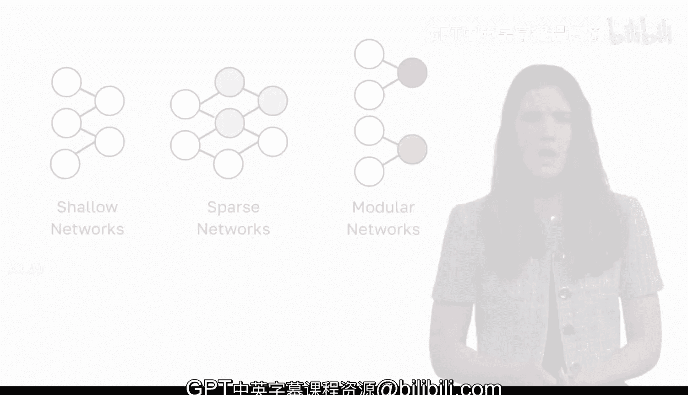

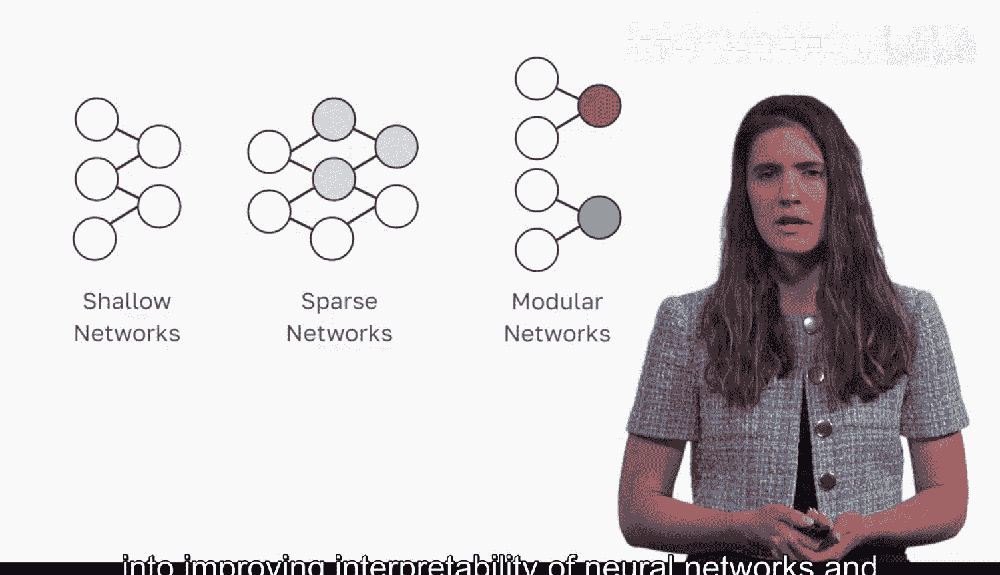

## 提升神经网络可解释性的形式

上一节我们提到了神经网络可解释性的重要性，本节中我们来看看提升可解释性的几种具体网络架构形式。

以下是三种主要的改进形式：

*   **浅层神经网络**：这是一种层数和节点数较少的简单架构。与更深、更复杂的模型相比，它通常更易于解释，因为输入与输出之间的关系更为明显。
*   **稀疏神经网络**：这类模型通过剪枝或将许多网络连接权重设置为0来实现稀疏性。由于保留下来的连接代表了最重要的特征，因此模型可能更具可解释性。
*   **模块化神经网络**：这类模型由专门化的子组件构成，例如分别负责物体检测、分类或推理的模块。与单一的整体架构相比，这种模块化设计可能更易于理解。

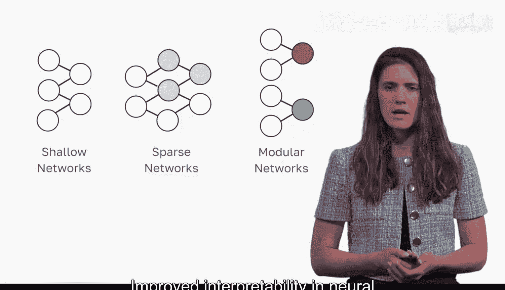

## 本质可解释的神经网络

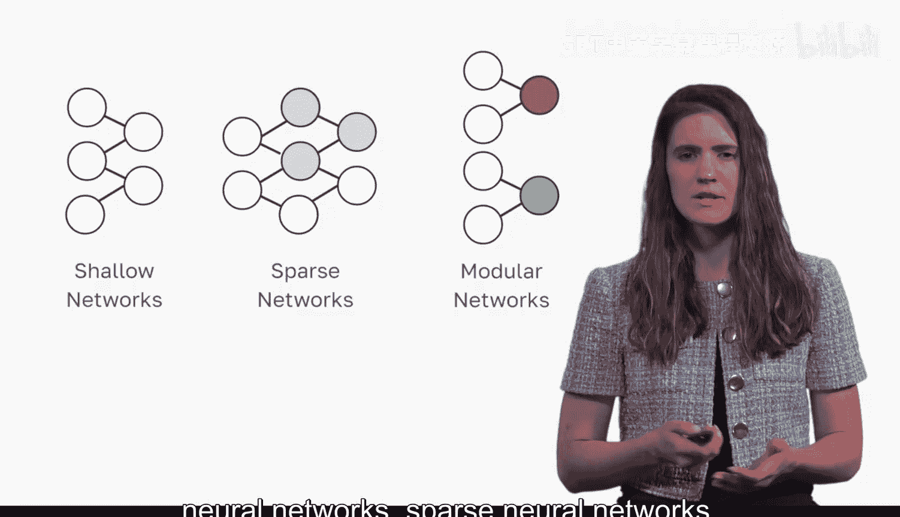

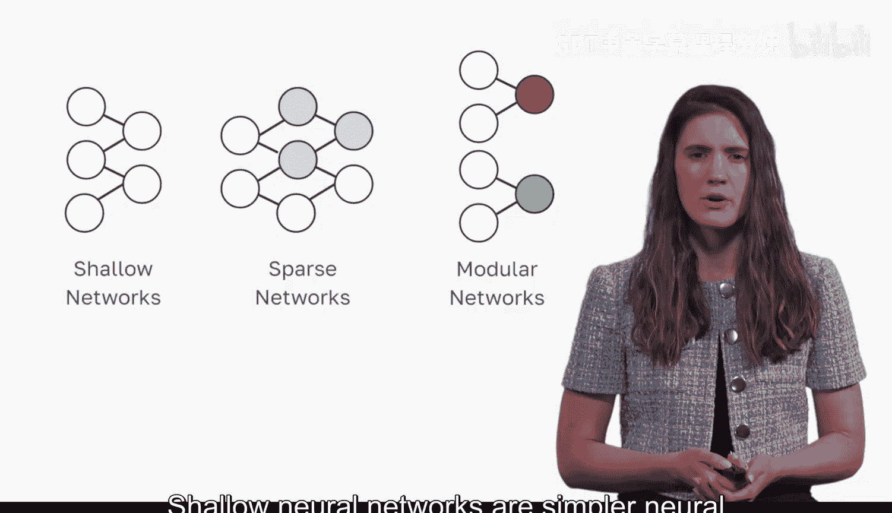

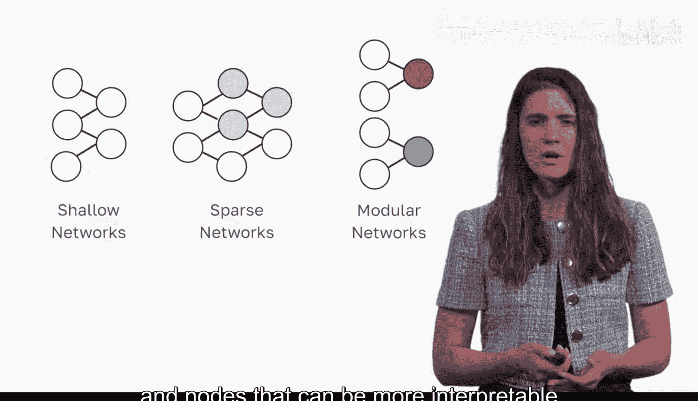

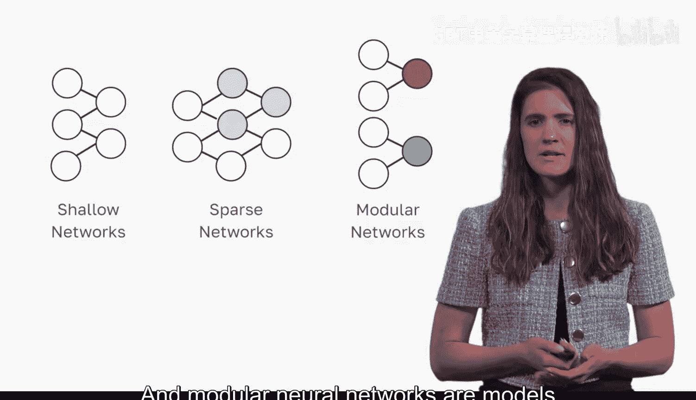

我们本课程关注的重点是本质可解释的模型。在神经网络领域，也有针对本质可解释模型的研究。接下来，我们将介绍三类主要的本质可解释神经网络。

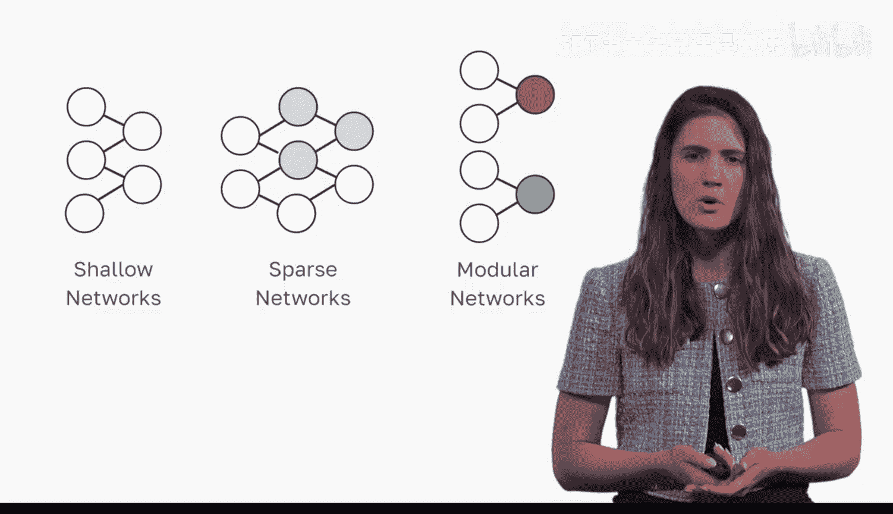

以下是三类主要的本质可解释神经网络：

*   **解耦神经网络**：这类模型学习到的表征中，每个神经元或特征图都对应一个特定的、可解释的概念（如边缘、纹理或物体部件）。这为窥探模型内部的推理过程提供了可能。
*   **基于原型的神经网络**：这类模型学习每个类别的原型示例，并以与这些原型的相似性作为预测的基础。与复杂的决策边界相比，这种基于相似性的判断可能更易于解释。
*   **单调神经网络**：这类模型对神经网络施加约束，使其输出相对于某些输入特征保持单调递增或递减。这使得模型的行为更加直观和可预测。

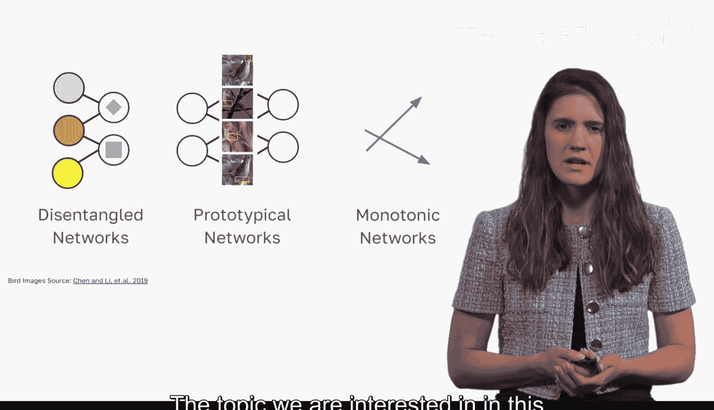

## 具体实现案例

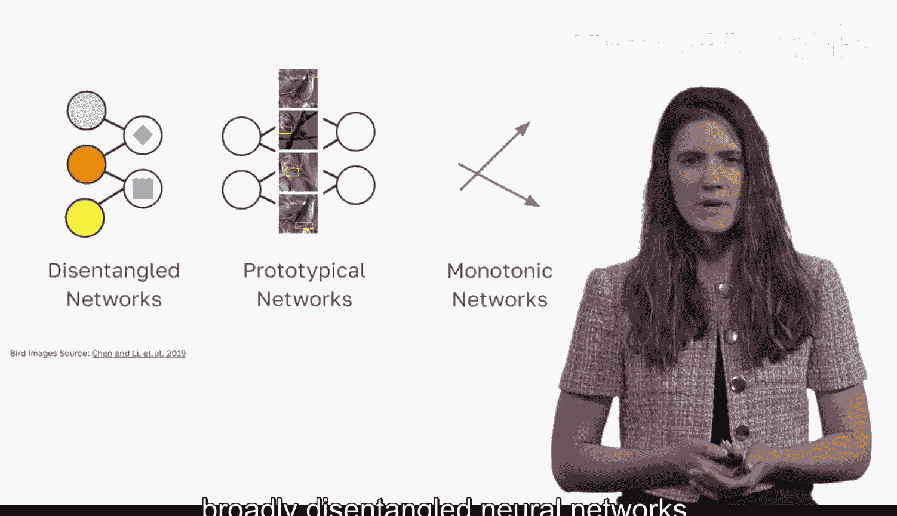

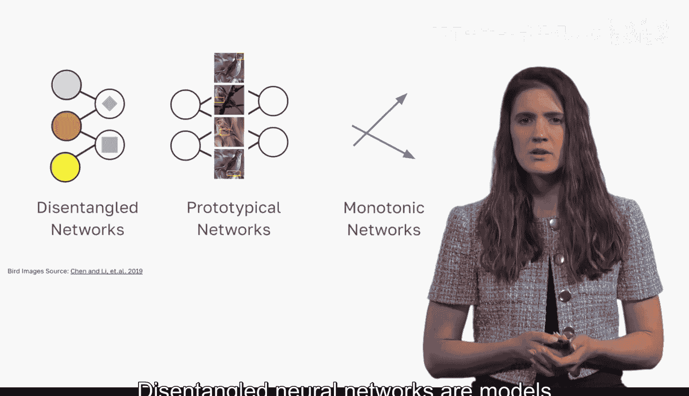

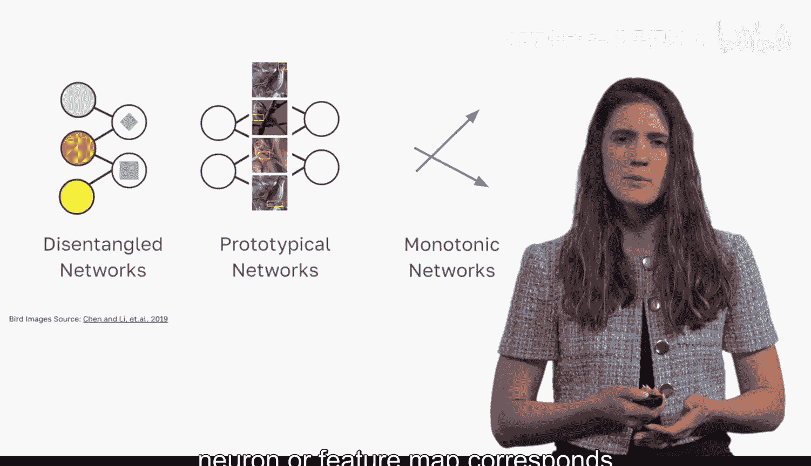

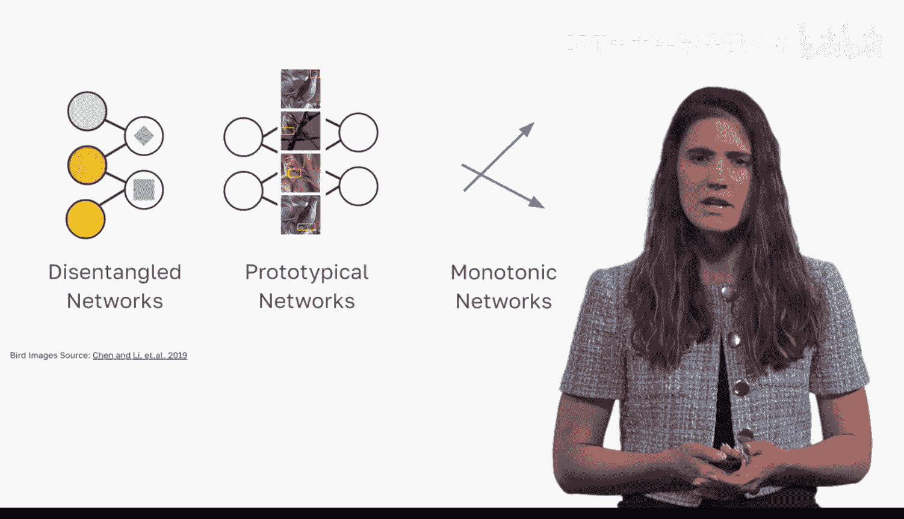

前面我们概述了几类本质可解释的神经网络，本节中我们来看看两个近期的具体实现。

我们将讨论两个近期提出的本质可解释神经网络的具体实现：**ProtoPNet** 和 **MonoNet**。

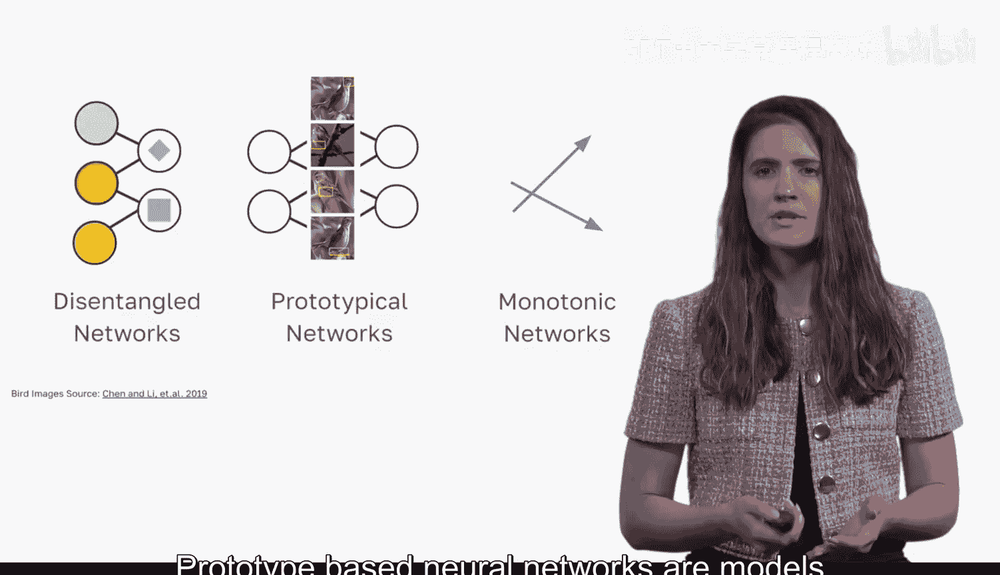

*   **ProtoPNet** 是 **Prototype-based Neural Network** 的一个典型代表。其核心思想是让网络学习一组可解释的“原型”，并在推理时通过比较输入与这些原型的相似性来做出决策。
*   **MonoNet** 是 **Monotonic Neural Network** 的一种实现。它通过特定的网络结构或约束条件，确保模型的预测与某些关键输入特征之间保持单调关系，从而增强可预测性。

---

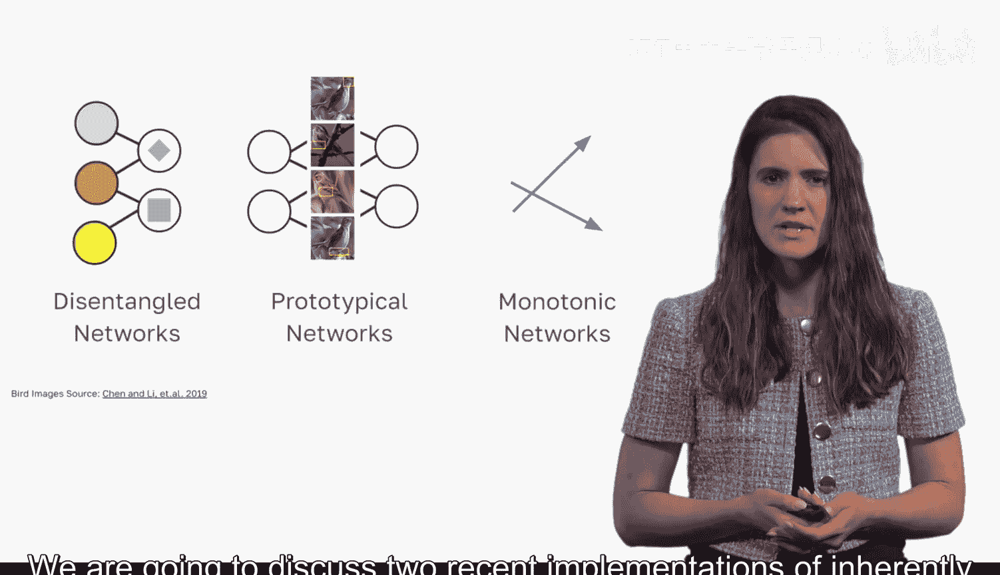

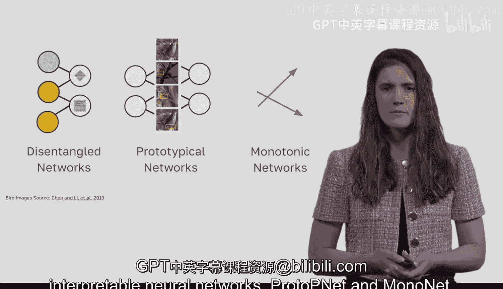

本节课中我们一起学习了神经网络的可解释性。我们了解到，尽管神经网络常被视为黑箱，但通过采用浅层、稀疏或模块化架构，可以提升其可解释性。更重要的是，研究界正在设计本质可解释的神经网络，如解耦网络、基于原型的网络和单调网络。最后，我们简要介绍了ProtoPNet和MonoNet这两个具体实现案例，它们分别代表了基于原型和单调约束的设计思路。