#  045：电路导论 🧠

在本节课中，我们将学习神经网络中“电路”的概念。我们将探讨如何通过研究神经元之间的连接，从网络权重中发现有意义的算法，这是可解释人工智能的一个核心原则。

---

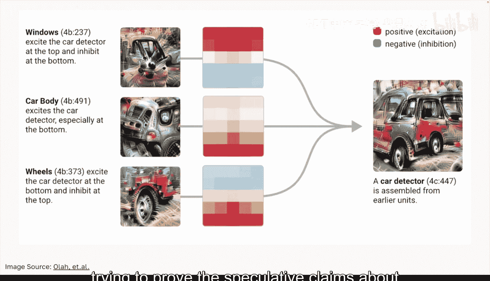

## 特征存在的证据 📊

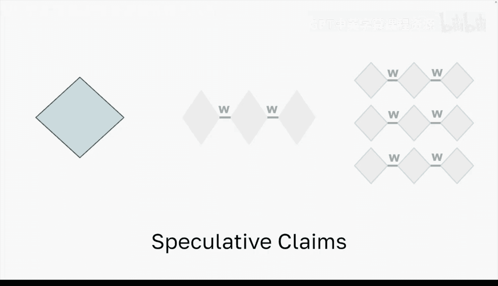

上一节我们介绍了关于神经网络的一些推测性主张。本节中，我们来看看支持“特征”存在的具体证据。特征可以理解为神经元所学习的特定模式或概念。

以下是支持特征存在的主要证据，我们将以“曲线检测器”为例进行说明：

1.  **特征可视化**：通过优化输入图像以最大化特定神经元的激活，可以可靠地生成曲线图像。这建立了因果关系，因为生成图像中的所有内容都是为了激活该神经元而添加的。公式表示为：`argmax_x activation(neuron, x)`。
2.  **数据集示例**：在ImageNet等数据集中，能强烈激活这些神经元的图像，通常是具有特定方向的曲线。
3.  **合成示例**：曲线检测器对人工合成的曲线图像也会产生预期的响应。
4.  **联合调谐**：如果旋转曲线图像，在某个角度，原神经元会停止激活，而对应新方向的曲线检测器则会开始激活。
5.  **特征实现**：通过分析构建曲线检测器的电路，可以直接从权重中解读出曲线检测算法。
6.  **特征使用**：曲线检测器的下游“客户”（即更高层的特征），是那些天然包含曲线的特征（如圆形）。这些客户会以预期的方式使用曲线检测器。
7.  **手写电路**：我们可以手动设置所有权重，重新实现曲线检测算法。这些权重构成了一个可理解的曲线检测算法，从而实现了对曲线检测器的逆向工程。

这些方法中，后三种是专门为机器学习研究创建的“MI特定方法”。

上图展示了更多关于曲线检测器的证据。研究通过收集最大化激活神经元的数据集示例，并将其从0度到360度以1度为增量旋转，记录后续的激活情况，量化了神经元对曲线方向的编码。

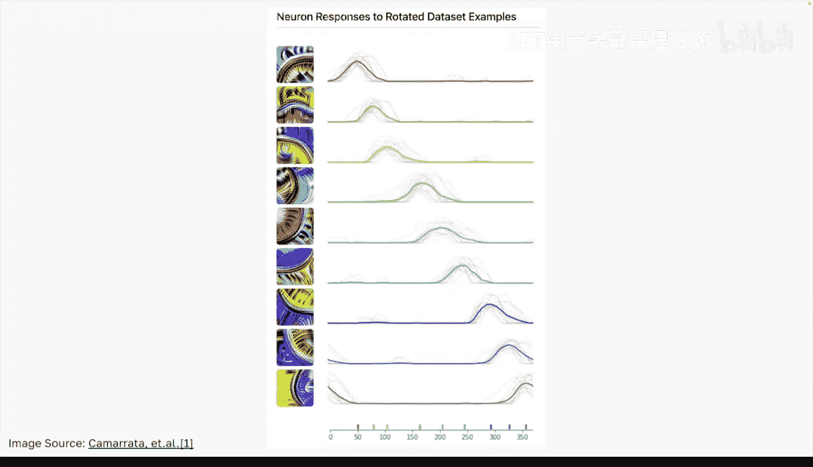

此外，“高-低频率检测器”也是特征存在的证据。它们在感受野的一侧寻找低频模式，在另一侧寻找高频模式，这似乎是检测物体边界（尤其是背景虚化时）的一种启发式方法。

“姿态不变的狗头检测器”是另一个例子。特征可视化建立了因果联系，而数据集示例则测试了神经元在实践中的用途。

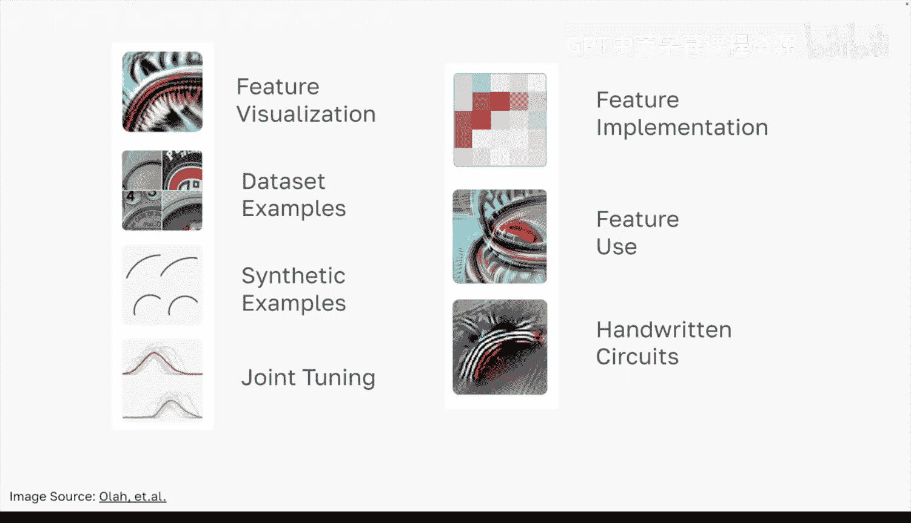

然而，神经网络中常存在“多语义神经元”，即一个神经元对多个不相关的输入（如猫脸、汽车前部和猫腿）产生响应。这个问题目前尚未完全解决。

---

## 电路存在的证据 ⚙️

了解了特征之后，我们进一步探讨支持“电路”存在的证据。电路指的是多个特征组合起来实现更复杂功能的连接模式。

曲线检测器本身也是电路存在的证据，因为它们是由更早的曲线检测器和直线检测器组合实现的。

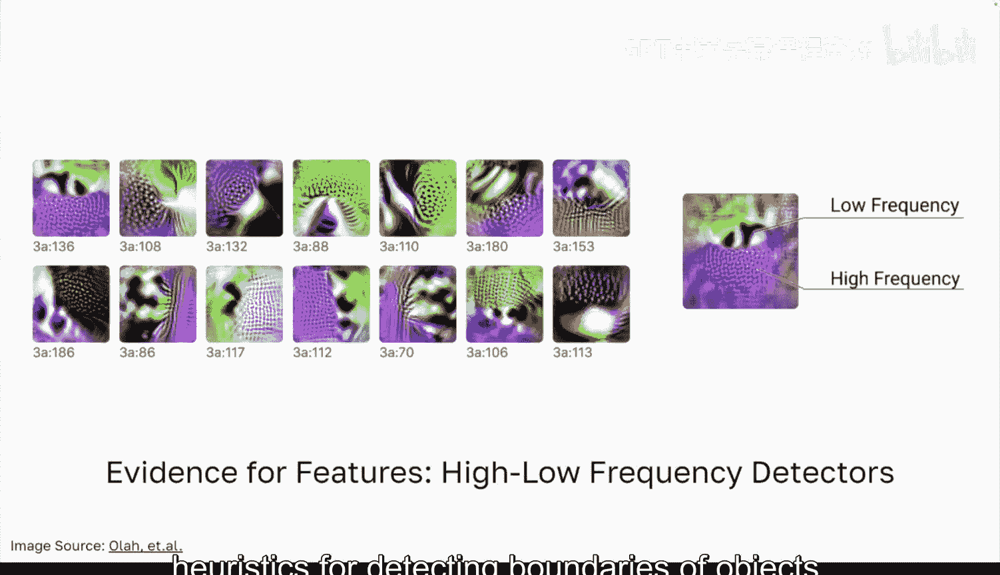

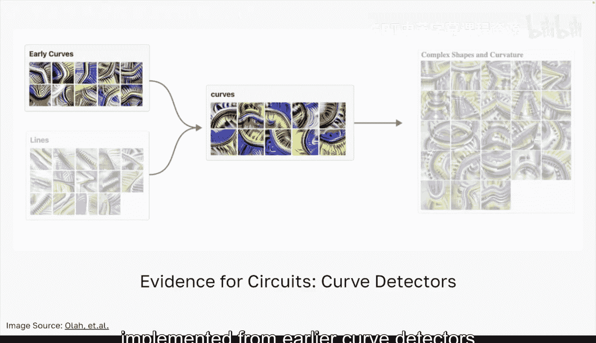

如上图所示，曲线检测器被特定方向的早期检测器（红色）所兴奋，并被相反方向的早期检测器所抑制。

另一个电路证据来自“定向狗头检测器”。当我们将不同方向的狗头检测器组合起来时，就得到了一个姿态不变的狗检测器，它能被任何方向的狗激活。

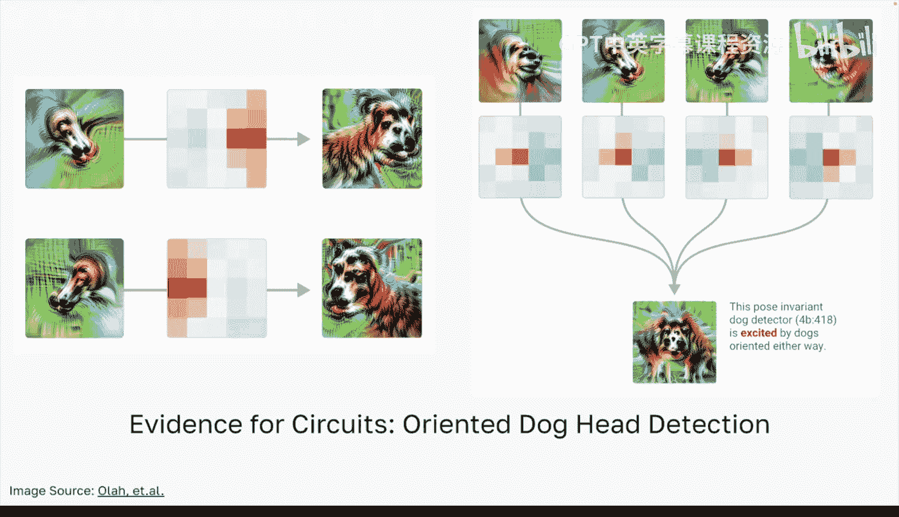

“叠加中的汽车”是我们要讨论的最后一个电路证据。汽车检测神经元整合了车窗、车身和车轮等特征。但在下一层中，这个特征会分散到许多多语义神经元中。这暗示了“叠加”现象，其假设是叠加允许模型使用更少的神经元，从而为更重要的任务节省资源。

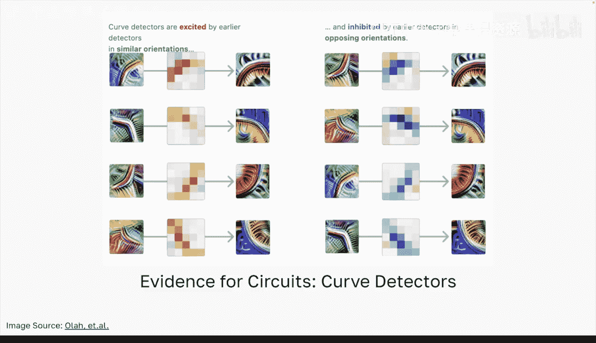

---

## 普遍性存在的证据 🌐

最后，我们来看看支持“普遍性”的证据。普遍性主张不同的神经网络可以发展出高度相关的神经元，并在隐藏层学习到相似的表示。

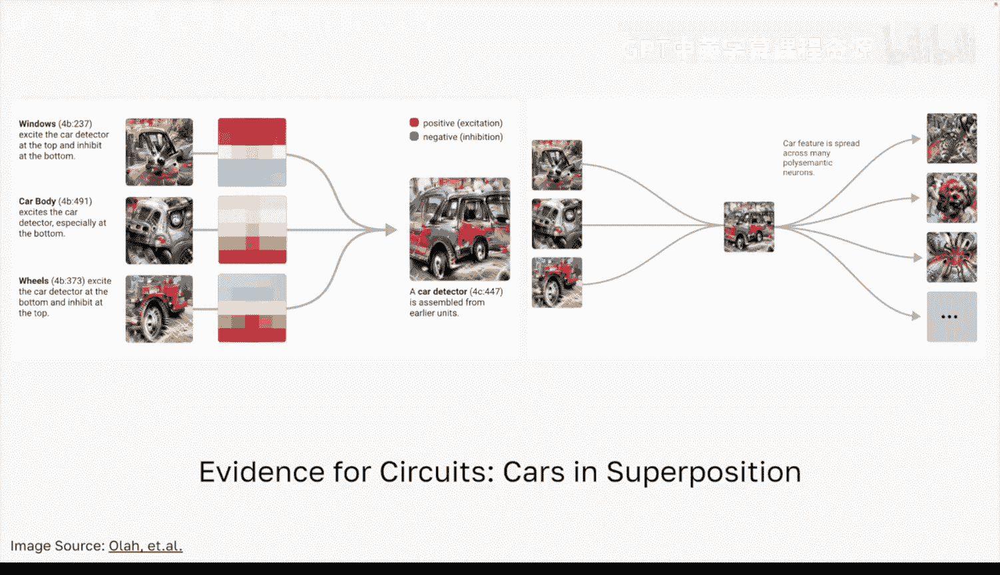

目前，我们仅拥有关于普遍性的观察性证据，主要来自曲线检测器和高-低频率检测器。

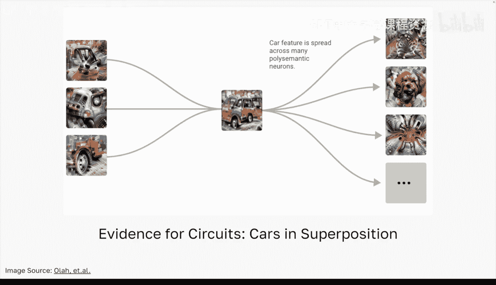

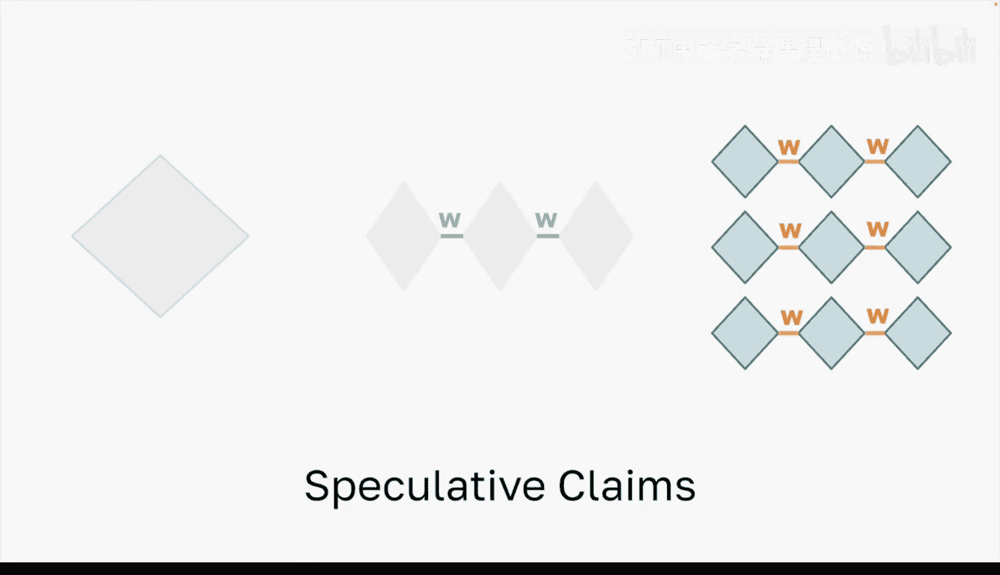

曲线检测器出现在许多不同的模型中，包括AlexNet、Inception V1、VGG19和ResNet V2-50等不同架构。事实上，曲线检测神经元可以在每一个被探索过的、非平凡的视觉模型中找到。

同样，高-低频率检测器也出现在这些模型中。虽然这还不是普遍性的确凿证据，但这些观察结果非常有说服力。

---

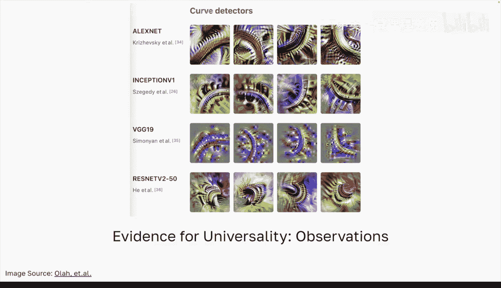

## 总结

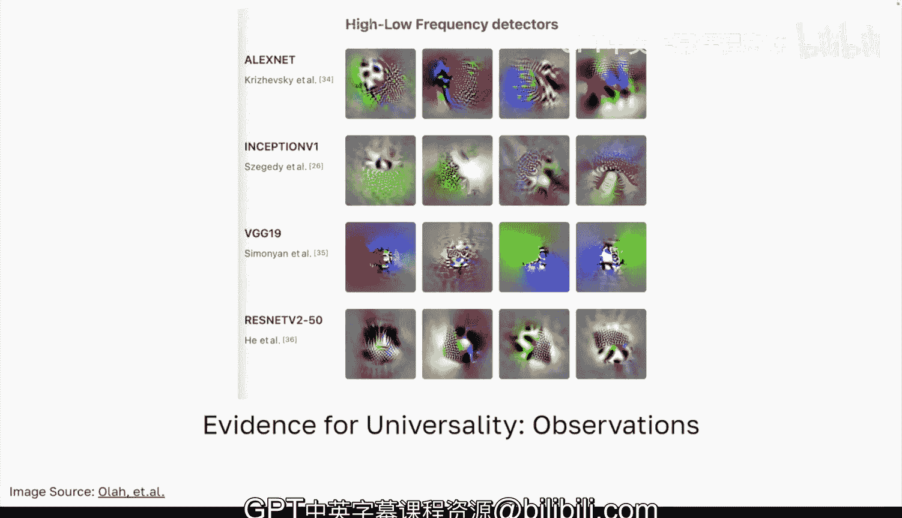

本节课中，我们一起学习了神经网络中“电路”的概念及其相关证据。我们首先回顾了支持“特征”存在的多种证据，包括可视化、数据集示例和电路分析等。接着，我们探讨了“电路”如何将基础特征组合以实现复杂功能，并看到了相关的证据。最后，我们观察了不同网络架构学习相似特征的“普遍性”现象。这些研究为我们理解神经网络内部的工作机制提供了重要的视角和工具。