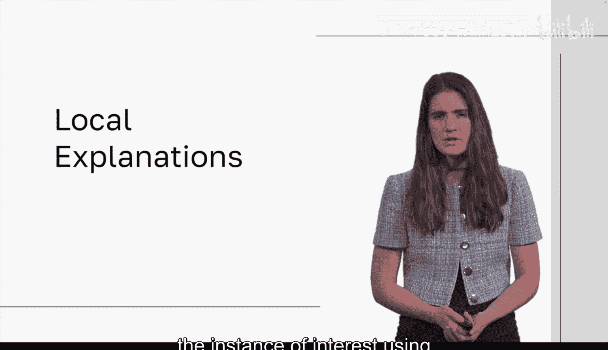
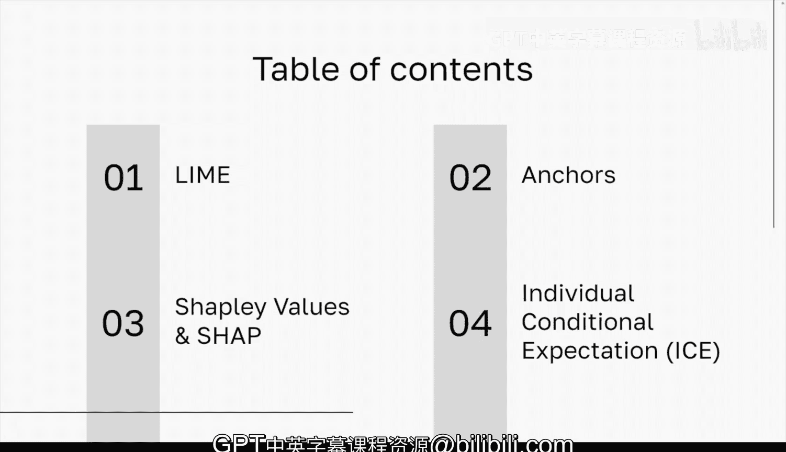

#  051：局部解释方法导论

在本节课中，我们将学习可解释人工智能领域中的局部解释方法。这些方法专注于解释模型对单个数据点或预测的决策过程，而不依赖于模型的具体内部结构。

上一模块我们介绍了模型无关的解释技术。本节中，我们将聚焦于局部解释方法。

局部解释方法的核心是解释单个预测。它们通过在感兴趣的实例（即我们想解释的那个数据点）附近，用一个可解释的模型（如线性回归）来近似原始模型的行为，从而提供解释。

以下是本课程将重点介绍的最流行的几种局部解释技术：

*   **局部可解释模型无关解释**：通常简称为LIME。
*   **锚点解释**：Anchors。
*   **沙普利值**：Shapley Values。
*   **沙普利加性解释**：通常简称为SHAP。
*   **个体条件期望图**：Individual Conditional Expectation，简称ICE图。

这些技术各有特点，但共同目标是为复杂的“黑箱”模型提供人类可以理解的、针对具体预测的解释。

本节课中，我们一起学习了局部解释方法的基本概念，并预览了后续将深入探讨的几种核心方法。理解这些方法是掌握如何为AI模型决策提供透明化解释的关键第一步。