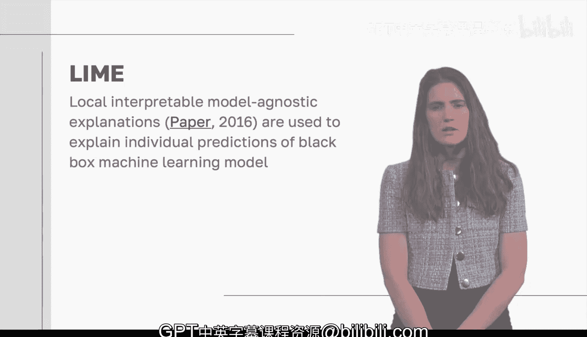
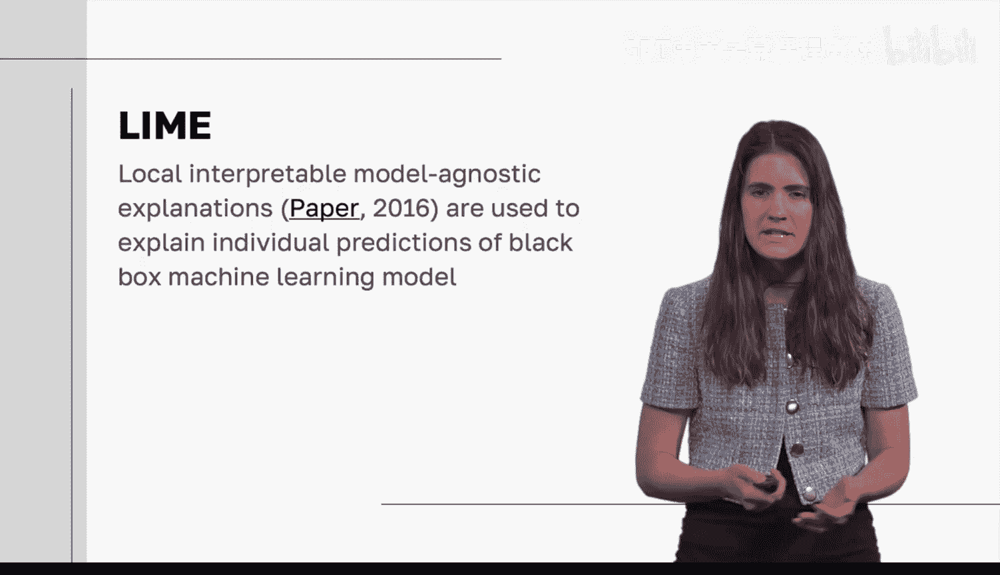
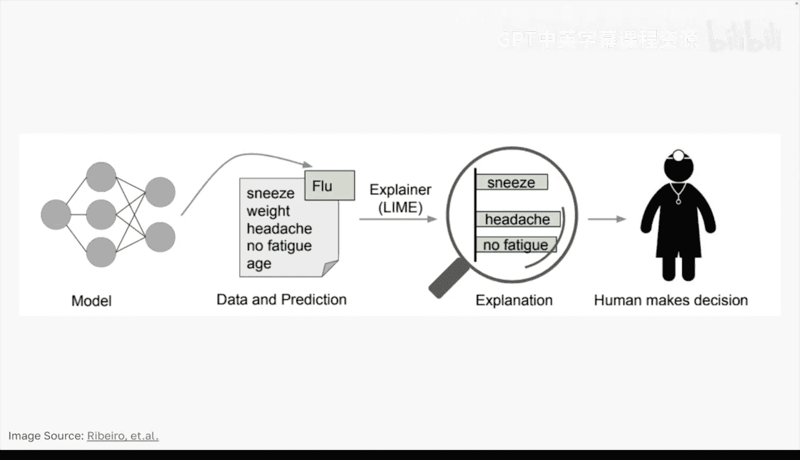
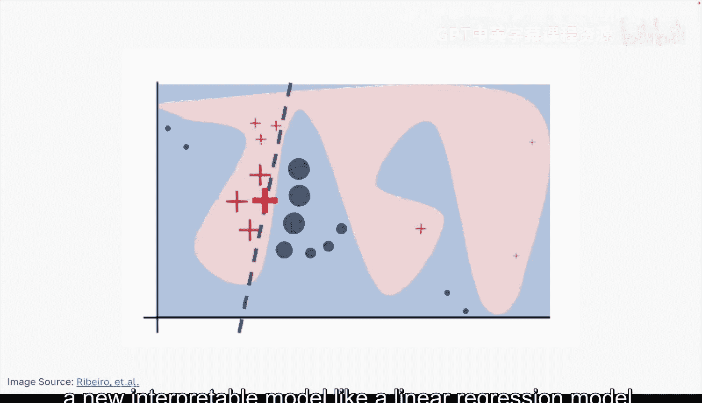
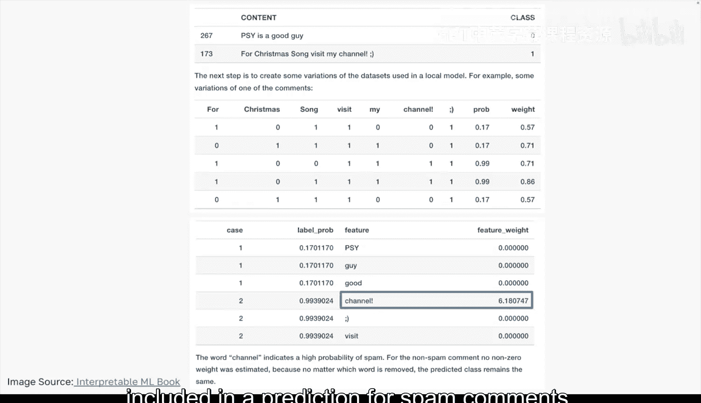
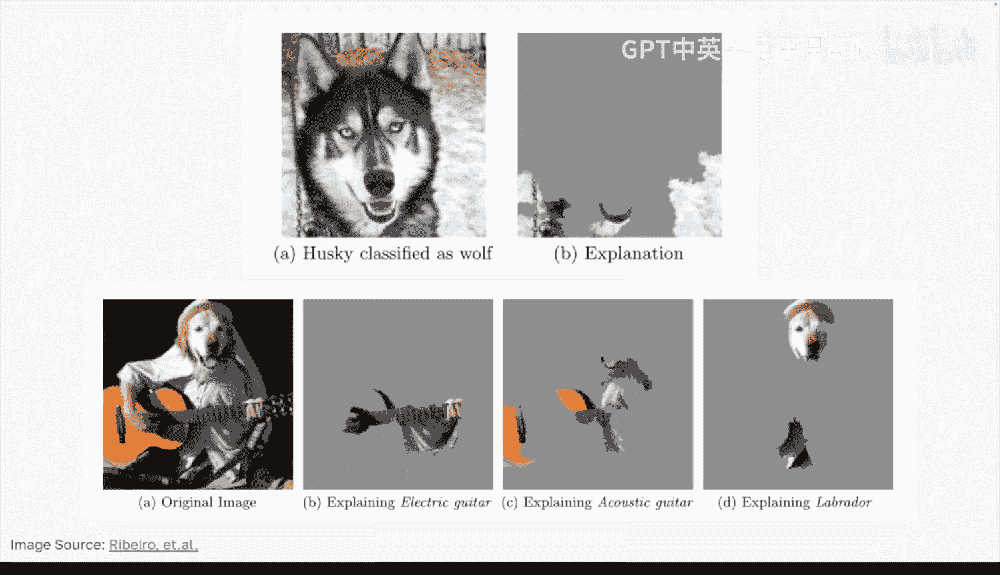
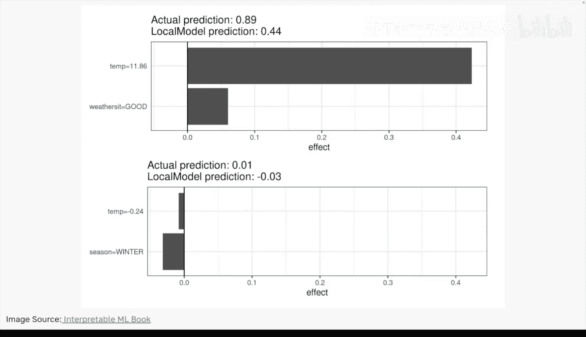
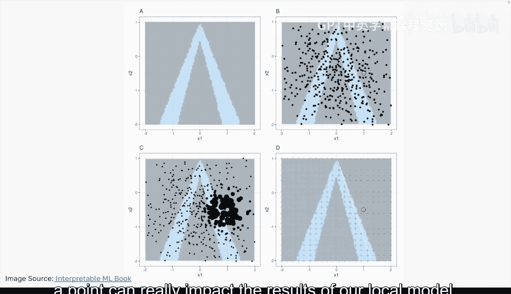
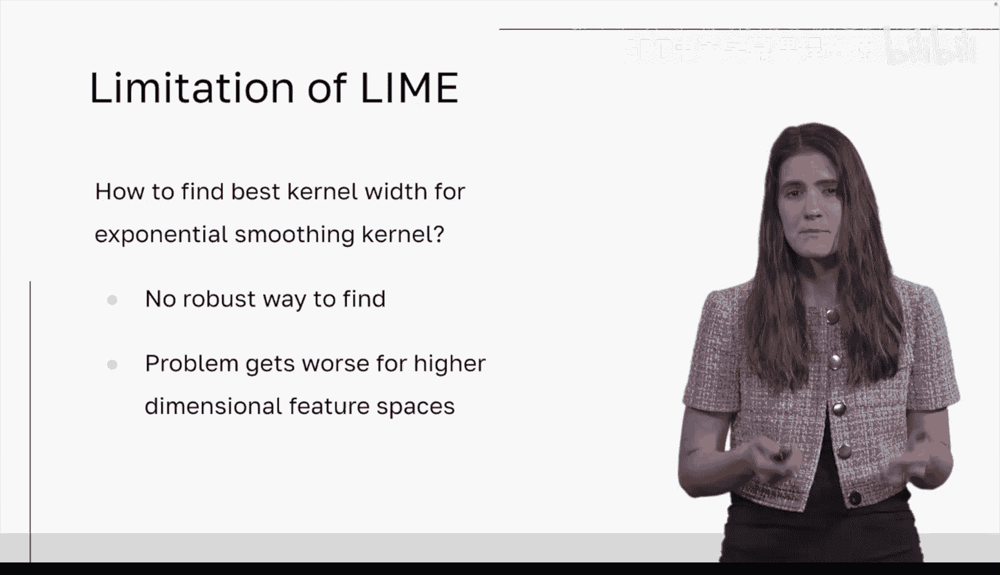
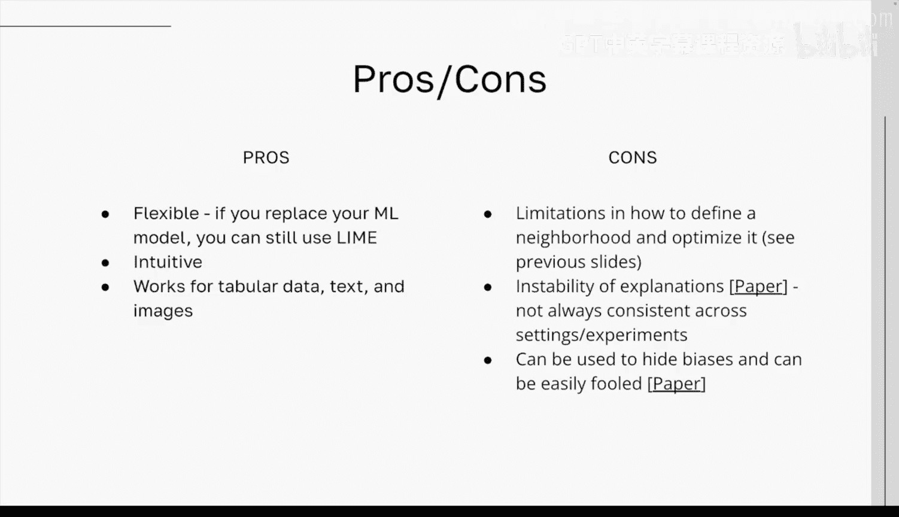

#  052：局部可解释模型无关解释（LIME）📖

在本节课中，我们将要学习一种名为“局部可解释模型无关解释”（LIME）的技术。这是一种用于解释任何“黑盒”机器学习模型对单个预测结果的方法。我们将了解其核心思想、工作原理、在不同数据类型上的应用，以及它的优缺点。

## 概述

局部可解释模型无关解释（LIME）于2016年被提出。它使用可解释的模型来解释黑盒机器学习模型的单个预测。LIME的优势在于它可以应用于多种数据源，包括表格数据、文本和图像。

## LIME的核心思想

上一节我们介绍了LIME的基本概念，本节中我们来看看其背后的核心思想。

LIME的核心思想是：虽然一个复杂的全局模型决策边界可能无法用一个简单的线性模型来近似，但在我们感兴趣的单个预测点附近，可以用一个简单的、可解释的模型（如线性回归）来局部地近似黑盒模型的行为。

## LIME的工作原理

理解了核心思想后，我们来看看LIME具体是如何工作的。以下是LIME的工作流程：

1.  **选择感兴趣的实例**：首先，选择一个你想要解释其预测结果的特定数据点。
2.  **扰动数据并获取预测**：围绕这个实例，通过扰动（例如，随机移除特征、修改像素等）生成一系列新的数据样本。然后，将这些扰动后的样本输入原始的黑盒模型，得到对应的预测结果。
3.  **构建新的数据集**：将扰动后的样本及其对应的黑盒模型预测结果，组合成一个新的数据集。
4.  **训练可解释的局部模型**：使用这个新数据集训练一个简单的、可解释的模型（如线性回归）。在训练时，会根据扰动样本与原始实例的接近程度（邻近度）为其分配权重，越接近的样本权重越高。
5.  **解释预测**：训练好的局部模型就可以用来解释原始预测。例如，在线性模型中，特征的系数大小和正负就代表了该特征对预测结果的影响程度和方向。

**重要提醒**：LIME是一种局部可解释技术，它只针对单个预测实例提供解释。它不是一个全局忠实的解释，不能推广到模型做出的其他预测。

## 数学原理

为了更深入地理解，我们来看看LIME的数学表述。其目标是找到一个解释模型 `g`（例如线性回归模型），使其在局部区域内近似黑盒模型 `f` 的行为。

其优化目标可以用以下公式表示：
`explanation(x) = argmin_{g ∈ G} [L(f, g, π_x) + Ω(g)]`

*   `x`：我们想要解释的实例。
*   `f`：原始的黑盒模型。
*   `g`：来自可解释模型族 `G` 的解释模型（如所有可能的线性模型）。
*   `L`：损失函数，衡量解释模型 `g` 的预测与黑盒模型 `f` 的预测在局部区域的接近程度。
*   `π_x`：邻近度度量，定义了在实例 `x` 周围多大的邻域内我们考虑进行解释。
*   `Ω(g)`：模型复杂度惩罚项，用于鼓励选择更简单的模型（例如，特征更少的线性模型）。

这个公式体现了“奥卡姆剃刀”原则：在解释效果相近的情况下，应选择更简单的解释。在实践中，LIME通常只优化损失部分 `L`，而用户通过指定线性模型可使用的最大特征数来控制复杂度 `Ω(g)`。

## LIME的实践应用

上一节我们介绍了LIME的理论基础，本节中我们来看看它在不同类型数据上的具体应用。

### 用于文本数据 📝

当LIME用于文本分类时，它通过随机移除原始文本中的单词来创建扰动样本。每个单词可以被视为一个特征（存在为1，移除为0）。训练出的局部线性模型可以显示哪些单词对预测为某个类别（如“垃圾评论”）的贡献最大。

例如，在判断一条YouTube评论是否为垃圾评论时，LIME可能会发现“channel”、“free”、“subscribe”等词具有很高的正权重，意味着它们增加了被预测为垃圾评论的概率。

### 用于图像数据 🖼️

LIME用于图像解释非常有趣。它首先将图像分割成多个“超像素”（颜色相似的连通像素块）。然后，通过随机将某些超像素块“关闭”（例如，用灰色填充）来创建扰动图像。训练出的局部模型可以显示哪些图像区域（超像素）对预测为某个类别（如“电吉他”或“哈士奇”）最重要。

这有助于发现模型是否关注了正确的特征。例如，一个区分“狼”和“哈士奇”的模型，如果其解释显示它主要依据图片背景中的“雪”来做判断，那么这个模型就是有问题的。

### 用于表格数据 📊

LIME用于表格数据可能最为直观。它可以为单个预测实例计算出每个特征的贡献度（权重），并以可视化方式展示。例如，在预测自行车租赁量的模型中，对于某个特定日期的预测，LIME可能显示“高温”和“晴天”对提高预测值有正向贡献，而“风速”则有负向贡献。

## LIME的局限性

尽管LIME功能强大，但在应用于表格数据时存在一个显著的局限性。

这个局限性在于：LIME在生成扰动样本时，并非严格围绕感兴趣的实例进行采样，而是可能从整个训练数据分布的中心区域进行采样。这导致对“局部邻域”的定义可能不够准确，从而影响局部解释模型的可靠性。

此外，LIME的实现依赖于一个“核宽度”参数，它决定了邻域的大小。目前还没有一个稳健的方法来自动确定最佳的核宽度，这个问题在高维特征空间中会更加严重。

## 总结与评价

本节课中我们一起学习了局部可解释模型无关解释（LIME）。现在，我们来总结一下LIME作为可解释AI技术的优缺点。

**优点：**
*   **模型无关性**：可以用于解释任何黑盒模型，更换模型后仍可使用。
*   **直观性**：提供的特征重要性易于理解。
*   **灵活性**：适用于文本、图像和表格等多种数据模态。

**缺点与挑战：**
*   **邻域定义问题**：如何定义和优化“局部邻域”是一个尚未完美解决的挑战。
*   **结果不一致性**：解释可能在不同实验或数据集间缺乏一致性。
*   **可能被滥用**：研究表明，LIME的解释可能被精心设计来隐藏模型的偏见或误导用户，这与可解释性的初衷相悖。

总而言之，LIME是一个强大且流行的局部解释工具，能帮助人们理解复杂模型的单个预测。但在使用时，需要意识到其局限性，并谨慎对待解释结果。