#  053：锚点解释法

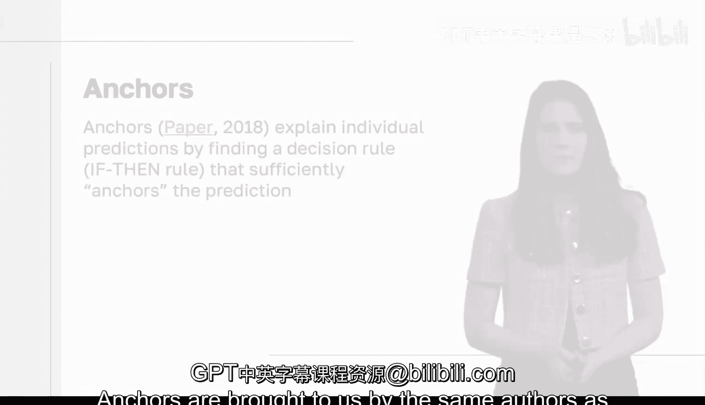

在本节课中，我们将要学习一种名为“锚点解释法”的模型无关解释技术。该方法与LIME类似，旨在解释单个预测，但其核心是寻找一个能够“锚定”预测结果的决策规则，而非使用线性模型进行局部近似。

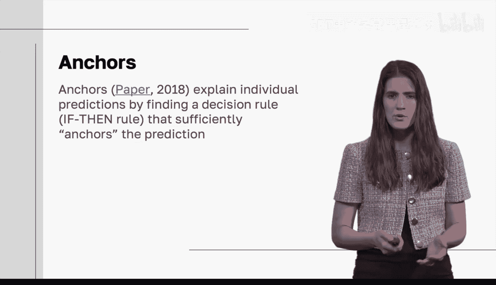

## 锚点解释法简介

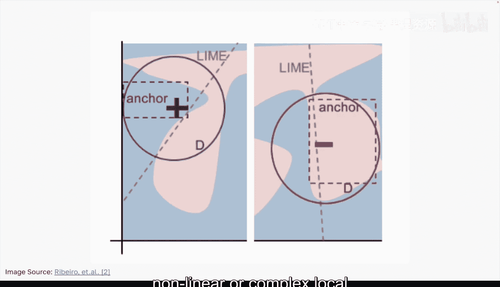

上一节我们介绍了LIME方法，本节中我们来看看锚点解释法。该方法由LIME论文的同一批作者提出，旨在提供高精度且模型无关的解释。锚点解释法同样用于解释单个预测，但其核心思想与LIME不同：它不再使用线性模型来近似局部决策边界，而是寻找一个能够充分“锚定”该预测的决策规则。

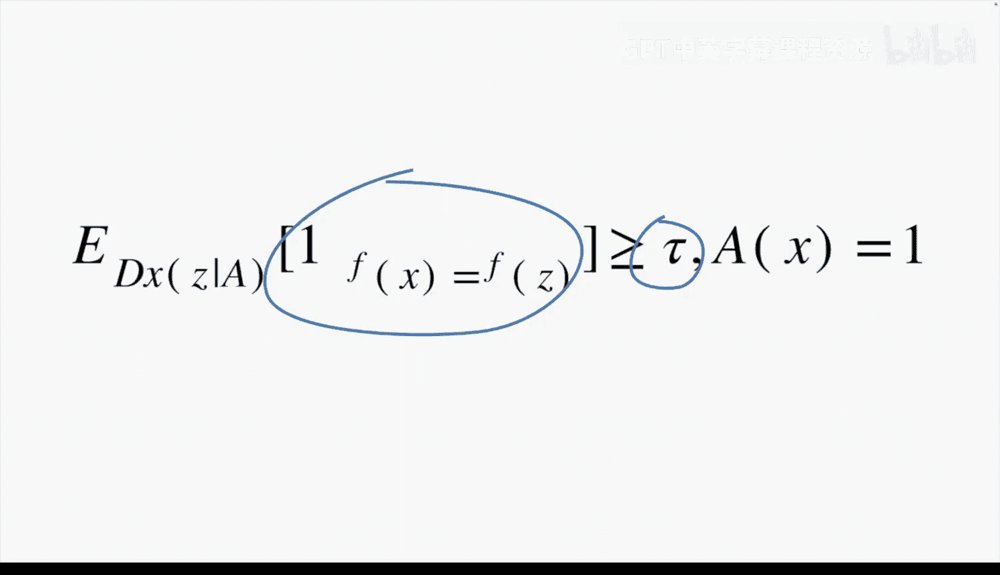

锚点解释法生成的规则是易于理解的“如果-那么”规则，非常适用于分类场景。

## 核心动机与定义

LIME方法的一个主要局限在于，我们无法保证复杂的局部决策边界能够被线性函数很好地近似，因为我们并不知道边界的真实形状。因此，锚点解释法旨在避免使用线性模型去近似可能非线性或复杂的局部边界。

锚点解释法的核心是一个概率化定义。首先，我们需要理解几个关键概念：
*   **锚点**：记作 `A`，是我们为待解释实例 `X` 找到的规则。
*   **规则精度**：通过评估从邻居分布中生成的、符合规则 `A` 的扰动样本 `Z`，并使用机器学习模型 `F`（记作 `F(z)`）进行预测来计算。精度公式可表示为：`Precision(A) = E_{D(z|A)} [1_{F(z)=F(x)}]`，其中 `D(z|A)` 表示符合规则 `A` 的扰动分布。
*   **精度阈值**：记作 `τ`。只有达到至少 `τ` 局部保真度的规则才会被视为有效。
*   **覆盖率**：指规则 `A` 适用于其邻居的概率。需要注意的是，规则的覆盖率与其精度之间存在权衡关系。

## 锚点生成算法

构建完美的规则通常不可行，因此锚点解释法采用了一种包含四个主要组件的算法来寻找解释。

以下是该算法的主要步骤：

1.  **候选规则生成**：此组件负责生成新的解释候选规则。在第一轮，它为待解释实例 `X` 的每个特征生成一个候选规则，每个规则固定该特征在后续扰动中的值。在后续轮次中，算法会扩展上一轮的最佳候选规则，为其添加一个尚未包含在内的新特征谓词。
2.  **最佳候选识别**：此组件通过比较候选规则来确定哪个规则能最好地解释实例 `X`。为此，它会创建符合当前观察到的规则的扰动样本，并通过调用模型来评估它们。为了最小化计算开销（模型调用次数），该组件的核心采用了一种**纯探索多臂老虎机算法**。在此设定中，每个候选规则被视为一个可以“拉动”的“臂”，每次拉动都会评估一批邻居样本，从而获得关于该规则“收益”（即精度）的更多信息。
3.  **候选精度验证**：如果尚无统计置信度表明候选规则的精度超过了特定阈值 `τ`，此组件会采集更多样本进行验证。
4.  **改进的束搜索**：此组件将以上所有组件整合到一个**束搜索**算法中。束搜索是一种图搜索算法，是广度优先算法的变体。它在每一轮中保留 `B` 个最佳候选规则（`B` 为束宽）到下一轮，然后用这些规则来创建新规则。通过设置较大的 `B` 值，算法更有可能避免陷入局部最优，但这会增加模型调用次数和计算负载。

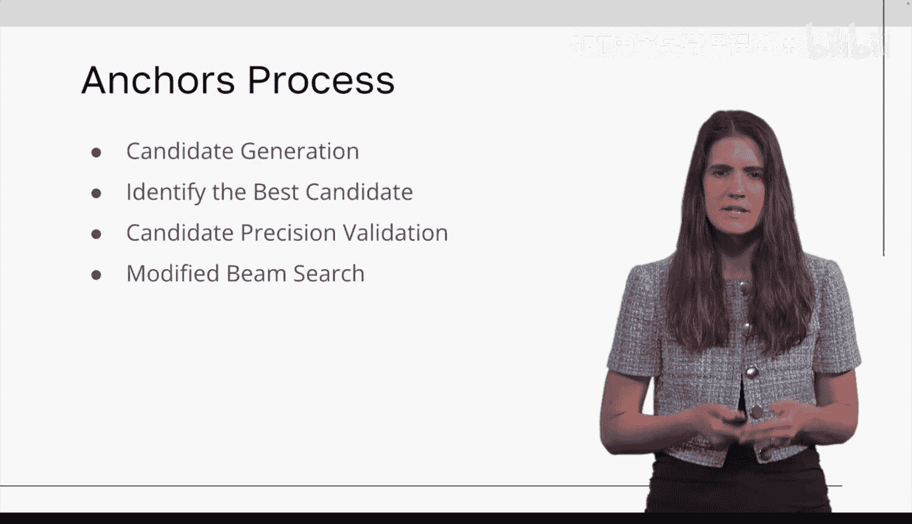

## 实际应用示例

锚点解释法可以应用于多种数据类型。

*   **表格数据**：可以生成简单的“如果-那么”规则来解释模型对某一行数据的预测。
*   **图像数据**：与LIME类似，当对图像使用锚点解释法时，我们使用一组超像素。规则可以描述为“如果某些特定的超像素存在，那么预测结果为某类别”。
*   **文本数据**：例如，在机器翻译系统中，锚点可以高亮显示源语言中哪些词或短语的存在，导致模型预测出某个特定的目标语言词汇。

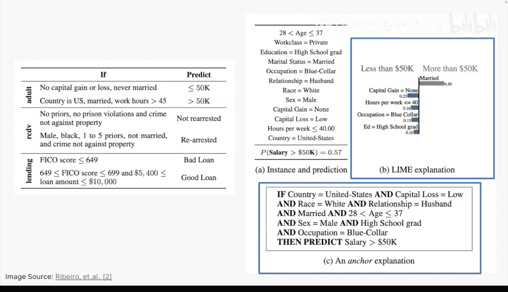

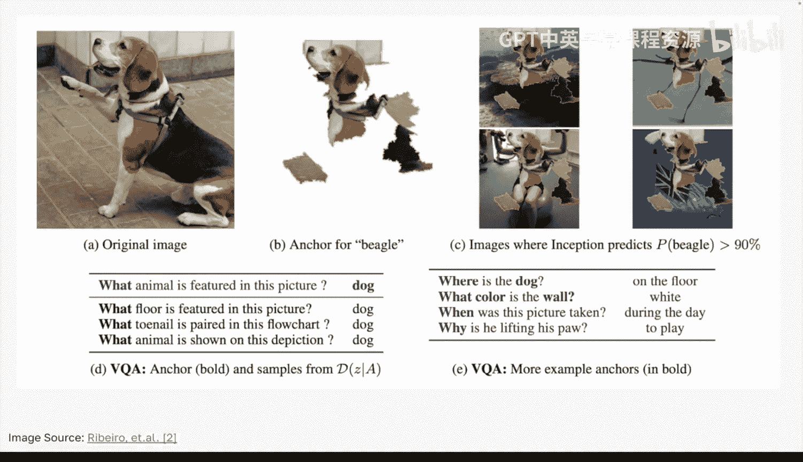

## 处理数据不平衡问题

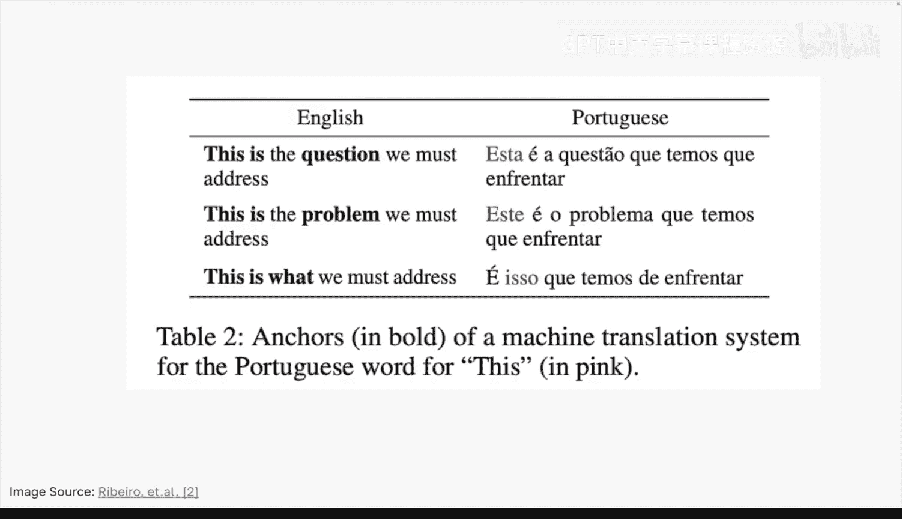

使用锚点解释法时需要注意，如果数据不平衡，需要格外小心，因为扰动空间反映了训练数据的分布。在一个高度不平衡的数据集中，解释属于多数类的实例可能会产生空规则（因为生成的邻居样本大多被预测为多数类），而解释属于少数类的实例则可能产生过于具体、包含大量特征谓词的规则。

如果遇到数据不平衡问题，可以考虑以下几种缓解策略，但每种策略都有其局限性，应谨慎使用：
*   通过不同的采样方式定义自定义的扰动空间。
*   使用训练数据的一个子集（例如，一个更平衡的子集）。
*   调整多臂老虎机算法的参数（如置信度和误差），这可能导致采集更多样本，最终使少数类样本被更频繁地采样。

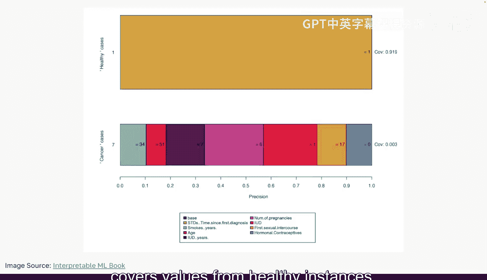

## 优点与局限性总结

本节课中我们一起学习了锚点解释法的原理与应用。现在，我们来总结一下这种可解释AI技术的优缺点。

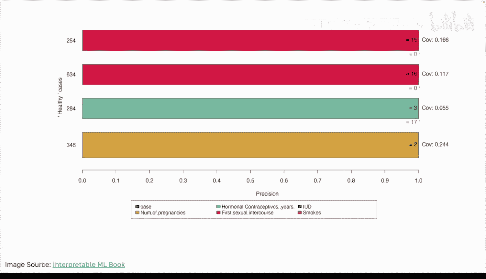

**优点**：
*   规则易于人类理解，因此解释性高。
*   与模型无关，适用性广。
*   计算效率高。
*   在预测结果局部非线性或复杂时仍然有效。

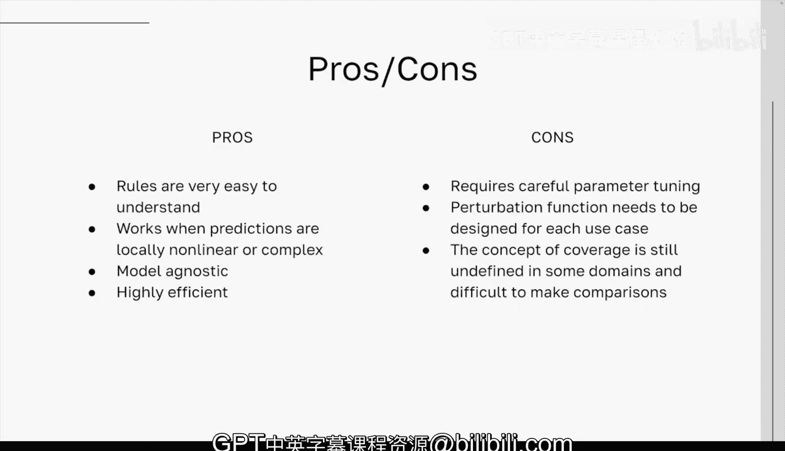

**缺点**：
*   需要仔细的参数调优。
*   扰动函数需要针对每个用例进行设计。
*   “覆盖率”的概念在许多领域尚未明确定义，因此使用锚点进行比较可能较为困难。