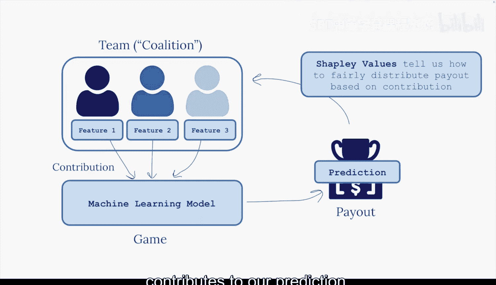
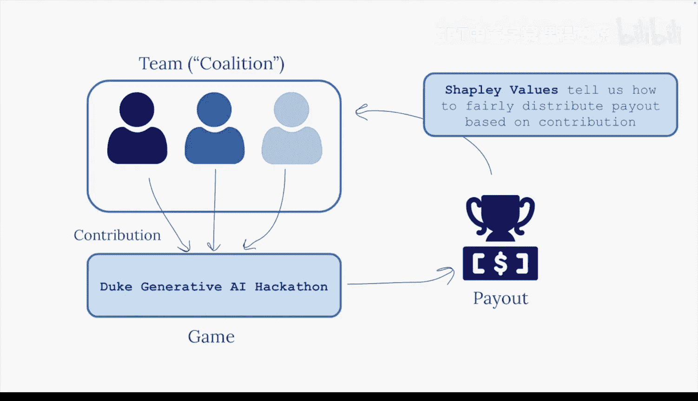
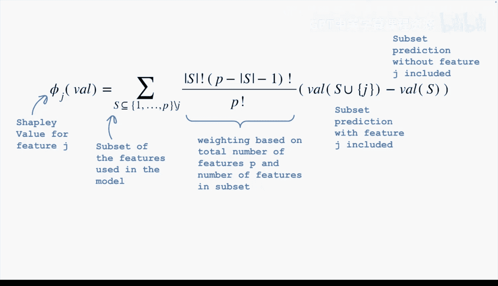
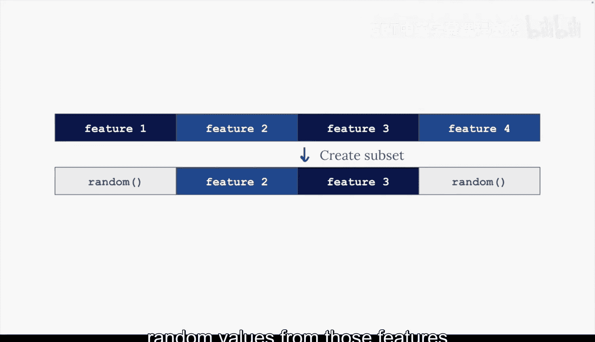
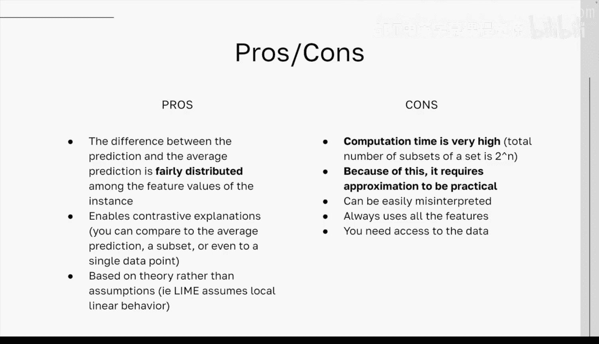

#  054：沙普利值 📊


在本节课中，我们将学习沙普利值（Shapley Values）这一核心概念。沙普利值是一种源自合作博弈论的方法，用于公平地分配“收益”，在机器学习中则用于解释每个特征对模型预测的贡献度。我们将从基本概念入手，逐步理解其计算逻辑、数学表达、实际应用以及优缺点。

## 概述

沙普利值最早于1952年被提出，是一个合作博弈论概念。其核心思想是：当一个团队（联盟）共同获得一笔收益（例如奖金）时，如何根据每个成员的贡献度来公平地分配这笔收益。

在机器学习语境下，我们可以将“联盟”视为用于训练模型的所有特征，将“预测值”视为团队获得的“收益”。沙普利值的作用，就是量化每个特征对这个最终预测值的贡献有多大。

## 从团队合作理解沙普利值



为了更好地理解，让我们看一个团队合作的例子。假设你每年秋天都会参加一个生成式AI黑客松。你和两位朋友组队参赛并赢得了奖金。现在，团队需要根据每位成员的贡献来公平地分配这笔奖金。

这正是沙普利值要解决的问题。它告诉我们如何根据贡献度来公平地分配收益。


## 如何量化贡献度？



那么，我们如何确定每位团队成员的影响力呢？这需要考虑两方面：

1.  **个人贡献**：例如，作为机器学习工程师，你构建了整个获胜模型，这可能是你的主要个人贡献。
2.  **交互效应**：然而，你能构建这个模型，依赖于你的朋友Casey通过网络爬虫获取数据集的能力。没有Casey，你的个人贡献就不会那么大。

为了量化这种复杂的贡献，我们可以用一个思想实验：乘坐时光机回到过去，用原始团队的不同子集（例如只有你、只有你和Casey等组合）重新参加黑客松。通过计算每个子集获得的“收益”，并平均每个成员在不同子集中的边际贡献，我们就能得到该成员对最终团队收益的公平贡献度，这就是沙普利值的核心思想。

## 沙普利值的正确与错误解读

关于如何解读沙普利值，这里有一个非常清晰的说明：

*   **如何正确解读**：在给定当前特征值的情况下，**一个特征值对“实际预测”与“平均预测”之间差异的贡献度，就是其估计的沙普利值**。这是一种对比性解释，你可以将预测与平均值、某个子集甚至单个数据点进行比较。
*   **如何错误解读**：**一个特征值的沙普利值，并不是将该特征从模型训练中移除后，预测值的变化量**。这是一个非常常见的误解，在使用沙普利值时务必牢记这一点。

## 深入数学原理

接下来，我们深入看看沙普利值的数学公式。特征 *j* 的沙普利值可以通过以下方式计算：

我们遍历所有可能的特征子集 *S*（不包含特征 *j*）。对于每个子集，我们计算两个预测值的差异：一个是包含特征 *j* 的预测，另一个是不包含特征 *j* 的预测。然后，我们根据子集的大小对这个差异进行加权，最后对所有可能的子集求和。

其公式可以表示为：

```
φ_j = Σ [ (|S|! (M - |S| - 1)! / M!) * (f(S ∪ {j}) - f(S)) ]
       S ⊆ {1, ..., M} \ {j}
```

其中：
*   `φ_j` 是特征 *j* 的沙普利值。
*   `M` 是特征总数。
*   `S` 是不包含特征 *j* 的特征子集。
*   `f(S)` 是使用子集 *S* 中的特征得到的预测值。
*   `(|S|! (M - |S| - 1)! / M!)` 是权重项，用于对所有可能的子集排列进行公平加权。

## 实际应用中的处理



在实际的机器学习模型中，输入特征的数量是固定的，我们无法简单地“移除”一个特征来观察预测变化。通常的做法是：用数据集中该特征的随机值来“替换”待评估的特征。

例如，假设我们有一个包含4个特征的模型。当评估特征1对某个预测的贡献时，我们会创建许多不同的特征子集。对于不包含特征1的子集，我们保留原值；对于包含特征1的子集，我们则用数据集中特征1的某个随机值来替换当前实例的特征1值，从而“屏蔽”其具体影响。这个过程会在所有可能的子集上重复多次，以计算平均贡献。

## 沙普利值的优缺点



作为一种可解释AI技术，沙普利值有其显著优势和局限性。

以下是其主要优点：

*   **公平分配**：预测值与平均预测值之间的差异被公平地分配给实例的各个特征值。
*   **对比性解释**：支持与平均预测、子集或单个数据点进行比较。
*   **理论基础坚实**：其分配方案基于坚实的博弈论理论，而非像LIME那样依赖于局部线性的假设。

以下是其主要缺点：

*   **计算成本高**：对于一个包含 *n* 个特征的集合，其所有子集的数量是 `2^n`。这导致计算复杂度极高。
*   **需要近似计算**：正因为计算成本高，在实际应用中必须采用近似算法（我们将在后续视频中讨论）。
*   **容易误解**：如前所述，人们很容易错误地将其解释为特征移除后的影响。
*   **总是使用所有特征**：计算时需要考虑所有特征的交互，无法孤立地评估单个特征。
*   **需要数据访问权限**：计算沙普利值需要能够访问训练数据集。

## 总结



本节课我们一起学习了沙普利值。我们了解到它源于合作博弈论，用于公平分配团队收益。在机器学习中，它被用来解释每个特征对单个预测的贡献度。我们探讨了其思想实验、正确的解读方式、核心的数学公式，以及在实践中如何通过特征替换进行计算。最后，我们分析了沙普利值方法在提供坚实理论解释和对比性分析方面的优势，也指出了其计算复杂度高、易被误解等局限性。理解这些将帮助我们在实际应用中更有效地利用这一强大的可解释性工具。