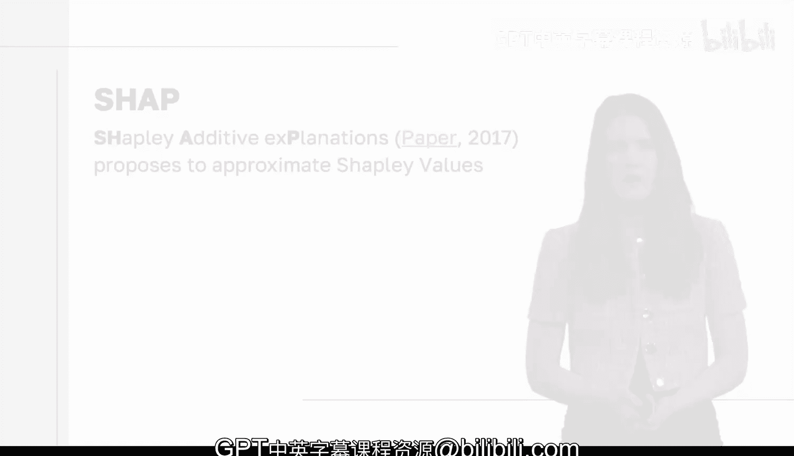
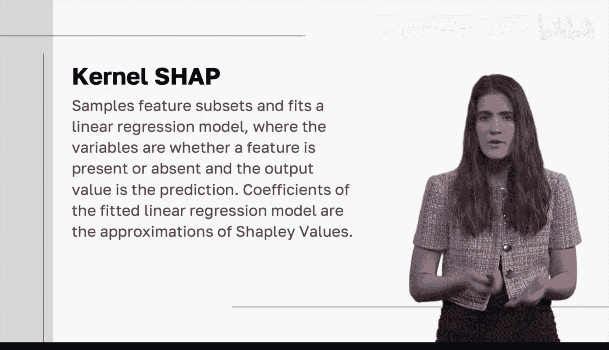
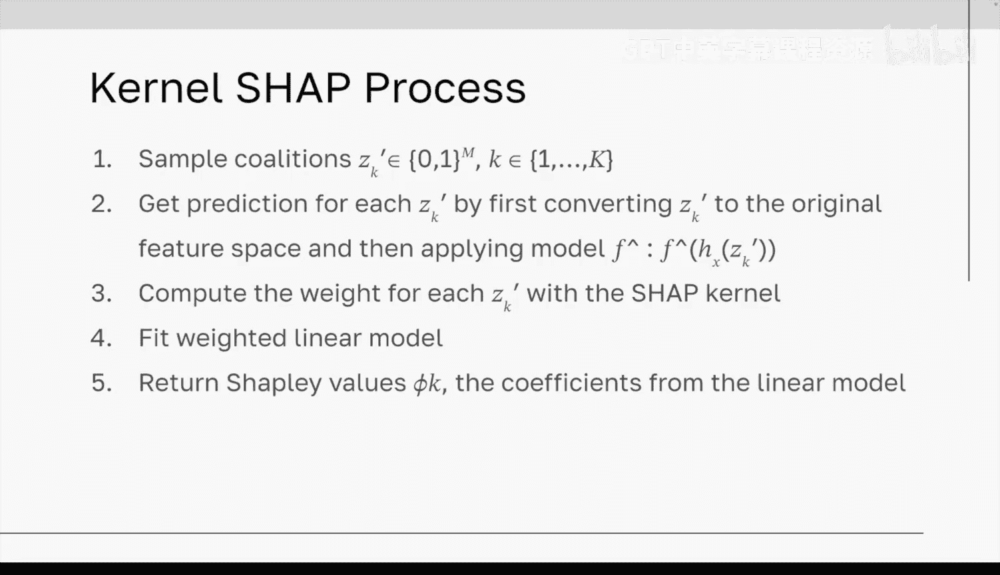
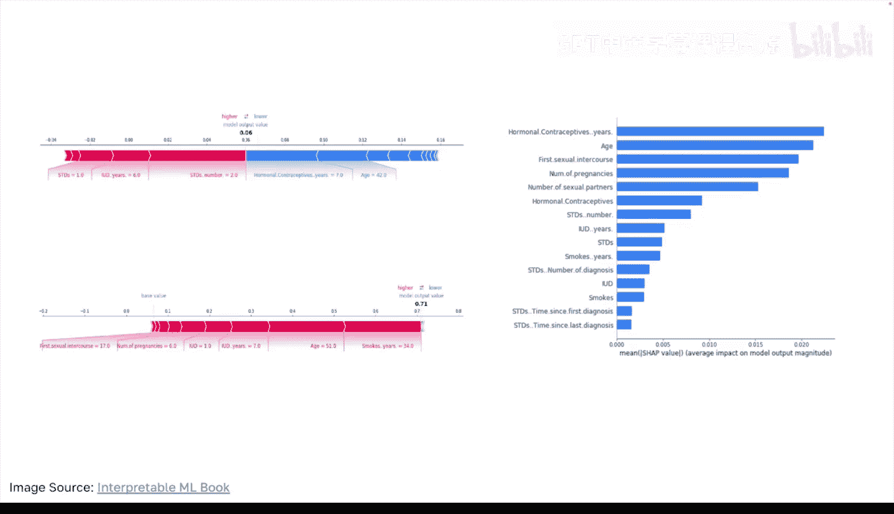
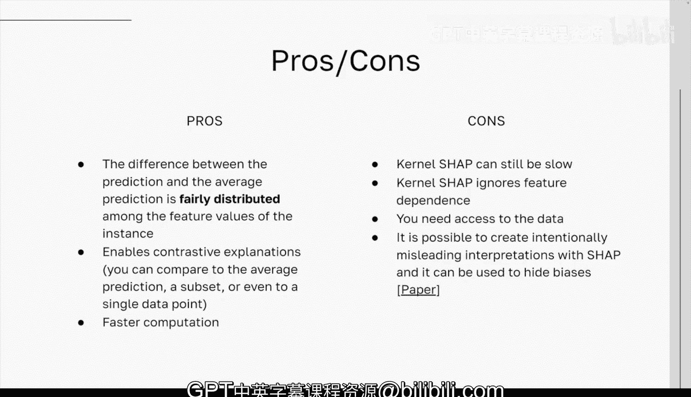

#  055：沙普利加性解释（SHAP）📊

在本节课中，我们将要学习一种重要的可解释人工智能方法——沙普利加性解释（SHAP）。我们将了解它的基本概念、工作原理、实现步骤以及优缺点。

---

沙普利加性解释（SHAP）于2017年被提出。它建立在沙普利值的概念之上。在关于沙普利值的视频中，我们曾讨论过其计算成本极高，因此实用性不强。SHAP方法提出通过**近似计算**沙普利值，而不是直接计算它们。

有多种方法可以近似沙普利值，包括但不限于核SHAP、树SHAP和深度SHAP。本节讲座我们将重点介绍核SHAP，但在代码演示中，我们将实现树SHAP，以便您能感受几种不同的SHAP方法。

上一节我们介绍了SHAP的核心理念。本节中我们来看看核SHAP的具体思路。核SHAP在概念上与LIME非常相似，都是通过一个线性回归模型来近似沙普利值。

我们将对特征子集进行采样，并拟合一个线性回归模型。在这个模型中，输出值是模型的预测结果，而自变量则表示某个特征是否存在。拟合后的线性回归模型的系数，就是我们所需的沙普利值的近似值。

以下是核SHAP的实现步骤：

1.  **采样联盟**：对特征的不同组合（联盟）进行采样。
2.  **获取预测**：将每个采样样本转换回原始特征空间，然后应用我们的模型得到预测值。
3.  **计算权重**：使用SHAP核函数为每个样本计算权重。
4.  **拟合加权线性模型**：使用加权样本拟合线性回归模型。
5.  **返回近似值**：线性模型的系数即为沙普利值的近似值。

原始SHAP论文中有一个很棒的可视化图表，展示了人类、LIME和SHAP为特征分配的特征归因值。我们可以直观地看到，SHAP与人类估计的一致性远高于LIME。

当SHAP应用于图像数据时，我们再次看到SHAP值相对于其他可解释性方法具有更高的性能。SHAP的输出有一些非常有趣的可视化方式，以下是《可解释机器学习》书中的几个例子。

接下来，让我们评估一下SHAP作为一种可解释AI技术的优缺点。

由于SHAP基于沙普利值，因此许多优点得以保留。实例的预测值与平均预测值之间的差异会公平地分配到各个特征值上，这使得它能够进行**对比解释**。你可以将预测与平均预测、某个子集甚至单个数据点进行比较。

与直接计算沙普利值相比，SHAP近似方法提供了**更快的计算速度**。然而，这并不意味着它很快。核SHAP仍然可能相当慢。同时，它**忽略了特征间的依赖性**。

与沙普利值一样，使用SHAP需要访问数据。并且，有可能用SHAP创建故意误导性的解释，它也可能被用来隐藏模型中的偏见。

---

本节课中我们一起学习了沙普利加性解释（SHAP）。我们了解到SHAP通过近似计算沙普利值，在保持其理论优点的同时，显著提升了计算效率，并支持直观的对比解释。然而，它也存在计算成本、忽略特征依赖等局限性。理解这些特点有助于我们在实践中更有效地应用SHAP进行模型解释。