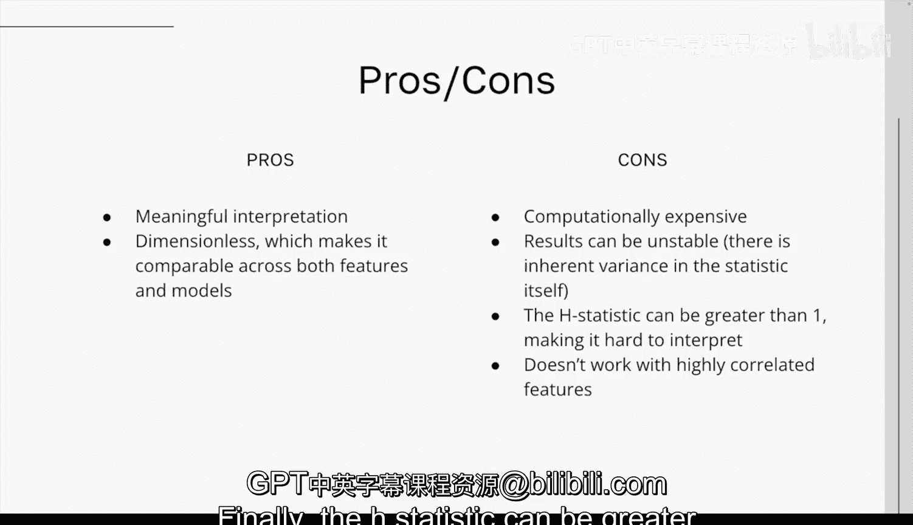
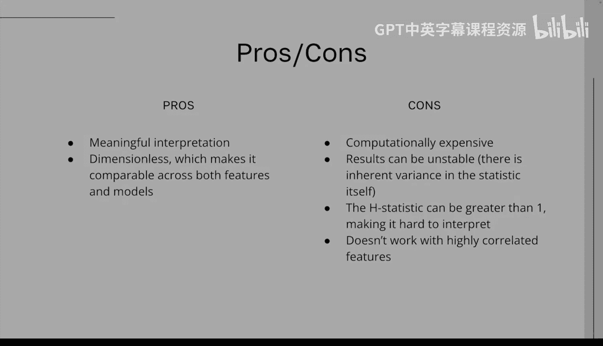

#  059：特征交互作用

在本节课中，我们将要学习特征交互作用的概念。我们将从功能分解出发，引入特征交互的定义，并学习如何通过H统计量来量化交互强度，最后讨论该方法的优缺点。

上一节我们介绍了功能分解，本节中我们来看看特征交互作用。

当我们考虑分解时，首先将一个模型预测分解为一个常数项、每个特征的项以及特征之间的交互项。

让我们看一个例子。在本幻灯片右上角，我添加了一个预测汽车价格的表格。这里只有两个特征：燃料类型和品牌。一辆汽油非豪华汽车的基础价格是30000美元，我们将其视为常数项。燃料类型项是：电动车加20000美元，汽油车加0美元。品牌项是：豪华品牌加40000美元，非豪华品牌加0美元。最后，是我们的交互项。

这就是特征交互作用发挥作用的地方。为了估计交互强度，我们可以测量预测的变化有多少取决于特征之间的交互。我们可以使用一种叫做H统计量的方法来实现。

2008年，Friedman和Popescu引入了用于特征交互的H统计量。他们引入了双向H统计量，用于观察两个特征J和K之间的交互；同时也引入了总H统计量，用于观察特征J与所有其他特征之间的交互。

在这些来自原始数据的图表中，可以清晰地可视化特征交互强度。这为我们提供了一个易于理解的视觉呈现，帮助我们理解不同特征是如何相互作用的。

让我们快速看一下H统计量的数学原理。它遍历所有数据点，并在每个点评估部分依赖函数，而部分依赖函数的计算又需要用到所有N个数据点。J和K之间交互的H统计量如左侧公式所示，J与任何其他特征交互的统计量如右侧公式所示。

我们必须认识到与特征交互相关的计算成本，以及这如何影响实际应用。在最坏的情况下，计算双向H统计量（J对K）需要对机器学习模型的预测函数进行2N²次调用。计算总H统计量（J对所有）则需要3N²次调用。

为了加速计算，我们可以从N个数据点中进行采样。这里需要指出的是，这会增加部分依赖估计的方差，可能导致H统计量不稳定。

解释H统计量可能具有挑战性，我们将在下一张幻灯片中讨论。但标准的解释是：如果H统计量为零，则表示没有交互作用。如果总H统计量为1，则函数的所有方差都由部分依赖函数之和解释。如果双向H统计量为1，则每个单独的部分依赖函数都是常数，预测中的效果仅来自交互作用。

以下是特征交互作用作为一种可解释人工智能技术的优缺点分析：

*   **优点**：特征交互提供了有意义的、无量纲的解释，因此我们可以用它来跨特征和跨模型进行比较。
*   **缺点**：计算成本高昂。由于统计量本身固有的方差，结果可能不稳定。与许多XAI方法一样，它不适用于高度相关的特征。最后，H统计量可能大于1，这使得解释变得困难。

本节课中我们一起学习了特征交互作用。我们从功能分解入手，定义了特征交互，并介绍了用于量化交互强度的H统计量及其计算方法。最后，我们分析了使用特征交互来解释模型时的优势与局限性。