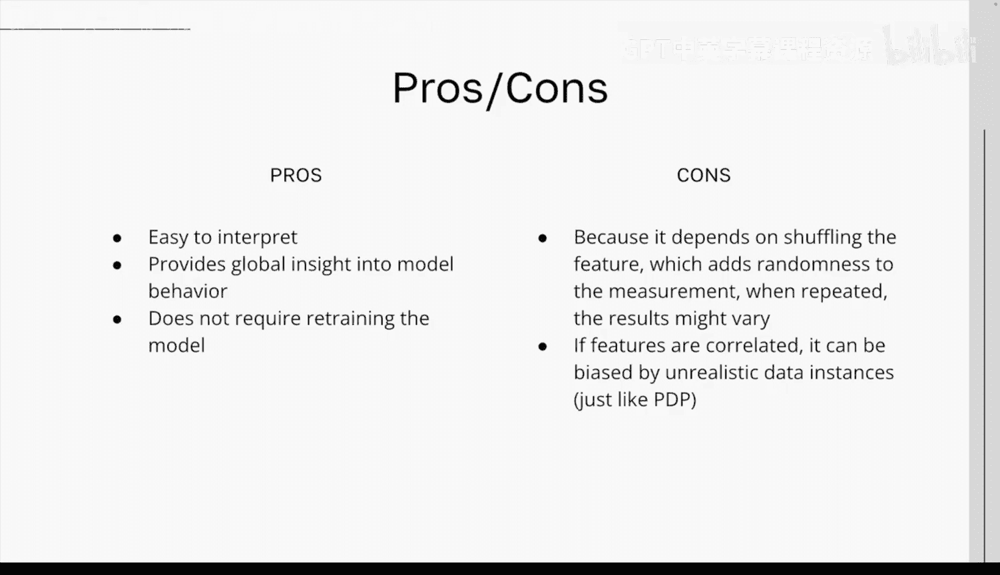
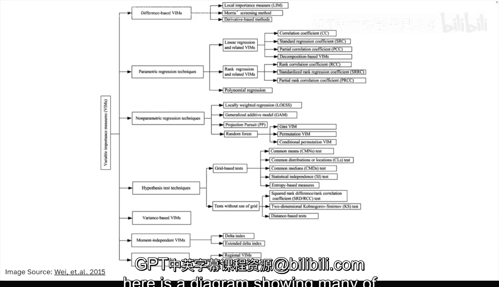

#  060：置换特征重要性 📊

在本节课中，我们将要学习一种名为“置换特征重要性”的模型解释方法。该方法通过打乱某个特征的数据，观察模型预测误差的变化，来衡量该特征对模型预测的重要性。

## 核心概念与原理 🔍

上一节我们介绍了模型解释的多种需求，本节中我们来看看一种具体且模型无关的评估特征重要性的方法。

特征的重要性可以通过计算在打乱该特征的值之后，模型预测误差的增加量来衡量。其核心逻辑可以用以下公式表示：

**特征重要性 = 误差(打乱后) - 误差(原始)**

如果打乱某个特征的值导致模型误差上升，则说明该特征重要。如果模型误差在打乱特征值后没有变化，则该特征被认为不重要。

这个概念最初于2001年为随机森林模型提出。在2018年，它被更新为一种与模型无关的方法，并更名为“模型依赖度”。

## 方法步骤详解 🛠️

了解了基本原理后，我们来详细拆解2018年提出的、与模型无关的“模型依赖度”方法的具体步骤。

我们的输入包括：训练好的模型 `F_hat`、特征矩阵 `X`、目标向量 `Y` 以及一个误差衡量指标（如均方误差）。

以下是计算置换特征重要性的具体步骤：

1.  **估计原始模型误差**：首先，使用原始数据计算模型的基准误差。通常使用均方误差（MSE）作为误差指标。
2.  **对特征进行置换**：对于每一个待评估的特征 `j`，我们通过打乱特征矩阵 `X` 中第 `j` 列的值来生成一个新的特征矩阵 `X_perm`。这一步切断了特征 `j` 与真实结果 `Y` 之间的关联。
3.  **计算置换后误差**：使用打乱后的数据 `X_perm` 输入模型得到预测值，并基于此计算新的模型误差。
4.  **计算重要性分数**：计算置换特征重要性，通常有两种方式：
    *   **差值法**：`重要性 = 误差(置换后) - 误差(原始)`
    *   **比率法**：`重要性 = 误差(置换后) / 误差(原始)`
5.  **排序特征**：最后，将所有特征按照计算出的重要性分数降序排列。

## 结果解读与示例 📈

执行完上述步骤后，我们如何解读结果呢？让我们通过一个示例来直观理解。

下图展示了一个使用支持向量机模型预测字节数时，各个特征的置换重要性可视化结果。这些图表相当直观，其中“温度”特征表现出最高的重要性，在图中位于顶部。

（此处应有图片：特征重要性排序条形图）

## 方法优缺点分析 ⚖️

在掌握了置换特征重要性的计算和解读后，我们来评估一下它作为一种可解释人工智能技术的优缺点。

**优点：**
*   **易于解释**：逻辑直观，结果易于理解。
*   **提供全局洞察**：揭示了每个特征对整个模型行为的平均影响。
*   **无需重新训练模型**：直接基于已训练好的模型进行计算，计算效率较高。

**缺点：**
*   **结果可能波动**：由于方法依赖于随机打乱特征，重复计算时结果可能因随机性而略有不同。
*   **可能产生偏差**：如果特征之间存在相关性，打乱一个特征可能会创建出数据集中不存在的、不现实的数据实例，从而导致重要性估计出现偏差。

## 其他特征重要性方法 🔄

置换特征重要性是众多方法中的一种。了解其局限性后，我们简要看看其他计算特征重要性的途径。

存在多种计算特征重要性的替代方法：
*   **模型特定的特征重要性**：例如随机森林中的**基尼重要性**，以及回归模型中的**标准化回归系数**。
*   **基于方差的重要性度量**：例如之前讨论过的**函数方差分析**，这是置换重要性的一种替代方案。

本课程不会具体涵盖所有这些方法，但下图来自2015年的一篇论文，展示了其中许多相关方法。

（此处应有图片：多种特征重要性方法关系图）

## 总结 📝

本节课中我们一起学习了**置换特征重要性**（或称模型依赖度）。我们了解到，该方法通过打乱特征数据并观察模型预测误差的变化来量化特征的重要性。它具有直观、全局且模型无关的优点，但也需注意其可能因随机性和特征相关性带来的波动与偏差。此外，我们还了解到存在其他如模型特定度量和基于方差的方法来评估特征重要性。