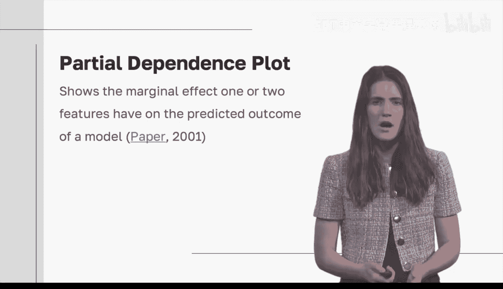
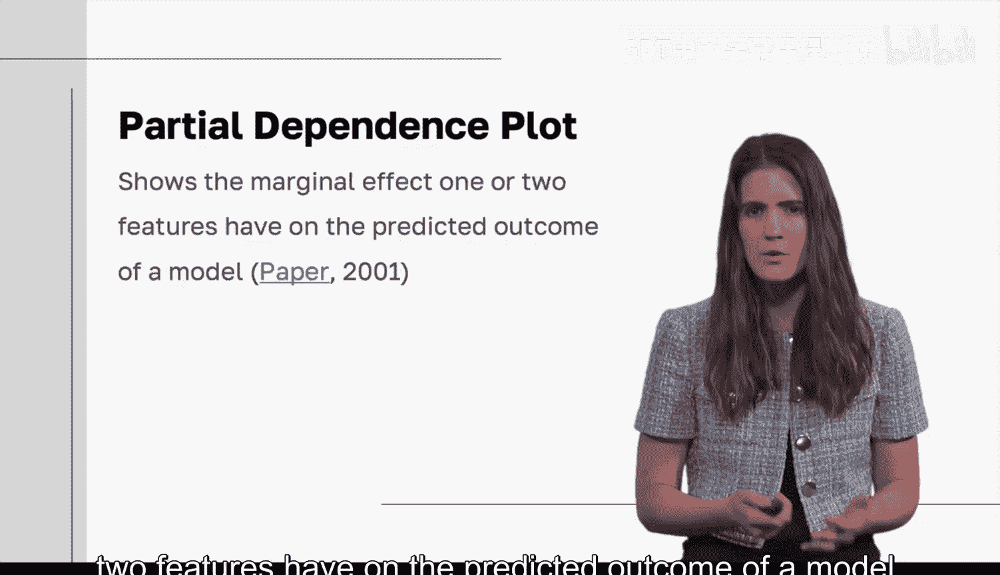
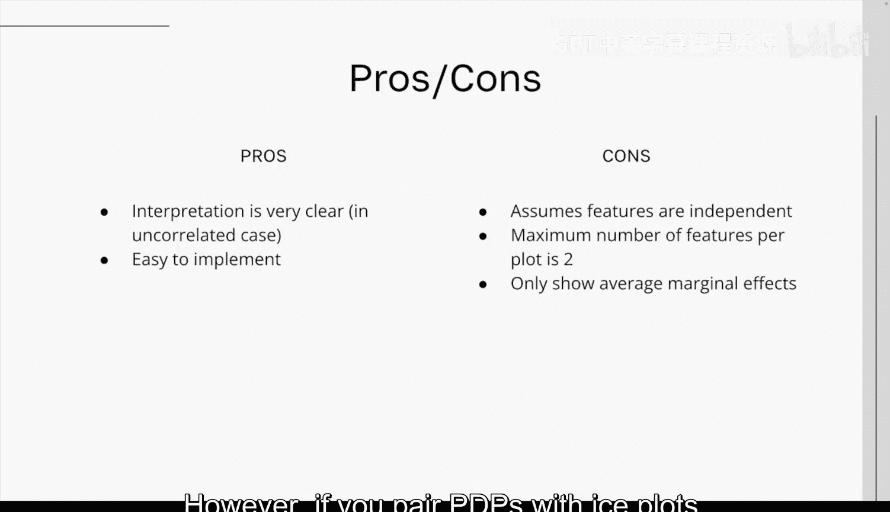
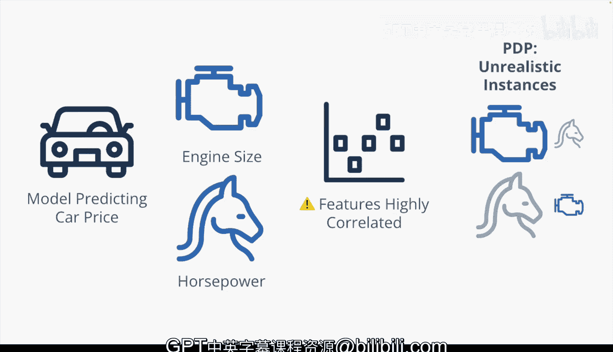

#  061：偏依赖图 📊

在本节课中，我们将要学习一种重要的模型解释工具——偏依赖图。我们将了解它的定义、工作原理、优缺点，并通过一个具体例子来理解其局限性。

## 概述

偏依赖图，简称PDP或PD，用于展示一个或两个特征对模型预测结果的边际效应。

上图展示了Friedman原始论文中的偏依赖图示例。如果它看起来很眼熟，那是因为它本质上是ICE图中所有线条的平均值。与ICE图类似，PDP可以展示特征与预测目标之间的关系。

## 创建偏依赖图的过程

上一节我们介绍了偏依赖图的概念，本节中我们来看看它的具体创建步骤。

以下是创建偏依赖图的流程：

1.  **选择目标特征**：首先，选定你感兴趣的特征。
2.  **固定其他特征**：对于数据集中的每一个实例，保持所有其他特征的值不变。
3.  **创建特征变体**：将该特征的值替换为网格中的一系列值，从而为每个实例创建多个变体。
4.  **进行预测**：使用黑盒模型对这些新创建的实例进行预测。
5.  **收集数据点**：现在，你为每个实例都得到了一组数据点，包含网格中的特征值及其对应的预测值。
6.  **计算平均并绘图**：最后，对所有实例的预测结果进行平均，并绘制成图。

在实践中，为了计算效率，我们通常采用偏依赖的近似计算方法。以下是其公式：

`f_S(x_S) ≈ 1/n * Σ_{i=1}^{n} f(x_S, x_C^{(i)})`

在这个公式中，我们改变特征`x_S`的值，同时固定其他特征`x_C`为第`i`个观测值的原始值，然后对训练数据中的`n`个观测值的模型预测结果`f`进行平均。

## 偏依赖图示例

现在，我们来看一个具体的应用示例。下图展示了自行车销量与温度、湿度和风速的偏依赖图。

其中，温度的PDP最有意思。当天气更热时，租用的自行车数量会增加。我们看到这个趋势一直上升到20摄氏度，然后趋于平缓，并在温度非常高时略有下降。

## 偏依赖图的优缺点评估

了解了PDP的创建和应用后，我们来评估它作为一种可解释人工智能技术的优缺点。

**优点**：
*   PDP易于实现。
*   在特征不相关的情况下，结果的解释非常清晰。

**缺点**：
*   该方法假设特征是独立的。
*   每张图最多只能展示两个特征。
*   它只展示了平均边际效应。

然而，如果你将PDP与ICE图结合使用，也可以获得局部信息。

## 局限性：特征相关性的影响

上一节我们讨论了PDP的优缺点，本节中我们通过一个具体例子来看看其核心局限性——对特征独立性的假设。

当特征之间存在强相关性时，PDP的解释可能会产生偏差。让我们考虑一个预测汽车价格的机器学习模型，它基于两个特征：发动机排量（升）和马力。实际上，这两个特征高度相关，发动机排量更大的汽车往往拥有更高的马力。

假设我们想用PDP来理解模型预测的汽车价格如何依赖于发动机排量这个特征。问题出现在为特定的发动机排量网格值计算平均预测时。

例如，当考虑一个较大的发动机排量（如5升）时，该方法会将所有实例的发动机排量都替换为5升，甚至包括那些马力值很低（如100马力）的实例。在现实中，由于发动机排量和马力之间的强相关性，一辆拥有5升发动机却只有100马力的汽车是极不可能且不现实的。

然而，PDP方法在平均步骤中仍然包含了这些不现实的实例，实际上默认了此类实例是合理的，并将其贡献于发动机排量对汽车价格的估计效应中。

因此，发动机排量的PDP图可能存在偏差，因为它包含了不现实特征值组合的预测，这可能导致对发动机排量与汽车价格之间真实关系的扭曲估计。

这个例子突显了当特征高度相关时，PDP可能面临的问题，因为它会对不太可能或不合逻辑的实例进行平均，可能导致对特征如何影响模型预测的误导性解释。

## 总结

本节课中我们一起学习了偏依赖图。我们了解到PDP是一种展示特征对模型预测平均边际效应的可视化工具，其创建过程涉及固定其他特征、网格化目标特征值并平均预测结果。PDP的优点是易于理解和实现，但其核心局限性在于假设特征独立性，当特征相关时，其解释可能基于不现实的数据组合而产生偏差。因此，在实践中，结合ICE图使用或注意其应用前提至关重要。