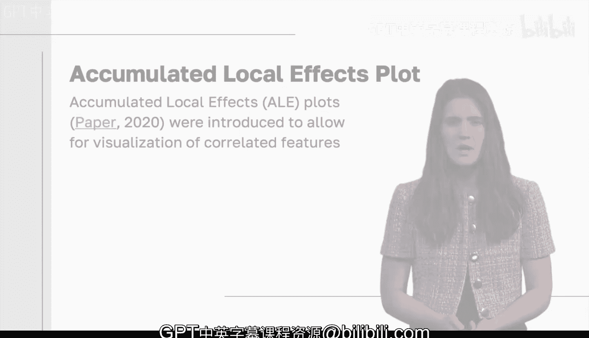
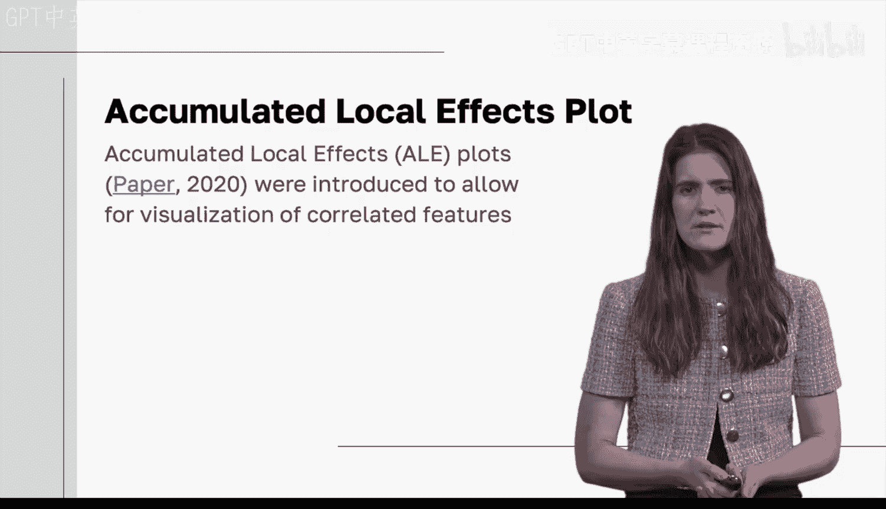
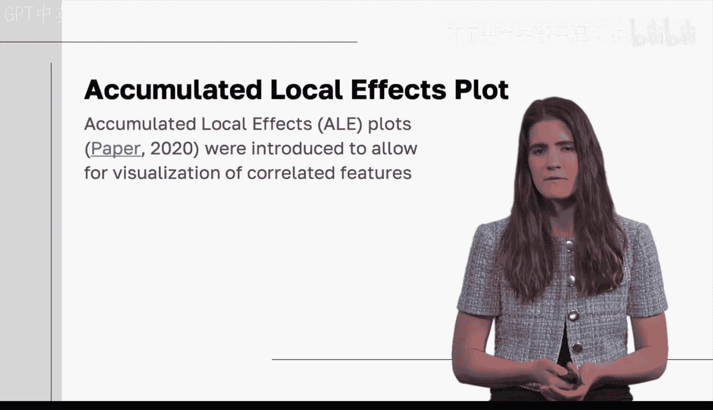
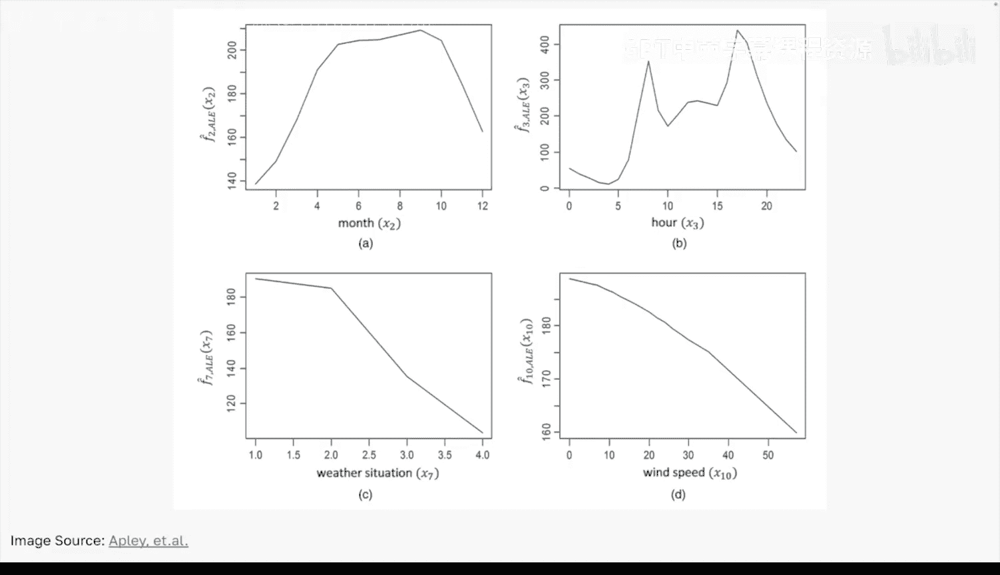
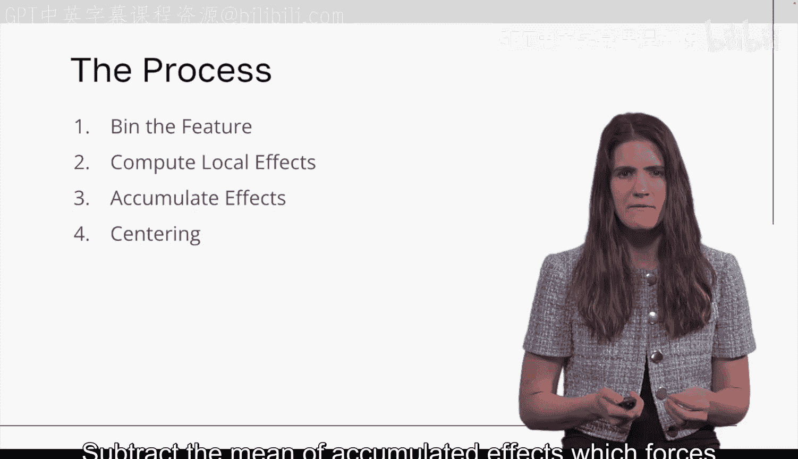
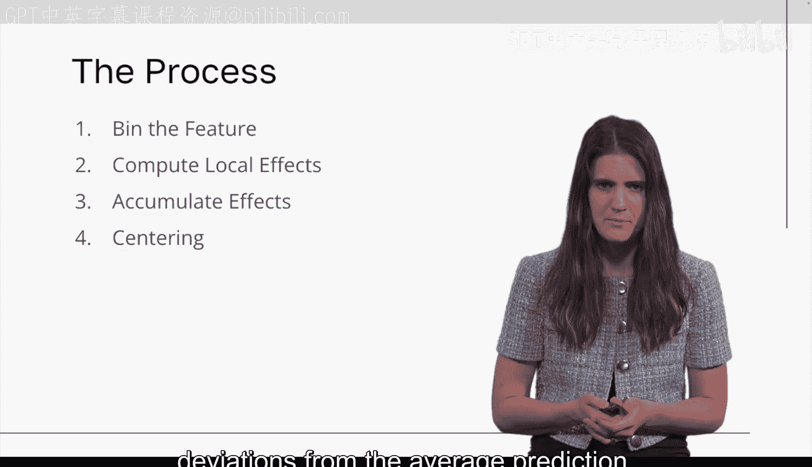
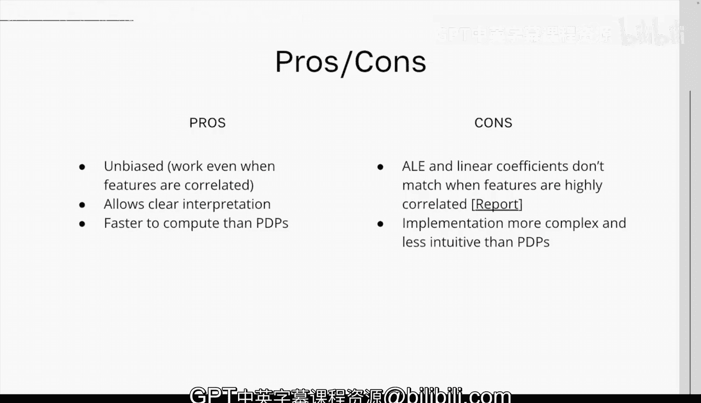

#  062：累积局部效应图（ALE）

在本节课中，我们将要学习一种名为“累积局部效应图”（Accumulated Local Effects Plot，简称ALE图）的可解释人工智能技术。ALE图旨在解决特征相关时，部分依赖图（PDP）解释不清的问题。

## 从PDP的局限到ALE的引入



上一节我们讨论了部分依赖图（PDP）的局限性，发现当特征之间存在相关性时，PDP的解释会变得不清晰。在实际应用中，特征通常是相关的，或者特征间的关系并不明确。


正因如此，累积局部效应图（ALE图）在2020年被提出。ALE图结合了局部效应和累积计算两个核心概念。



## ALE图的核心思想

与PDP在整个特征空间上平均化效应不同，ALE图关注的是当某个特征值发生变化时，模型预测的**局部变化**。




ALE图并不直接绘制这些局部效应，而是将效应在特征的整个取值范围内**累积**起来。这有助于我们理解该特征如何影响预测的**全局趋势**。




以下是原始论文中展示的几个ALE图示例，它们探索了月份、小时、天气和风速等特征对共享单车使用量的影响。


## 如何构建ALE图

要创建一个ALE图，我们需要遵循以下步骤：

**1. 特征分箱**
首先，将我们感兴趣的特征划分为若干个区间或“箱”。分箱有助于管理数据，并在更小、更易处理的片段内计算局部效应。

**2. 计算每个箱的局部效应**
计算特征对预测的局部效应。这涉及到计算从箱的下边界移动到上边界时，预测值的变化，并对落入该箱的所有实例取平均。
```
局部效应 = 平均( f(上边界, 其他特征) - f(下边界, 其他特征) )
```

**3. 累积效应**
从第一个箱开始，将所有箱的局部效应依次累加起来。通过顺序求和平均效应，展示特征值变化时对预测的累积影响。
```
累积效应(k) = Σ(从第1箱到第k箱的局部效应)
```

**4. 中心化处理**
为了使图形更具解释性，将累积后的效应以0为中心进行调整。减去累积效应的均值，这迫使解释聚焦于与平均预测的偏差。
```
中心化ALE值 = 累积效应 - 均值(累积效应)
```





## ALE图与PDP的对比

这张图对比了PDP和ALE图。在本例中，PDP的估计值受到了模型在数据分布之外异常行为的影响，这在图中表现为陡峭的跳跃。相比之下，ALE图正确地识别出了特征与预测之间的线性关系。

## ALE图的优缺点评估

现在，让我们评估一下ALE图作为一种可解释AI技术的优缺点。

以下是其主要优点：
*   **无偏性**：即使特征相关，ALE图也能提供无偏估计。
*   **解释清晰**：允许清晰的解释。
*   **计算更快**：相比PDP，计算速度更快。

然而，它也存在一些局限性：
*   **高度相关特征的挑战**：当特征高度相关时，ALE与线性系数可能不匹配。对于高度相关的特征，它并非完美的解决方案。
*   **实现更复杂**：ALE图的实现比PDP更复杂，直观性也稍差。



## 总结


本节课中，我们一起学习了累积局部效应图（ALE）。我们了解了ALE图如何通过关注局部变化并累积效应，来解决特征相关时PDP解释不清的问题，掌握了其构建的四个关键步骤（分箱、计算局部效应、累积、中心化），并通过对比认识了其相对于PDP的优势，同时也分析了其自身的局限性。ALE图是处理相关特征时一个强大且更可靠的可视化工具。