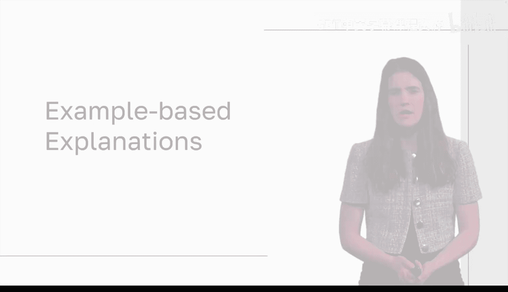
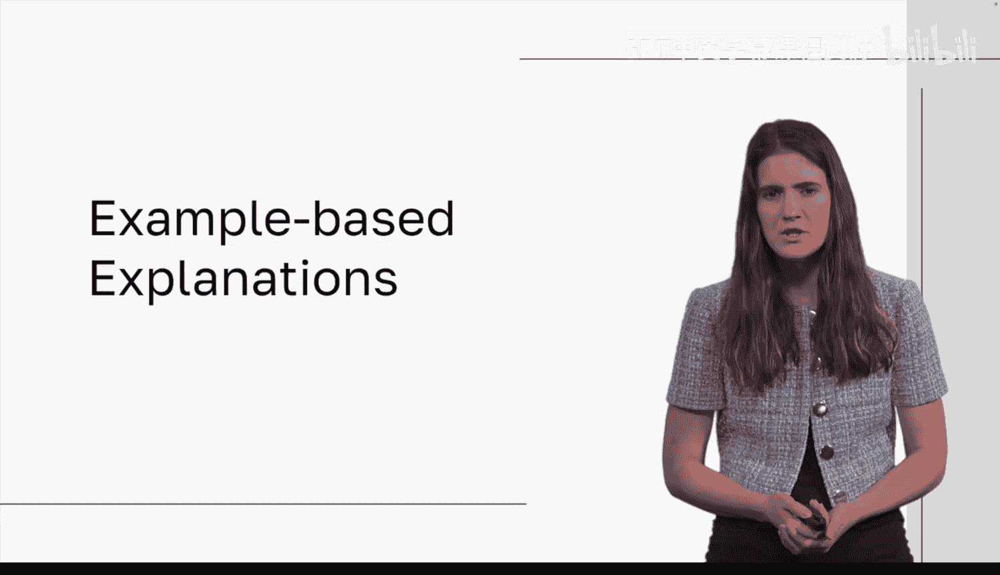
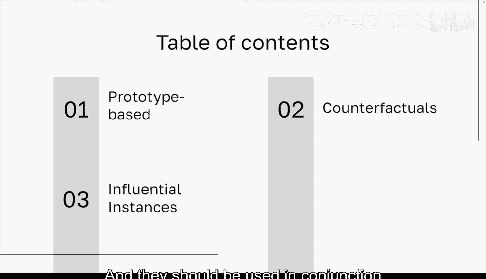

#  063：基于实例的解释方法导论 🧩

在本节课中，我们将要学习一种重要的可解释人工智能方法——基于实例的解释方法。这种方法通过展示相关的例子或反事实场景，为机器学习模型的预测提供人类可以理解的解释。

基于实例的解释方法是一种解释和理解机器学习模型决策的方式，尤其在计算机视觉和自然语言处理等复杂任务中。这些解释旨在通过呈现相关的例子或反事实场景，为模型的预测提供人类可理解的依据。

我们将讨论几种不同类型的基于实例的解释方法，包括基于原型的解释、反事实解释和有影响力的实例。

## 应用场景与重要性

基于实例的解释方法在医疗诊断、贷款审批或犯罪风险评估等高风险的决策场景中特别有用。在这些场景中，理解模型预测背后的推理过程至关重要。

这些解释有助于建立对模型决策的信任，识别潜在的偏见或缺陷，并促进人机协作。

## 方法的局限性

然而，需要注意的是，与所有可解释人工智能技术一样，基于实例的解释方法可能并不总能完全捕捉深度神经网络复杂的决策过程。它们应与其他解释技术结合使用，以获得对模型行为更全面的理解。

本节课中，我们一起学习了基于实例的解释方法的基本概念、应用场景及其重要性。我们了解到，这种方法通过具体的例子来解释模型决策，对于建立信任和识别模型问题非常有帮助，但也认识到其局限性，需要与其他技术结合使用。