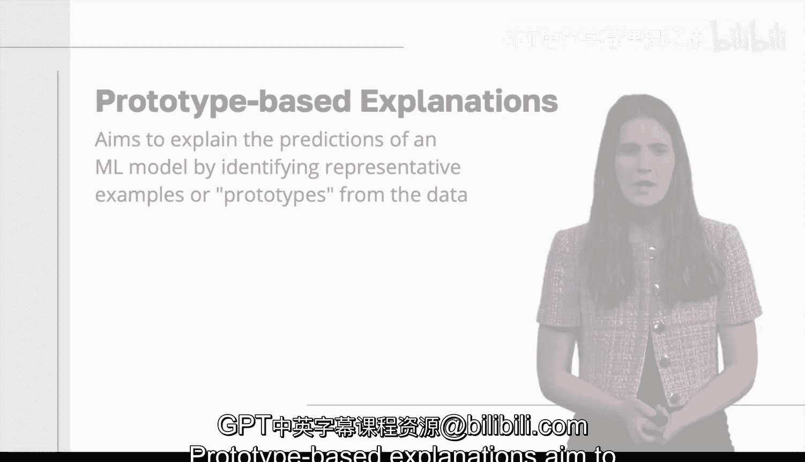
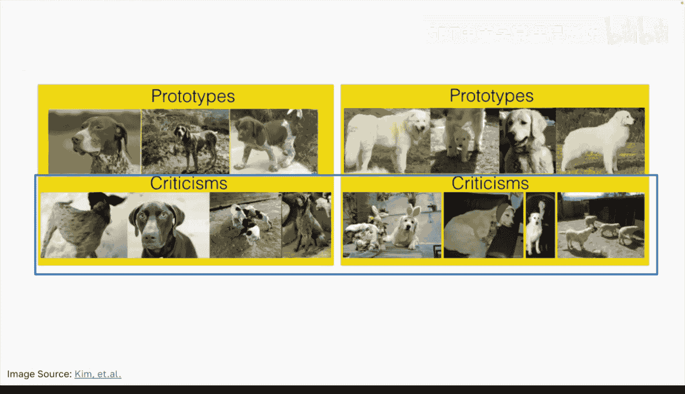
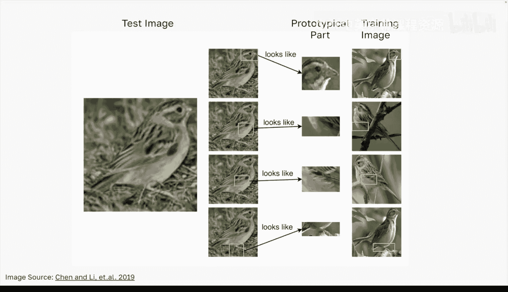
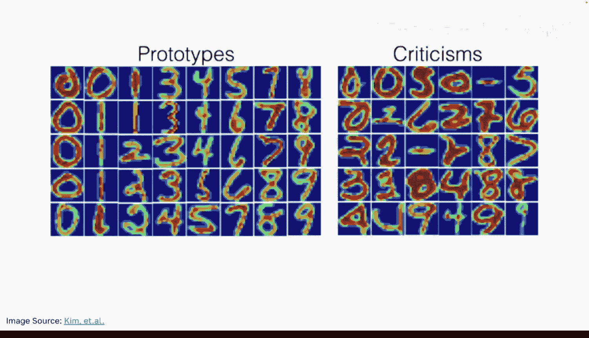
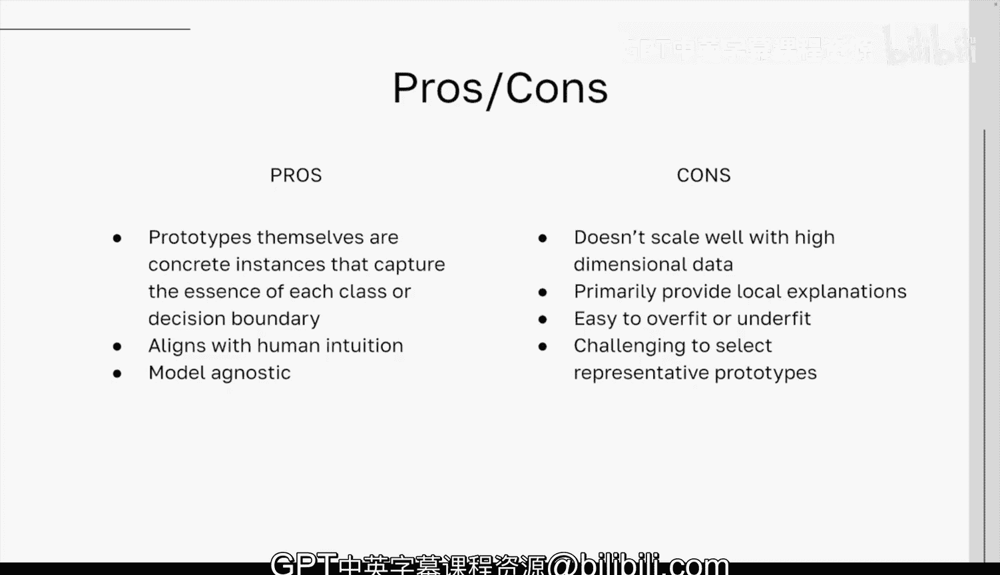

#  064：基于原型的解释 🧩

在本节课中，我们将要学习一种重要的可解释人工智能方法——基于原型的解释。这种方法旨在通过从数据中识别出具有代表性的样本或原型，来解释黑盒模型的预测结果。

## 概述 📋

基于原型的解释的核心论点是，我们使用原型实例或模式来表示模型的知识。这种方法通过展示与当前输入最相似的训练样本，来帮助用户理解模型的决策依据。

## 工作原理与实现 ⚙️

上一节我们介绍了基于原型的解释的基本概念，本节中我们来看看它的具体工作原理和实现步骤。

对于一个给定的预测，模型会从训练数据中选择最相似的样本作为原型。这些原型通常基于它们在特征空间中与输入实例的接近程度来选择。

模型通过评估输入实例与各个原型之间的相似度来完成这一过程。相似度通常使用特征空间中的距离度量来计算，例如欧几里得距离。

系统随后将这些原型展示给用户，说明输入实例与这些示例的相似之处。用户可以检查这些原型，观察共同的特征和模式，从而更容易理解模型为何做出特定预测。

除了原型，我们还可以使用对比示例或批评样本。这些是与输入相似但属于不同类别的样本。这有助于用户理解预测类别与其他类别之间的区别。

需要明确的是，原型和批评样本始终是我们数据中的真实实例。

## 扩展与应用 🔄

这些方法已被扩展到神经网络的可解释性领域，我们将在讲解深度学习的模块中详细讨论。

## MMD-Critic 方法 📊

一种于2016年提出的基于原型的解释方法是MMD-Critic。其名称来源于其对最大均值差异（MMD）双样本统计检验的使用。

MMD-Critic背后的主要思想是，它选择能够最小化两个分布之间差异的原型。高密度区域的数据点是良好的原型，而那些原型未能很好解释的区域的数据点则被选为批评样本。

原始论文中的图表展示了USPS数据集的原型和批评样本示例。可以看出，即使不理解底层模型本身，人类也很容易理解这些原型和批评样本。

以下是MMD-Critic的一般方法步骤：

首先，确定你希望选取的原型和批评样本的数量。

1.  **寻找原型**：通过贪心搜索，找到使原型分布与数据分布最接近的点。
2.  **寻找批评样本**：通过贪心搜索，找到原型分布与数据分布差异最大的点。

最大均值差异（MMD）是衡量两个分布差异程度的指标。MMD-Critic的目标是最小化MMD的平方。

理解了MMD之后，我们可以讨论寻找原型的算法：

1.  从一个空的原型列表开始。
2.  当原型数量小于预设数量 `m` 时，对数据集中的每个点，检查将其加入原型列表后MMD减少了多少。
3.  将能使MMD最小化的数据点加入列表。
4.  该过程完成后，返回原型列表。

## 优缺点评估 ⚖️

现在，我们来评估将基于原型的解释作为可解释AI技术的优缺点。

**优点**：
*   原型本身是捕捉每个类别或决策边界本质的具体实例，这符合人类的直觉。
*   它们是模型无关的。

**缺点**：
*   基于原型的解释难以扩展到高维数据。
*   它主要用于提供局部解释。
*   容易过拟合或欠拟合。
*   选择具有代表性的原型非常具有挑战性。

## 总结 ✨

本节课中，我们一起学习了基于原型的解释方法。我们了解了其通过展示代表性样本来解释模型预测的核心思想，探讨了MMD-Critic这一具体算法的原理与步骤，并分析了该方法的优势与局限性。这种方法以其直观性，为理解复杂模型的决策过程提供了一条有效途径。