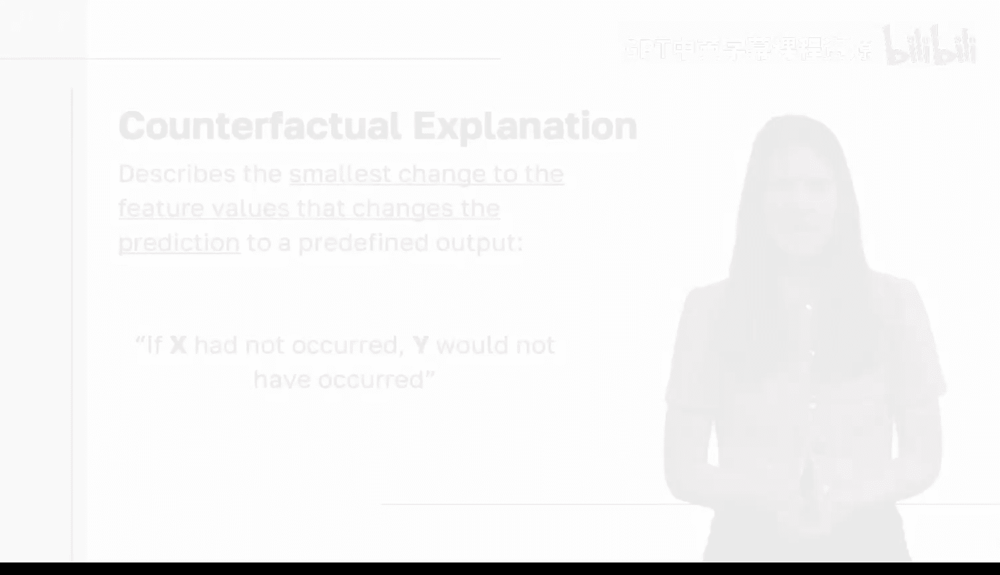
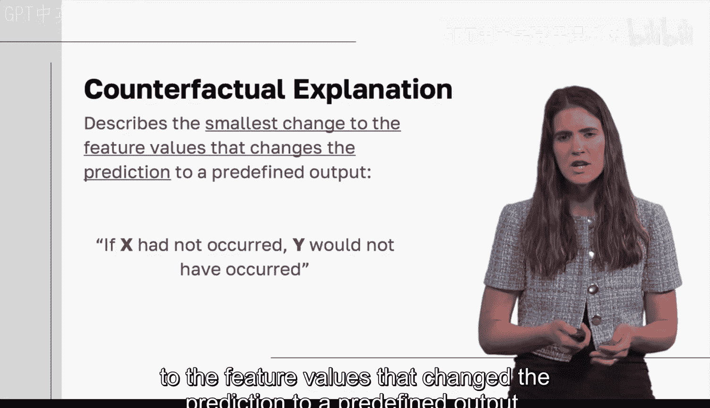
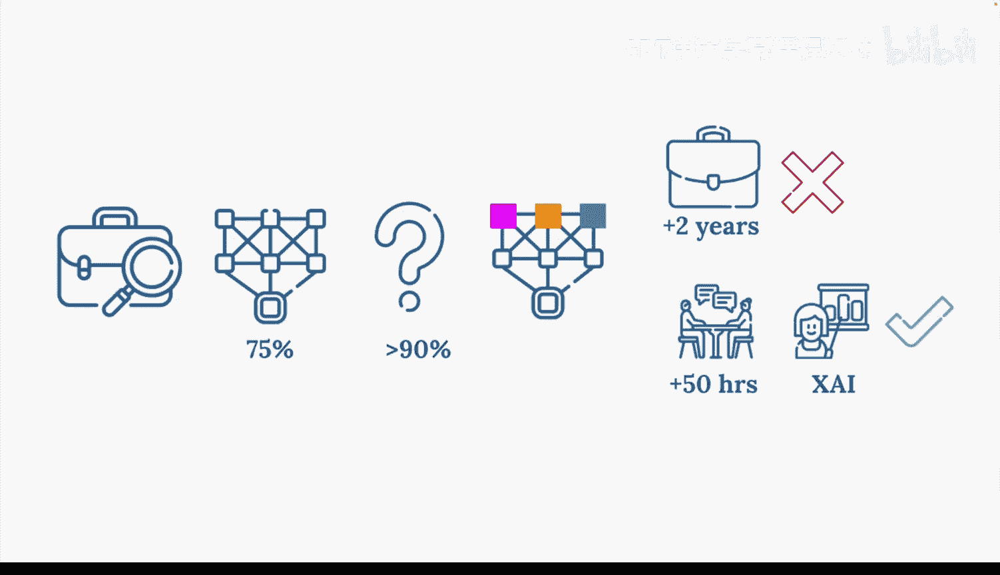
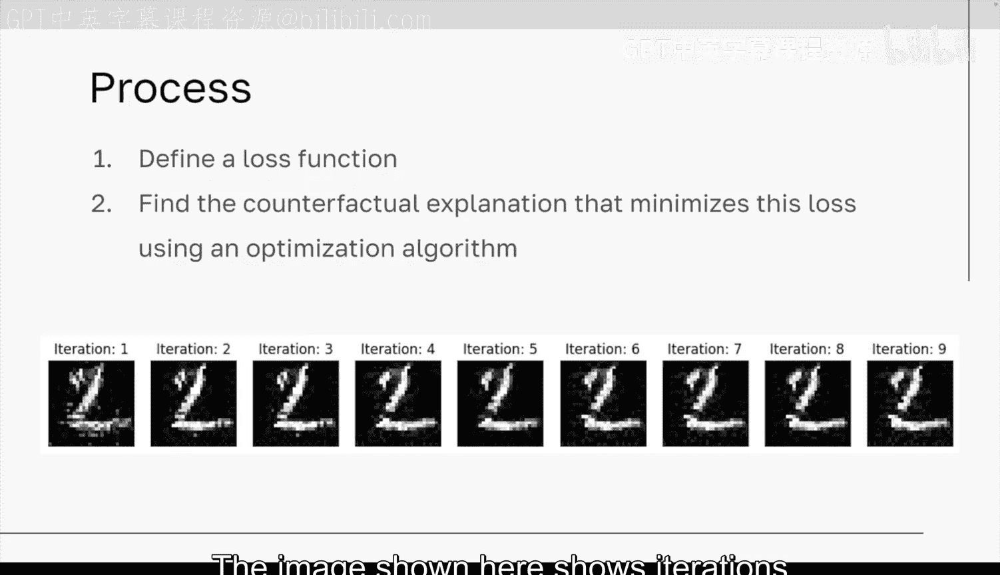
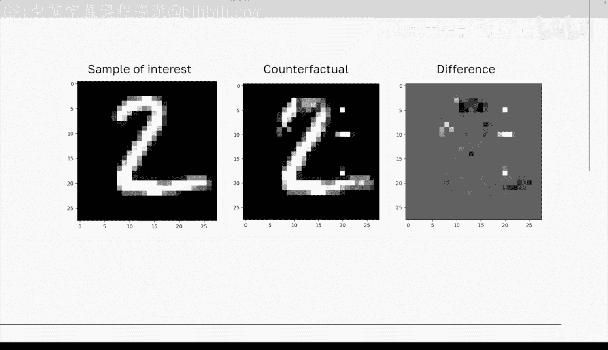
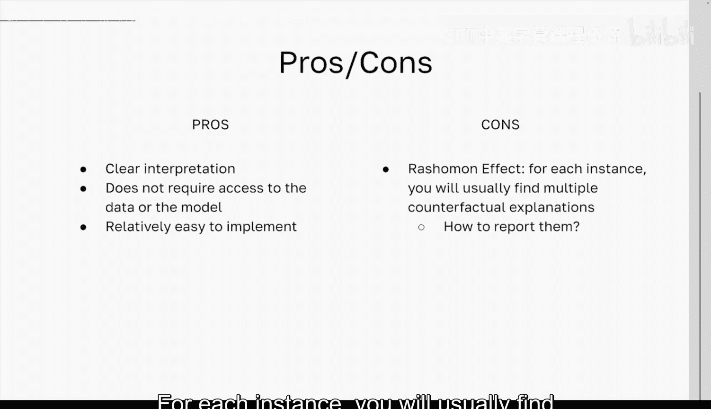
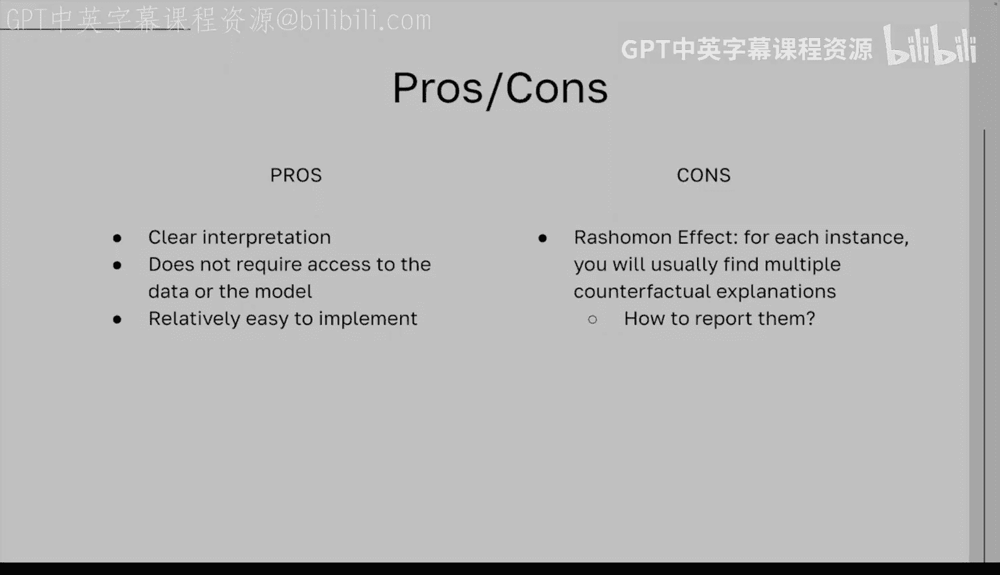

#  065：反事实解释

在本节课中，我们将要学习一种重要的可解释人工智能技术——反事实解释。我们将了解其核心概念、工作原理、应用方法以及优缺点。

## 概述

反事实解释通过描述“如果某些条件改变，结果将如何不同”来为模型的预测提供洞见。它是一种直观且强大的解释方法，尤其适用于指导决策。

---

## 反事实解释的核心概念

反事实描述了一种因果关系：如果事件X没有发生，那么事件Y就不会发生。

我们可以通过改变一个数据实例的特征值，然后观察模型预测结果如何变化，来为黑盒机器学习模型的预测模拟反事实。

一个预测的反事实解释，描述了将预测结果改变为预定输出所需的最小特征值变化。

**核心公式**可以表示为：寻找一个反事实实例 `x'`，使得 `f(x') = y'`，同时 `distance(x, x')` 尽可能小。其中 `f` 是模型，`x` 是原始实例，`y'` 是期望的预测结果。

---

## 一个直观的例子

上一节我们介绍了反事实的基本概念，本节中我们来看一个具体的例子，以加深理解。

假设你正在申请机器学习相关的工作，并对自己能否获得一家顶尖科技公司的录用感到不确定。你决定利用历史申请者数据构建一个模型，特征包括教育背景、工作经验、技能、项目经历和面试准备时长，用以预测你获得录用通知的概率。

模型预测你获得录用的概率为75%。这个结果尚可，但你希望将概率提升到90%以上。于是，你开始尝试改变特征值，看看如何能改善预测结果。

你发现，如果你能增加两年的工作经验，你的录用概率将提升至85%。然而，立即获得两年经验并不现实。

接着，你将注意力转向可控因素，例如面试准备和特定技能提升。你发现，如果你在面试准备上多投入50个小时，并完成一门可解释人工智能课程，你的预测成功率将升至92%。

通过探索这些反事实情景，你可以利用模型做出数据驱动的决策。

---

## 如何构建反事实解释

我们的直观例子展示了通过试错法构建反事实解释。但作为机器学习工程师，我们需要更系统的方法。

我们可以使用优化算法来最小化损失函数。以下是基本步骤：

1.  **定义损失函数**：该损失函数接收三个输入：感兴趣的原始实例、一个反事实实例、以及期望的反事实结果。
2.  **使用优化算法**：寻找能最小化此损失函数的反事实解释。

存在多种方法，它们在损失函数的定义和优化方法上有所不同。下图展示了构建反事实解释的迭代过程。

（此处原有一张展示迭代过程的图片）

---

## 实践案例：MNIST数据集

让我们看一个在MNIST手写数字数据集上的具体案例。

这里展示了一个来自MNIST数据集的样本（一个数字）及其生成的反事实解释。我们还可视化了它们之间的差异，以展示需要改变哪些像素才能让模型将其误分类为数字“6”。

在配套的编程练习中，你将使用MNIST数据集开发自己的反事实解释。

（此处原有一张MNIST数字及其反事实对比的图片）

---

## 反事实解释的优缺点

现在我们已经了解了反事实解释的构建方法，本节我们来评估一下它作为一种可解释AI技术的优缺点。

以下是其主要优点：
*   **解释清晰直观**：反事实解释（“如果...那么...”的形式）易于人类理解。
*   **无需访问数据或模型**：某些方法可以在不了解模型内部细节或训练数据的情况下生成解释。
*   **相对易于实现**：核心思想直接，有多种开源工具包可供使用。

然而，该方法也存在挑战，主要是“罗生门效应”：
*   **罗生门效应的挑战**：罗生门效应指的是不同人对同一事件或经历给出截然不同的描述。这一概念源自1950年的日本电影《罗生门》。在电影中，同一事件被四位证人或参与者以四种相互矛盾的方式描述，每种描述都看似合理且自洽，但彼此根本不相容。
*   **对反事实的影响**：对于同一个实例，通常可以找到多个不同的反事实解释，并且没有标准化的方法来报告哪一个是最佳或“正确”的解释。

---

## 总结

本节课中，我们一起学习了反事实解释。我们首先理解了其“如果X未发生，则Y不会发生”的核心因果逻辑。然后，通过一个求职预测的例子，我们看到了反事实如何用于指导 actionable 的决策。接着，我们探讨了使用优化算法自动生成反事实的系统方法，并观察了在MNIST数据集上的应用实例。最后，我们分析了该技术的优势（直观、保护隐私、易实现）和主要局限（存在多个可能解释的“罗生门效应”）。掌握反事实解释，能帮助你为机器学习模型提供更贴近人类思维的、具有操作性的见解。