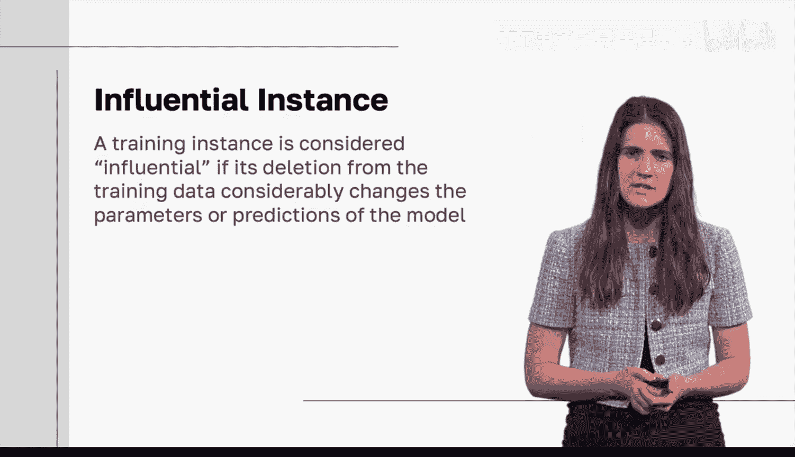
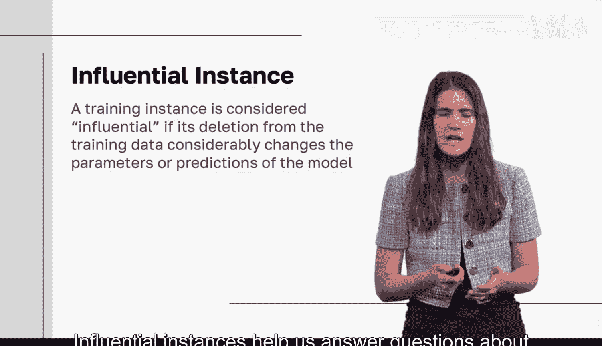
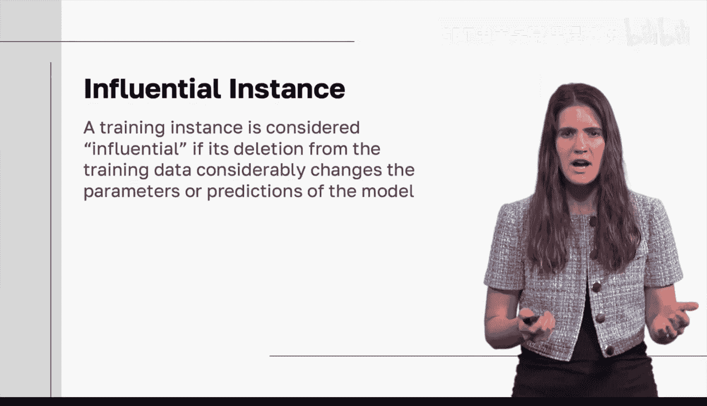
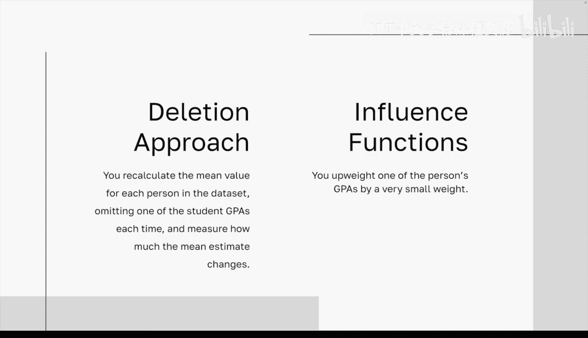
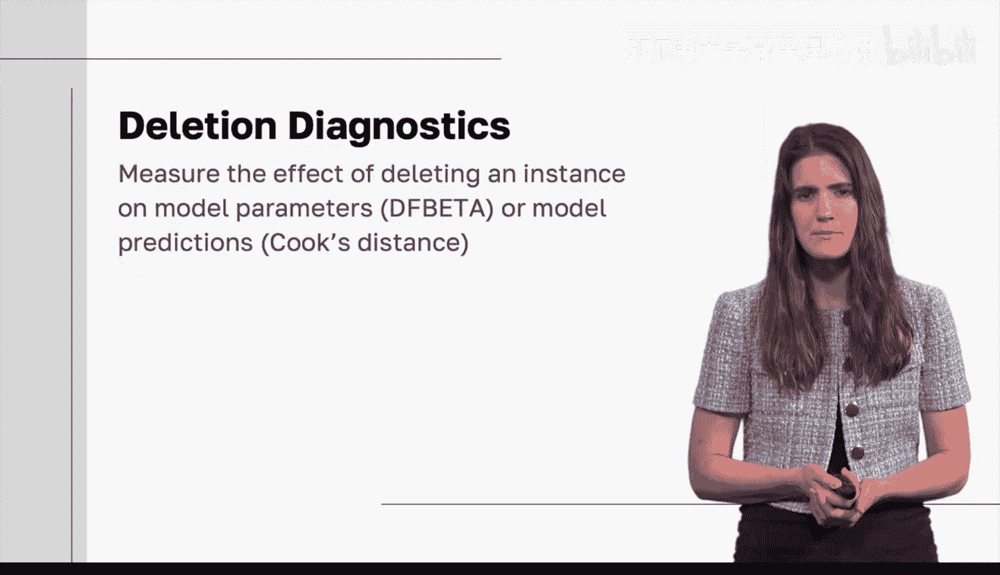
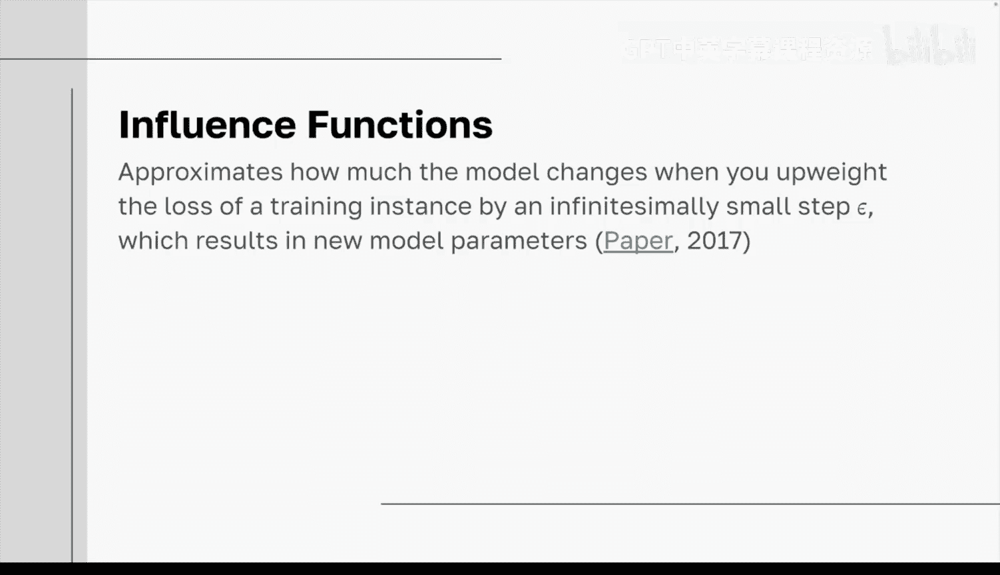
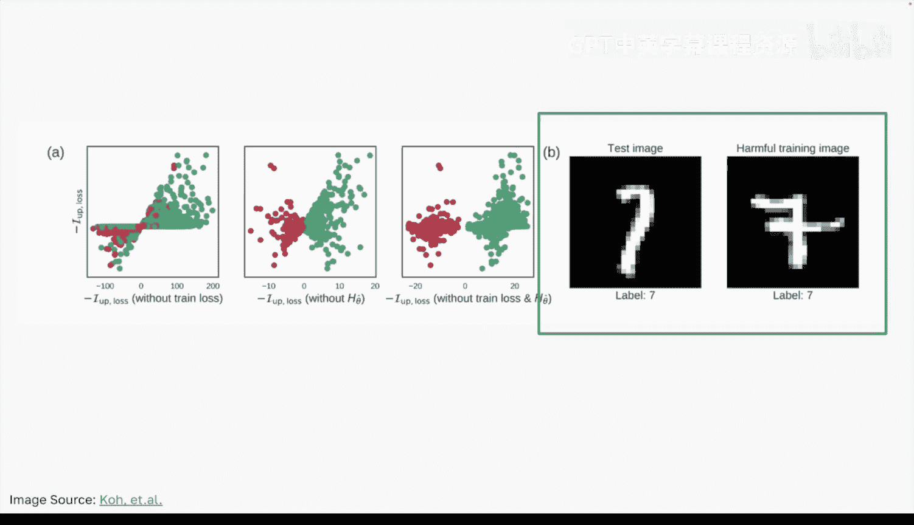
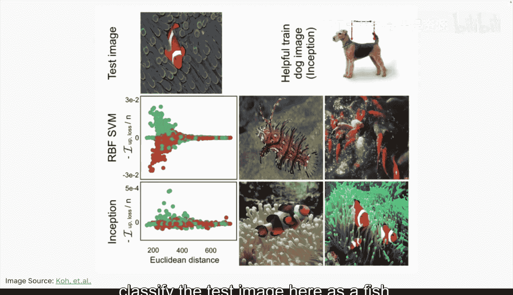
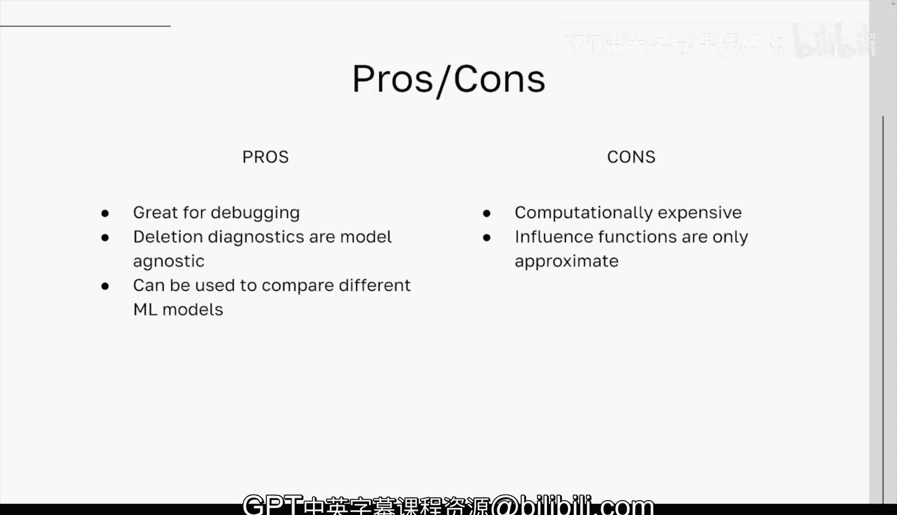

#  066：影响实例分析

在本节课中，我们将要学习一种重要的模型解释方法：影响实例分析。我们将探讨如何识别那些对模型参数或预测结果有重大影响的训练数据点，并了解其背后的两种主要技术。

## 概述

删除一个训练数据实例可能会影响最终得到的模型。如果一个训练实例从训练数据中删除后，会显著改变模型的参数或预测结果，那么它就被认为是一个有影响力的实例。通过识别这些有影响力的训练实例，我们可以调试模型，并更好地解释它们的行为和预测。

## 影响实例的用途

影响实例帮助我们回答关于模型全局行为和个体预测的问题。以下是两类关键问题：

*   哪些实例对模型参数或整体预测最具影响力？
*   哪些实例对某个特定的预测最具影响力？

## 影响实例的类型

上一节我们介绍了影响实例的概念，本节中我们来看看它的两种主要类型：删除诊断法和影响函数法。需要注意的是，影响实例分析并非与模型无关的通用方法，每种类型都有其特定的要求。

## 一个简单的例子

假设你决定估算Coursera学生的平均绩点，因此你从你的XAI课程同学中抽取了一个样本。我们暂时忽略你的抽样方法。问题是：单个学生能在多大程度上影响你计算出的平均绩点？

以下是两种分析思路：

*   **删除法**：你为数据集中的每个人重新计算平均绩点，每次计算时都省略一个学生的绩点，然后衡量平均估计值的变化程度。
*   **影响函数法**：你将其中一个人的权重增加一个非常小的值，这相当于计算某个统计量或模型的一阶导数。

## 具体技术：Df Beta 与 Cook‘s 距离

检测有影响力的数据点对于构建稳健的机器学习模型至关重要。让我们探讨两种流行的技术：Df Beta 和 Cook‘s 距离。

首先，我们来谈谈 Df Beta。Df Beta 衡量删除一个实例对模型参数的影响。它对于具有权重参数的模型（如逻辑回归或神经网络）特别有用。通过计算 Df Beta，你可以识别那些对模型学习到的权重有不成比例影响的实例。

以下是 Df Beta 的计算过程：
1.  移除一个实例。
2.  重新计算权重向量。
3.  将其与使用所有实例得到的权重向量进行比较。

接下来是 Cook‘s 距离。这个指标衡量删除一个实例对模型预测的影响。它最初是为线性回归模型创建的，包含一个平方项和均方误差。然而，通过移除这些特定项，它可以被修改以适用于其他模型类型。

以下是 Cook‘s 距离的计算过程：
1.  移除一个实例。
2.  重新计算模型预测。
3.  将其与使用所有实例得到的预测进行比较。

## 影响函数法

2017年引入的影响函数法为删除诊断法提供了一种替代方案。它不直接删除训练实例，而是通过将某个训练实例的损失函数权重增加一个无穷小的量，来近似计算模型会发生多大变化，从而得到一组新的模型参数。这种方法需要获取损失函数相对于模型参数的梯度，因此只适用于某些模型，如逻辑回归、支持向量机和神经网络。

## 实例展示

以下是来自2017年原始论文中影响函数的示例。

在图1B中，你可以看到一个测试图像和一个具有相同标签的有害训练图像。这个训练图像的存在使得模型认为测试图像是数字“7”的可能性降低了。这是一个有害训练图像的例子。

在图4中，展示了一个在对鱼和狗进行分类时有帮助的训练狗图像。这个训练图像被证明对帮助Inception模型正确地将这里的测试图像分类为“鱼”具有影响力。

## 影响实例与异常值

在结束之前，有一点需要注意：你可能会认为影响实例看起来与异常值非常相似。然而，影响实例关注的是实例与其对应的模型参数或预测之间的关系，而异常值关注的是实例与其他实例或数据之间的关系。一个有影响力的实例不一定是异常值，反之亦然。如果一个异常值影响了模型，那么它就是一个有影响力的实例。

## 优缺点评估

现在，让我们评估一下影响实例作为一种可解释人工智能技术的优缺点。

**优点**：
*   非常适用于调试模型。
*   删除诊断法在很大程度上与模型无关，可用于比较不同的机器学习模型。

**缺点**：
*   计算成本高昂。
*   需要了解影响函数法只是近似计算。

## 总结

本节课中我们一起学习了影响实例分析。我们了解到，通过识别对模型有重大影响的训练数据点，我们可以深入理解模型的行为，并对其进行调试。我们探讨了两种主要方法：删除诊断法（如Df Beta和Cook‘s距离）和影响函数法，并比较了它们的特点与适用场景。理解影响实例与异常值的区别，以及该技术的优缺点，对于在实际中有效应用这一解释工具至关重要。