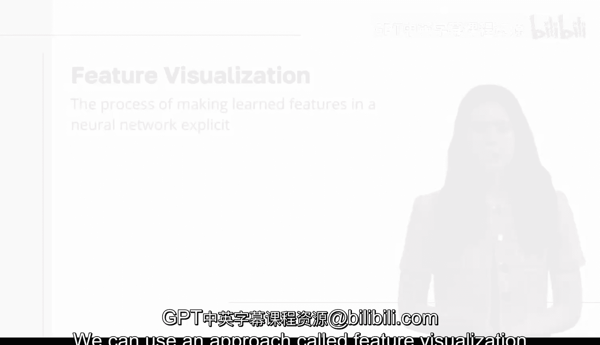
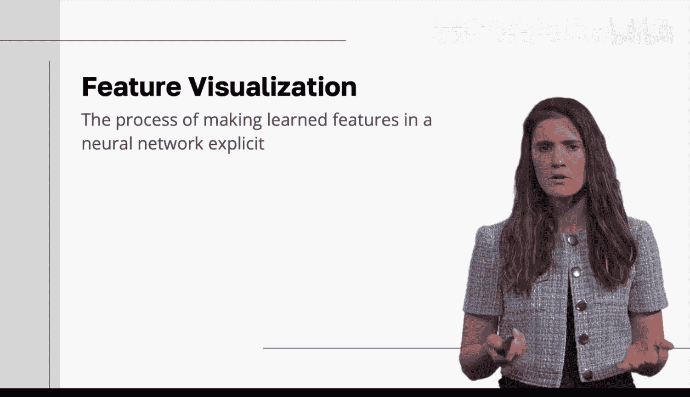
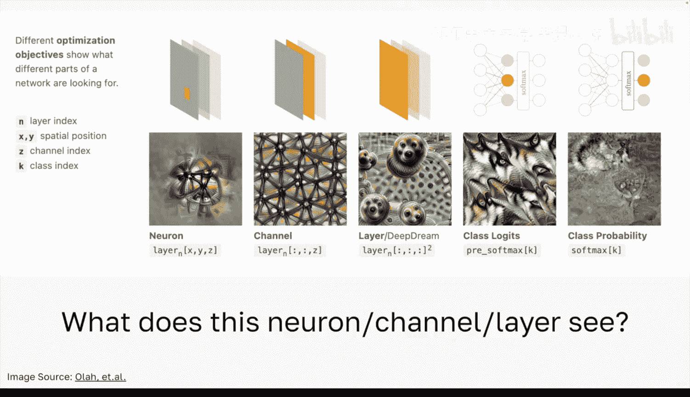
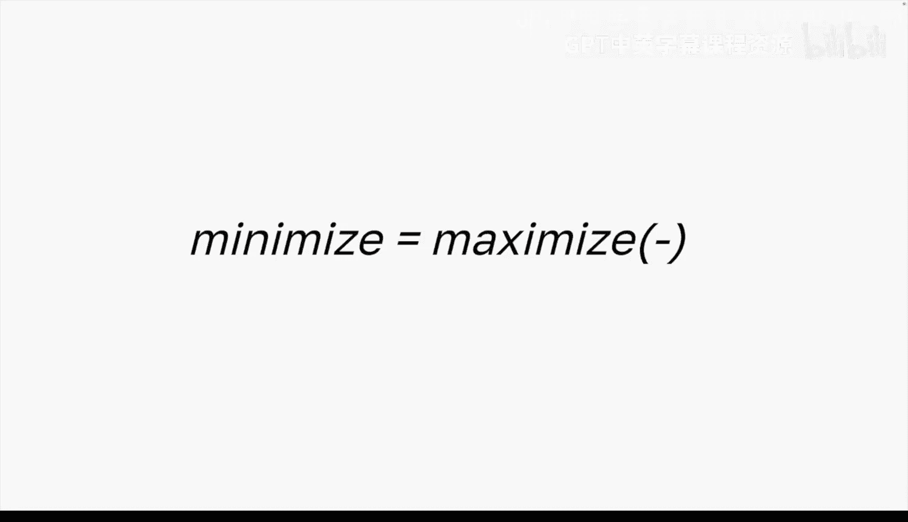
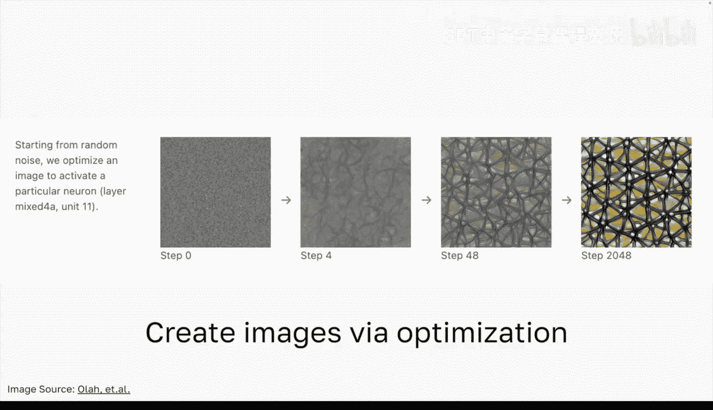
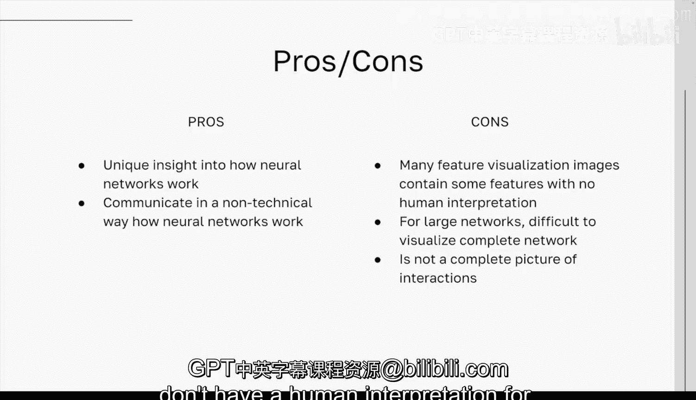

#  067：特征可视化 🎨

在本节课中，我们将要学习一种名为“特征可视化”的技术，它可以帮助我们直观地理解神经网络内部正在发生什么。

特征可视化是一个使神经网络中学习到的特征变得明确的过程。它回答了这样一个问题：这个神经元、通道或层“看到”了什么。

---

上一节我们介绍了特征可视化的基本概念，本节中我们来看看它的具体表现形式。

在谷歌2017年介绍该方法的文章中，我们可以看到不同层次的特征可视化：神经元级别、通道级别和层级别。

---

了解了特征可视化的表现形式后，我们来看看其背后的数学原理。

通过特征可视化，我们的目标是最大化某个神经元对于一张输入图像 `X` 的激活值 `H`。在这个公式中，`X` 和 `Y` 指的是神经元在空间中的位置，`n` 指的是层数，`Z` 指的是通道索引。

为了计算整个通道 `Z` 在层 `N` 中的平均激活，我们会对该通道进行求和，如下所示：

**公式：**
`argmax_X H_{X,Y}^{(n,Z)}`

**注意：** 除了最大化激活值，你也可以最小化它，这等同于在负方向上最大化激活。

---

理解了数学原理后，接下来我们探讨如何实现特征可视化。

以下是实现特征可视化的关键步骤：

1.  **通过优化创建图像**：我们从随机噪声图像开始，通过优化过程来获得有意义的可视化结果。
2.  **施加图像约束**：为了获得清晰的结果，我们会对图像施加约束，例如只允许微小的变化。
3.  **应用变换以减少噪声**：在优化前，我们可以对图像应用抖动、旋转或缩放，以减少可视化结果中的噪声。
4.  **添加其他正则化**：例如，频率惩罚可以降低相邻像素的方差。
5.  **使用学习到的先验生成图像**：例如，可以使用生成对抗网络（GANs）或去噪自编码器来生成更自然的图像。

这个过程展示了从随机噪声开始，通过优化一张图像来激活特定神经元，并试图最大化其激活值的过程。

---

最后，我们来评估一下特征可视化作为一种可解释人工智能技术的优缺点。

以下是特征可视化的主要优点和缺点：

*   **优点**：
    *   它为我们理解神经网络的工作原理提供了独特的视角。
    *   它允许我们以非技术性的方式向他人解释神经网络是如何工作的。
*   **缺点**：
    *   对于大型网络，它无法提供完整的交互图景，难以全面可视化。
    *   许多特征可视化图像包含一些抽象的、我们无法用人类语言解释的特征。

---

本节课中我们一起学习了特征可视化技术。我们了解了它的定义、表现形式、数学原理、实现步骤以及优缺点。特征可视化是打开神经网络“黑箱”、理解其内部工作机制的一扇重要窗口。