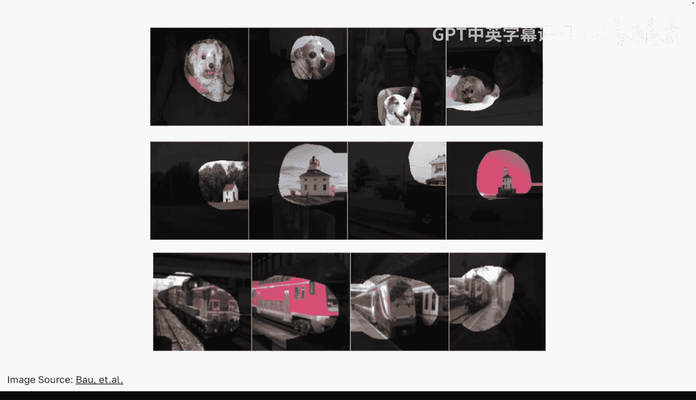
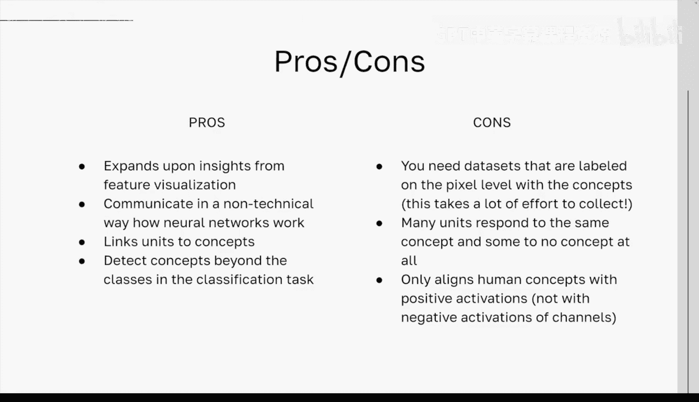
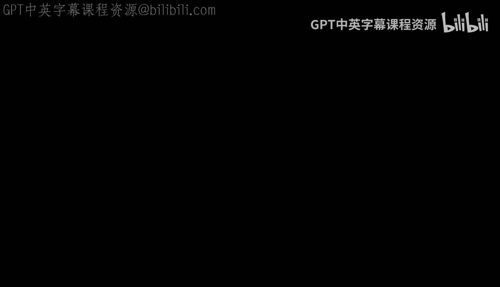

#  069：网络解构分析 🔍

在本节课中，我们将学习一种名为“网络解构”的技术。该技术旨在揭示卷积神经网络内部单元与人类可理解概念之间的关联，帮助我们理解神经网络究竟学到了什么。

## 概述

网络解构技术于2017年被提出，其核心目标是建立神经网络内部单元与人类概念之间的联系。它试图回答一个关键问题：卷积神经网络是否学习了“解耦”的特征？这里的“解耦特征”指的是单个网络单元能否检测到特定的现实世界概念。如果答案是肯定的，那么网络就具备了一定的可解释性。但需要提前说明的是，研究发现，卷积神经网络实际上并非完美解耦的。接下来，我们将深入探讨这一方法。

## 网络解构的实现步骤

网络解构的实现过程相当直接明了，主要包含以下三个步骤。

以下是具体步骤：
1.  **获取带有人工标注视觉概念的图像**：这些图像需要在像素级别上标注了不同抽象层次的概念。
2.  **测量CNN通道激活**：针对这些图像，计算卷积神经网络各通道的激活情况。
3.  **对齐激活与标注概念**：将网络的激活模式与人工标注的概念进行匹配。

此方法可用于探测任何卷积层。接下来，我们将深入每个步骤的细节。

## 测量通道激活

上一节我们介绍了整体步骤，本节中我们来看看如何具体测量通道激活。

对于每个卷积通道 **K** 和每张图像 **X**，我们执行以下操作：
1.  将图像 **X** 前向传播到包含通道 **K** 的目标层。
2.  提取通道 **K** 的像素激活图，记为 **a_K(x)**。
3.  在所有图像上，计算像素激活值 **a_K** 的分布。
4.  确定该激活分布 **α_K** 的 0.995 分位数，作为该通道的激活阈值 **T_K**。
5.  对于每张图像 **X**，将激活图 **a_K(x)** 缩放到图像 **X** 的分辨率，得到 **s_K(x)**。
6.  对激活图进行二值化处理。每个像素根据其激活值是否超过阈值 **T_K** 被判定为“开启”或“关闭”。生成的新掩码 **M_K(x)** 由以下公式定义：
    `M_K(x) = s_K(x) >= T_K`

至此，我们为每张图像和每个通道都得到了一个激活掩码。

## 对齐激活与概念

在得到激活掩码后，本节我们将探讨如何将其与人类概念对齐。

对于每个通道 **K**，我们需要找到最能激活该通道的人类概念。具体做法是将该通道的激活掩码与所有已标注的概念掩码进行比较。

我们使用交并比（Intersection over Union, IoU）来量化激活掩码 **K** 与概念掩码 **C** 之间的对齐程度。当 **IoU(K, C) > 0.04** 时，我们认为单元 **K** 是概念 **C** 的一个检测器。

右侧展示了交并比的计算公式：`IoU = (Area of Intersection) / (Area of Union)`。

让我们看一个视觉示例。以杜克大学教堂图片为例，红色虚线区域代表人工标注的真实概念区域，蓝色实线区域代表网络激活最强的区域。两者的重叠部分即为交集区域，而包含两者及交集的总区域即为并集区域。

## 实例分析

现在，让我们观察一些来自原论文的实例。

在这张图中，我们可以看到与“狗”、“房屋”和“火车”等概念相关的激活区域。

原论文中的另一个例子，展示了网络激活与人工标注概念之间的比较。

## 优缺点总结

最后，我们来评估网络解构作为一种可解释人工智能技术的优缺点。

**优点**：
*   网络解构拓展了特征可视化的见解。
*   它以一种非技术性的方式传达神经网络的工作原理。
*   我们可以用它来将网络单元与概念联系起来。
*   它能够检测到超出分类任务类别范围的概念。

**缺点**：
*   它需要像素级别标注了概念的数据集，这类数据收集成本高昂。
*   许多单元会对同一概念产生响应，而有些单元则不对任何概念响应，这可能造成混淆。
*   它只关注通道的正向激活与人类概念的对齐，而忽略了负向激活可能蕴含的信息。

## 总结

本节课中，我们一起学习了网络解构分析技术。我们了解了它如何通过测量通道激活、并与像素级标注的概念进行IoU比对，来建立CNN内部单元与人类可理解概念之间的联系。虽然该方法在提升模型透明度方面提供了有力工具，并揭示了神经网络学习到的一些语义特征，但我们也认识到它对标注数据的依赖以及解释范围上的局限性。理解这些优缺点有助于我们在实际应用中更有效地利用这项技术。