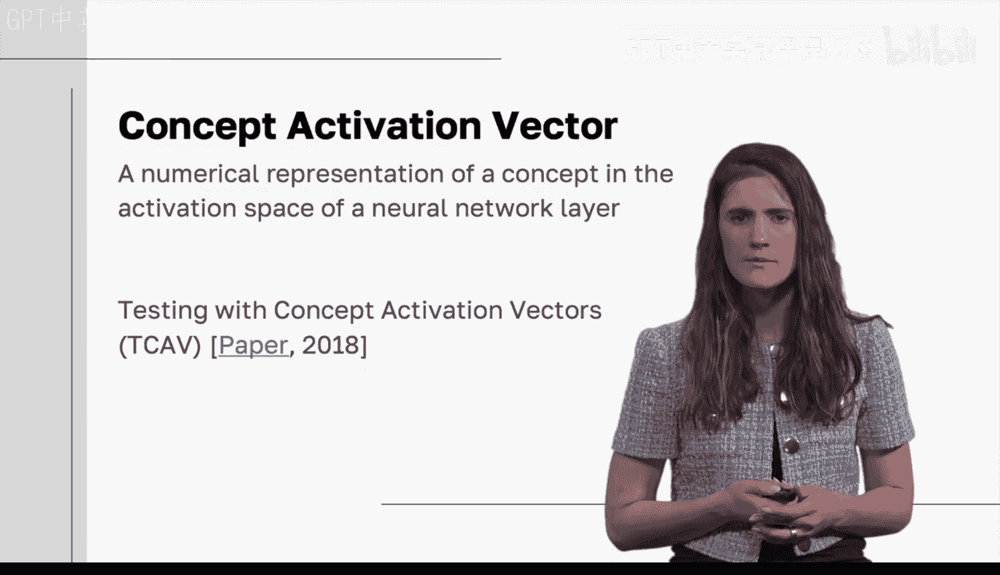
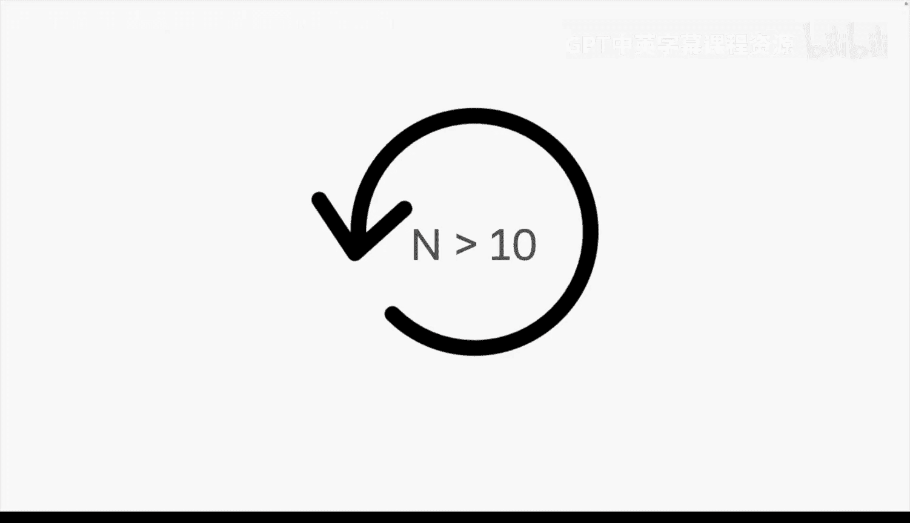
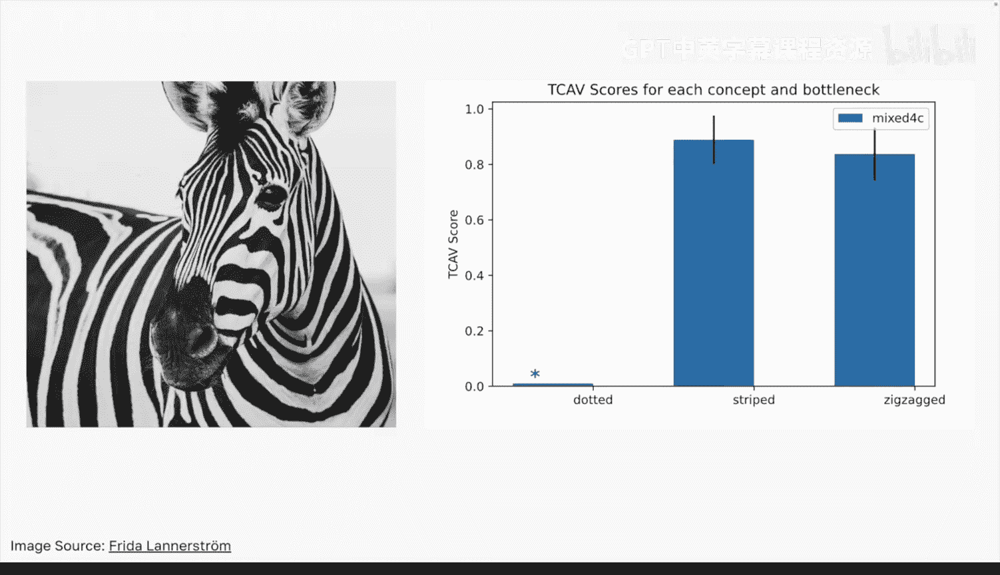
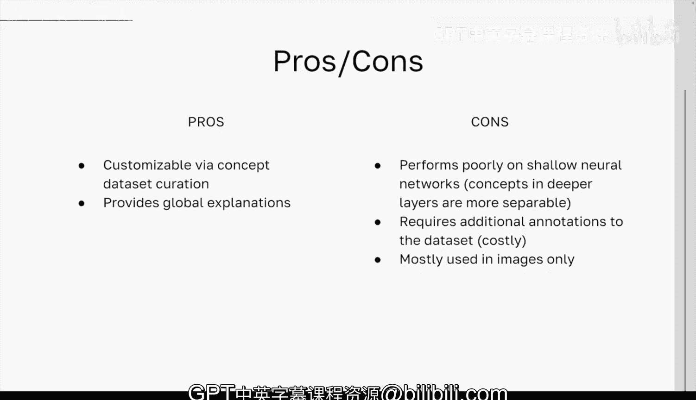

#  070：概念激活向量 (CAV) 🧠

在本节课中，我们将学习一种名为“概念激活向量”的可解释人工智能技术。这是一种用于量化神经网络内部“概念”如何影响其最终预测的方法。我们将通过一个斑马分类的例子，一步步理解其原理、计算步骤以及优缺点。

---

## 概述 📋

概念激活向量是神经网络某一层激活空间中，某个“概念”的数值化表示。测试概念激活向量的方法，即TCAV，于2018年被首次提出。对于任何给定的概念，TCAV能够衡量该概念对模型针对特定类别的预测有多大程度的影响。

上一节我们介绍了可解释性的基本需求，本节中我们来看看如何具体量化神经网络内部学到的“概念”。

---

## TCAV 实现步骤详解 🛠️

我们将通过一个“斑马”图像分类的例子，详细讲解TCAV的实现步骤。

### 1. 准备数据集

首先，需要准备两类数据集：一个代表特定概念C的**概念数据集**，以及一个**随机数据集**。

以下是具体的数据集示例：
*   右侧是目标类别（例如“斑马”）的数据集。
*   左侧是三个不同的概念数据集：**条纹**、**锯齿形**和**圆点**。

### 2. 训练概念分类器并获取CAV

接下来，选定一个隐藏层L，并训练一个二元分类器。这个分类器的任务是区分由概念数据集和随机数据集在该层L生成的激活值。

以下是关于分类器的说明：
*   这个二元分类器可以是支持向量机或逻辑回归模型。
*   训练好的二元分类器的**系数向量**，就是该概念的**概念激活向量**。

### 3. 计算概念敏感度

给定一个输入图像X，我们可以通过计算模型预测在单位概念激活向量方向上的方向导数，来衡量其**概念敏感度**。

其计算公式如下：

`S_{C,k,l}(x) = ∇ h_{l,k}(f_l(x)) · v_C^l`

其中：
*   `h_{l,k}` 组件将激活向量映射到类别K的逻辑输出。
*   `f_l(x)` 组件将输入X映射到第L层的激活向量。

### 4. 计算TCAV分数

TCAV分数定义为：对于某个类别K，其输入中具有**正概念敏感度**的样本数量，占总输入样本数量的比例。

公式表示为：

`TCAV_{Q_{C,k,l}} = |{x ∈ X_k: S_{C,k,l}(x) > 0}| / |X_k|`

---

## 评估CAV的鲁棒性 ✅

我们如何知道得到的概念激活向量是稳健可靠的，而非偶然结果呢？方法不是只训练一个CAV，而是训练多个。

一个有意义的“概念”会在使用不同随机数据集时，产生一致的TCAV分数。以下是评估步骤：

以下是具体的评估流程：
1.  **收集N个随机数据集**。原论文建议 N ≥ 10。
2.  固定概念数据集，使用每一个随机数据集计算对应的TCAV分数。
3.  对这N个TCAV分数，与由**随机概念**生成的TCAV分数进行双侧T检验。随机概念可通过选择一个随机数据集作为“概念数据集”来获得。
4.  在假设检验中，使用多重假设校正方法，如邦费罗尼校正。

---

## 结果示例：斑马分类 🦓

我们以“斑马”类别和“圆点”、“条纹”、“锯齿形”三个概念为例，观察神经网络中名为“mixed_4c”的层。

结果符合我们的直觉：对于斑马类别，“条纹”和“锯齿形”概念的TCAV分数很高，而“圆点”概念的分数非常低。

---

## TCAV的优缺点 ⚖️

最后，我们来评估概念激活向量作为一种可解释AI技术的优缺点。

以下是其主要优点：
*   **可定制性强**：通过创建不同的概念数据集，可以探索任何用户定义的概念。
*   **提供全局解释**：能够量化一个概念对整个类别预测的总体影响。

以下是需要注意的局限性：
*   **在浅层网络上效果不佳**：因为概念在更深的网络层中通常更具可分离性。
*   **需要额外标注**：构建概念数据集可能成本高昂。
*   **应用范围有限**：目前主要应用于图像数据。

---

## 总结 🎯

本节课中，我们一起学习了**概念激活向量**这一重要的可解释性工具。我们了解了CAV如何将抽象概念转化为神经网络激活空间中的向量，并通过TCAV方法量化该概念对模型决策的影响。从数据准备、CAV计算到鲁棒性检验，我们完整地走过了其工作流程，并分析了其优势和当前存在的限制。掌握TCAV有助于我们更深入地理解复杂模型内部的运作机制。