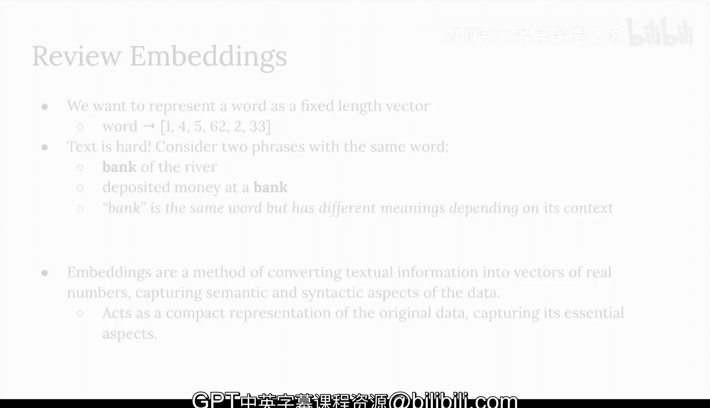
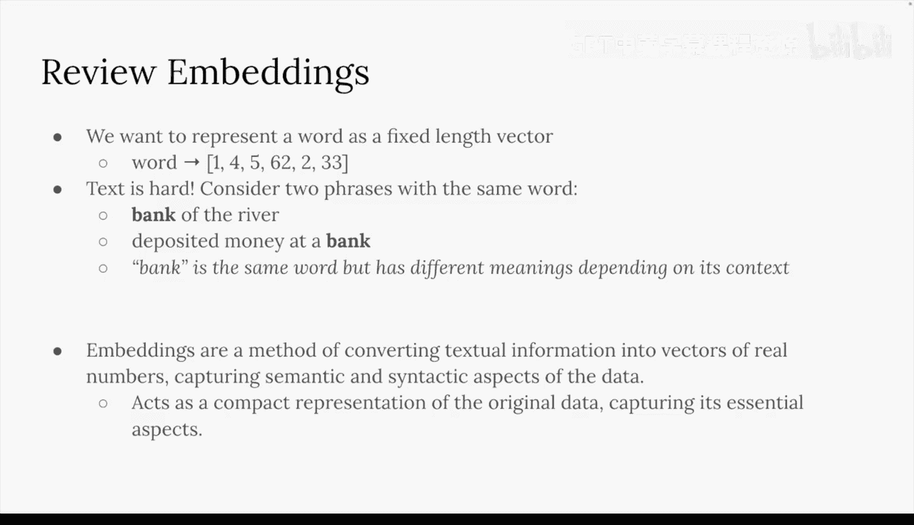
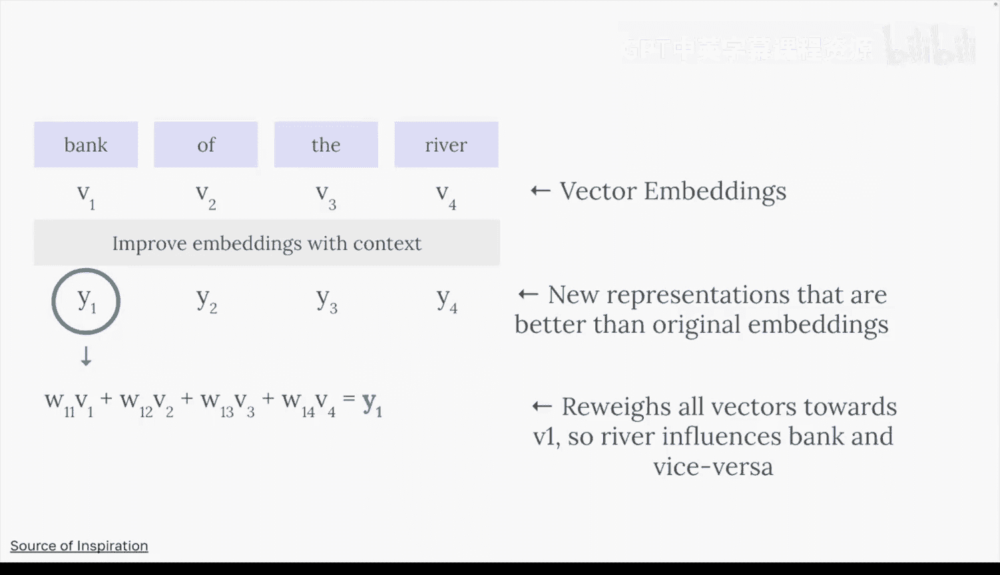
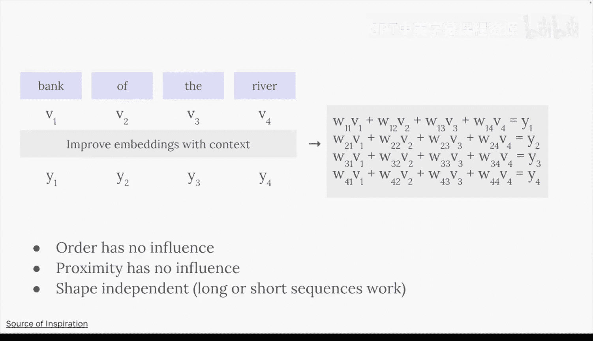
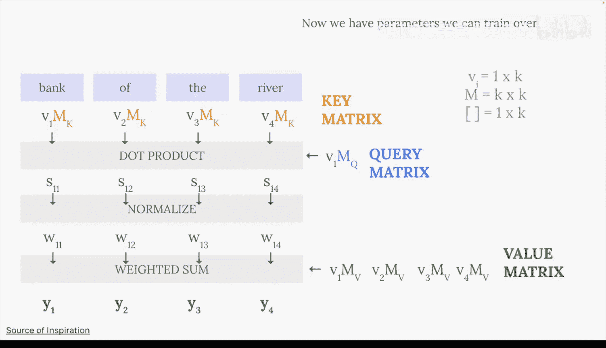
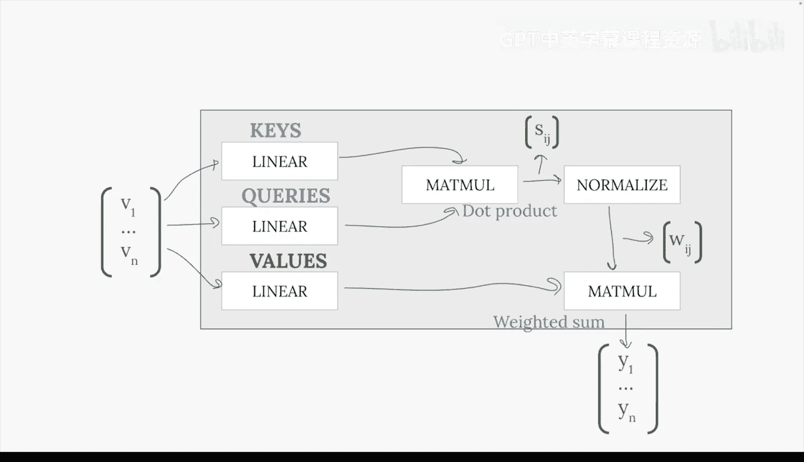
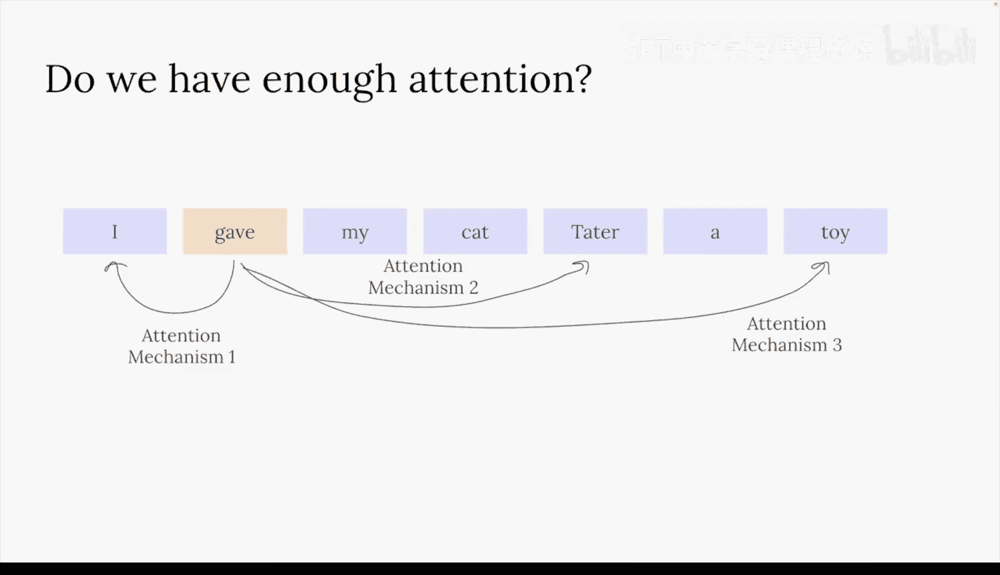
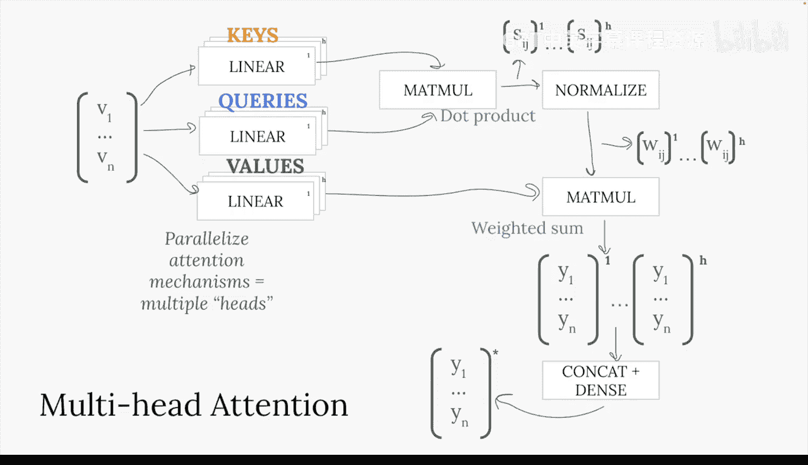
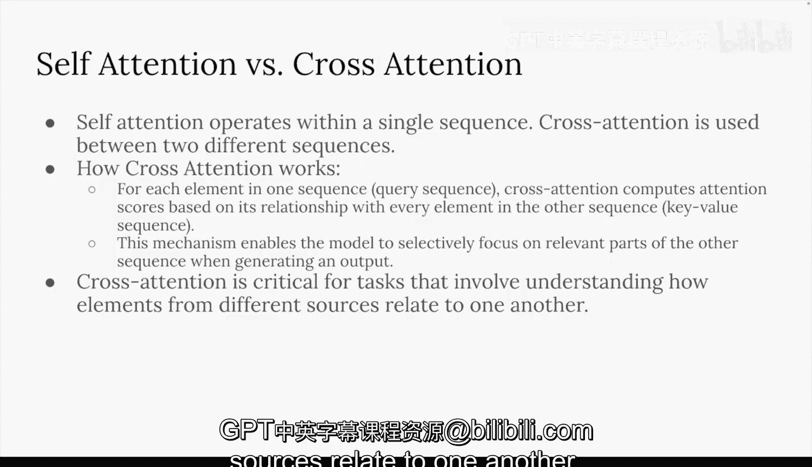

#  071：注意力机制综述 🧠

在本节课中，我们将要学习注意力机制的核心概念，特别是自注意力与多头注意力。我们将从词嵌入的基础开始，逐步理解注意力如何为这些嵌入向量添加上下文信息，并最终探讨跨注意力的工作原理。

## 词嵌入回顾

上一节我们介绍了神经网络处理文本的基本需求。文本处理具有挑战性。请看以下两个包含相同单词的短语：
*   “Bank of the river”（河岸）
*   “deposited money at the bank”（在银行存钱）

“Bank”这个词在两句中拼写相同，但其含义根据上下文或周围的单词而不同。

词嵌入是一种将文本信息转换为实数向量的方法，旨在捕捉数据的语义和句法特征。它充当原始数据的紧凑表示，捕获其本质特征。

## 自注意力机制

现在，让我们深入一个简化版的自注意力机制。假设我们有短语“Bank of the river”。我们可以将每个单词嵌入为一个向量，记为 **V1**、**V2**、**V3** 和 **V4**，分别对应短语中的每个词。自注意力的目标是用上下文信息来改进这些原始嵌入。

理想情况下，我们希望输出是优于原始表示的新表示，我们将其称为 **Y1**、**Y2**、**Y3** 和 **Y4**。让我们聚焦于第一个词“bank”。我们知道“bank”根据其上下文可以有多种含义。我们的目标是从原始向量嵌入 **V1** 转换到一个更好的新向量嵌入 **Y1**。

以下是实现步骤：

1.  **计算得分**：首先，计算 **V1** 与序列中每个向量（包括自身）的点积。即计算 **V1·V1**、**V1·V2**、**V1·V3** 和 **V1·V4**。这些输出被称为“得分”。
2.  **归一化得分**：我们通过 softmax 函数对这些得分进行归一化，因为我们希望所有权重之和为 1。现在，我们得到了归一化后的权重。
3.  **加权求和**：这些权重用于对指向 **V1** 的所有向量进行重新加权，因此“river”会影响“bank”，反之亦然。**Y1** 就是这个重新加权后的向量。

我们对序列中的每个单词重复此过程。关于这个过程需要注意几点：词序没有影响，词与词之间的邻近性没有影响，并且它与序列形状无关。无论序列长短，此方法都适用，最终只会得到一个更长或更短的加权和。

另一种绘制方式是展示每个数学运算及其输入。**V1** 与原始嵌入的点积产生得分，得分归一化后成为权重，权重与原始嵌入的加权和则创建了我们的新向量嵌入 **Y1**、**Y2**、**Y3** 和 **Y4**。

需要指出的是，到目前为止，这完全是纯数学运算，没有任何可训练的参数。

## 引入可训练参数

那么，如果我们在使用原始嵌入的每个地方引入可训练参数会怎样呢？我们将在原始嵌入被使用的每个位置引入可训练参数。这些参数被称为 **键**、**查询** 和 **值**。它们源自数据库术语的启发，但不必过于纠结于这个类比。

*   **键** 与我们的原始嵌入相关联。
*   **查询** 表示我们希望 **V1** 获得更多上下文。
*   当结合查询和键时，我们期望返回 **值**。

现在我们有了可以训练的参数：一个键矩阵、一个查询矩阵和一个值矩阵。这些就是我们将要训练的可训练权重。注意，这些矩阵是 k×k 维的，其中 k 是我们原始嵌入向量的长度。

如果我们将此绘制成一个自注意力块，我们会看到原始向量嵌入与我们的键、查询和值（即可训练矩阵）相结合的线性层。其余部分相同：我们进行点积运算得到得分，将其归一化得到权重，然后执行加权求和以获得输出，即改进后的向量嵌入 **y1** 到 **yn**。

现在，我们有了一个可以用来训练键、查询和值矩阵的模块。这些可训练参数与传统神经网络层中的可训练权重相同。

简而言之，自注意力就是添加上下文信息的过程。

## 多头注意力

现在，我们提出一个问题：单一的注意力足够吗？考虑句子“I gave my cat, Tater, a toy”中的单词“gave”。单词“gave”需要同时关注句子的多个部分：它需要关注“I”、“Tater”和“toy”。这些都可以是独立的注意力机制，各自拥有经过训练的键、查询和值矩阵。

这引出了**多头注意力**的概念，我们通过拥有多个“头”来并行化注意力机制。这里，我们有 1 到 H 个头。这导致产生 1 到 H 组得分、权重和最终输出。

现在，我们的最终输出需要与输入向量嵌入的大小相同。因此，我们在这里做的是将 1 到 H 的输出进行拼接，然后通过一个全连接层，最终得到一个与之前大小相同的输出。

## 跨注意力

我们已经回顾了自注意力，但跨注意力呢？自注意力在单个序列内操作。跨注意力则用于两个不同的序列之间。

以下是跨注意力的工作原理：对于查询序列中的每个元素，跨注意力根据其与键-值序列中每个元素的关系来计算注意力得分。这种机制使模型在生成输出时能够选择性地关注另一个序列的相关部分。跨注意力对于涉及理解来自不同来源的元素如何相互关联的任务至关重要。

## 总结

本节课中，我们一起学习了注意力机制的核心组成部分。我们从词嵌入的基础出发，理解了自注意力如何通过计算序列内元素间的关联得分并加权求和，来为词向量添加上下文信息。接着，我们探讨了通过引入可训练的键、查询、值矩阵，使注意力机制能够被优化。然后，我们认识到单一注意力可能不足，从而引入了多头注意力来并行捕获不同类型的依赖关系。最后，我们简要了解了跨注意力，它用于处理两个不同序列之间的信息关联。这些机制共同构成了现代Transformer架构处理和理解序列数据的基础。