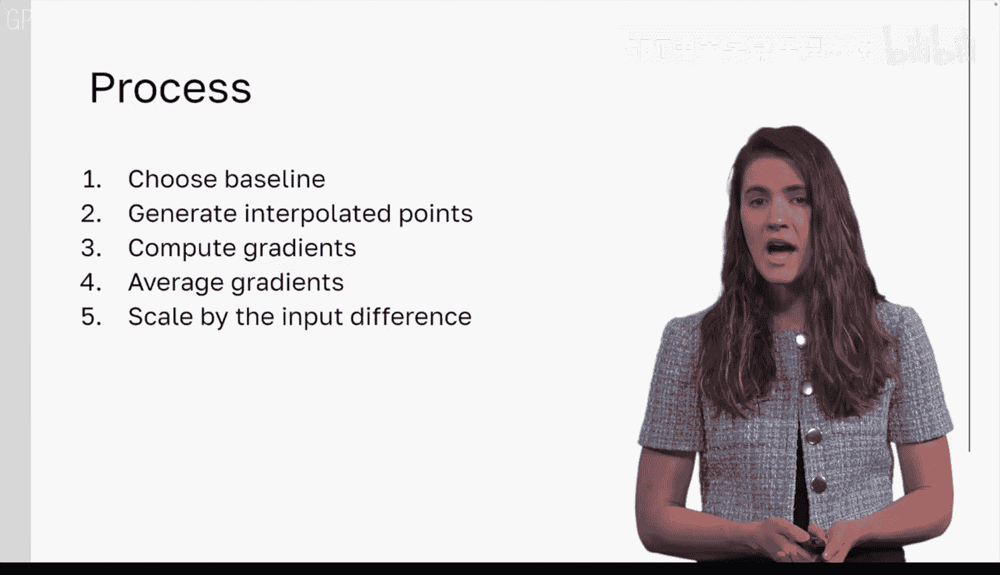
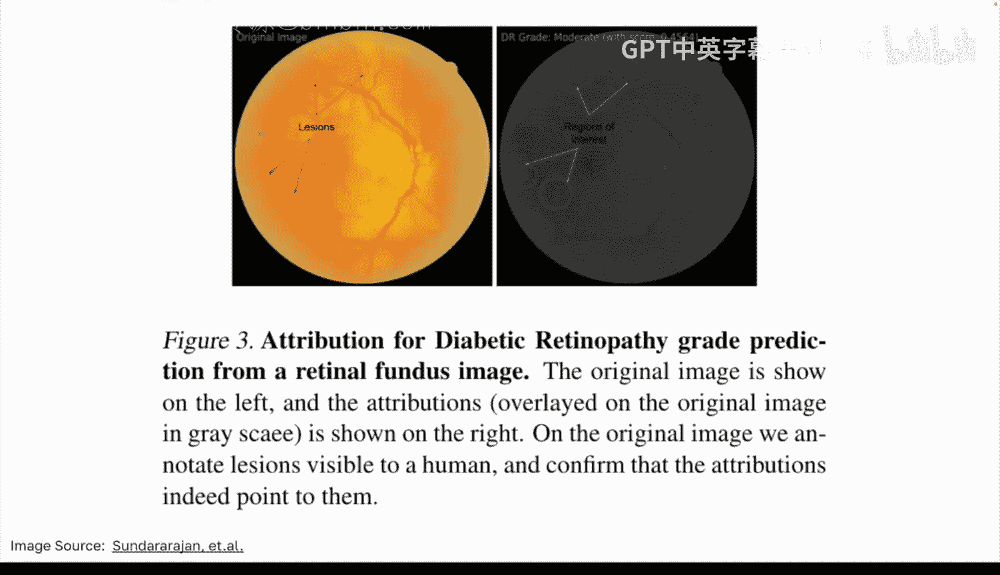
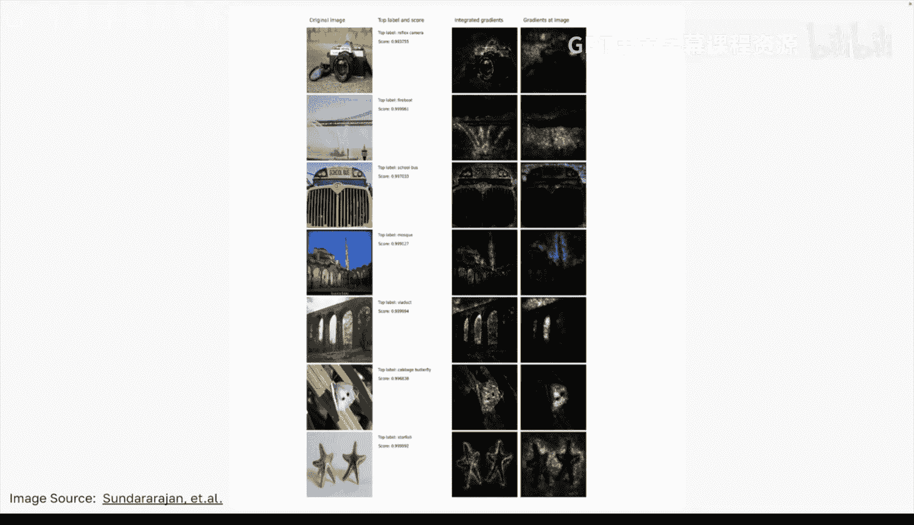
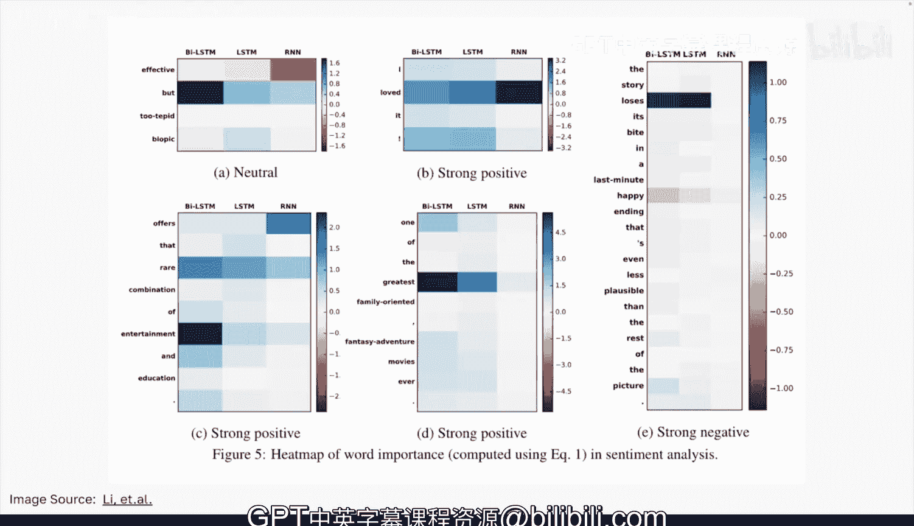

#  074：显著性映射替代方法

在本节课中，我们将学习几种可以替代注意力机制、用于解释模型预测的显著性映射方法。我们将重点介绍三种主要方法：基于梯度的方法、基于传播的方法和基于遮挡的方法。

---

## 概述

上一节我们讨论了使用注意力权重进行解释的局限性。本节中，我们将探讨几种被推荐作为注意力机制替代方案的显著性映射方法。这些方法通过量化每个输入特征对特定模型预测的贡献程度，来提供更具解释性的洞察。

## 显著性映射方法简介

显著性映射方法旨在揭示模型做出某个特定预测的原因，其方式是评估每个输入特征（例如文本中的单词）对该预测的相关性。这使得它们比备受争议的注意力可视化更具可解释性。

以下是论文中推荐的几种替代方法：

*   **基于梯度的方法**：例如积分梯度。
*   **基于传播的方法**：例如逐层相关性传播。
*   **基于遮挡的方法**。

## 积分梯度法

积分梯度法于2017年被提出。其定义为：**沿着从基线输入 `x'` 到实际输入 `X` 的直线路径，对梯度进行路径积分**。

具体而言，我们考虑从基线 `x'` 到输入 `X` 的直线路径，并计算该路径上所有可能点的梯度。积分梯度通过累积这些梯度得到。在下图中，绿色的路径P2即对应积分梯度所使用的线性路径。

**公式**：`积分梯度(x_i) = (x_i - x'_i) × ∫_{α=0}^{1} (∂F(x' + α(x - x')) / ∂x_i) dα`
其中，`∂F(x)/∂x_i` 是函数 `F(x)` 沿第 `i` 个维度的梯度。

### 实践步骤

在实践中，实现积分梯度遵循以下过程：

1.  **选择基线**：选择一个代表“特征缺失”的基线输入。例如，如果输入是图像，基线可以是一张所有像素值都为零的图像。
2.  **生成插值输入**：在基线 `x'` 和实际输入 `X` 之间创建一系列插值输入，通常使用线性路径。
3.  **计算梯度**：对每个插值输入 `x_i`，计算模型输出相对于该输入的梯度。这告诉我们 `x_i` 处的每个输入特征对输出的影响程度。
4.  **平均梯度**：对所有插值输入的梯度进行平均。这个平均梯度代表了每个特征从基线到实际输入路径上的贡献。
5.  **按输入差值缩放**：将每个平均梯度乘以实际输入与基线之间的差值。这可以缩放梯度贡献，以反映实际输入特征。

### 应用示例

上图展示了使用积分梯度法对糖尿病视网膜病变分级预测（基于视网膜图像）进行归因分析的结果。左侧是原始图像，右侧是将归因（显著性）叠加在原始图像上的效果。可以看到，原始图像中标注的病变区域，确实在基于积分梯度的归因图中显现出来。

更多图像及其积分梯度可视化结果（中间列）如下所示：

## 逐层相关性传播法

另一个可考虑用于替代可解释性注意力的显著性方法是**逐层相关性传播**，于2019年提出。LRP是一种将神经网络对样本的预测分解为该样本单个输入维度相关分数的方法。

LRP的过程很直观：

1.  首先进行前向传播，获得输出（即顶层相关性）。
2.  然后使用一个定制的反向传播过程，在每一层将传入的相关性重新分配给该层的输入。
3.  相关性被不断重新分配，直到抵达输入层。每种层类型（例如前馈层、LSTM层）都有其自己的传播规则。

LRP的一个优势在于你可以对方法进行精确的控制。

下图展示了对错误分类的句子1、2以及人工构建的句子1A、1B、1C、2A、2B、2C生成的热力图。预测类别被用作可视化的目标类别，因此对预测重要的单词可以被高亮显示。

## 基于遮挡的方法

本模块将介绍的最后一个显著性方法是**基于遮挡的方法**，于2017年提出。该方法通过遮挡或擦除输入特征，并测量对模型的影响来计算输入显著性。

你可以擦除表征的不同部分，例如：
*   输入词向量的维度
*   中间隐藏单元
*   输入单词本身

原始论文中的下图展示了针对不同训练策略和词向量（Word2Vec和GloVe）的词向量维度重要性。

另一张图则展示了在不同模型架构下，情感分析任务中的单词重要性。

## 总结

本节课中，我们一起学习了三种用于解释模型预测的显著性映射替代方法：**积分梯度法**、**逐层相关性传播法**和**基于遮挡的方法**。这些方法通过量化输入特征对预测的贡献，提供了比单纯可视化注意力权重更可靠、更深入的解释视角。除了今天介绍的方法外，还有其他显著性方法可用于基于注意力的网络，并且新的方法和技术目前仍在不断研究中。