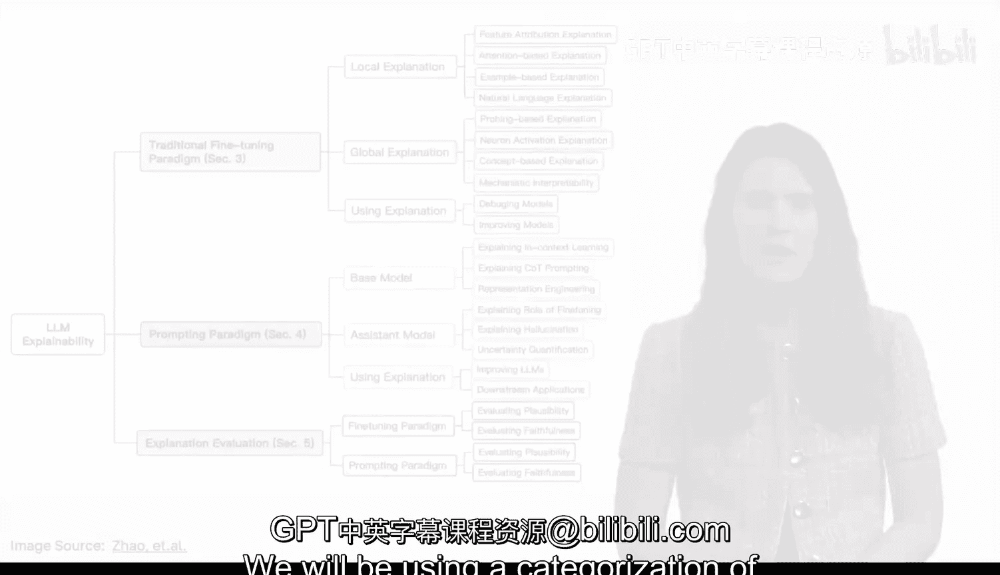
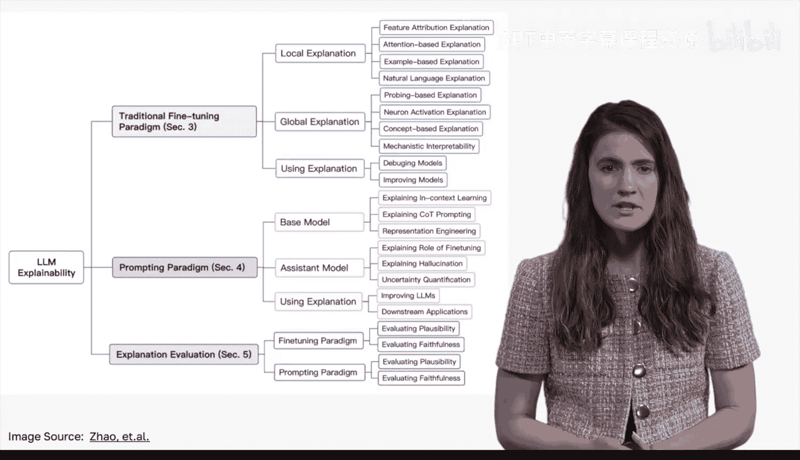
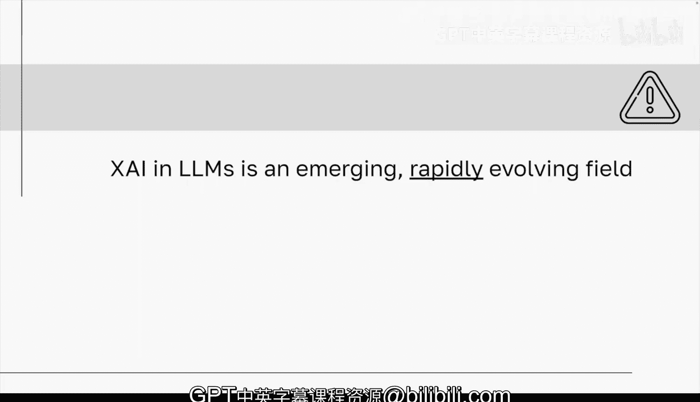

#  075：大语言模型可解释性挑战

在本节课中，我们将探讨大语言模型（LLM）可解释性所面临的独特挑战，并介绍该领域的一个基本分类框架。我们将了解为何解释这些庞大模型如此困难，并为后续学习微调、提示工程以及知识增强等具体解释方法奠定基础。

我们将主要依据Zotal在2023年提出的大语言模型可解释性分类框架进行讨论。

我们的讨论将主要围绕微调和提示工程中的可解释性展开，并会涵盖此处展示的多种解释方法。

除了微调和提示工程，我们还将讨论可解释性与LLM知识增强（或称检索增强生成，RAG）的关系。

在深入具体方法之前，有必要先探讨将可解释性方法应用于大语言模型所面临的一些根本性挑战。

以下是解释大语言模型时遇到的主要困难：

*   **模型规模与复杂性**：像GPT-4这样的大语言模型，其参数量可能达到**万亿**级别，这使得追溯其推理过程变得几乎不可能。它们学习到的是高维、分布式、相互纠缠且抽象的表示。
*   **缺乏基准真相**：对于模型的内部决策过程，通常不存在明确的“正确答案”，这使得设计能准确反映LLM决策过程的解释算法非常困难。这也让评估解释的**忠实度**和**保真度**极具挑战性。
*   **模型不透明**：许多LLM缺乏透明度，关于其模型架构、权重和训练数据的文档不足，这为开发可解释性方法设置了障碍。

在开始之前，需要特别说明一点：大语言模型的可解释性是一个新兴且快速发展的领域。

这意味着当前的学习材料可能在六个月后就会过时。我希望能随着新研究的发表不断更新本课程。然而，我必须提醒你，这并非关于可解释LLM的终极真理来源，它仅仅是该领域当前进展的一个快照。

作为你在可解释人工智能领域持续学习的一部分，我鼓励你阅读最新的论文，并随时跟进关于LLM可解释性的不断变化的观点和视角。

本节课中，我们一起学习了为何大语言模型的可解释性充满挑战，主要原因包括其巨大的规模与复杂性、内部决策缺乏基准真相以及模型本身的不透明性。我们还了解了这是一个快速演进的领域，需要持续关注最新研究。在接下来的章节中，我们将基于此背景，深入探讨在微调、提示工程和知识增强等具体场景下应用可解释性方法的技术。