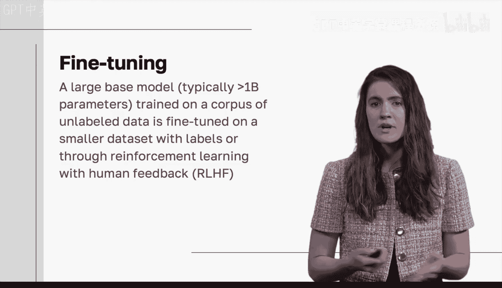
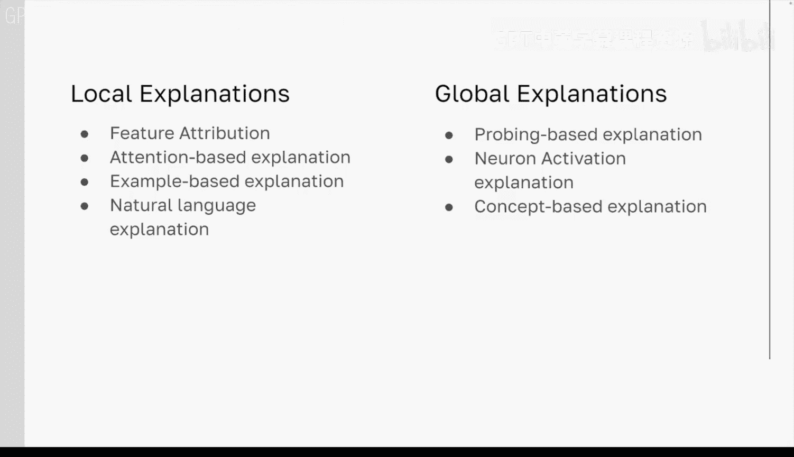
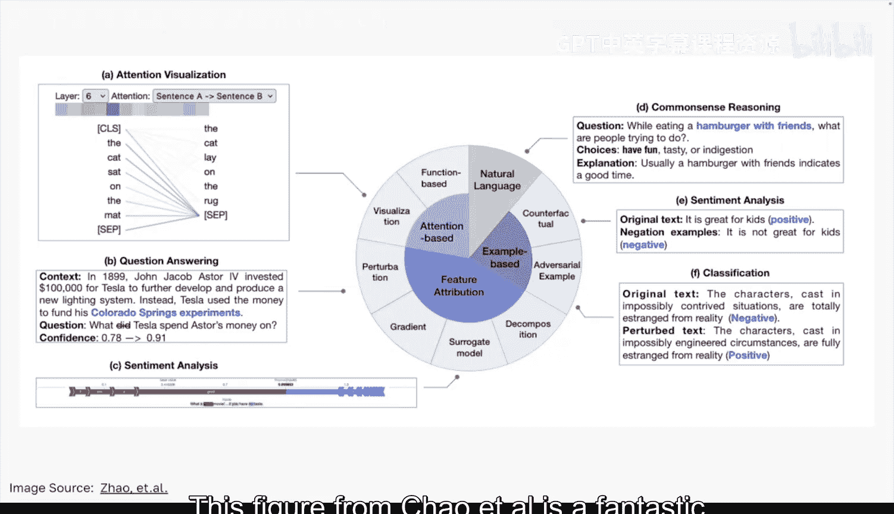
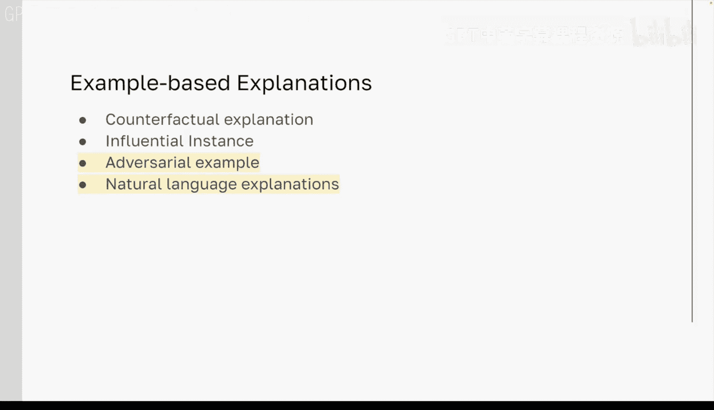
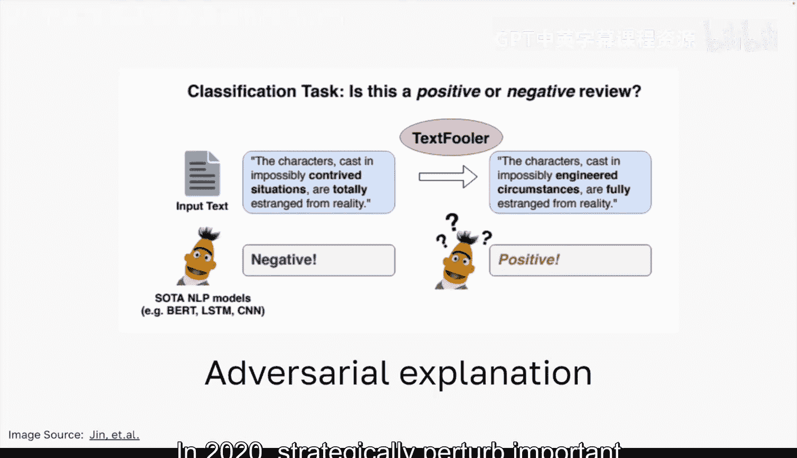
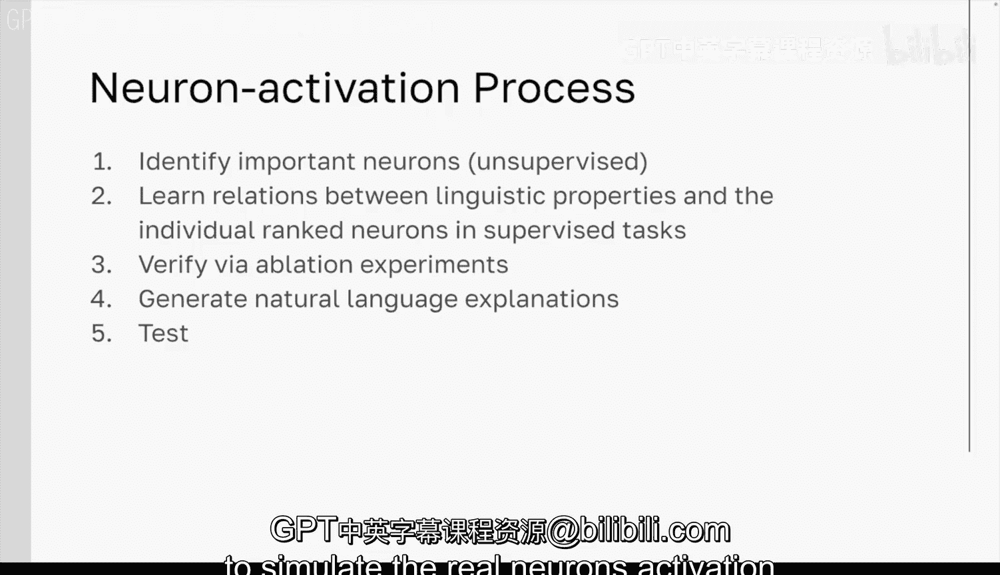

#  076：大语言模型微调可解释性

在本节课中，我们将要学习大语言模型（LLM）微调过程中的可解释性方法。我们将探讨如何解释经过微调的模型，理解其决策背后的原因，并区分局部解释与全局解释。

## 概述：大语言模型微调回顾

首先，我们回顾一下大语言模型的微调过程。在LLM微调中，一个大型基础模型（通常参数量超过10亿）首先在无标签的语料库上进行预训练。随后，它会在一个较小的、带有标签的数据集上，或通过人类反馈强化学习（RLHF）进行微调。

这个过程可以用下图来可视化。我们使用大规模文本语料库对基础模型（如Llama 2）进行无监督预训练。基础模型通常不擅长生成令人满意的回答。为了获得能提供有用结果的模型，通常需要进行某种形式的微调。我们使用一个较小的微调数据集，对基础模型进行监督微调和/或人类反馈强化学习，从而创建出我们的助手模型，如Llama 2 Chat。

## 🧩 局部解释与全局解释

我们可以将LLM微调中的解释分为**局部解释**和**全局解释**。局部解释旨在解释一个特定的预测或一组预测，而全局解释则试图提供对整个模型的全局性理解。

我们将讨论的局部解释方法包括：
*   特征归因
*   基于注意力的解释
*   基于实例的解释
*   自然语言解释

我们将讨论的全局解释方法包括：
*   基于探针的解释
*   神经元激活解释
*   基于概念的解释

如果你计划学习本专项课程中的可解释机器学习课程，我们将详细讲解其中的许多方法。

上图来自Chow等人的研究，它精彩地分解了我们的局部解释方法。接下来，让我们深入细节。

## 🔍 局部解释方法详解

### 特征归因

目前，解释LLM可解释性主要有四种特征归因方法。

以下是四种主要方法：
1.  **基于扰动的解释**：通过移除、掩码或改变输入特征（可以是嵌入向量、隐藏单元、单词或标记）来扰动输入样本，然后评估模型输出的变化。
2.  **基于梯度的解释**：通过分析输出相对于每个输入维度的偏导数来确定每个输入特征的重要性。导数的大小反映了输出对输入变化的敏感度。在LLM中，**积分梯度**是基于梯度解释的主要方法。
3.  **SHAP**：我们在XAI方法概述中简要讨论过SHAP。Gen等人在2023年将SHAP适配到基于Transformer的语言模型。**TransSHAP**主要侧重于将SHAP适配于子词文本输入，并提供序列可视化解释。
4.  **基于分解的方法**：分解技术旨在将相关性分数分解为输入的线性贡献。**逐层相关性传播**（LRP）就是这种方法的一个例子。

### 基于实例的解释

上一节我们介绍了特征归因，本节中我们来看看基于实例的解释。这类方法通过具体的例子来说明模型的决策。

以下是两种主要类型：
*   **反事实解释**：揭示如果观察到的输入发生某些特定变化，预测结果会如何改变。
*   **影响力实例**：通过衡量单个训练样本对测试点损失的影响程度，来刻画其影响力。

我们今天将涵盖的主题包括对抗性示例和自然语言解释。

### 对抗性示例

神经网络模型非常容易受到输入数据中精心设计的微小修改的影响，这些修改可以极大地改变模型的预测，尽管这些修改对人类来说几乎无法察觉。这些被称为**对抗性示例**。对抗性示例暴露了模型失败的领域，并在训练中被用来提高模型的鲁棒性和准确性。

早期的对抗性示例生成侧重于词级操作，如错误、移除和插入。更先进的方法，如Jin等人在2020年提出的**TextFooler**，则基于词嵌入和语义相似性，策略性地扰动重要词汇。

大语言模型中对抗性示例的最新方法，利用掩码语言模型，并采用“掩码-填充”过程进行标记级扰动，如替换、插入和合并。最近，Wang等人在2022年提出的一种名为**SEA**的方法，提出了一个更通用的框架，直接在嵌入空间（如知识和上下文语义）上操作。它迭代地优化扰动后的嵌入以满足攻击目标。SEA攻击的可视化如下表1所示，将一个蓝色词替换为红色的对抗性词，误导了正确预测到错误类别，但不会欺骗人类。

### 自然语言解释

我们将讨论的最后一个局部解释方法是**自然语言解释**。这种方法通过生成的文本来解释模型对输入序列的决策过程。其思路是使用原始文本数据和人工标注的解释来训练一个语言模型。

最近，这种方法已被应用于各种数据集和任务。如上表（来自Luo等人）所示，2019年的一篇论文引入了常识解释数据集（COSE），并用它来训练语言模型自动生成解释，这些解释可用于训练和推理。类似地，2022年的一项更新研究探讨了自然语言解释的少样本域外迁移学习，即从拥有大量自然语言解释的父任务迁移到子任务。

## 🌐 全局解释方法详解

现在我们来讨论全局解释。**基于概念的解释**允许我们将输入映射到一组概念，并衡量每个预定义概念对模型预测的重要性分数。测试概念激活向量就是这种方法的一个例子。

在可解释LLM微调中使用的两种全局解释——**基于探针的解释**和**神经元激活解释**——将是我们接下来要详细探讨的主题。

### 基于探针的解释

在基于探针的解释中，我们可以查看**基于分类器的探针**或**无参数探针**。

在基于分类器的探针中，过程如下：
1.  冻结LLM参数。
2.  从LLM生成表示。
3.  在这些表示上训练一个浅层分类器，以预测语言属性。

如果你在探测句法，你关注的是词性、形态或依存关系等。或者，如果你在探测语义，你检查的是共指、实体和关系。

无参数探针直接在定制的数据集上评估LLM，而无需使用分类器。

需要注意的是，与许多方法一样，探针的有效性在研究人员中存在争议。高性能可能并不意味着LLM真正理解了语言。

### 神经元激活解释

神经元激活分析检查的是单个神经元或维度，而不是整个向量空间。它涉及两个步骤：一，识别重要神经元；二，学习语言属性与神经元之间的关系。

缺乏真实标注使得评估组件级解释具有挑战性。

上图展示了一个神经元激活解释的例子，它观察了GPT-2第五层第131个神经元的激活可视化。

神经元激活解释的过程如下所示：
1.  以无监督方式识别重要神经元。这涉及基于相关性测量、学习权重或使用监督分类方法等指标对神经元进行排序。
2.  在监督任务中，学习语言属性与单个排序神经元之间的关系。
3.  然后，通过消融实验（如掩码和擦除）定量验证排序后神经元的重要性。
4.  使用LLM生成自然语言解释，总结触发给定神经元高激活的文本模式。
5.  最后，通过测试这些自然语言解释能让模型在**新测试示例**上多好地模拟真实神经元的激活行为，来评估解释的质量。

## 总结

本节课中，我们一起学习了与大语言模型微调相关的可解释性技术。我们首先回顾了微调过程，然后区分了**局部解释**（如特征归因、对抗性示例）和**全局解释**（如探针分析、神经元激活分析）。理解这些方法有助于我们洞察微调后模型的决策机制，评估其可靠性，并为进一步改进模型提供方向。