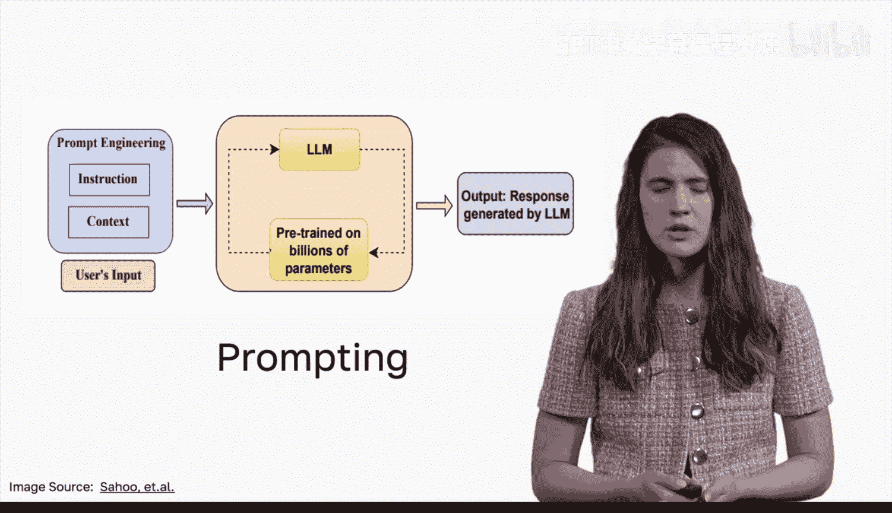
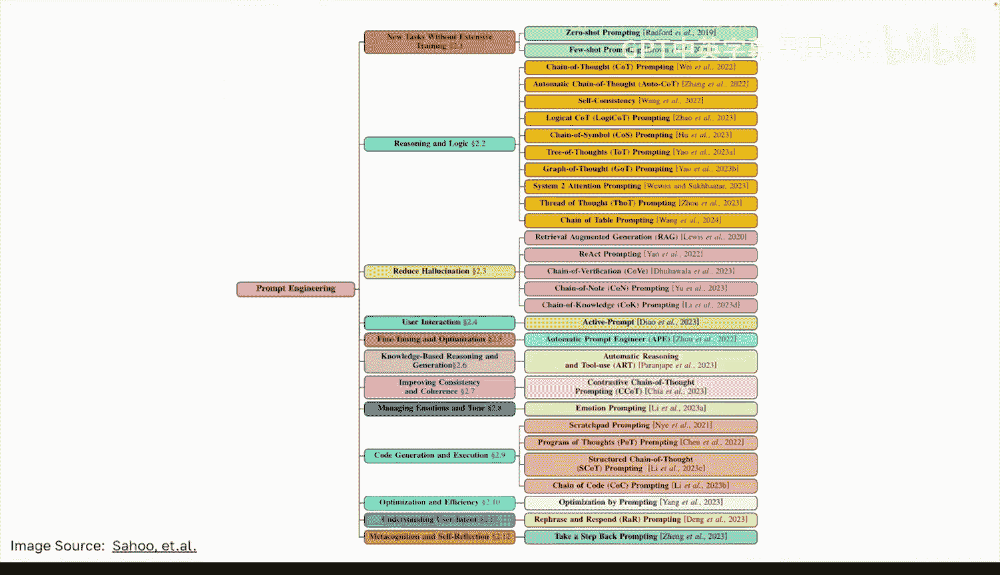
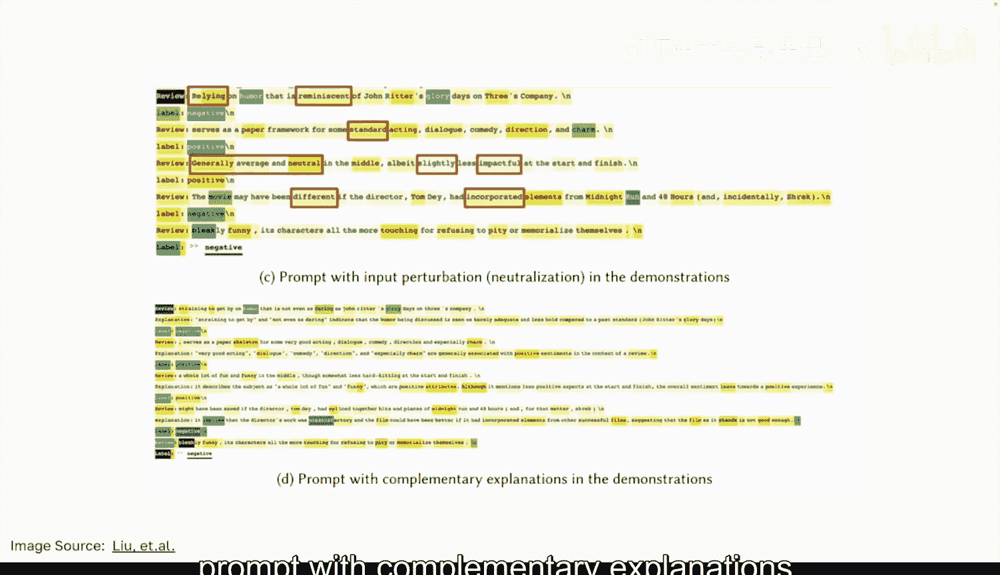
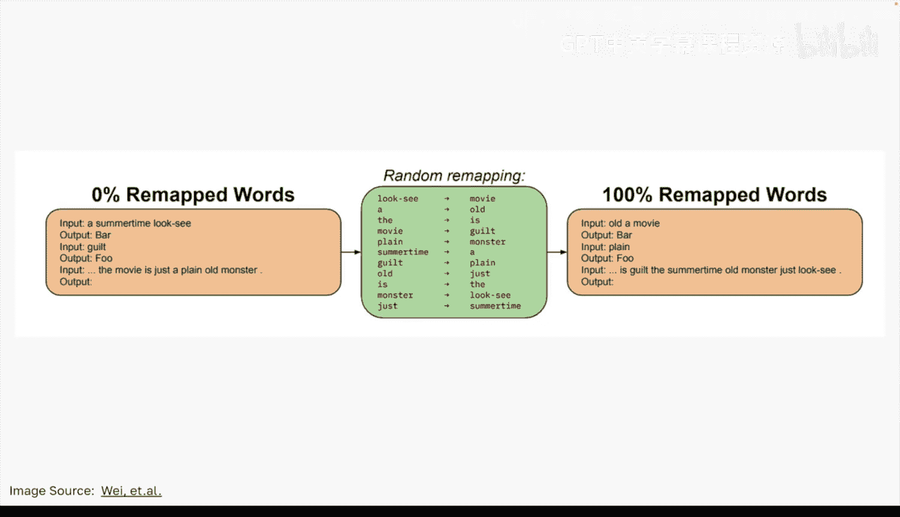
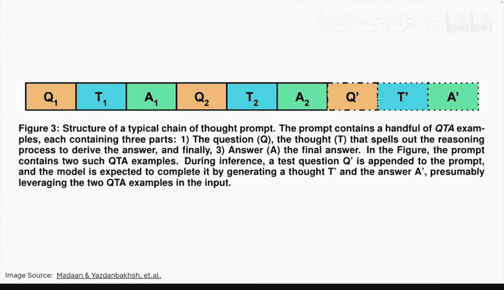
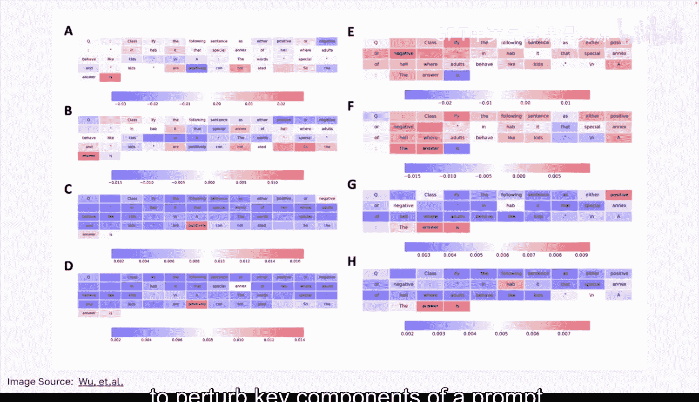
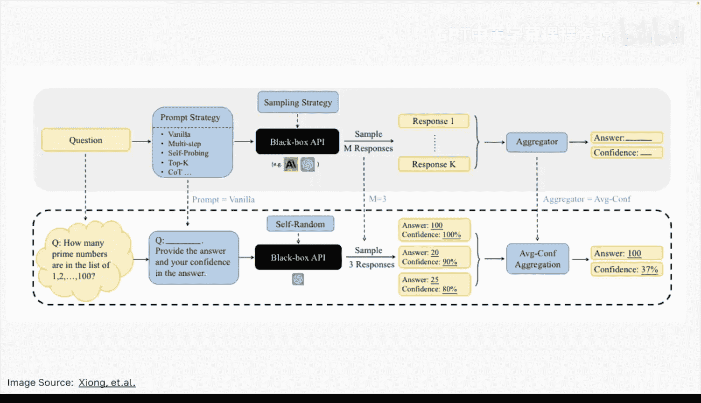
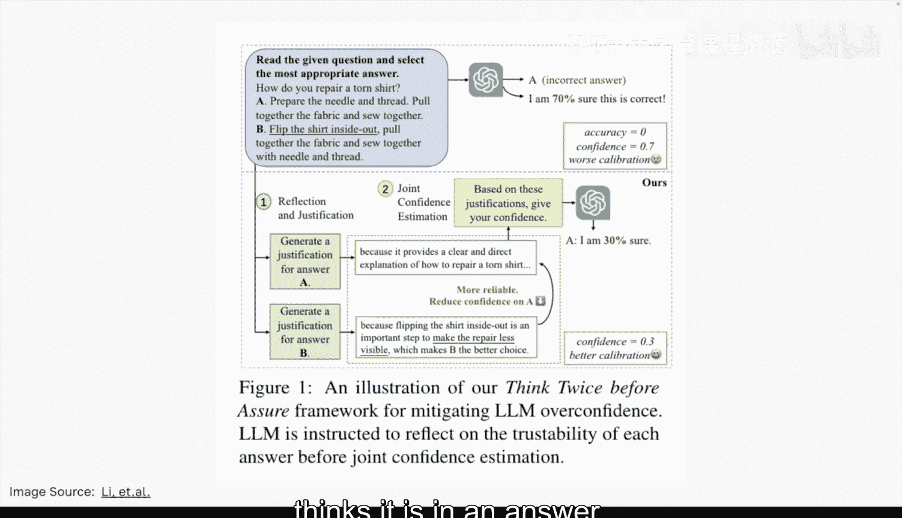

#  077：大语言模型提示工程的可解释性

在本节课中，我们将要学习大语言模型提示工程的可解释性。我们将回顾提示工程的基本概念，并深入探讨两种关键的提示方法——上下文学习和思维链——的可解释性研究。最后，我们还将讨论大语言模型面临的不确定性挑战以及相关的评估方法。

## 提示工程回顾




提示工程是指在不改变模型参数的前提下，通过策略性地设计自然语言的任务特定指令来引导模型输出的过程。

提示通常包含三个部分：**指令**、**上下文**和**用户输入**。这些部分共同用于引导预训练大语言模型的输出。



```
Prompt = 指令 + 上下文 + 用户输入
```


提示工程包含多种方法，上图展示了Sahuitel等人2024年论文中概述的部分方法论。

在可解释性的语境下，我们将重点讨论两种提示方法：上下文学习和思维链。

## 上下文学习的可解释性

上下文学习是指将任务示例作为提示的一部分展示给模型，使其能够从示例中学习并执行任务。

当我们思考上下文学习的可解释性时，核心问题是：**上下文学习如何影响模型的行为？**

为了回答这个问题，近期研究主要依赖于以下几种方法：
*   **对比示例**：创建与原始示例形成对比的样本。
*   **输入文本扰动**：对输入文本进行微小的修改。
*   **标签翻转**：将示例中的正确标签替换为错误标签。
*   **语义无关标签**：使用与任务语义无关的标签。



以下是相关研究的示例：

Lee等人在2023年的研究中，使用SST-2情感分析基准任务，通过分析对比示例和显著性图谱来解释上下文学习在LLM中如何工作。他们通过翻转标签、扰动输入文本和添加补充解释来构建对比示例。

*   **标签翻转提示**：在演示中将正面情感标签改为负面，或反之。
*   **输入扰动提示**：轻微修改演示中的输入句子。
*   **补充解释提示**：为演示添加额外的解释性文字。




Wei等人在2023年的研究则通过调查两种设置来解释上下文学习受语义先验与输入-标签映射的影响：
1.  **使用翻转标签的上下文学习**。
2.  **使用语义无关标签的上下文学习**。

该研究还展示了“重映射输入”的概览，即将词语映射到其他词语，以降低输入的语义意义。




## 思维链提示的可解释性

思维链提示涉及引导模型描述其推理过程，并逐步解决问题。

对于思维链提示的可解释性，我们提出类似的问题：**思维链提示如何影响大语言模型的行为？**

近期研究通过探索以下方面来回答这个问题：
*   **显著性分数**：衡量每个输入标记对模型输出的影响程度。
*   **扰动**：对思维链示例进行修改。
*   **反事实分析**：构建与事实相反的假设场景。



一个典型的思维链提示结构包含：**问题（Q）**、**思考（T）** 和 **答案（A）**。


以下是具体的研究方法：

Woo等人在2023年分析了输入标记的显著性分数，旨在理解与标准提示相比，思维链提示是否会改变显著性分数，或者说，思维链为何能提升模型性能。

2022年的多篇论文通过向少样本提示中的思维链演示添加错误来进行扰动，以确定哪些方面对于生成好的解释至关重要。其中，Madaan等人的一篇论文还提出了**反事实提示**，用于扰动提示中的关键组件，如符号、模式和文本。


## 大语言模型的不确定性挑战

不确定性是当前大语言模型面临的一个重大挑战。尽管大语言模型在生成类人文本方面能力出众，但它们可能表现出过度自信，即使在训练数据不完整或模糊时，也会提供高度确定的回答。这种不确定性量化的缺失可能导致潜在风险，例如传播错误信息或基于不可靠的输出做出关键决策。解决这个问题对于构建可信赖的AI系统至关重要，尤其是在医疗保健、金融和决策制定等高风险领域。

目前有两种主要的方法来评估大语言模型的不确定性：

**1. 基于一致性的不确定性估计**
Xi Yong等人在2024年的论文中提出，通过生成对同一问题的多个回答，并利用这些回答之间的一致性来估计模型的置信度。他们通过两种方式引入随机性以产生多样化的回答：
*   **Self-Consistency**：在答案生成过程中引入随机性。
*   **诱导一致性**：在提示中添加误导性暗示。
其核心思想是，如果一个微调后的大语言模型在多次回答中表现得更一致，那么它对答案的估计置信度就更高。

**2. 基于标记级别的不确定性估计**
Dwent等人的论文研究了标记级别的不确定性。主要概念是：大语言模型通过预测每个标记来生成文本。标记级别的不确定性方法根据每个预测标记的概率分布计算其置信度分数，整体不确定性可以基于标记级别不确定性的聚合来估计。




## 关于直接询问模型置信度的思考

你可能会问：**我们能否直接要求一个大语言模型告诉我们它对答案有多自信？**

答案很可能是否定的。尽管有研究框架被提出（例如Lee等人在2024年提出的让LLM为其置信度提供理由，而非简单地要求模型给出置信度的天真方法），但仍需考虑以下几点：
*   当前的大语言模型经常产生“幻觉”，并且不知道它们不知道什么，或者训练数据之外的信息。它们极有可能凭空编造。
*   很难将这种自我报告的置信度映射到任何真实的度量上。
虽然尝试理解模型自认为对答案有多自信可能是一个有趣的研究方向，但这本身并不是一种可解释人工智能的方法。



## 总结


本节课中，我们一起学习了大语言模型提示工程的可解释性。我们首先回顾了提示工程，然后分别探讨了**上下文学习**和**思维链提示**的可解释性研究方法，包括使用对比示例、扰动和显著性分析等技术来理解提示如何影响模型行为。最后，我们讨论了大语言模型面临的**不确定性**挑战，并介绍了基于一致性和标记级别的评估方法，同时指出直接询问模型置信度目前并非可靠的可解释性途径。理解这些机制对于开发更可靠、更透明的人工智能系统至关重要。