#  080：生成对抗网络可解释性 🧠

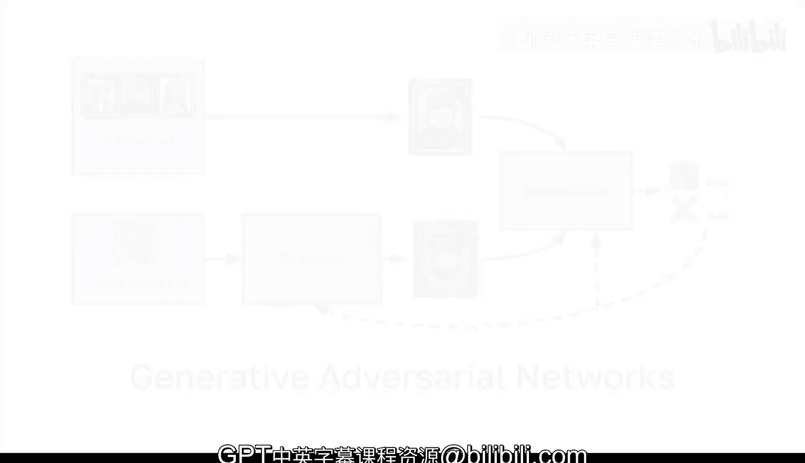

在本节课中，我们将学习生成对抗网络的基本原理，并探讨如何为GAN模型提供可解释性。我们将回顾GAN的核心概念，并介绍几种理解其内部工作机制的方法。

## GAN快速回顾 🎯

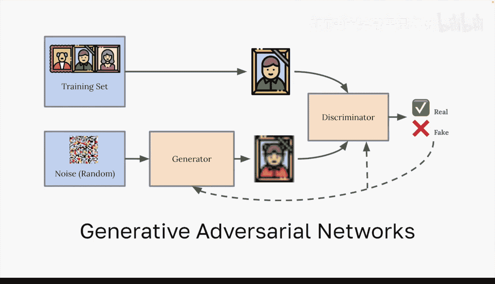

生成对抗网络巧妙地运用了博弈论思想，让两个神经网络相互对抗。一个**生成器**模型将随机噪声转换为合成图像，同时存在一个包含真实图像的训练集。合成图像和来自训练集的真实图像都会被输入到一个简单的分类模型——**判别器**中，判别器试图判断哪些图像是假的，哪些是真的。

生成器和判别器模型被一起训练。它们的训练方式是零和的。当判别器的预测正确时，生成器模型会受到惩罚。当生成器成功欺骗了判别器时，判别器模型会受到惩罚。在极限情况下，生成器每次都能生成输入域的完美复制品，而判别器则无法区分，对每个案例预测真假的可能性均为50%。

## 生成器模型详解 🏗️

生成器的输入是一个从简单分布（如高斯分布或均匀分布）中采样的、固定长度的随机噪声向量。这是生成器用来产生多样化输出的随机性来源，其维度通常远小于期望的输出维度。

输入噪声通过网络中的一系列层进行传递，这些层将噪声转换为类似于训练数据的数据样本。这些层可以是卷积层、全连接层或其组合。我们将模型学习到的表示称为**潜在空间**，因为它们旨在捕捉训练数据的底层分布，最终输出是一个合成的数据样本。

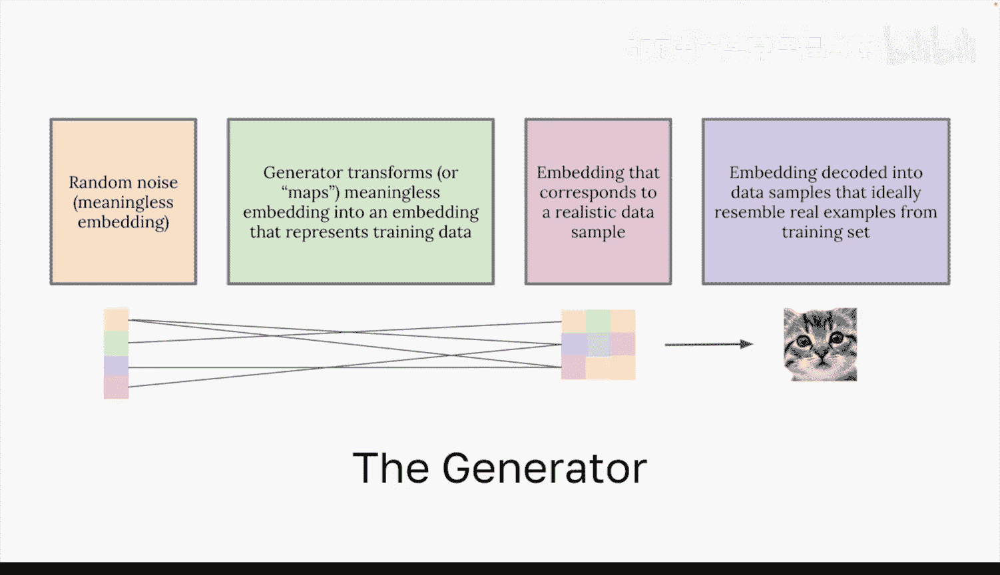

我喜欢从嵌入的角度来思考生成器模型的流程。首先，从一个无意义的嵌入开始，然后生成器将这个无意义的嵌入转换或映射成一个代表训练数据的嵌入。输出是一个对应真实数据样本的嵌入。最后，该嵌入被解码成数据样本，理想情况下，这些样本能代表训练集中的真实示例，以欺骗判别器模型。

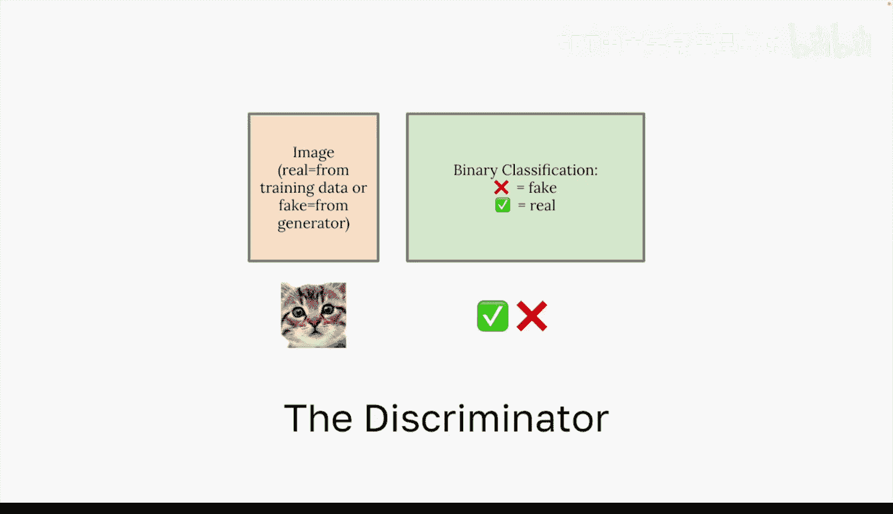

## 判别器模型简介 🕵️

判别器模型很简单。它是一个二元分类器，试图判断输入图像是真实的还是伪造的。我们只在训练过程中使用判别器，训练完成后通常会将其丢弃。

## GAN的可解释性方法 🔍

上一节我们回顾了GAN的基本原理，本节中我们来看看如何为GAN提供可解释性。

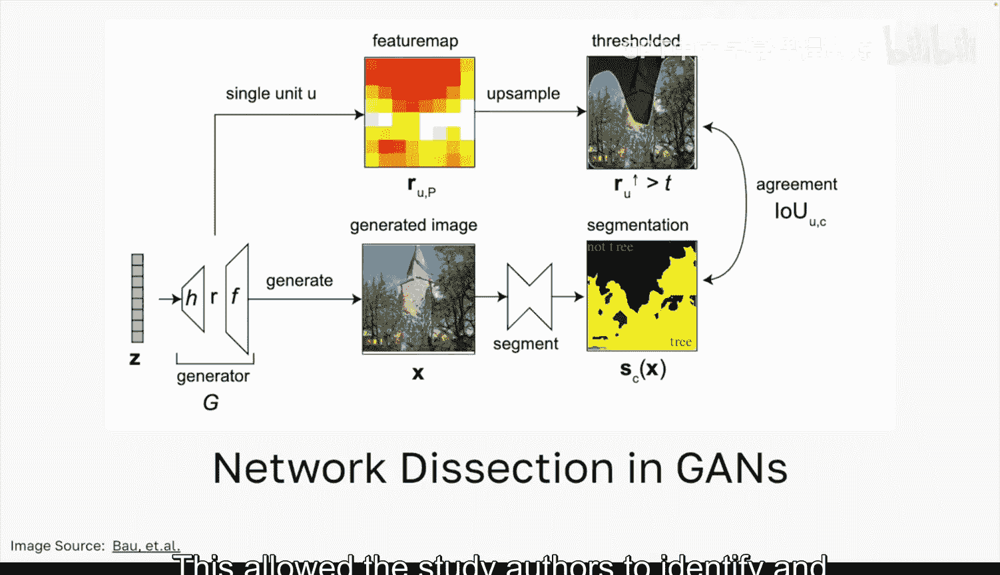

以下是几种主要的GAN可解释性方法。

### 网络剖析

Bau等人通过将网络剖析方法与分割网络结合，展示了其在GAN中的应用。他们能够回答一些有趣的问题：网络是否学习了与有意义概念匹配的内部神经元？这些神经元集合是否仅仅与物体相关？或者GAN是否使用这些神经元来推理物体？能否通过操纵因果神经元来改进GAN的输出？

这张图应该看起来很熟悉。如果不熟悉，请回顾“解释神经网络”讲座中的网络剖析部分。这里唯一的区别是增加了分割组件。

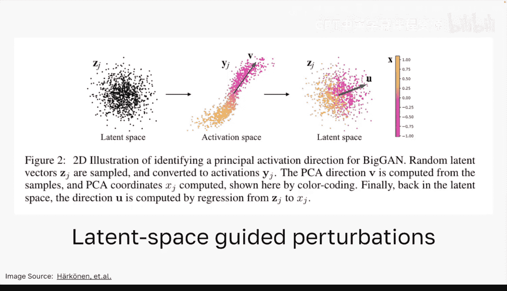

你可以使用网络剖析对GAN进行扰动操作。神经元可以被直接激活和停用。这使得研究作者能够识别并抑制那些导致图像生成错误的神经元。

### 潜在空间降维与可视化

如果你看过“大语言模型中的可解释人工智能”讲座，你会记得我们讨论了用于可解释性的潜在空间降维和可视化。这种方法也可以应用于图像生成。

Härkönen等人将主成分分析应用于GAN的潜在空间，发现它给出了具有语义意义的方向。这意味着，在GAN特定层的这些方向上扰动输入，会导致生成图像属性的可解释性编辑。你可以在论文的图中看到这一点，这是一个二维示意图，展示了一个名为BigGAN的GAN模型的主激活方向。随机采样潜在向量并转换为激活。这里显示的PC方向V是从这些样本中计算出来的，然后PC坐标被计算回潜在空间。方向U通过从Z_j到X_j的回归计算得出。

这是一个非常酷的技术，因为它是无监督的，所以你不需要像许多其他可解释性技术那样需要带标签的数据。

以下是一些来自Härkönen等人的图像。该图显示了使用他们方法在三个不同GAN模型上发现的控件进行图像编辑的序列。初始图像在左侧，使用潜在空间引导的扰动更新了各种特征。

在该图中，第1至2行说明了GAN模型StyleGAN2中间潜在空间中最大的主成分。它们涵盖了人像摄影中预期的主要变化，包括感知性别和头部旋转。

### 潜在空间引导的属性编辑

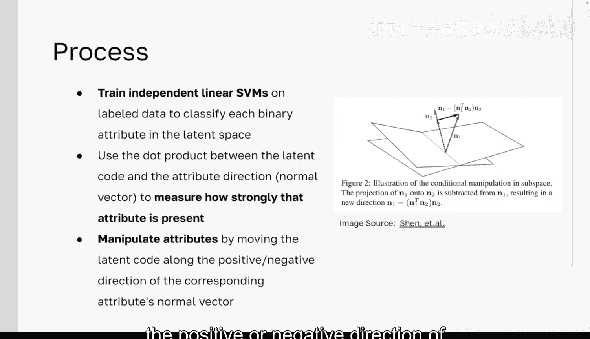

Shen等人也进行了潜在空间引导的扰动，并将其应用于在图像生成过程中专门编辑人脸。与之前使用PCA的方法不同，这篇论文训练线性模型（支持向量机）来寻找潜在空间中对应于不同二元属性（如年龄和姿态）的分离超平面子空间。

该图显示了通过改变GAN模型的潜在代码来操纵图像生成的结果。每一列都展示了操纵特定属性的结果。

以下是他们使用的过程。首先，在带标签的数据上训练独立的线性SVM，以在潜在空间中对每个二元属性进行分类。SVM决策超平面的法向量代表了潜在空间中与该属性对应的方向。然后，使用潜在代码与属性方向法向量的点积来衡量该属性存在的强度。接下来，通过沿着相应属性法向量的正方向或负方向移动潜在代码来操纵属性。最后，通过减去在其他属性方向上的投影来执行条件操纵，以解耦纠缠的属性。该过程的示意图在此处的图2中显示，展示了子空间中的条件操纵。N1在N2上的投影被从N1中减去，从而产生图中以黑色显示的新方向。

### 将局部解释集成到GAN训练中

我们还可以将局部解释集成到GAN的训练中，正如Nagi等人于2022年首次展示的那样。他们将显著图、LIME以及一种称为Deep SHAP的SHAP变体集成到他们的GAN模型中，他们称之为XAI-GAN。

这些模型产生的解释被转换为一个解释矩阵M。对于示例中的每个特征（例如，输入图像中的一个像素），在矩阵M的相应单元格中分配一个0到1之间的值。如果一个特征（更准确地说，是M中对应的单元格）被赋值为0或接近0，则意味着该像素对判别器D做出的分类决策没有影响。如果一个特征被赋值为1或接近1，则该特征非常重要。这可能是因为该特征对D的分类具有决定性作用，或者因为它损害了D的分类，具体来说，如果该特征被改变，那么D对其分类的置信度将会提高。

XI系统生成的矩阵M随后被用于改进的梯度下降算法中，以更新生成器的权重。传统上，生成器的权重是通过首先计算生成器输出相对于损失的梯度，然后应用链式法则来修改的。作者修改了这个算法，首先通过XAI系统计算解释矩阵M，然后计算M与生成器输出相对于损失的梯度之间的乘积。这意味着解释矩阵M被用来对梯度函数进行加权。因此，在梯度下降过程中修改生成器权重时，会考虑进入判别器分类的像素的重要性。

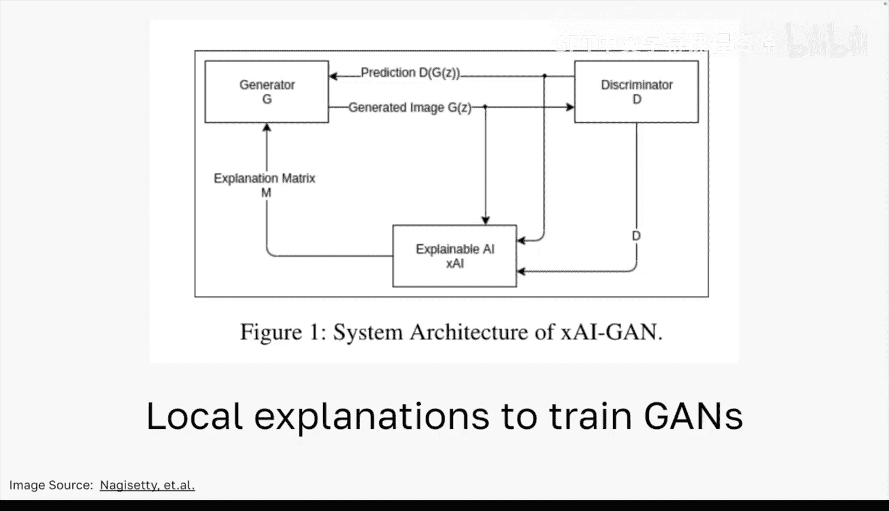

## 图像生成质量评估指标 📊

在讨论图像生成中的XAI时，你可能会在XAI技术评估中看到图像质量评估指标的出现。最常见的是初始分数和弗雷歇初始距离。

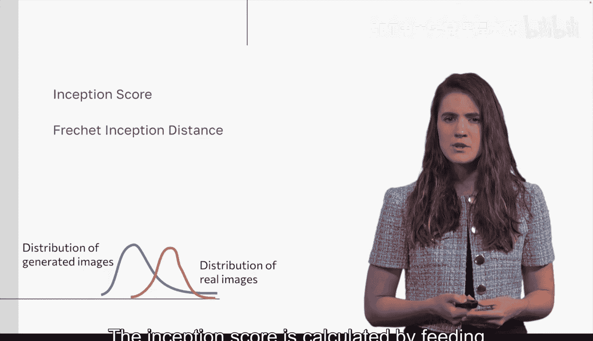

初始分数的计算方式是将生成的图像输入到一个预训练的初始模型（一个用于图像分类的卷积神经网络）中，然后计算生成图像的边际类别分布与分类器给出的条件类别分布之间的KL散度。初始分数越高，表示图像质量和多样性越好。

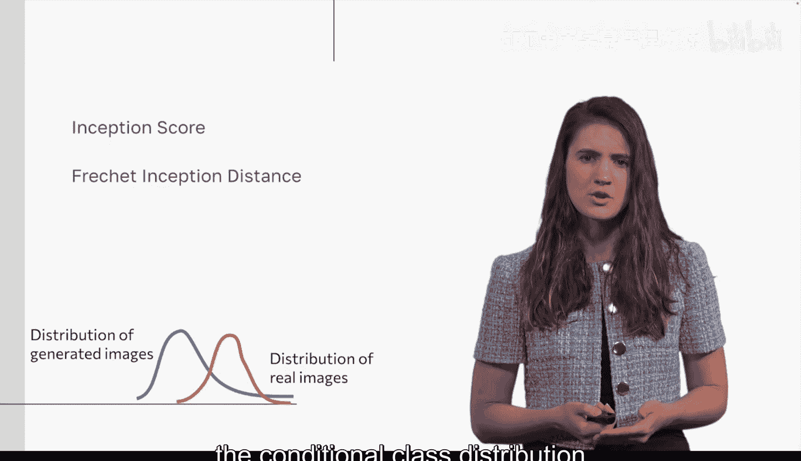

弗雷歇初始距离衡量的是真实图像分布与生成图像分布在特征空间中的相似性。FID的计算方式是计算真实图像和生成图像的特征表示（通常从预训练初始模型的中间层获得）之间的弗雷歇距离。FID分数越低，表示分布之间的相似性越高，生成的图像质量越好。

## 总结 📝

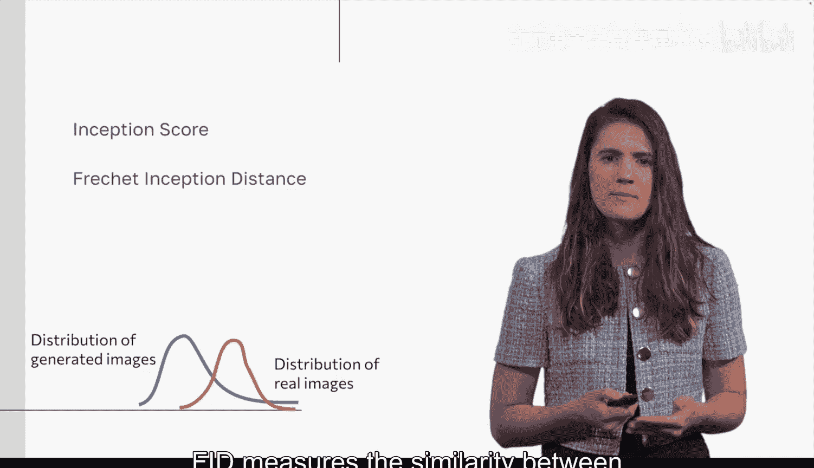

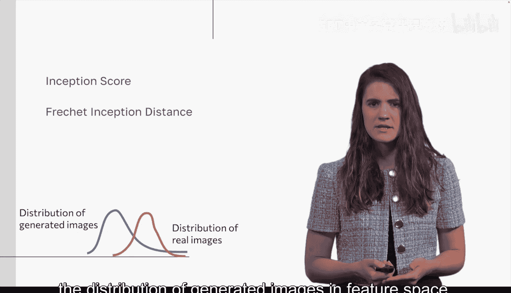

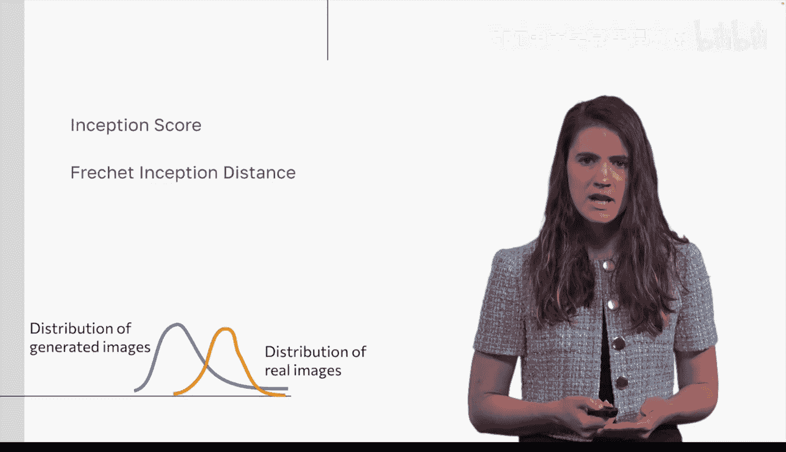

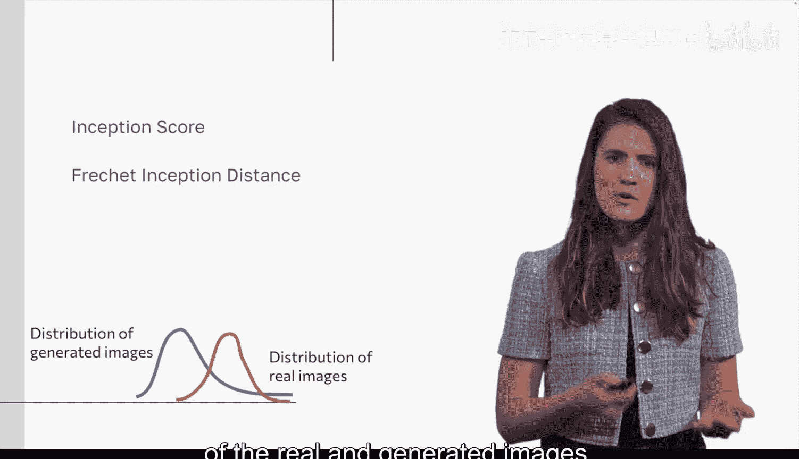

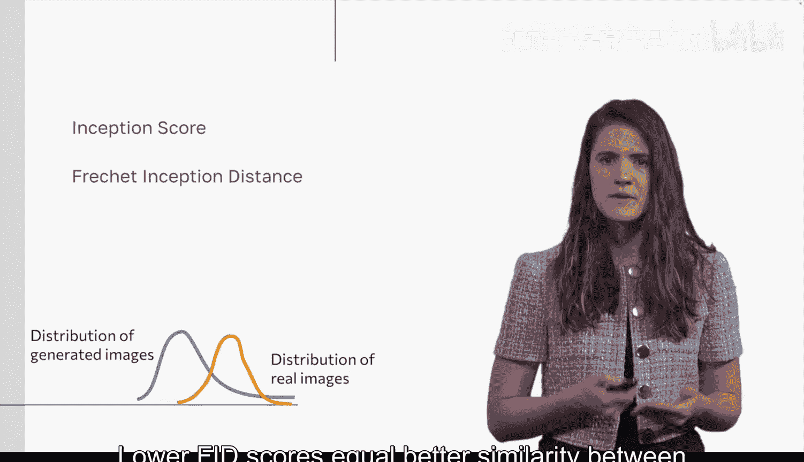

本节课中我们一起学习了生成对抗网络的基本原理及其可解释性方法。我们回顾了GAN中生成器和判别器的对抗训练过程，并探讨了多种理解GAN内部机制的技术，包括网络剖析、潜在空间降维与可视化、基于SVM的属性编辑，以及将局部解释集成到训练过程中的XAI-GAN。此外，我们还了解了评估生成图像质量的常用指标，如初始分数和弗雷歇初始距离。这些方法有助于我们更好地理解和控制GAN模型的行为，使其生成过程更加透明和可控。