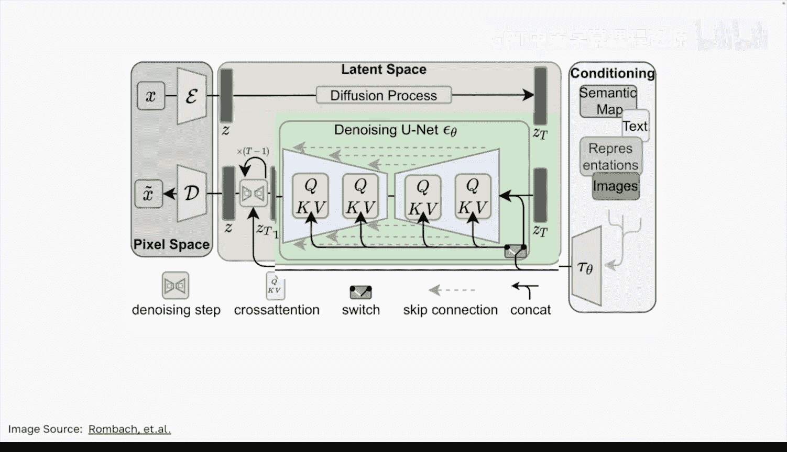
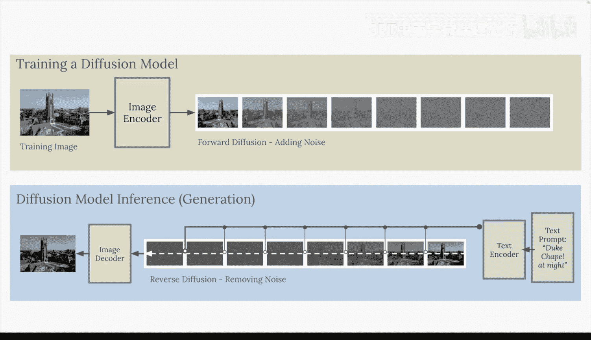
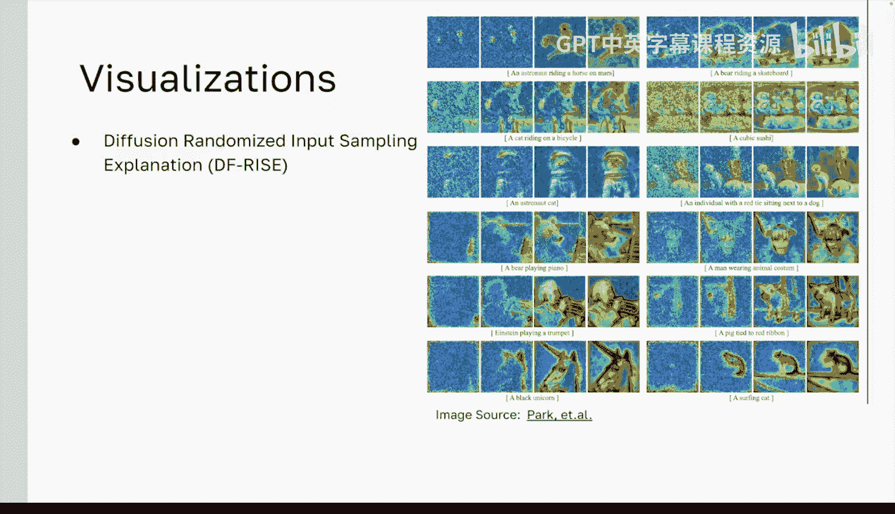
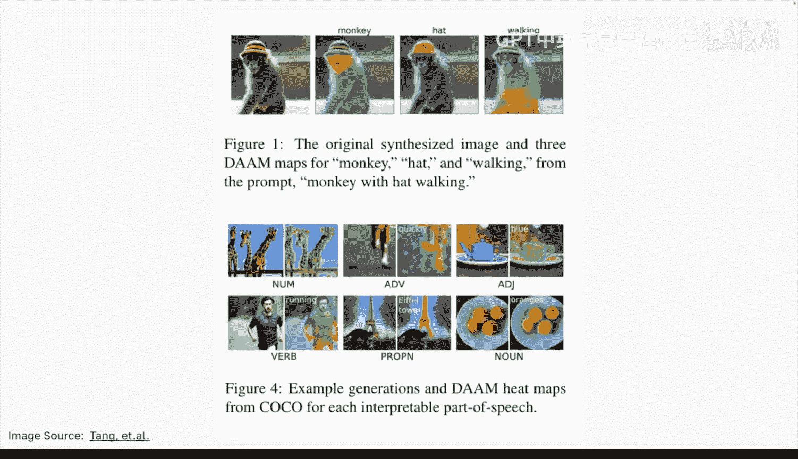
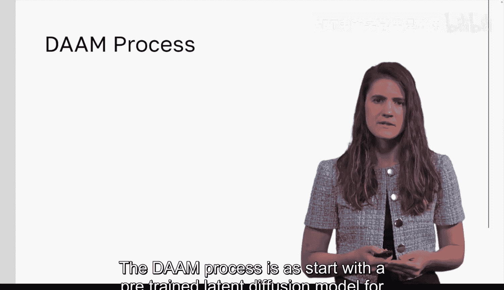
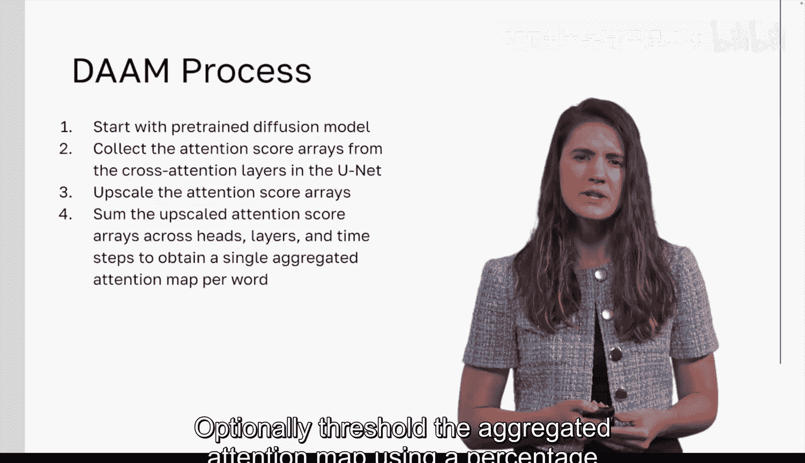
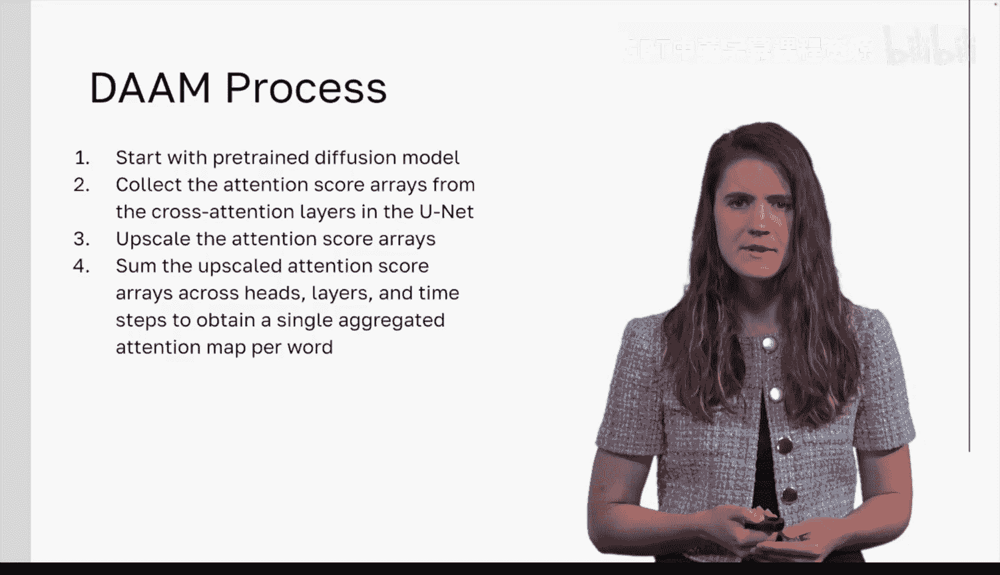
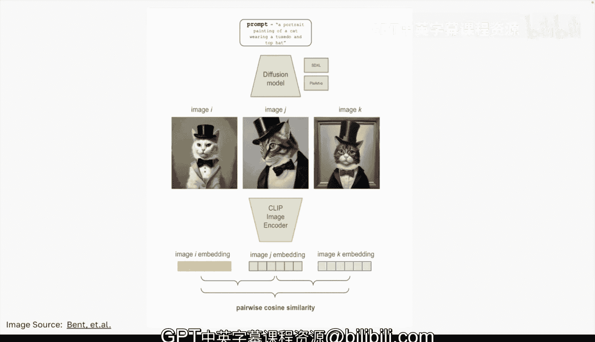

#  081：扩散模型可解释性 🧠

在本节课中，我们将要学习扩散模型的基本原理及其在图像生成中的应用，并探讨如何解释这些强大但复杂的模型。我们将从扩散模型的核心概念和工作流程开始，然后介绍几种前沿的可解释性研究方法。

---

扩散模型是一类生成模型，在图像生成任务中取得了显著成功。它们的工作原理是逐步向初始图像添加噪声，然后学习逆转这个扩散过程，从而从随机噪声中生成高质量、多样化的图像。

扩散模型背后的核心思想是定义一个马尔可夫链。该链从数据分布（如图像）开始，逐步添加噪声，直到最终状态变为纯高斯噪声。在反向过程中，模型通过学习逐步去除噪声，从而从数据分布中生成样本。

与生成对抗网络相比，扩散模型通常训练更稳定。GAN可能遭受模式崩溃和其他训练不稳定的问题。像Stable Diffusion这样的开源扩散模型的发布，使得强大的图像生成能力得以普及，从而在艺术、设计和媒体创作等领域催生了广泛的应用。

此处展示的图表来自关于潜在扩散模型的奠基性论文，这也是Stable Diffusion模型的基础。

---

上一节我们介绍了扩散模型的基本概念，本节中我们来看看它的几个关键组件。

以下是扩散模型的主要组成部分：

*   **变分自编码器**：该组件将图像编码到潜在空间，也能从潜在空间解码回图像。你可以将其视为一个“翻译器”。它在一个大型图像数据集上进行预训练，训练过程涉及尝试编码到潜在空间并准确重建训练图像。
*   **条件编码器**：在文生图任务中，它将用户提示编码到潜在空间，这是一个文本编码器。在图生图任务中，则是一个图像编码器。用户提示用于指导去噪单元的每一步，引导单元产生特定输出。
*   **去噪单元**：该组件引导反向扩散过程。类似于GAN，你从一个随机的潜在图像开始。单元预测其中有多少噪声，然后从上一个随机潜在图像中减去噪声，同时用户输入会引导单元。这个过程会重复N次。

---

扩散模型的训练过程涉及两个步骤：

1.  **前向扩散**：在此步骤中，模型学习逐步向原始数据分布添加噪声，创建一系列受扰动的数据分布。
2.  **反向扩散**：模型被训练来逆转前向扩散过程，从纯噪声开始，逐步去除噪声以重建原始数据分布。

在生成过程中，模型从随机噪声开始，迭代地进行去噪，在反向扩散过程结束时产生高质量图像。用户文本提示通过文本编码器传递，并用于通过去噪单元指导此过程。

---

现在我们已经回顾了扩散模型，接下来将讨论扩散模型图像生成可解释性方面的一些新兴研究趋势。

首先是Gart等人展示的反事实解释。下图来自该论文，展示了扩散模型中的反事实解释。

Park等人提出了可视化扩散模型图像生成的方法。以下是这些方法的介绍：

*   **DFRISE**：即扩散随机输入采样解释。该方法通过使用随机输入掩码和为生成模型定制的结构相似性函数生成显著图，来可视化扩散模型在每一步所关注的去噪区域。
*   **DFCAM**：即扩散梯度加权类激活映射。该方法通过使用梯度加权激活图来突出显示模型在每个去噪步骤中关注的具体视觉概念，从而可视化扩散模型的内部运作。
*   **指数时间步采样**：该方法在反向扩散过程中调整时间步采样策略，以集中在特定阶段（早期、中期或晚期），从而分析在不同时间阶段被强调的视觉概念。
*   **相关性分数**：该论文采用生成图像与输入文本提示之间的相关性分数，来量化和分析在不同时间步和阶段显现的视觉概念。

下图来自Park等人的论文，他们将自己的方法DFRISE和DFCAM与LIME进行了比较。虽然LIME依赖于此处显示的分割区域，但DFRISE可视化的决策过程不受外部因素影响。

---

Tang等人在2022年引入了DAM，这是一种用于交叉注意力像素归因可视化的方法。他们通过对去噪子网络中的交叉注意力词-像素分数进行上采样和聚合，来生成像素级归因图。其核心思想是将扩散模型中现有的交叉注意力重新用作一种手段，以归因哪些词语影响了哪些图像区域。

论文中的示例如下图所示。左图中，显示了“monkey”、“hat”和“walking”的DAM图叠加在原始生成图像上。右图显示了不同词性（如形容词、动词和名词）的DAM热图。

DAM的过程如下：

1.  从一个预训练的用于文生图的潜在扩散模型开始，例如Stable Diffusion 2.0。
2.  识别U-Net网络中那些将文本嵌入关注到空间图像表示的交叉注意力层。
3.  从这些交叉注意力层中，跨U-Net的不同尺度（下采样和上采样块）收集注意力分数数组。
4.  使用双三次插值将注意力分数上采样到原始图像大小。
5.  跨注意力头、层和时间步对上述上采样后的注意力分数进行求和，以获得每个单词的单个聚合注意力图。聚合的注意力图将单词与图像区域关联起来，其中较高的值表示更强的归因。
6.  可选地，使用最大值的百分比对聚合注意力图进行阈值处理，以生成二进制分割掩码。

---

当将扩散模型应用于图像生成时，生成的输出存在可变性。这种可变性是扩散过程固有随机性因素的结果，包括扩散过程的随机初始化、从概率分布中采样以及非线性激活。

虽然可变性是扩散模型固有的，但由于模型架构、训练程序（包括近似方法）以及用于控制或引导生成过程的技术存在差异，不同模型的可变性水平也有所不同。当将这些模型应用于现实世界问题时，挑战在于如何调和生成输出中对多样性和创造性的渴望与相对于输入提示需要一致性和连贯性之间的矛盾。

量化生成输出的一致性或可重复性将允许量化这种可变性，并能在为特定应用或任务选择扩散模型时，就创造性与一致性之间的权衡做出决策。这种量化可以提供模型稳定性和一致性的评估，检测意外偏差，验证模型输出的解释，并增强用户理解。

在相关论文中，作者提出了一种量化扩散模型图像生成一致性的语义方法。该方法使用多模态嵌入模型CLIP来生成N次生成的图像的嵌入，并对生成的N个图像嵌入进行两两余弦相似度计算。

虽然目前不常在可解释性中使用，但多模态嵌入模型是一种非常有趣的工具，可用于可解释性。我们必须警惕这些多模态模型中固有的偏见，并且与所有可解释性指标类似，必须深思熟虑该方法的局限性。

---

本节课中我们一起学习了扩散模型的工作原理及其关键组件，并探讨了多种前沿的可解释性技术，包括反事实解释、可视化方法（如DFRISE和DFCAM）、像素级归因（DAM）以及量化生成一致性的方法。理解这些技术对于负责任地开发和应用强大的生成模型至关重要。