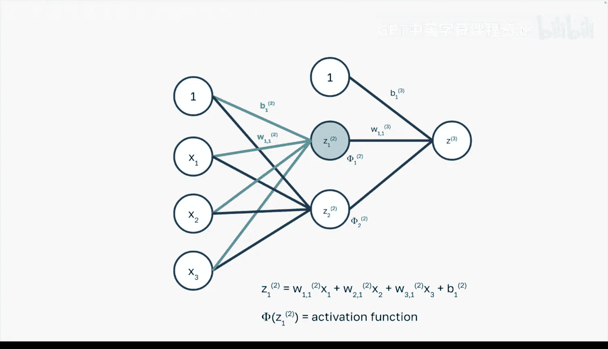
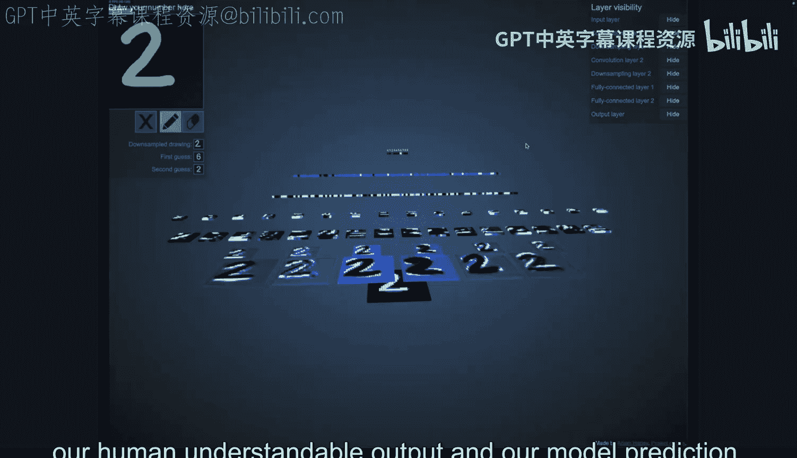

# 可解释人工智能 (XAI)：01：黑盒问题：XAI的动机 🎯

在本节课中，我们将要学习什么是人工智能中的“黑盒”问题，以及为什么理解模型内部的工作机制至关重要。我们将探讨人类与机器在信息表示方式上的根本差异，并审视黑盒模型在现实世界应用中可能引发的风险。

## 信息表示方式

首先，我们来思考信息的表示方式。人类如何相互沟通？人类通过语言（口头或书面）进行交流，语言中包含了数字和符号的概念。我们也可以通过图像，即思想和想法的视觉表现，来进行沟通。

另一方面，机器（除了量子计算机）仅通过数字进行交流。今天的计算机将所有概念或想法归结为1和0，即构成计算机基础的电子元件上的开或关的门电路。

我们已经学会了将我们的信息表示方式（如语言和图像）转换为计算机能够理解的数字。例如：
*   **图像**：一张彩色图像被分解为像素，每个像素由代表红、绿、蓝含量的数值表示。这些数值就是该图像中信息的表现形式。
*   **文本**：文本被分解为词元或文本片段，它们通常被表示为固定长度的数字向量。这个向量是词元含义的压缩版本。根据生成这个固定长度向量（或嵌入向量）的方法，该向量可能包含词元的语义和概念定义，甚至包括使用该词元的上下文。这对于像“bank”这样根据上下文（或周围的词语）具有多重含义的词语尤其有用。

这意味着，我们可以将人类可理解的输入（如图像或基于文本的问题）放入机器学习模型，而模型应该能够以人类可以理解的形式表示其输出，无论是代表图像中物体边界框的一系列数字、一个类别标签，还是一串词元。

## 深入黑盒内部

现在让我们回到黑盒问题。我们有一个人类可理解的输入，也有一个人类可理解的输出。但这个黑盒内部发生了什么？这正是我们今天要讨论的内容。

首先，简要回顾一下黑盒。由于许多传统机器学习方法具有不同程度的可解释性（稍后会详细讨论），这里我将重点讨论基于神经网络架构的深度学习模型。

在神经网络架构中，我们有多层节点。每个节点对其输入进行加权求和，并将结果通过一个通常是非线性的激活函数。对于我们网络中的每个节点，加权求和有一定数量的权重，还有一个需要设置的偏置分量。

我们设置这些权重和偏置的方式是通过训练神经网络：将训练数据通过网络传递，并迭代地更新这些权重和偏置。神经网络可以拥有数千、数百万甚至数万亿个权重。随着我们向神经网络添加更多层，它从输入数据中提取越来越抽象特征的能力也随之增强。虽然这可以提升性能，但也使其进一步远离我们人类可理解的表示方式。不同的架构也可能导致更多的抽象。

当你的神经网络得出一个输出时，我们通常不知道模型是如何得出这个结论的。

上图是一个关于这种抽象过程的绝佳可视化展示，它基于一个非常简单的卷积神经网络。这个可视化由Adam Harley开发，链接将在课程资源中提供，以便你自己查看。

这个可视化的工作原理是，在网络的每个节点，我们实际上可以输出模型所看到内容的人类可理解表示。首先，我画一个数字。这个数字的数值表示将成为模型的输入层。接下来，我将展示神经网络的第一层。你可以看到图像表示看起来与输入层基本相同。然后，我们添加一个下采样层，它基本上只是让所有东西变小。我们网络的第二层对原始输入进行了大量提取，以至于我们甚至无法再识别出数字“2”。随后的层将信息进一步抽象，直到全连接层。最后，我们将所有内容映射回人类可理解的输出和我们的模型预测。

## 关于黑盒的澄清与动机

这里我想强调一个重要的旁注，因为关于这一点存在很多混淆：**黑盒模型并不意味着我们无法重现结果的模型**。如果我们拥有模型架构（包括训练好的权重）、相同的输入数据以及用于产生包含某些随机过程（如Dropout层或某些类型的注意力机制）的模型输出时所用的随机种子，那么我们就可以重现结果。黑盒模型的核心思想在于，尽管我们可能拥有训练好的权重，但这些权重是人类无法理解的。稍后我们将讨论透明度，可重现性正是在那里发挥作用。

现在，你可能在想：谁在乎呢？如果我得到了答案或模型输出，为什么需要理解模型是如何得出答案的？

让我们考虑几个例子：
*   **招聘**：你向一家使用AI算法筛选面试人选的公司提交了简历。尽管你的简历与职位描述中发布的技能和要求完全匹配，但你未被选中。你联系公司的招聘团队，他们无法告诉你为什么你的申请没有通过筛选，因为模型只给出了输出，没有提供任何解释。结果发现，他们在训练过程中使用了现有员工的简历，而许多现有员工的简历中都把“玩地掷球”列为一项技能。你没有，所以你被筛掉了，尽管地掷球并非职位描述的一部分，也不是工作所需的技能。
*   **金融**：你申请了一笔贷款，尽管信用评分优秀，但仍被拒绝。当你致电银行时，他们承认现在使用AI算法处理贷款申请，并且不确定你的贷款为何被拒。
*   **医疗**：你去医院，分诊使用了AI算法。你被排到队尾，需要等待三个小时才能得到治疗，而患感冒的孩子却能立即就诊。AI算法正在使用关于你社会经济状况的信息来对你进行分诊，尽管训练算法的工程师认为这些数据不重要，所以只是将其保留在数据中。

这些例子虽然是虚构的，但都基于现实。招聘、金融和医疗保健是三个正在积极使用AI工具的高风险领域。

那么，一个真实的例子呢？2023年，底特律警方使用了面部识别技术（计算机视觉机器学习模型），错误地将Portia Woodruff识别为一起劫车案的嫌疑人。她在怀孕八个月时因一项她并未犯下的罪行而被逮捕。模型为何将Portia识别为嫌疑人？他们无法确定模型识别她照片的原因。

这些只是缺乏对模型决策的理解可能带来严重后果的几个例子。而这正是我们开始介绍可解释人工智能（XAI）的出发点。

## 总结

本节课中，我们一起学习了人工智能中的“黑盒”概念。我们了解到，尽管模型的输入和输出对人类是透明的，但其内部复杂的数值计算和抽象特征提取过程却难以理解。这种不透明性在招聘、金融、司法等关键领域可能带来偏见、不公和无法追责的风险。正是为了解决这些问题，理解和开发可解释的人工智能（XAI）变得至关重要。在接下来的课程中，我们将深入探讨如何让这些“黑盒”变得透明。