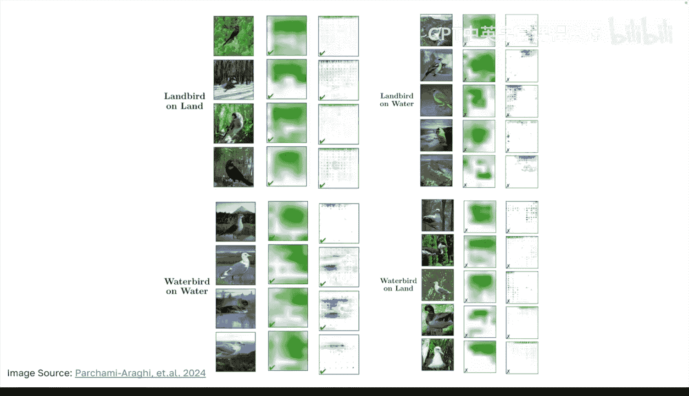
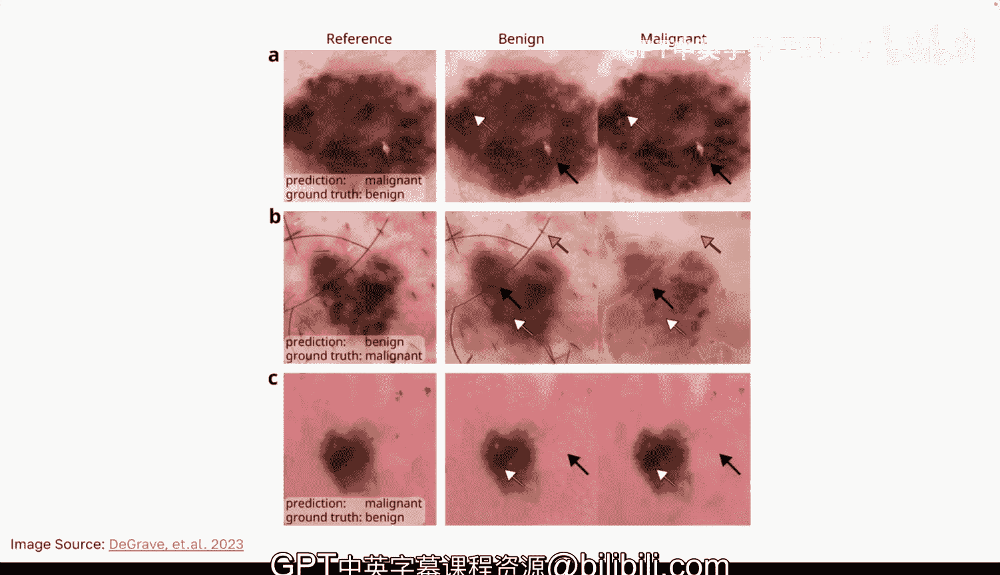

# 可解释人工智能 (XAI)：02：良好决策的定义 🎯

在本节课中，我们将探讨可解释人工智能（XAI）的基本理念，并理解为什么一个良好的决策应基于知识而不仅仅是数字。我们将通过几个生动的例子来阐明这一核心观点。

---

柏拉图曾说过：“良好的决策基于知识，而非数字。”这句话精辟地概括了可解释人工智能的核心理由。它提醒我们，在依赖数据做出判断时，必须结合我们对世界的理解。

## 冰淇淋与鲨鱼攻击的关联 🍦🦈

为了理解上述观点，我们可以看一个例子。以下是两个数据图表。

第一个图表展示了冰淇淋销量随月份的变化趋势。

第二个图表展示了鲨鱼攻击事件随月份的变化趋势。

当你观察这两个图表时，可能会提出一个问题：吃冰淇淋会导致鲨鱼攻击吗？从纯粹的数值角度来看，这两者似乎高度相关。因此，你可能会得出结论：吃冰淇淋确实会导致鲨鱼攻击。

然而，在得出这个结论时，我们忽略了我们的知识，特别是关于季节性温度波动及其对人们吃冰淇淋和进入海洋行为影响的知识。因此，我们的结论会截然不同。虽然这两个事件相关，但我们知道其中一个并不会导致另一个发生。

## 神经网络分类中的陷阱 🐺❄️

上一节我们看到了相关性不等于因果性的经典案例。本节中我们来看看机器学习模型可能存在的类似问题。

当我们训练一个神经网络来将图像分类为哈士奇或狼时，例如下图所示，我们可能获得很高的准确率，并且不会质疑结果。

但是，如果我们只看简单的准确率指标或数字，我们就忽略了模型做出分类决策背后的推理或知识。如果我们不深入理解模型结果，我们将不会意识到模型做出这个决策仅仅基于图像的背景，具体来说，就是地面上是否有雪。

## 水鸟数据集的启示 🐦🌊

同样，我们可以看看水鸟数据集。这个数据集包含带有陆地背景的陆地鸟类图像和带有水域背景的水鸟图像，这些数据被用于训练模型。

现在，假设我们想测试我们的模型，但我们想在陆地背景上测试水鸟，以及在水域背景上测试陆地鸟类。我相信你已经明白问题所在了。

我们的模型在第一列中准确地分类了陆地鸟类和水鸟，但在第二列中却没有正确预测任何一只鸟。最近一篇论文的作者使用了可视化方法来观察模型使用图像的哪一部分来进行预测。他们发现，事实上，模型使用的是背景是陆地还是水域，而不是鸟本身。

## 皮肤病学模型中的误分类分析 🩺

在另一篇最近的论文中，作者试图理解皮肤病学模型中的误分类。作者使用了一种方法来解释模型的预测，并发现某些色素沉着或毛发的存在导致了误分类。这对于理解模型的行为以及如何基于其预测做出决策非常有帮助。

---

在本节课中，我们一起学习了良好决策的定义，即决策应基于深刻的知识而不仅仅是表面的数字。我们通过冰淇淋与鲨鱼攻击的关联、神经网络对背景的依赖、水鸟数据集的偏差以及皮肤病模型的误分类等例子，清晰地看到了忽视模型内部推理可能带来的风险。理解模型“为什么”做出某个预测，与知道它“做出”了某个预测同样重要，这正是可解释人工智能（XAI）的价值所在。