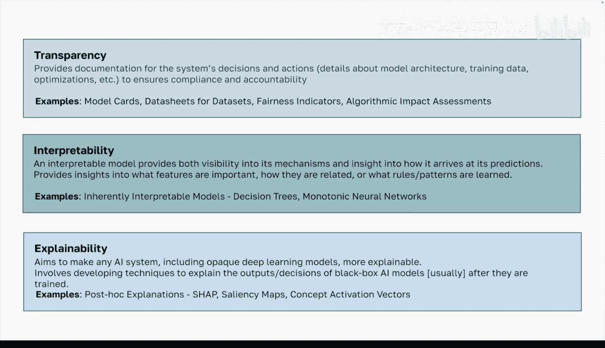
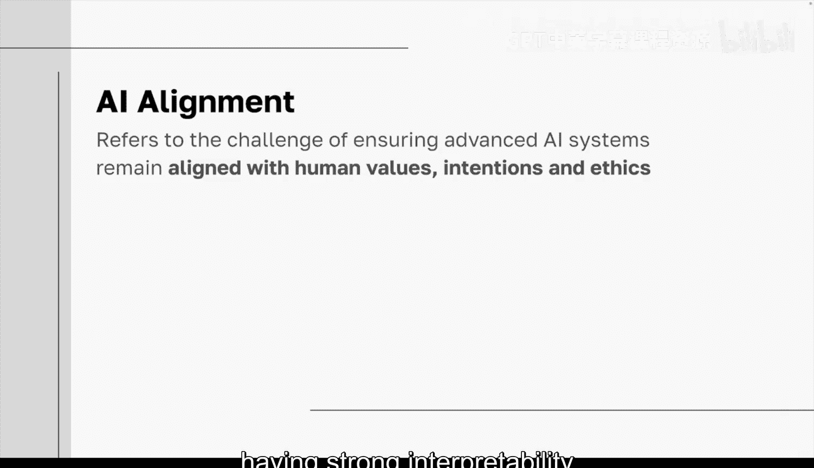
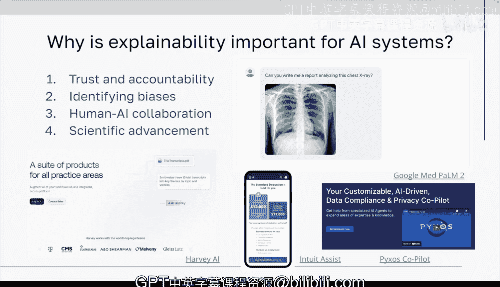

# 杜克大学《可解释人工智能｜Explainable AI (XAI)》中英字幕 p03 03_01_04_定义可解释性、可说明性与透明度.zh_en -BV1HnrBBmEon_p3-

Transparency， interpretability and explainability are related but distinct concepts when it comes to AI systems。

 You may hear these terms used interchangeably， and there is confusion around the differentiation of these terms。

 The confusion arises because these terms often overlap in discussions about AI ethics。

 accountability and trustworthiness。 While transparency。

 interpretability and explainability are related。 they address different aspects of making AI systems understandable and trustworthy to humans。

Transparency focuses on providing evidence and documentation for the system's decisions and actions such as details about the model architecture。

 training data， optimization， procedure， and so on。

It can help users verify and validate the system's decisions。

 as well as ensure its compliance and accountability。

Interprettable machine learning focuses specifically on developing machine learning models and techniques that are inherently interpretable or self explanatory。

The goal is to make the model itself transparently understandable without the need for additional explanations。

Explainable AI or X AI is a broad field that aims to make any AI system。

 including opaque deep learning models more explainable。

 Expplainable machine learning involves developing techniques to explain the outputs or decisions of a black box AI model after they are trained。

 The goal is to generate post hoc explanations for an existing model's behavior。😊。

Examples of transparency include model cards， data sheets for data sets， fairness indicators。

 and algorithmic impact assessments。Examples of inherently interpretable models include decision trees and monotonic neural networks。

Examples of posttoc explanations and explainability include Shap。

 saliency maps and concept activation vectors。

I would be remiss to not briefly touch on the concept of AI alignment。

 since it is tightly coupled with our concepts of transparency， interpretability and explainability。

At its core， AI alignment refers to the challenge of ensuring advanced AI systems remain aligned with human values。

 intentions and ethics as they become more capable and autonomous。As AI grows more powerful。

 keeping it correlated and aligned with the goals and motivations we actually want it to pursue becomes paramount。

Misaligned AI systems that deviate from their intended purposes or optimizing objectives can lead to harmful unintended consequences at scale。

Even seemingly innocuous misalignments in an AI's reward function or training process can result in misguided or deceptive behaviors once that system operates in the open world。

X AI plays a vital role in AI alignment by allowing us to inspect。

 understand and provide corrective feedback on an AI's decision making process and inner representationations without explainability。

 it becomes extremely difficult to detect deviations or misalignments before they amplify into severe issues once the AI operates in the open world。

Explainable AI provides the transparency necessary to audit AI systems for potential misalignments with human ethics。

 preferences and societal values encoded in their training data or reward functions。

 It enables meaningful human oversight over the AI's reasoning process。

Explainability allows AI systems to not just expose their inner workings。

 but provide rationale and justification to human supervisors in an interpretable manner。

This two way communication channel is really crucial for recognizing misalignments and rectifying them through iterative feedback loops。

As AI capabilities grow more advanced and autonomous。

 the complexity of their internal representations and decision procedures will increase exponentially；

 robust XAI techniques will therefore become imperative for maintaining clear human understanding and the ability to steer these systems towards robustly aligned behaviors。

In fact， many proposed approaches for achieving AI alignment， such as reward modeling。

 inverse reward design and debate based methods inherently rely on AI systems having strong interpretability and explainability capabilities。

So let's come back to the question， why is explainability so important for AI systems。

 there are a few key reasons， one trust and accountability。

 being able to understand an audit in AI's decision making process is crucial for building trust。

 especially in high stakes domains like healthcare， criminal justice and finance。

Identifying biases explainable models can help uncover uncover unintended biases。

 discrimination or other ethical issues embedded in the training data or model。Third。

 human AI collaboration when humans can understand in AI's reasoning， they can provide guidance。

 feedback， and corrections to improve future outputs。

Debugging AI systems is part of this collaboration， and explainable methods make debugging easier。

And lastly， scientific advancement， explainable models facilitate deeper understanding of the underlying phenomena being modeled。

