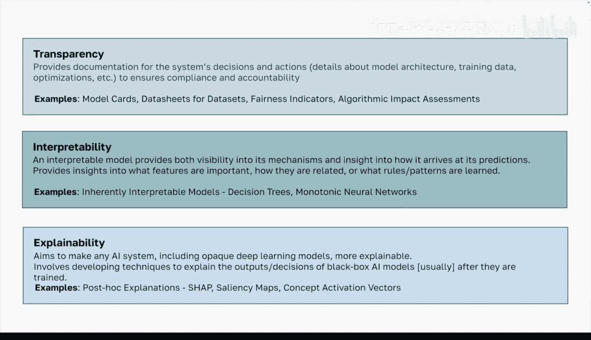
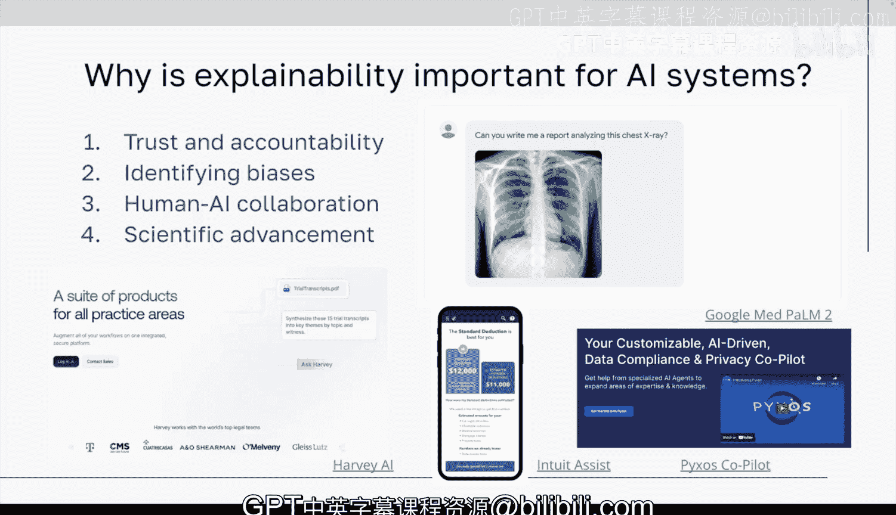

# 可解释人工智能：03：定义可解释性、可说明性与透明度

在本节课中，我们将学习人工智能领域中三个核心且易混淆的概念：透明度、可解释性与可说明性。我们将明确它们的定义、区别与联系，并探讨它们为何对构建可信赖的AI系统至关重要。

## 透明度、可解释性与可说明性的区别

透明度、可解释性与可说明性是人工智能系统中相关但不同的概念。

你可能会听到这些术语被混用，并且它们之间的区别确实存在混淆。这种混淆源于在讨论AI伦理、问责制和可信度时，这些术语经常重叠。虽然透明度、可解释性与可说明性相关，但它们解决的是使AI系统对人类而言可理解和可信赖的不同方面。

上一节我们明确了这些概念的重要性，本节中我们来看看它们各自的具体含义。

以下是这三个核心概念的定义：

*   **透明度**：侧重于为系统的决策和行动提供证据和文档，例如关于**模型架构、训练数据、优化过程**等的详细信息。它帮助用户验证和确认系统的决策，并确保其合规性和问责性。
*   **可解释性**：特指开发**本质上可解释或自解释**的机器学习模型和技术。其目标是使模型本身透明易懂，无需额外的解释。
*   **可说明性**：是一个广泛的领域，旨在使任何AI系统（包括不透明的深度学习模型）更具可说明性。可说明性机器学习涉及开发技术，用于在**黑盒AI模型训练完成后**解释其输出或决策。其目标是为现有模型的行为生成**事后解释**。

## 概念示例与AI对齐

为了更清晰地理解，以下是每个概念的具体示例：

*   **透明度示例**：模型卡片、数据集数据表、公平性指标和算法影响评估。
*   **本质可解释模型示例**：决策树和单调神经网络。
*   **事后解释与可说明性示例**：SHAP值、显著性图和概念激活向量。

在深入探讨可说明性的重要性之前，有必要简要提及**AI对齐**的概念，因为它与我们的透明度、可解释性和可说明性概念紧密相连。

AI对齐的核心是指确保先进的AI系统在变得更有能力和更自主时，始终与**人类价值观、意图和伦理**保持一致的挑战。随着AI变得更强大，使其与我们真正希望它追求的目标和动机保持关联与一致变得至关重要。

偏离其预期目的或优化目标的未对齐AI系统，可能导致大规模的有害意外后果。即使AI奖励函数或训练过程中看似无害的错位，一旦系统在开放世界中运行，也可能导致误导性或欺骗性行为。

可解释AI在AI对齐中扮演着至关重要的角色，它允许我们检查、理解AI的决策过程和内部表征，并提供纠正性反馈。没有可说明性，一旦AI在开放世界中运行，在其偏差或错位放大为严重问题之前，将极难被察觉。

可解释AI提供了必要的透明度，以审计AI系统是否存在与编码在其训练数据或奖励函数中的人类伦理、偏好和社会价值观的潜在错位。它使得人类能够对AI的推理过程进行有意义的监督。

可说明性允许AI系统不仅暴露其内部运作，还能以可解释的方式向人类监督者提供理由和论证。这种双向沟通渠道对于识别错位并通过迭代反馈循环纠正它们至关重要。

随着AI能力变得更加先进和自主，其内部表征和决策过程的复杂性将呈指数级增长；因此，强大的XAI技术对于维持清晰的人类理解以及引导这些系统走向稳健对齐行为的能力将变得不可或缺。

事实上，许多实现AI对齐的提议方法，如奖励建模、逆向奖励设计和基于辩论的方法，本质上都依赖于AI系统具备强大的可解释性和可说明性能力。

## 可说明性为何重要

那么，让我们回到核心问题：为什么可说明性对AI系统如此重要？

以下是几个关键原因：

*   **信任与问责**：能够理解和审计AI的决策过程对于建立信任至关重要，尤其是在医疗保健、刑事司法和金融等高风险领域。
*   **识别偏见**：可说明的模型有助于揭示训练数据或模型中嵌入的意外偏见、歧视或其他伦理问题。
*   **人机协作**：当人类能够理解AI的推理时，他们可以提供指导、反馈和纠正，以改进未来的输出。调试AI系统是这种协作的一部分，而可说明的方法使调试更容易。
*   **科学进步**：可说明的模型有助于更深入地理解被建模的底层现象。

本节课中，我们一起学习了透明度、可解释性与可说明性这三个核心概念的定义与区别，了解了它们与AI对齐的紧密联系，并明确了可说明性对于构建可信、可靠、负责任的人工智能系统的基础性作用。理解这些概念是进一步探索具体XAI技术和方法的第一步。