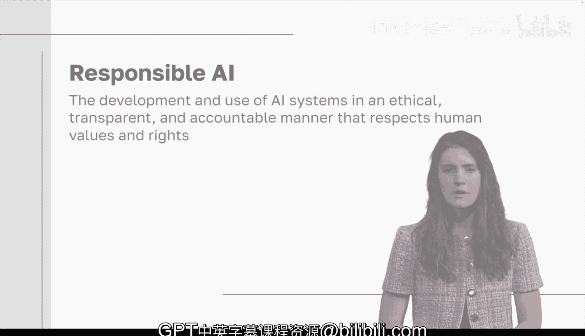
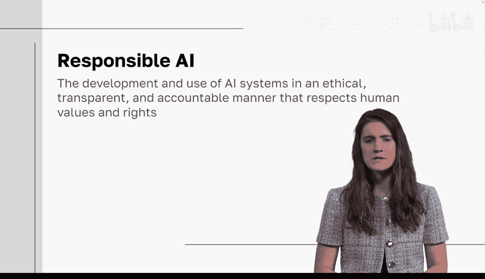
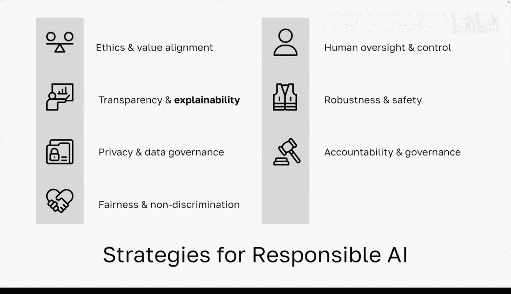
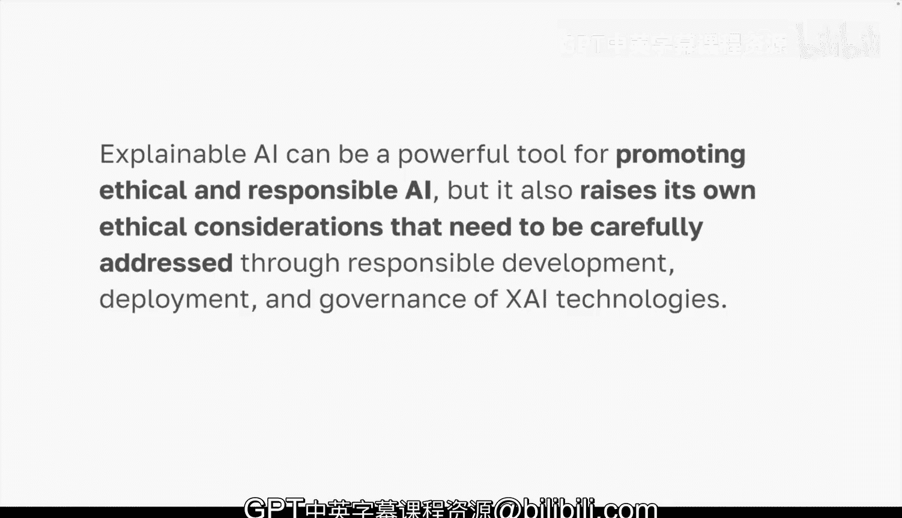

# 杜克大学《可解释人工智能｜Explainable AI (XAI)》中英字幕 p04 04_01_01_负责任的人工智能.zh_en -BV1HnrBBmEon_p4-

Explainable AI is just one component of what has been termed responsiblepon AI。

 Responible AI refers to the development and use of AI systems in an ethical。

 transparent and accountable manner that respects human values and rights。

Responsible AI encompasses many strategies for developing systems that are trustworthy。

 reliable and beneficial。 The goal is to build systems that operate within ethical boundaries to prevent misuse and negative societal impacts。

Strategies of responsible AI include ethics and value alignment。

 ensuring AI systems are designed and deployed in alignment with ethical principles。

 human rights and societal values like fairness， privacy， security and well being。

Transparency and explainability。 This is what we discussed in the first module and what is the core focus of this course and the specialization on explainable AI。

 making AI systems transparent and their decision making processes explainable to the affected stakeholders This enables incountability。

😊，Privacy and data governance， responsibly managing data used to train AI models， protecting privacy。

 and ensuring data is collected and used ethically。Fairness and non discriminationmination。

 mitigating bias and ensuring AI models do not discriminate against individuals or groups based on sensitive attributes like race and gender。

Human oversight and control， incorporating human oversight。

 the ability to intervene and meaningful human control over critical decisions made by AI systems。

Robustness and safety， ensuring AI systems are robust， reliable and safe， with adequate testing。

 monitoring and risk management processes and accountability and governance。

 establishing clear lines of accountability， audit trails and governance frameworks for the development and use of AI。

😊。

In alignment with responsible AI， it is important to discuss ethical considerations of this technology。

 A side note here that ethics is an incredibly important topic in the field of AI。

 and one that I will emphasize throughout this specialization。

 Ethics is not limited to a discussion in a single module。

 but rather part of every discussion we have as part of this course。

 Explainable AI can be a powerful tool for promoting ethical and responsible AI。

 but it also raises its own ethical considerations that need to be carefully addressed through responsible development。

 deployment and governance of X AI technologies。😊。

Ways in which X AI can promote ethics in AI technology include accountability。

 fairness and transparency。 X AI can help ensure that AI systems are accountable and that their decisions and recommendations can be explained and justified。

 in healthcare care。 If an AI diagnostic system recommends an incorrect treatment。

 We need to be able to explain how it arrived at that decision Was there bias in the training data。

 Do the algorithm have flaws， Iplementing X AI approaches can help us answer these questions。

 This is crucial in domains such as health care， finance and cral justice。

 where AI decisions can have significant consequences for individuals and society。

