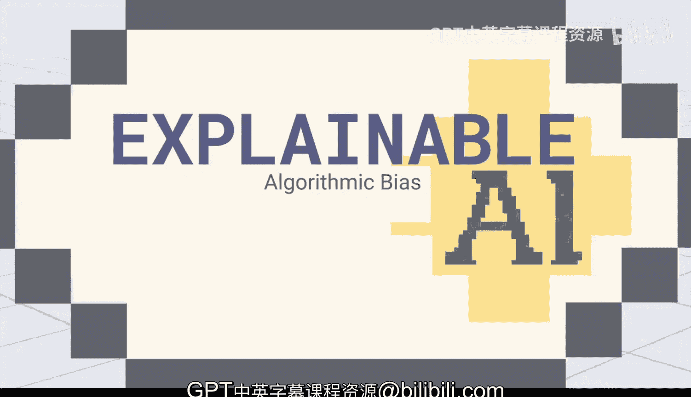
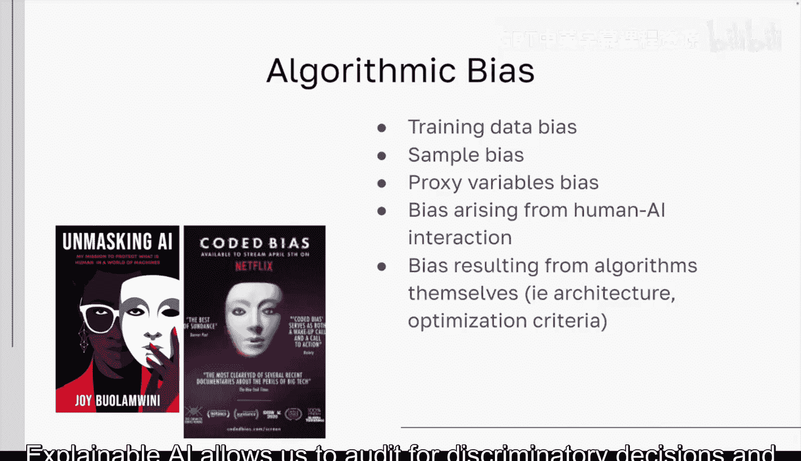
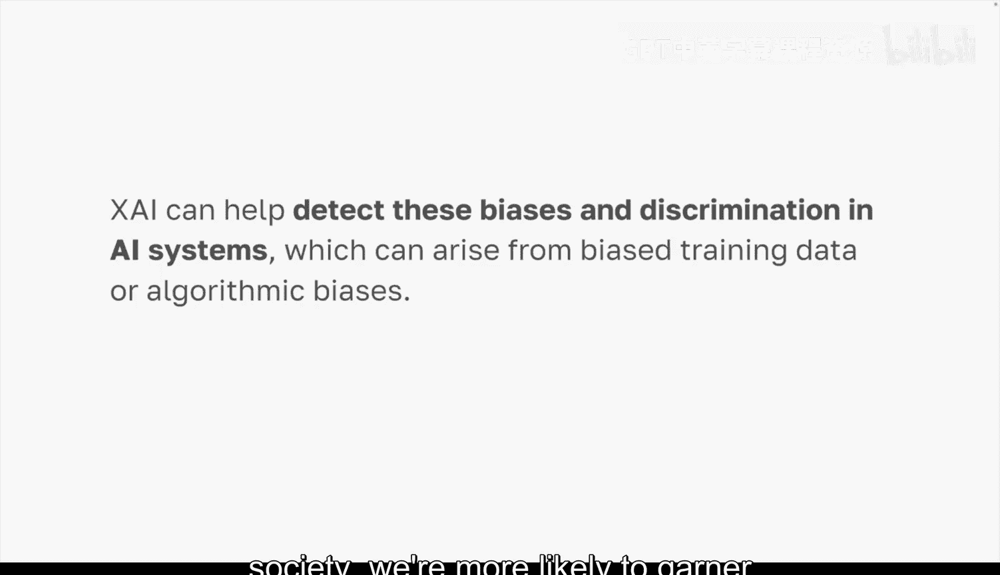

# 杜克大学《可解释人工智能｜Explainable AI (XAI)》中英字幕 p05 05_01_02_算法偏见.zh_en -BV1HnrBBmEon_p5-

。

It is incredibly important that AI technology be fair。

 but a lot of current systems exhibit algorithmic bias， where AI systems exhibit unfair。

 discriminatory or skewed outcomes due to various factors in their training data。

 model architecture or implementation。 this can be the result of training data if the data used to train in AI model is biased or lax representation from certain groups。

 the model may learn in perpetuate those biases going back to one of our examples motivating XI。

 if official recognition system is trained primarily on images of people from one particular ethnicity。

 it may perform poorly on recognizing faces from other ethnic groups。The way data is collected。

 sampled or labeled can introduce biases。 This is known as sample bias。 For instance。

 if a data set for resume screen is predominantly composed of resumes from a particular geographic region or industry。

 The resulting model may be biased against candidates from other regions or industries。

 Sometimes algorithms may rely on proxy variables that are correlated with protected characteristics like race。

 gender or age， leading to indirect discrimination against those groups。

Biaes can also emerge from the interaction between humans and AI systems。

 such as bias language or behavior exhibited by users。

 which can influence the system's outputs over time。Even if the training data is unbiased。

 the algorithms themselves can introduce biases via the mathematical formulation。

 optimization criteria or model architecture， XAI can help detect these biases and discrimination in AI systems。

 which can arise from biased training data or algorithmic biases。

By understanding how an AI system arrives at its decisions。

 steps can be taken to ensure fairness and prevent unfair treatment of certain groups or individuals。

 Expplainable AI allows us to audit for disc decisions and correct those unfair biases。

Algorithmic bias can enter into AI systems in many ways。

 pre existingisting perceptions of system creators， design of data collection or the model。

Unanticipated use of the system。And bias can be introduced at any point in our machine learning pipeline from data collection to defining our labels to training and evaluating our model to deployment。

By understanding how an AI system arrives at its decisions。

 steps can be taken to ensure fairness and prevent unfair treatment of certain groups or individuals。

 Explainable AI allows us to audit for discrimin decisions and correct these unfair biases。

 As we discussed in the last module， transparency builds public trust。

 if we can open the black box and explain an AI systems's reasoning to regulators。

 impacted individuals and society we're more likely to garner acceptance of beneficial AI applications。

