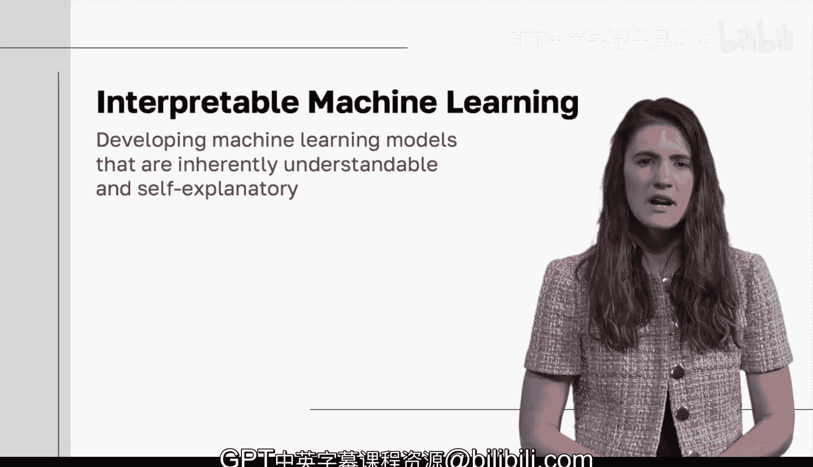
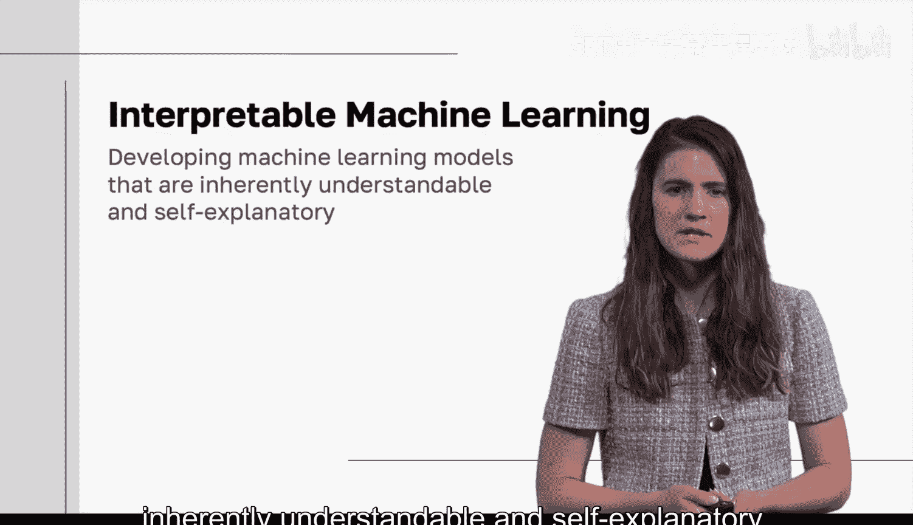
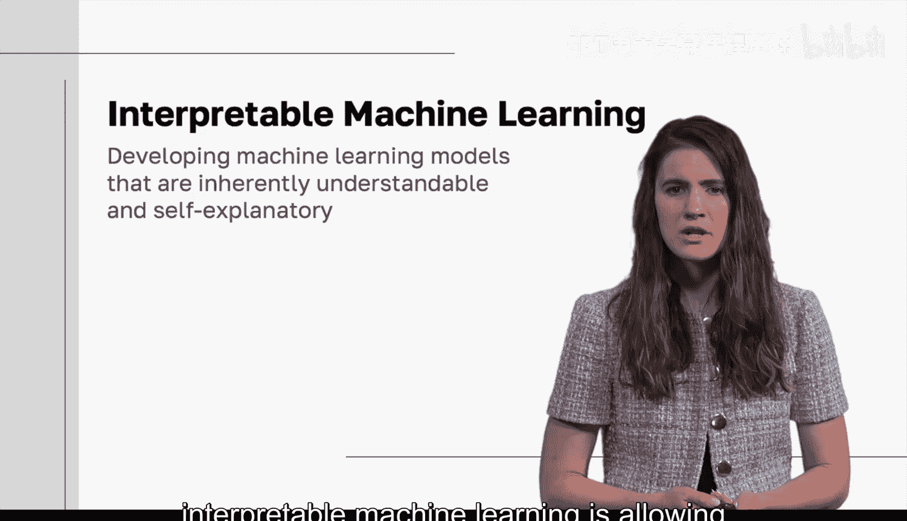
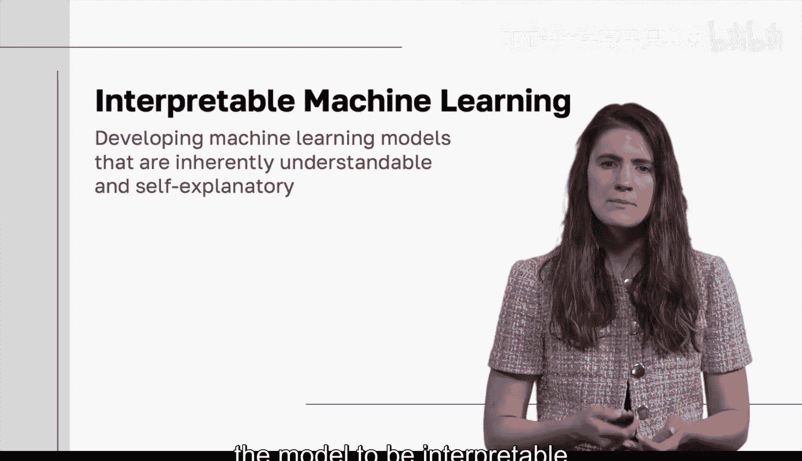
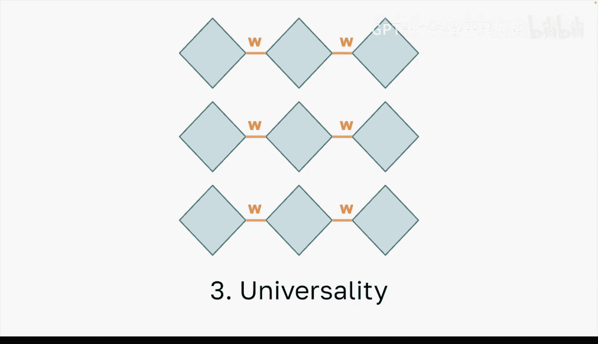
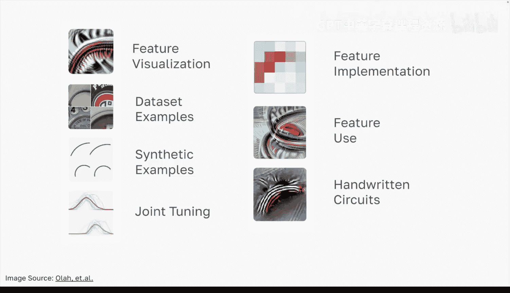
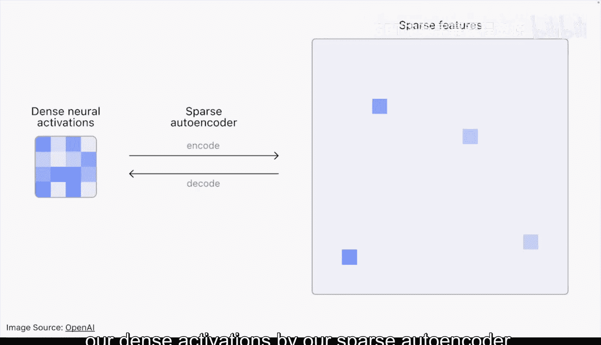

# 杜克大学《可解释人工智能｜Explainable AI (XAI)》中英字幕 p07 07_02_01_可解释的机器学习.zh_en -BV1HnrBBmEon_p7-

In the context of explainable AI or X AI and interpretable machine learning。

 interpretable machine learning is defined as developing machine learning models that are inherently understandable and self explanatory。

 This is typically done using transparent modeling techniques like linear regression。

 decision trees or rule based models。 The main idea behind interpretable machine learning is allowing the internal logic and decision making process of the model to be interpretable without needing additional explanation methods。

😊。

In a current landscape dazzled by the results of generative AI。

 many problems can be solved using an interpretable model。

 and I recommend that interpretable models be included in the models you are evaluating for your use case。

Something that I put into practice both teaching AI in the classroom and when building products with AI is a principle of Oham's razor。

 Oham's razor states that if you have two competing ideas to explain the same phenomenon。

 you should prefer the simpler one。 For example， you hear a sound in the middle of the night and form two hypotheses。

 First is that your cat knocks something off the table。

 The second is that aliens landed on your roof and are now invading your house。

 The simpler of the two hypotheses is that your cat knocks something off the table。

 So that is the one you should prefer， according to Oham's razor。In the context of AI。

 if you have two AI models that perform similarly on the evaluation criteria。

 you should prefer the simpler， more interpretable one。 at a minimum。

 you should always consider the simplest approach and provide rationale on why you need an approach that is more complex。

Let's look at some examples of interpretable machine learning models。

 Line models like linear regression and logistic regression are highly interpretable as their predictions are based on a weighted sum of input features。

 The coefficients directly indicate the importance and directionality of each feature。

 enforcing sparsity， for example， via alasso or elastic net regularization can enhance interpretability by driving coefficients of irrelevant features to0。

 effectively performing feature selection。😊，Generalized models try to solve some of the problems with linear regression。

 For example， generalized additive models combine linear models with nonlinear feature transformations。

 while maintaining an additive and interpretable structure。

 showing how each feature shape impacts predictions。

Regression and generalized models give us interpretable coefficients。The sign。

 positive or negative of a coefficient， indicates whether the associated feature has a positive or negative relationship with the variable。

The magnitude of a coefficient represents the strength of that relationship。

 larger coefficients indicate a stronger influence of that feature on the target variable。

Decision trees like CAt and GeSDT are also intrinsically interpretable models。

 Their hierarchical tree structure of if then elses decision rules provides a natural way to trace how predictions are made for different instances based on their feature values。

 Rule based models encode code knowledge in the form of human readable rules。

 like if age is greater than 65 and medication equals X， then risk equals high。

Treebase models work in this intuitive way。 Treebase models split the data multiple times based on certain cutoff values in the features。

  different subsets of the data set are created through this splitting with each instance belonging to one subset。

The terminal， also known as leaf nodes are the final subsets to predict the outcome in each leaf node。

 the average outcome of the training data in this node is used。

Decision tree based models can be used for either classification or regression due to their intuitiveness and interpretability。

 decision trees are widely used across many domains。

But how do we go about finding the optimal decision tree， the search space is huge。

 this is where generalized and scalable optimal sparse decision trees。

 or GSDT also known as Gt comes in。The idea is to reduce that search space of all decision trees。

 10 analytical bounds are proposed in the paper to reduce the search space。

 analytical bounds help in efficiently pruning the search space。

 thereby speeding up the process of finding the optimal decision tree。

There are also inherently interpretable neural networks。

 Pro based networks like ProtoPnet integrate prototypes or examples into the neural network。

 monotonic constraints like those used in a monotonic neural network architecture we will explore in this course。

 ensure sure model predictions vary in a consistent direction as feature change。

 aligning with human intuitions。New representation networks like the Kmogra of Arnold Network or CanN have introduced alternatives to weights using spline representations。

While sacrificing some flexibility， these interpretable machine learning approaches can be invaluable in domains like healthcare。

 finance and critical decision making systems where being able to understand and inspect model reasoning is paramount。

When we think about neural networks， interpretability usually doesn't come to mind。 In fact。

 neural networks are our prototypical example of black box machine learning models。 however。

 the research community has invested a lot of effort into improving interpretability of neural networks and making models that are inherently interpretable。

Improved interpretability in neural networks come in the form of shallow neural networks。

 sparse neural networks， and modular neural networks。Shallow neural networks are simpler。

 neural network architectures with fewer layers and notes that can be more interpretable than deeper。

 more complex models。The relationships between inputs and outputs are more readily apparent。

Sparrse neural networks are models that have many network connections pruned or set to zero。

 these can be more interpretable as the remaining connections represent the most important features。

And modular neural networks are models composed of specialized subcomps， for example。

 for object detection， classification or reasoning。

 these can be more interpretable than monolithic architectures。

Inherently interpretable neural networks come in a few different flavors。

 disentangled neural networks are models that learned representations where each neuron or feature map corresponds to a specific interpretable concept。

 for example， edges， textures or object parts。 This can provide visibility into the model's internal reasoning。

Prototype based neural networks are models that learn prototypical examples of each class and use similarity to these prototypes as the basis for predictions。

 which can be more interpretable than complex decision boundaries。

 and monotonic neural networks are models that constrain the neural network to produce outputs that are monotonically increasing or decreasing with respect to the input features。

 This can make the models's behavior more intuitive and predictable。

Commoga of Arnold networks or can were introduced very recently in spring of 2024 by Lu at all。

 Cans have no linear weights at all。 Every weight parameter is replaced by a univariate function。

 parameterized as a spline。 Cans can be intuitively visualized and can easily interact with human users。

A relatively new field of study， Mechanistic interpretability or MI。

 is a process of reverse engineering neural networks from learned weights down to human interpretable algorithms。

The field of MI is based on three speculative claims about neural networks。

Features features are the fundamental unit of neural networks。

 they correspond to directions or a linear combination of neurons in a layer。

Circuits features are connected by weights forming circuits。

 a circuit is a computational subgraph of a network。

 a circuit consists of a set of features and the weighted edges that go between them。

And universality， universality poses that analogous features and circuits form across models and tasks。

Mechanistic interpretability uses many methods to provide evidence for these speculative claims。

 We're going to share some of arguments for neurons that detect curves in specific orientations。

 we call these curve detectors。Feature visualization shows us that optimizing the input to cause curved detectors to fire reliably produces curves。

 This establishes a causal link since everything in the resulting image was added to cause the neuron to fire。

 We can see this in the top left image。Next is data set examples。

 Inet images that cause these neurons to strongly fire are images of curves in a particular orientation。

 as shown in the second figure on the left。Synthetic examples can also be used curve detectors respond as expected to synthetic curve images shown in the third figure on the left。

Joint tuning can also provide an argument for curve detectors and evidence for features if we rotate curve images。

 at some point the neuron stops firing and curve detectors in the next orientation start firing。

These last three are what we call MI specific methods。

 which are research methodologies created explicitly for the purpose of MI research。

 feature implementation by looking at the circuit constructing the curve detectors。

 we can read a curve detection algorithm off of the weights。 This is shown in the heat map。

Feature use， the downstream clients of curve detectors are features that naturally involve curves。

 like a circle as shown here in the second figure on the right。

The curved detectors are used by these clients in the expected manner。And finally。

 handwritten circuits， we can hands set all weights to reimplement curve detection。

 These weights are an understandable curve detection algorithm。

 and thus we reverse engineered curve detectors。

Now， in an ideal scenario， each neuron in a network would map to one of our features like we see in curved detectors。

 where each neuron corresponds to a curve of a specific orientation。However。

 neurons don't always or usually map cleanly to interpretable features。

 Sometimes it happens like with curve detectors， Other times we have polysemanity。

 where a neuron maps to many features that are seemingly unrelated。 Other times。

 we have no idea how to match the neuron to a specific feature or feature set。

This is what really happens。Enter the superposition hypothesis。

 According to the superposition hypothesis， neural networks， as we observe them。

 are simulations of larger networks where each neuron is a disentangled feature。

 We can pause here because this is pretty meta。 We are compressing a bunch of information into a neural network that is decompressing that data。

 learning it， and then compressing it back into the observed neural network。

According to the hypothesis， these idealized neurons are projected onto the actual network as almost orthogonal vectors over the neurons。

For interpretability， we need to be able to resolve superposition。

Current research exploring the resolution of superposition has turned to sparse autoencors。

 We take dense neural activation shown on the right and use a sparse autoencoder to encode or map these dense activations to a sparse feature space。

 These can then be decoded back into our dense activations by our sparse autoencoder。😊。

This is what is behind current mechanistic interpretability work。

 If you are following AI research in spring 2024 or even just the news。

 you may have heard of the concept of Golden Gate Cla。

 While researchers identified many interpretable features。

 the most widely publicized one was the learn feature called the Golden Gate Bridge feature a feature that appeared to specifically detect references and representations related to the iconic Golden Gate Bridge。

 the main plot in this figure shows the distribution of activation levels across inputs with activations ranging from negligible on the left to high on the right。

 the color coding indicates the results of an automated scoring system that judged each activation based on how well it aligned with the Golden Gate Bridge concept using a rubric from zero irrelevant to three clearly identifies the concept。

While there are numerous low level activations corresponding to vaguely related concepts。

 like other bridges， tourist attractions and monuments。

 The highest activations overwhelmingly correlate with explicit mentions or depictions of the Golden Gate Bridge itself。

 as evidenced by the prevalence of red bars on the right。 Despite being relatively rarer。

 These high activations likely carry greater importance in shaping the model's behavior。😊。

The automated scoring reveals that strong activations of this feature demonstrate high specificity to the Golden Gate Bridge interpretation。

 while even weaker activations tend to maintain some level of conceptual relevance。

 if more abstracted or generalized。😊。

