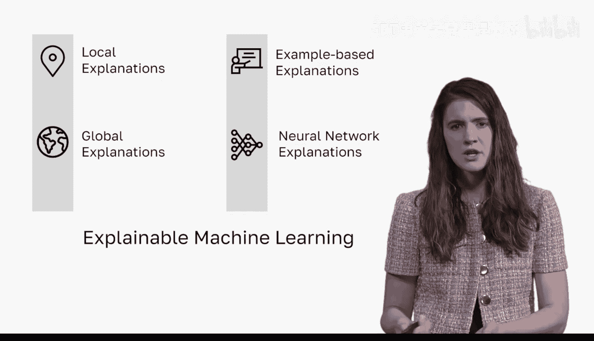
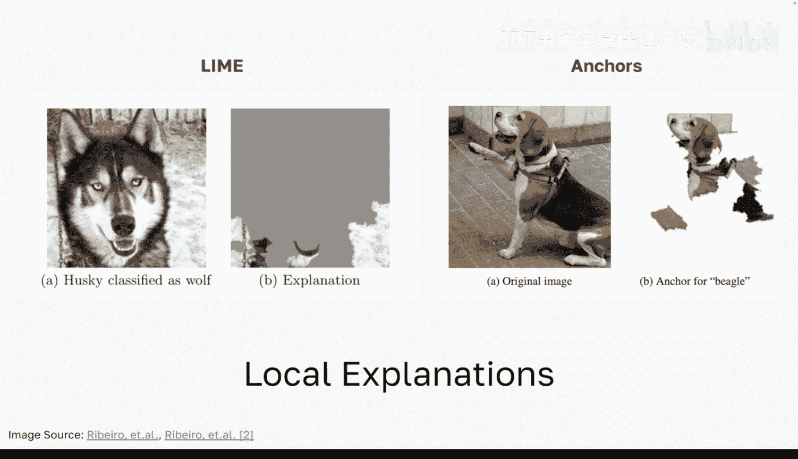
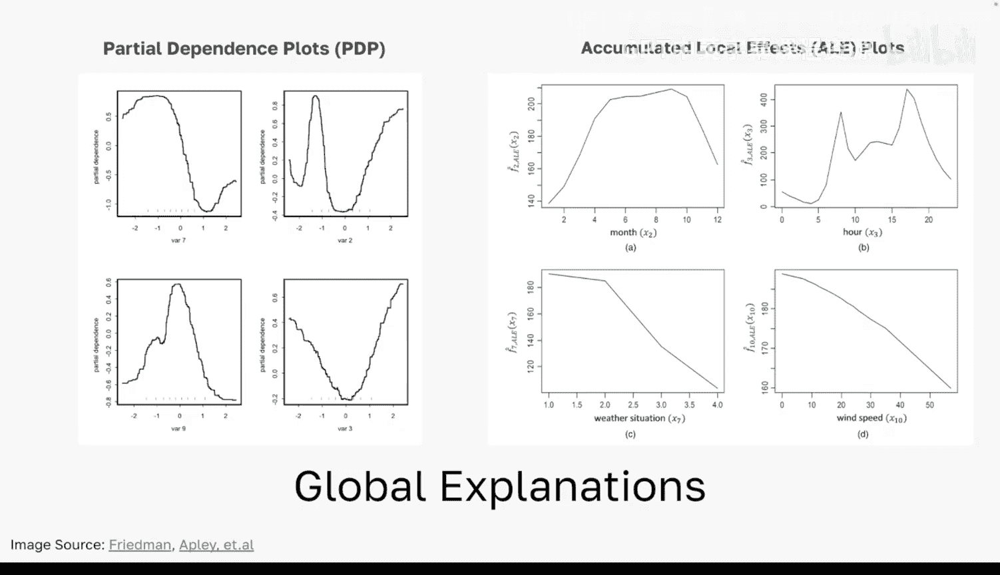
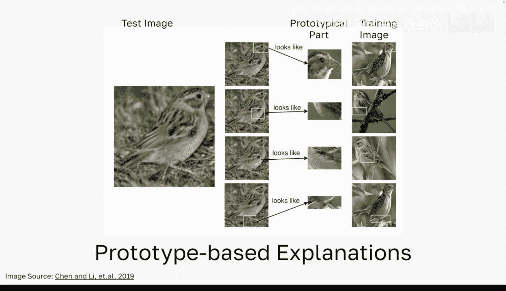
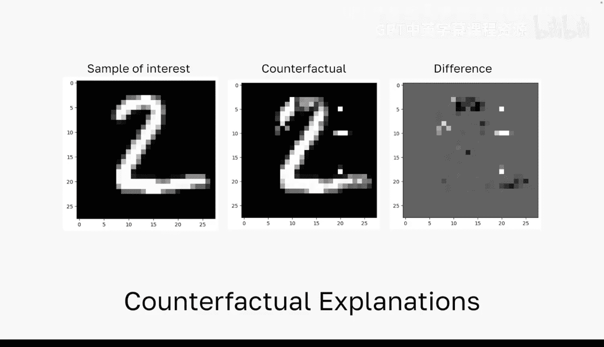

# 杜克大学《可解释人工智能｜Explainable AI (XAI)》中英字幕 p08 08_02_02_解释技术.zh_en -BV1HnrBBmEon_p8-

🎼，🎼The。There are explainable machine learning approaches for nearly all models and domains。

 Local explanation methods like Lyme and Shap focus on explaining individual predictions。

 They approximate the original model's behavior locally around the instance of interest using an interpretable model like linear regression。

😊，In contrast to local explanations， global explanations aim to capture overall model behavior。

 methods like functional decomposition， feature interaction。

 and partial dependence plots are considered global explanations。

Example based explanations operate by providing representative examples to support a model's prediction。

 key methods include finding the most influential training instances that significantly sway a particular prediction if removed。

Lastly， neural networks have their own challenges regarding explainability and thus approaches tailored for specific neural networks。

There is a lot of emerging research on explainable machine learning。

 and I recommend to stay up to date on the latest approaches and research in the pros and cons of each of these explanations。

 We will only briefly cover these topics。 If you continue in the specialization。

 you will learn more about each of these approaches and learn how to implement them。😊。

Local interpretable model agnostic explanations or Lyme were introduced in 2016。

 they use interpretable models to explain individual predictions of a black box machine learning model。

Using lime for images is really interesting image variations are created by segmenting the image into super pixelixs or interconnected pixels with similar colors and turning them on or off by replacing each pixel with a user defined color like gray。

The user is also able to specify a probability for turning off a super pixel at each permutation。

The lime image shows the original image and the explanation of a bad model's prediction in a task classifiedifying between Husky and Wolf。

 You can see here that the model only picked up some snow in the background to make its prediction。

 which is not desired since we would like the model to use characteristics of the animal in the picture to determine whether it is a husky or a wolf。

With anchors， you will see a lot of similarities to the lime approach。 Again。

 we are explaining individual predictions。 but this time。

 instead of using a linear model to approximate the local decision boundary as with lime。

 we are now finding a decision rule that sufficiently anchors the prediction。

Splely additive explanations， or Shap was introduced in 2017。

 They build off of the concept of Shaplely values， which are extremely computationally expensive。

 And so they are not very practical。 The Shap method proposes to approximate Shaplely values。

 instead of outright calculating them。Individual conditional expectation or ice plots were introduced in 2014 by Goldsteineen at all。

 icece plots plot one line per instance that displays how the instance's prediction changes when a particular feature changes by visualizing all of our instances。

 we can improve local explainability while also gaining better global understanding。😊。

In contrast to local explanations， global explanations aim to capture overall model behavior。

 global explanations include functional decomposition， feature interaction。

 permutation feature importance， and visualizations including partial dependence plots and accumulated local effects or ale plots。

Functional decomposition divides complex models into simpler constituent parts。

 Each part or function can then be analyzed separately。

 making it easier to understand the overall behavior of the model。

 It breaks a model into the main effects how each feature affects the prediction。

 independent of the values in the other feature。Interaction effect， the joint effect of the features。

 and the intercept， what the prediction is when all feature effects are set to zero。

Building off of functional decomposition， let's introduce feature interaction。

 When we consider decomposition， we first decompose a model prediction into a constant term。

 a term for each feature and a term for the interaction between factors in 2008。

 Friedman and Popescu introduced that each statistic which we use for feature interaction。

A partial dependence plot， PDP or PD shows the marginal effect one or two features have on the predicted outcome of a model。

 If this looks familiar it should， it is the average of the lines of an ice plot。

 just like with ice plots， the PDP can show the relationship between a feature and the target。

PDPs do not have clear interpretations when features are correlated in real life features are usually correlated。

 or relationships between features are not well understood。

 This is why accumulated local effects or ale plots were introduced in 2020。

Ail plots include local effects and accumulation Ale plots focus on local changes in the prediction when a feature value changes。

 unlike PDPs which average out the effects over the entire feature space。

Instead of plotting the local effects directly， ale plots accumulate these effects across the range of a feature。

 this helps in understanding the global trend of how the feature influences predictions。

Prototype based explanations are an example based explanation that aims to explain the predictions of a black box model by identifying representative examples or prototypes from the data。

 The main thesis is that we represent the model's knowledge in terms of prototypical instances or patterns。

Coterfactuals describe a causal situation if X had not occurred， Y would not have occurred。

 We can simulate counterfactuals for predictions of black box machine learning models by changing the feature values of an instance before making the predictions and analyzing how the prediction changes。

A counterfactual explanation of a prediction describes the smallest change to the feature values that changes the prediction to a predefined output。

This is a sample of interest from the Mnines data set and a generated counterfactual。

 We have also visualized the difference between them to show what pixels needed to be changed for this to be misclassified as a 6。

