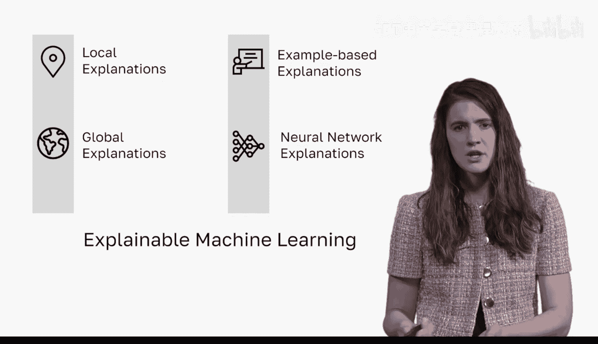
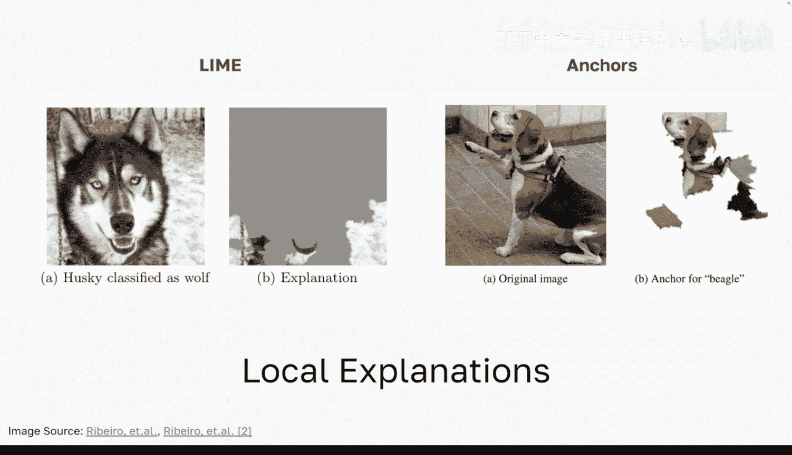
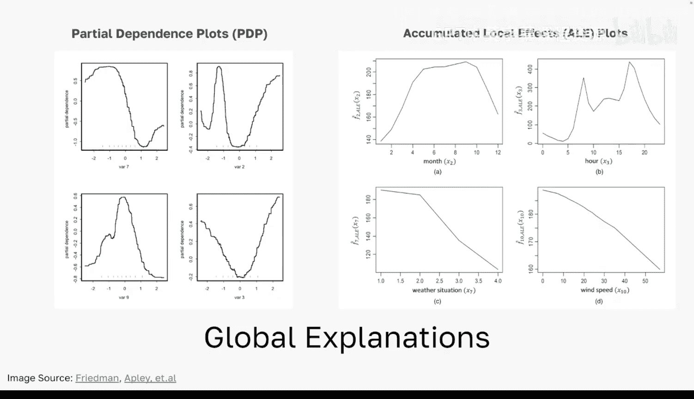
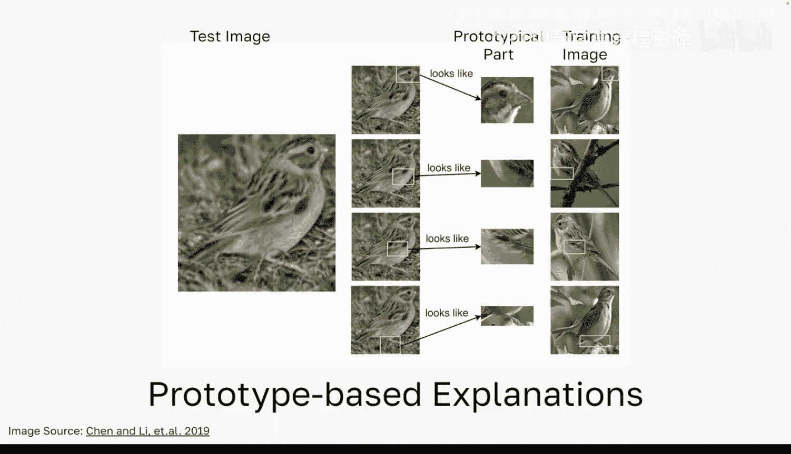
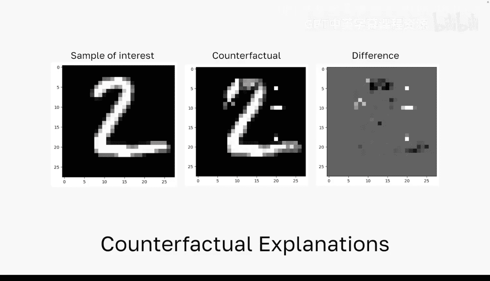

# 可解释人工智能 (XAI)：08：解释技术

在本节课中，我们将学习多种可解释人工智能技术。这些技术旨在帮助理解机器学习模型的决策过程，涵盖局部解释、全局解释、基于实例的解释以及针对特定模型（如神经网络）的方法。我们将逐一介绍这些核心概念及其代表性方法。

## 局部解释方法

上一节我们概述了可解释AI的范畴，本节中我们来看看局部解释方法。这类方法专注于解释模型对单个预测实例的决策依据。

以下是几种主要的局部解释技术：

*   **LIME**：局部可解释模型无关解释。它通过在感兴趣的预测点附近生成扰动数据，并训练一个简单的可解释模型（如线性回归）来近似原始复杂模型在该局部区域的行为。其核心思想是：`解释 = 简单模型在局部对复杂模型的近似`。
*   **Anchors**：锚点解释。与LIME类似，它也解释单个预测，但目标是找到一个足够“锚定”该预测的决策规则，而不是用线性模型近似决策边界。
*   **SHAP**：沙普利加性解释。它基于博弈论中的沙普利值概念，通过计算每个特征对预测的贡献度来解释单个预测。由于精确计算沙普利值计算成本极高，SHAP方法旨在对其进行高效近似。
*   **ICE图**：个体条件期望图。它为数据集中的每个实例绘制一条线，显示当某个特定特征值变化时，该实例的预测如何变化。通过可视化所有实例的线条，我们既能获得局部解释性，也能更好地理解全局模式。

## 全局解释方法

与局部解释不同，全局解释方法旨在捕捉模型的整体行为模式。

以下是几种主要的全局解释技术：

*   **功能分解**：将复杂模型分解为更简单的组成部分（如主效应、交互效应和截距项），以便分别分析每个部分对预测的影响。
*   **特征交互**：基于功能分解，专门量化并分析不同特征之间如何共同影响预测结果。弗里德曼和波佩斯库在2008年引入了H统计量来衡量特征交互的强度。
*   **部分依赖图**：显示一个或两个特征对模型预测结果的边际效应。它本质上是ICE图中所有线条的平均值。公式可以表示为：`PDP(x_S) = E_X_C[f(x_S, X_C)]`，其中`x_S`是目标特征，`X_C`是其他特征。
*   **累积局部效应图**：为了解决PDP在特征相关时解释不清的问题而引入。ALE图关注特征值发生微小变化时预测的局部变化，然后在整个特征范围内累积这些局部效应，以理解特征影响预测的整体趋势。

## 基于实例的解释方法

除了分析特征贡献，我们还可以通过提供代表性样本来解释模型的预测。

以下是两种主要的基于实例的解释技术：

*   **原型解释**：通过从数据中识别代表性样本（原型）来解释黑盒模型的预测。其核心论点是，用典型的实例或模式来表征模型的知识。
*   **反事实解释**：描述为改变模型对某个实例的预测结果，所需对该实例特征值进行的最小改变。它回答的问题是：“如果输入稍微不同，预测结果会如何变化？” 这有助于理解模型的决策边界。

## 神经网络的可解释性

神经网络由于其复杂的结构和非线性，在可解释性方面面临独特挑战。因此，研究者开发了许多针对特定神经网络架构（如卷积神经网络、循环神经网络）的定制化解释方法。这是一个快速发展的研究领域。

## 总结

本节课我们一起学习了可解释人工智能中的多种核心技术。我们介绍了**局部解释方法**（如LIME、SHAP），它们解释单个预测；**全局解释方法**（如PDP、功能分解），它们揭示模型的整体行为；以及**基于实例的解释方法**（如反事实解释），它们通过具体例子来说明预测。最后，我们提到了针对**神经网络**的特有解释方法仍在不断涌现。理解这些方法的原理和适用场景，对于构建可信、可靠的人工智能系统至关重要。